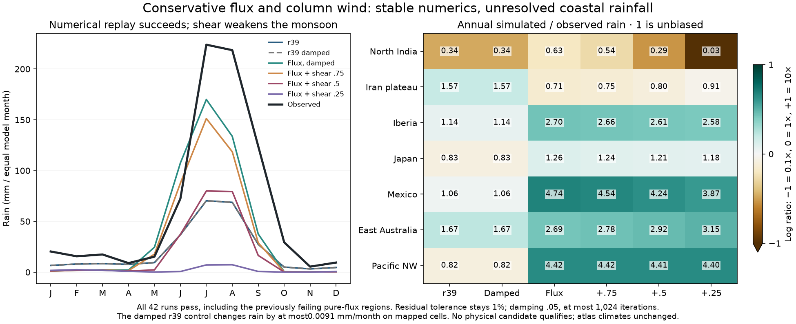

# Stable conservative replay: numerical success, physical rejection

All42 integrations pass in the separately declared follow-up. The seven original
r39 controls reproduce archived float32 monthly arrays/observations exactly.
No criterion or failure from the earlier35-attempt flux pilot is overwritten.

Five profiles use moisture relaxation.05 and at most1024 iterations instead of
.25/256. The1% equation-residual tolerance, linear tolerance, temperature checks,
calendar, observed forcing and planetary reference stay unchanged. One is a
damped r39 numerical control; one replays conservative mean+storm transport;
three add pressure-column drag ratios.75/.5/.25. Only those three physical
profiles may qualify. Numerical and physical updates are separate input blocks.

## Numerical replay

Japan and Mexico now converge, including with pure conservative transport.
The old256-iteration failures remain recorded as failures in their original
source epoch. The damped r39 control changes mapped-cell monthly rain by at
most0.00901 mm (Iberia); other regions have still smaller changes. The portable
JSON reports each region's maximum/mean rain difference and temperature-MAE
change. It does not claim a maximum temperature-field difference: those full
monthly temperature arrays were not retained by this recorder.

The large physical flux-transport effects therefore cannot be attributed to
that small reference numerical drift. This is an actual recorded sensitivity
check, not a claim that tighter/different iteration always preserves climate.
Future physical candidates would still need the full gates with their explicit
numerical work profile and unchanged error tolerances.

## Column-flow results

| Profile | North India annual rain | Seven-region combined S | Eligible physical candidate |
|---|---:|---:|---|
| Adopted r39 reference | 256.26 mm | 1 | reference only |
| Damped r39 | 256.26 mm | .999995 | no, numerical control |
| Pure conservative flux, damped | 481.71 mm | 1.692394 | no, diagnostic replay |
| Flux + column drag.75 | 411.51 mm | 1.679418 | rejected |
| Flux + column drag.5 | 222.20 mm | 1.690939 | rejected |
| Flux + column drag.25 | 23.49 mm | 1.764699 | rejected |

North India has760.83 mm observed. Turning/accelerating the pressure-driven
column component reduces monsoon rain and does not remove the coastal wet bias.
The pure flux replay still produces1057 mm/year in Iberia and3966 in Pacific NW,
versus392 and897 observed. All three eligible profiles fail the declared
regional/overall protections; some also fail the integrated SST guard. No full31,
ocean-finalist, finer-grid or established-six stage runs. No r40 profile.

Conservative regional accounting is retained as an opt-in research capability,
not adopted rainfall physics. The surface-derived velocity field and its
terrain slowdown remain a plausible structural cause of excessive full-column
convergence; this experiment does not isolate the correct vertical circulation
or demonstrate a remedy. More small pressure-turning changes alone are not
supported by these trials.

## Reproduction and atlas companion

Plan: `calibration/flux_column_wind_20261026/plan.json`. Run:

```sh
python -I scripts/check_vapor_flux.py \
  --plan calibration/flux_column_wind_20261026/plan.json \
  --out output/flux_column_wind_20261026
```

The declared runner/helper source is commit`8f5408b`. Use the exact recorded
source epoch or a new output directory; never bypass the frozen guards. The
generic recorder now retains parameters and partial solver diagnostics even
on failure. Full31 tooling supports separately declared candidate numerical
updates while keeping the adopted r39 reference and error tolerances.

The launcher hub's Climate accuracy page now has a small experiment index,
newest-open collapsible research sections and image/JSON downloads. The layout
formatter only reorganizes already published content; it recalculates no
scientific measurements. All normal atlas climate, food, population and trade
fields remain unchanged. r39 remains qualified on Earth; the fantasy Earth
atlas retains the separately verified r38 world.


