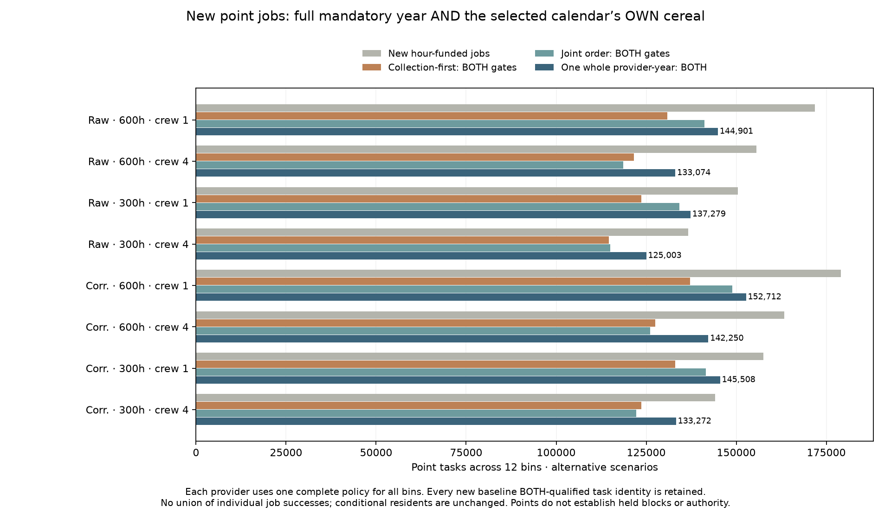
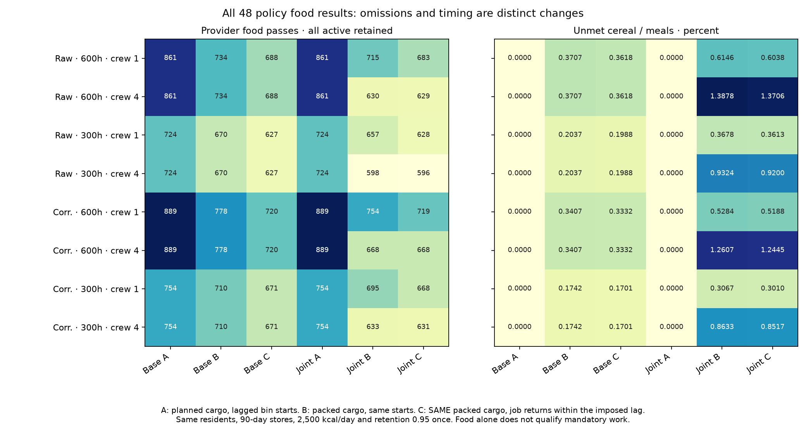

# NEW point visits with whole-calendar and OWN destination cereal checks

Declaration `4d496baf` preceded every output in this phase. Eight NEW point-job plans
use the four continuous-resident parents, exact recorded directed b3_p0 paths,
600/300 farm hours and crew1/4. The unchanged allocator spends ONLY the new
reserved patrol slice. Unpacked mandatory collection never finances extra visits.
The conditional resident plans differ from the older point-map parents; task
preservation below refers to the NEW baseline, not to those older allocations.

Each plan is packed with unchanged collection-first and joint-duration-first
worker policies: 50 duty hours/person/bin, 7*365/12 calendar hours, actual integer
collector trips, synchronized crews and funded divisible home commitments.
Actual physical visits remain charged even when mandatory work or food fails.
Greedy failure is not evidence that every possible schedule is impossible.

A supplies every planned load at the original lagged bin starts; B supplies only
packed loads at the same starts; C supplies the SAME packed loads at return
phases within the imposed one-bin lag. Retention 0.95 applies ONCE. All active
providers stay in each A/B/C inventory, including partial delivery. Baseline
collection prefixes and all A/B/C food fields equal the collector-only audit,
including duplicated baseline results between crews. Food passes use the fixed
unmet<=1e-8*max(1,annual needed kcal) diagnostic, not a fitted famine threshold.
Each inventory has 365 days, uniform 2500 kcal/person/day, staff included once,
90-day physical stores, 5% annual stored loss and minimum repeating reserves.

Choose exactly ONE complete policy per provider for all 12 bins. It qualifies
only when active, every mandatory bin completes AND its OWN C food passes.
Retain a BOTH-qualified baseline unless the alternate also passes BOTH gates,
contains every baseline (month,actor,target) identity and adds at least one.
Equal sets and any lost identity retain baseline. A sole qualified alternate
can recover a failed baseline; neither-qualified providers retain the baseline
physical trace with zero qualified tasks. No job-by-job or food/calendar union.
Physical completion, own food and their conjunction remain separate fields.

The point CSV partitions every request into qualified, schedule-unqualified,
route-unreachable, provider-work-unavailable or capacity-unmet. It additionally
retains funded/physical/baseline-BOTH masks and physical/nonphysical failure
subchannels. Provider and policy IDs by bin permit exact task identity checking.

The eight optional experimental maps under Supply-supported reach display ONLY
qualified point tasks. Their provider table and CSV show actual selected-calendar
arrivals, return-phase stocks and food gaps. The displayed planning ceiling is
explicitly the parent continuous BIN-START cereal ceiling, not a newly solved
return-phase resident maximum. Parent dispatch scale and source gate are likewise
labelled as planned before omissions. Failed qualification does not move residents.
Background, intervening land, mobile and unaffiliated contexts remain unscored.

## Every declared visit outcome

|Climate|Farm h|Crew|Stage|Policy|Funded tasks|Physical tasks|BOTH-qualified tasks|BOTH providers|
|---|---|---|---|---|---|---|---|---|
|Raw|600|1|funded|hour_plan|171871|Unscored|Unscored|Unscored|
|Raw|600|1|policy|baseline|171871|147720|130853|687|
|Raw|600|1|policy|joint|171871|171744|141216|682|
|Raw|600|1|selected|one_provider_year|171871|157384|144901|711|
|Raw|600|4|funded|hour_plan|155548|Unscored|Unscored|Unscored|
|Raw|600|4|policy|baseline|155548|137735|121518|687|
|Raw|600|4|policy|joint|155548|155291|118576|627|
|Raw|600|4|selected|one_provider_year|155548|141900|133074|732|
|Raw|300|1|funded|hour_plan|150386|Unscored|Unscored|Unscored|
|Raw|300|1|policy|baseline|150386|135516|123585|625|
|Raw|300|1|policy|joint|150386|150312|134200|627|
|Raw|300|1|selected|one_provider_year|150386|144116|137279|650|
|Raw|300|4|funded|hour_plan|136654|Unscored|Unscored|Unscored|
|Raw|300|4|policy|baseline|136654|125795|114566|625|
|Raw|300|4|policy|joint|136654|136458|115039|595|
|Raw|300|4|selected|one_provider_year|136654|128737|125003|669|
|Corrected|600|1|funded|hour_plan|179063|Unscored|Unscored|Unscored|
|Corrected|600|1|policy|baseline|179063|156362|137228|717|
|Corrected|600|1|policy|joint|179063|178946|148915|716|
|Corrected|600|1|selected|one_provider_year|179063|166246|152712|747|
|Corrected|600|4|funded|hour_plan|163389|Unscored|Unscored|Unscored|
|Corrected|600|4|policy|baseline|163389|145851|127473|717|
|Corrected|600|4|policy|joint|163389|163170|126117|666|
|Corrected|600|4|selected|one_provider_year|163389|150422|142250|778|
|Corrected|300|1|funded|hour_plan|157533|Unscored|Unscored|Unscored|
|Corrected|300|1|policy|baseline|157533|143611|133030|671|
|Corrected|300|1|policy|joint|157533|157468|141565|668|
|Corrected|300|1|selected|one_provider_year|157533|151312|145508|696|
|Corrected|300|4|funded|hour_plan|144167|Unscored|Unscored|Unscored|
|Corrected|300|4|policy|baseline|144167|133648|123697|671|
|Corrected|300|4|policy|joint|144167|143980|122171|630|
|Corrected|300|4|selected|one_provider_year|144167|136456|133272|710|

## Every declared policy food outcome

|Climate|Farm h|Crew|Policy|Food test|Active providers|Food passes|Unmet kcal|Unmet %|
|---|---|---|---|---|---|---|---|---|
|Raw|600|1|baseline|A|861|861|33.474|0.000000|
|Raw|600|1|baseline|B|861|734|1,250,420,866.387|0.370690|
|Raw|600|1|baseline|C|861|688|1,220,533,578.121|0.361830|
|Raw|600|1|joint|A|861|861|33.474|0.000000|
|Raw|600|1|joint|B|861|715|2,073,222,238.367|0.614612|
|Raw|600|1|joint|C|861|683|2,036,757,832.468|0.603802|
|Raw|600|4|baseline|A|861|861|33.474|0.000000|
|Raw|600|4|baseline|B|861|734|1,250,420,866.387|0.370690|
|Raw|600|4|baseline|C|861|688|1,220,533,578.121|0.361830|
|Raw|600|4|joint|A|861|861|33.474|0.000000|
|Raw|600|4|joint|B|861|630|4,681,500,248.394|1.387843|
|Raw|600|4|joint|C|861|629|4,623,212,719.412|1.370563|
|Raw|300|1|baseline|A|724|724|24.907|0.000000|
|Raw|300|1|baseline|B|724|670|510,649,139.116|0.203691|
|Raw|300|1|baseline|C|724|627|498,498,854.087|0.198844|
|Raw|300|1|joint|A|724|724|24.907|0.000000|
|Raw|300|1|joint|B|724|657|922,058,196.587|0.367796|
|Raw|300|1|joint|C|724|628|905,858,655.603|0.361334|
|Raw|300|4|baseline|A|724|724|24.907|0.000000|
|Raw|300|4|baseline|B|724|670|510,649,139.116|0.203691|
|Raw|300|4|baseline|C|724|627|498,498,854.087|0.198844|
|Raw|300|4|joint|A|724|724|24.907|0.000000|
|Raw|300|4|joint|B|724|598|2,337,493,148.848|0.932393|
|Raw|300|4|joint|C|724|596|2,306,537,654.694|0.920046|
|Corrected|600|1|baseline|A|889|889|34.234|0.000000|
|Corrected|600|1|baseline|B|889|778|1,175,466,567.569|0.340684|
|Corrected|600|1|baseline|C|889|720|1,149,752,299.952|0.333231|
|Corrected|600|1|joint|A|889|889|34.234|0.000000|
|Corrected|600|1|joint|B|889|754|1,823,003,218.629|0.528358|
|Corrected|600|1|joint|C|889|719|1,789,916,093.801|0.518769|
|Corrected|600|4|baseline|A|889|889|34.234|0.000000|
|Corrected|600|4|baseline|B|889|778|1,175,466,567.569|0.340684|
|Corrected|600|4|baseline|C|889|720|1,149,752,299.952|0.333231|
|Corrected|600|4|joint|A|889|889|34.234|0.000000|
|Corrected|600|4|joint|B|889|668|4,349,649,416.135|1.260653|
|Corrected|600|4|joint|C|889|668|4,293,939,714.477|1.244506|
|Corrected|300|1|baseline|A|754|754|25.504|0.000000|
|Corrected|300|1|baseline|B|754|710|447,071,778.233|0.174156|
|Corrected|300|1|baseline|C|754|671|436,721,673.684|0.170124|
|Corrected|300|1|joint|A|754|754|25.504|0.000000|
|Corrected|300|1|joint|B|754|695|787,304,548.465|0.306693|
|Corrected|300|1|joint|C|754|668|772,687,577.854|0.300999|
|Corrected|300|4|baseline|A|754|754|25.504|0.000000|
|Corrected|300|4|baseline|B|754|710|447,071,778.233|0.174156|
|Corrected|300|4|baseline|C|754|671|436,721,673.684|0.170124|
|Corrected|300|4|joint|A|754|754|25.504|0.000000|
|Corrected|300|4|joint|B|754|633|2,216,146,461.672|0.863296|
|Corrected|300|4|joint|C|754|631|2,186,496,751.463|0.851746|

## Independent review and reproduction

Independent directed-path and scalar allocation review checks every funded job.
Separate sorted-list worker replays check all choices, services, crew intervals,
nonoverlap and duty limits; all raw packed/missing serials and event cargo are
checked. Independent scalar food roots and conservation check all 48 policy
outcomes and every active inventory, before strict whole-year reconstruction.
Six new selector controls and the retained allocator, worker, joint, year, cargo
and event controls ran before production. Four trace controls verify display bins.

Fresh replay matches 244 model files, 22 map exports and 12 download exports.
Independent map review checks every case, exact NEW-parent residents and work,
all point CSV rows, binary masks, selected food/physical flags, scalar stock paths
and visited pixels. Download review checks 240 archive entries, all 58,436
provider outcomes and all 80 typed comparison rows. Eight ZIPs contain complete
monthly worker/crew/cargo calendars, policy food/events, selected fields and case
metadata. Extract them beside results.json to restore the recorded paths.
All earlier data/maps remain byte identical; three UI integration files are
explicitly tracked before/after to add the optional family. Earlier defaults stay.

## Remaining whole programme

This is a necessary calendar/destination-cereal conjunction under supplied work,
uniform destination meals and MONTHLY source availability. It does not locate
crew meals in transit, issue carried rations, validate within-bin source crops
and exports, or complete diets, household and draft work. Unshipped raw grain
stays identified at source; missing destination potential is counterfactual,
not transport loss on unshipped grain. Actual provider roles, dated occupation,
compatible size/extent/sampling evidence, prospective transfer, central fiscal
and military functions, mobile/nonstate/unaffiliated resources remain open.
Release1–4/S1–S5 remain a whole programme; these are not historical population
calibration, observed visits, held blocks or authority. No default adoption.

Next audit the chronology of source food availability and crew food location
before treating destination stocks as complete annual provisioning. Keep the
physics queue independent. The historical all-evidence publisher still lacks
the private Vidarbha cache; this direct reviewed publication exposes its scope.
