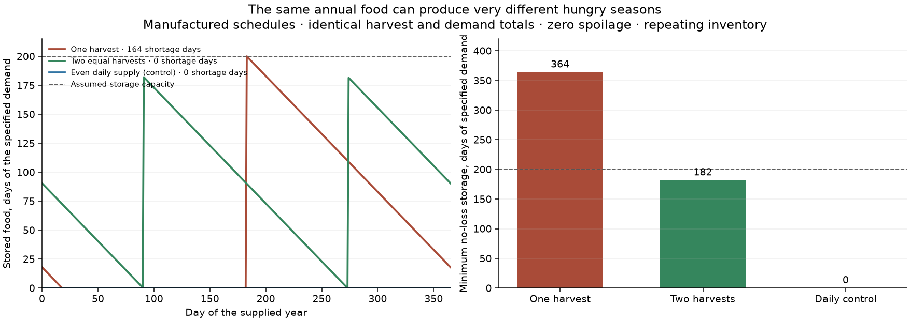

# Seasonal food inventories: an isolated numerical prototype

The agricultural food-stock kernel is implemented in harvest/food_stocks.py.
It is not integrated into atlas population, yields, trade, FORGE or state reach.
Inputs are one homogeneous pool of net edible harvest energy, food demand,
finite storage capacity, step lengths and an explicit annual storage-loss
scenario. Seed and processing deductions are made upstream; a real seed
inventory and crop-specific storability still need separate accounting.

Each step admits harvest, serves meals, records unmet needs, limits the
remaining stock to capacity and applies storage loss. The ledger is
`initial + harvest = consumed + spoiled + overflow + final`.
Loss compounds with actual step lengths. No implicit initial reserve is
created by an annual reset. food_year takes an explicit initial inventory;
periodic_food_year finds the smallest repeating inventory for an identical
repeated year using a monotone annual-map bracket. A repeating shortage year
can converge perfectly: periodicity and food sufficiency are different checks.
Neither calculation reconstructs historical stock accumulation or construction
of granaries.

The exact zero-loss minimum-capacity calculation uses the largest cyclic
cumulative food deficit. It returns infinity when annual production is
insufficient, rather than suggesting a larger inherited reserve could feed a
population forever. Stock capacities and demands do not infer population.

## Manufactured demonstration

Three schedules each supply365 units/year against365 units/year of demand.
One harvest requires364 daily-demand units of storage, two equal pulses182,
and an even daily supply zero. With capacity200, the repeating one-harvest
scenario has164 shortage days; the other two have none. These are numerical
examples with zero spoilage, not ancient yields, actual calendars, famine
probabilities or a map of food insecurity in this world. Crop calendars,
period storage priors, complementary foods and trade remain future inputs.

The receipt and stock/shortfall arrays are in
output/food_stock_prototype_20261103. The module passes manufactured periodic
reserve, no-free-food, conservation, time-weighted loss, overflow, vector-cell,
capacity minimality, monotonicity and invalid-input checks. The focused suite
with existing Harvest and FORGE components passes38 checks. The broader run
also exposed a pre-existing quantizer test fixture missing settlement_cored;
that fixture is updated without changing production export behaviour.

Before integration, preserve and audit alternative crop calendars: the current
annual crop routine keeps each crop's best-season mask, with deterministic
tie-breaking. Equal-yield calendars are not evidence of one actual harvest
date. Dates/perennials and double crops require their own timing contracts.
Do not impose an arbitrary calendar just to turn annual food ceilings into
precise hungry-season maps. Keep production, consumption, reserve assumptions
and supportable population explicitly separate.
