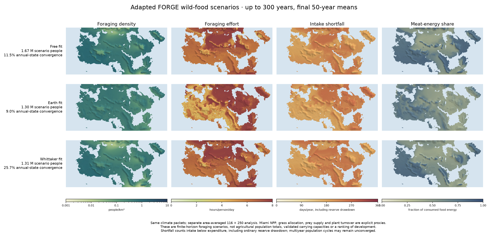

# Adapted FORGE foraging scenarios — 27 October 2026

The three standard atlases now include a separate **Foraging** topic: wild-food density, food-procurement effort, intake shortfall and meat-energy share. Open `start_atlases.bat` and choose Foraging. These outputs do not replace agricultural support or c.200 AD census-allocation scenarios.

This independently implemented human kernel follows [Zhu et al. (2021)](https://doi.org/10.1038/s41559-021-01548-3), with daily food extraction, effort, body-fat reserves and annual demography. The original ORCHIDEE vegetation and herbivore inputs are unavailable for the fantasy world. Miami productivity, seasonal allocation, grass share, plant turnover and prey supply are therefore explicit proxy assumptions. Published parameters and implementation conventions are distinguished in [the method](../docs/FORAGING_MODELS.md).

Sources/configuration were committed as `6bd8758` before the official exports. Each fit uses its own unchanged climate packet, a separate coastal-area-weighted 116 × 250 grid, and up to 300 simulated years. Maps report final 50-year means; annual-state convergence, population variability, numerical-floor effects and terminal states remain available. Multiyear cycles are common. These are finite-horizon scenarios, not validated equilibrium carrying capacities.

| Climate fit | Scenario people | Mean people/km² | Foraging hours/person/day | Converged land |
|---|---:|---:|---:|---:|
| free_fit | 1,671,297 | 0.508 | 6.38 | 11.5% |
| earth_fit | 1,302,704 | 0.396 | 6.18 | 9.0% |
| whittaker_fit | 1,314,513 | 0.399 | 6.55 | 25.7% |

Hours cover food procurement, excluding water collection, fuel, shelter and other subsistence work. Intake-shortfall days count energy expenditure exceeding intake, including ordinary reserve drawdown; they are not famine days. Fishing, migration, human food storage, agriculture and pathogen effects are absent. No environmental or biome score predicts technological or political development.

The [30-row biome CSV](../output/foraging_20261027/biomes.csv) separates land-area-weighted density from population-weighted effort, diet and shortfall. It retains nonconvergence and outside-diagram land. Its coarse classifications do not replace the finer atlas biome-coverage measurements.

Fifteen initial analytic/export tests plus the viewer checks pass; additional independent ledger tests reconstruct annual food stocks, discarded prey and per-person energy from stored start states, flows and endpoints. All three official packets pass those checks. Province totals conserve coastal land area and scenario people; changing numerical batch sizes reproduces 54 model fields exactly. All 553 original climate/farming data assets remain byte-exact. This is numerical verification, not empirical validation of the proxy resource model.

Tallavaara et al.'s fitted model needs biodiversity and multiple-pathogen predictors that are unavailable for this world. We do not substitute malaria alone and call it a reproduction. The methods document describes the related studies and the missing inputs.
