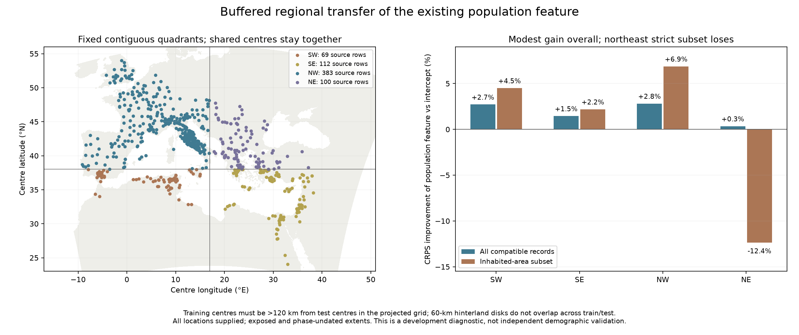

# A small population-feature gain survives geographical separation, unevenly

17 November 2026. The existing population feature retains modest pooled skill
when entire contiguous regions are withheld and training hinterlands are
separated from the test sites. **This does not establish robust regional totals
or dated AD200 population predictions.** The northeastern inhabited-area subset
gets worse, and generated total area is too high. No atlas change is adopted.

The [declaration](../calibration/roman_benchmark_20261117/geographic_transfer.json)
was committed as `e7cec7875` before constructing the groups or fitting. This
follows the [negative grain comparison](CONDITIONAL_GRAIN_EXTENT_20261117.md).
There is no new grain tuning, hour estimate, hierarchy fit or environmental solve.

## Result

| Evaluation set | Intercept CRPS | Population-feature CRPS | CRPS improvement | Median-log MAE improvement |
| --- | ---: | ---: | ---: | ---: |
| 663 AD200-compatible records | 0.619987 | 0.606658 | 2.15% | 3.67% |
| 152 inhabited-area records | 0.611964 | 0.593771 | 2.97% | 4.35% |

Lower CRPS is better. These are paired comparisons under the new buffered
training protocol. They should not be compared as paired changes to archived
province-hash scores: the training geometry and predictive dispersion differ.

| Held-out quadrant | Compatible targets | CRPS improvement | Inhabited-area targets | Strict CRPS improvement |
| --- | ---: | ---: | ---: | ---: |
| SW | 69 | 2.72% | 23 | 4.51% |
| SE | 111 | 1.45% | 32 | 2.19% |
| NW | 383 | 2.82% | 80 | 6.88% |
| NE | 100 | 0.35% | 17 | **−12.38%** |

The population feature wins all four broad groups and three of four strict
groups, but the strict NE loss is substantial. These small/mixed groups are
retained, not removed to improve the conclusion. Quadrants are geographical
shapes; NE is not an alias for any particular historical province.

The generated-total/reference-area ratio is **1.3265** for the population model
on compatible records and **1.3799** on the inhabited-area subset. Even the
intercept baseline is high at 1.2175 and 1.3043. The individual predictive-score
gain does not make regional totals reliable. Predictive normal draws and
uncalibrated dispersion contribute to the model's total; no city population
has been inferred from these area sums.



## Exact experiment

The fixed source-centre latitude/longitude splits at 17°E and 38°N define four
contiguous quadrants. Equality goes north/east. All 664 existing rows are
retained and shared-centre rows remain in the same group. Each outer test
withholds a whole quadrant. Training excludes every row whose centre is
within or exactly 120 km of any test centre, measured in the same projected
grid plane used by the 60-km hinterlands. This prevents overlap/touching
between the training and test catchment disks; it does not turn projected
distances into exact great-circle distances.

Outer source test/training counts are SW 69/588, SE 112/527, NW 383/270 and
NE 100/532. The SE source test includes the one occupation-incompatible row;
the compatible evaluation has 111. The minimum remaining outer train/test
centre separation is 128.86 projected km. Inner training sets have 133–456
rows and pass the predeclared rank/support checks; no group boundary or buffer
was changed to obtain a fit.

Each outer training set supplies three inner regional holdouts with the same
120-km exclusion rule. Fit the log-area mean using an intercept or an intercept
plus log of the existing hinterland reference population. Compute predictive
sigma from the inner-held-out log residuals; fit the final mean only on the
outer training set. Eight outer means and 24 inner means are fitted. The
same 256 seeds, truncated-normal draws and inherited area bounds are paired
between models. Supplied sites condition the common hinterland partition
throughout; this remains a known-location exercise.

## Checks and remaining gates

Independent direct distance calculations reconstruct all 32 outer/inner masks
and verify shared-centre grouping. A centred scalar regression separately
reproduces all eight outer coefficients and the inner fits/dispersion. Eight
held-out outcome perturbations leave fitting unchanged. All draws are
reconstructed; direct pairwise CRPS independently checks both models and 200
nonempty aggregate score cells. A fresh run reproduces all six producer
exports byte for byte. The diagnostic was visually inspected. Input and
publication identities remain unchanged.

These are already exposed, mixed-basis and phase-undated city extents.
Occupation compatibility alone does not qualify their date. No independent
survey coverage, local population census, household work allowance or draft
stock is supplied by this test. The current annual agricultural calibration
gate remains closed and the r5 atlas remains fixed.

## Next decision

There is enough signal to retain the existing population feature as a
development baseline; there is not enough evidence to claim reliable
historical population or regional totals. The next useful numerical check is
the predictive distribution itself: the log-residual RMS currently supplies
dispersion, while drawing and clipping change its relation to area totals.
A separately declared experiment may calibrate dispersion against inner
held-out city-area scores with the same buffered outer test, retaining all
regional failures. It must compare both models symmetrically and must not fit
to outer totals, tune geographical boundaries, infer labour capacity or
automatically adopt an atlas. Dated extent/population evidence remains a
separate requirement for historical validation.

Reproduce with an isolated output directory; completed receipts are preserved:

```sh
.venv/bin/python scripts/geographic_extent_transfer.py --out /tmp/extent-transfer-replay
.venv/bin/python scripts/review_geographic_extent_transfer.py --out /tmp/extent-transfer-replay
```
