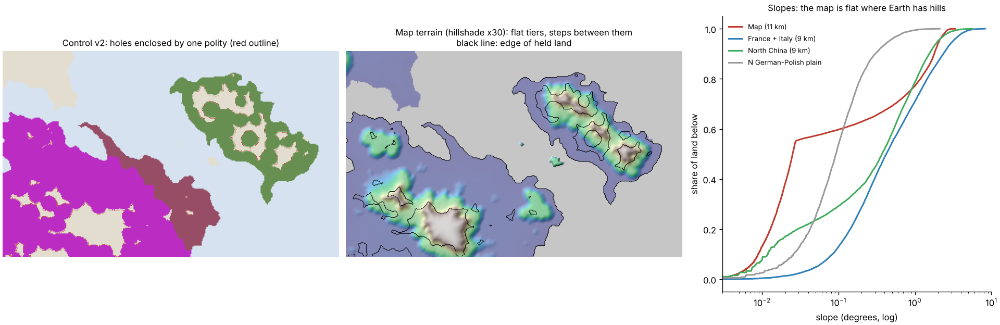

# Geography-shaped control: terrain, water, forests and borders — plan, 7 November 2026

The owner's request: control map v2 looks dotty. Real borders followed geography. Should we model forest edges, and
build a more realistic eroded height map? It must still produce the marked rivers (and possibly new ones and other
features) while staying faithful to the marked height tiers. Other ideas are welcome.

This plan covers:

* the diagnosis (measured, below);
* five workstreams, each with its Earth test;
* the order of work;
* the decisions that are the owner's.

Every model change follows the project's rules: its plan is frozen before results, it is developed on seen Earth
data, and it is tested once on a blind pool declared in advance. The tiers, marked rivers, coasts, painted claims,
towns and roads stay as drawn.

## 1. Diagnosis: why v2 is dotty

Measured on the Earth-fit atlas (corrected climate) in `output/control_v2_20261107/diagnostic_dots.json`. The
figure is `reports/figures/control_v2_dots_diagnosis.png`.

1. **The map has almost no hills.**
   * Elevation is built as smooth ramps between the four painted tiers (`rotclimate/geography.py`, `_tier_ramps`),
     then blurred.
   * The climate fit set the tier tops to 62 / 814 / 1,135 / 2,528 m. Tier 1, which is 70 % of the land, therefore
     spans only 0–62 m.
   * At 9–11 km, the map's median slope is 0.025°. Earth's is 0.30° for land between 25° and 56° N, 0.42° for France
     and Italy, and 0.37° for North China. 72 % of the map's land is flatter than 0.5°.
   * The map's steep land is all on the tier steps: its 75th and 90th percentile slopes match Earth's, but nothing
     lies between.
2. **On flat land, every travel-time zone is a circle.**
   * v2 holds land within 2 year-round days of a polity's staffed towns, or of the roads they keep.
   * Walking cost uses Tobler's hiking function on slope, plus forest, marsh, snow and mud. With no slopes, two days
     is the same distance in every direction.
   * Small held patches have a circularity of 0.96, where a perfect disc is 1.
3. **The holes are the uplands, but they come out as round domes.**
   * 161 unheld pockets lie inside a single polity: 10,444 cells, about 141,000 km² (median pocket 160 km², 90th
     percentile 1,600 km²).
   * Their median elevation is 765 m (held land: 39 m), median slope 0.55° (0.025°), forest 40 % (20 %), and
     population density 11 per km² (20).
   * Hill country left outside the state is plausible; James Scott's "non-state spaces" are exactly this. But each
     upland is a smooth dome, so control rings it in circles. On real terrain, valleys reach into the hills and control
     follows them, leaving the ridges and high blocks unheld.
4. **v2 is a hard threshold at 2 days.**
   * Every staffed town paints its own disc, whether it is an isolated outpost or part of a dense network of towns.
   * The 0/1 cut turns gradual loss of grip into stark holes and blobs.
5. **On Earth, frontiers follow desert edges more than mountains or rivers.** A quick check: Cliopatria AD 150 / AD 2
   border cells at 9 km, against land within 300 km of the border.

   | Border feature | Roman AD 150, border | Roman AD 150, nearby land | Han AD 2, border | Han AD 2, nearby land |
   |---|---|---|---|---|
   | desert edge | 56 % | 12 % | 25 % | 7 % |
   | top-quartile relief | 30 % | 25 % | 19 % | 25 % |
   | within 18 km of a Natural Earth river | 12 % | 16 % | 27 % | 20 % |

   Natural borders are real, but which features matter varies, and at this resolution it is not mountains everywhere.
   Kitamura & Lagerlöf (*Natural Borders*, Economic Journal 2015) find European borders over-represented on ridges and
   rivers at finer scale. Fernández-Villaverde, Koyama, Lin & Sng (*The Fractured-Land Hypothesis*, QJE 2023) show
   that rugged land fragments states in simulation. So the plan measures this on Earth rather than assuming it.

**Conclusion.** Three causes produce the dots:

* flat tiers that make every travel zone a circle;
* a per-town hard threshold;
* no land cover or drainage structure for control to follow.

Smoothing the image would only hide the symptom. The fix is better terrain and a better control rule, both tested on
Earth.

## 2. Workstreams

### A. Control rule on the current terrain (quick; independent of the new terrain)

| Step | Change | Literature | Earth test |
|---|---|---|---|
| A1 | **Summed influence.** A polity's grip at a cell is the sum over its staffed towns of the town's resident cohort × exp(−t / τ), where t is year-round days. Land is held where the strongest polity's grip ≥ θ; the owner is the strongest. Towns in a dense network reinforce each other, and an isolated outpost only holds near itself. | Boulding's loss-of-strength gradient (1962); gravity / potential models | Fit τ and θ on Rome AD 150 and Han AD 2 (balanced accuracy, as v2). Blind pools declared in advance (§3). Gates: balanced accuracy not below v2 − 0.01, and the shape metrics of §3 closer to Earth. |
| A2 | **Hole rule.** Fill an enclosed pocket if it is governable: its median slope, forest share and grain density lie inside the Earth-fitted range of held land. Otherwise label it "unadministered upland / forest" rather than leaving it blank. | Scott, *The Art of Not Being Governed* (2009): state space is concentrated, accessible grain land | Same pools; the share and terrain of filled pockets reported. Real atlases rarely map interior non-state land, so the labels stay scenario-tier unless a pool of mapped highland autonomies is found (e.g. Roman Isauria, Han southern "Man" regions). |
| A3 | **Drainage-basin cantons.** Control is decided per small catchment (≈ 300–3,000 km²) rather than per cell, by majority grip, so borders run along watersheds and around valleys. This needs the new terrain (B) on the map; on Earth it uses HydroBASINS levels 7–8. | Pre-modern administrative units commonly followed drainage (e.g. Skinner's macroregions; civitas and county territories) | Earth: HydroBASINS cantons on the dev and blind pools. Score balanced accuracy plus how often the border lies on a watershed divide, against the real enrichment. |
| A4 | **Cartography.** Draw borders as vector lines over a hillshade. Show grip as a continuous tint with the hold line as a contour. Apply a minimum mapping unit (patches under ~3 cells merge into their neighbour). | standard map generalization | None needed: presentation only, labelled as generalization. |

A1, A2 and A4 can ship before any terrain work. They remove the per-town discs and most single-cell speckle. On flat
tiers the edges will still be smooth isochrones until B arrives.

### B. Terrain: an eroded height map faithful to the tiers and rivers

**B0. Earth reference data.**
* Elevation: ETOPO 2022 at 30″ (NOAA, public domain) or Copernicus GLO-90 tiles (open).
* Basins: HydroBASINS (HydroSHEDS, free with attribution).
* Rivers: HydroRIVERS (already cached).

**B1. Generator.**
* A landscape-evolution model run to steady state: the stream-power law dz/dt = U − K A^m S^n with m/n ≈ 0.45, plus
  hillslope diffusion and depression handling.
* Literature: Howard 1994; Whipple & Tucker 1999; Braun & Willett 2013 (FastScape, O(n) implicit) via
  `fastscapelib`; Barnes et al. 2014 priority-flood.
* Inputs and constraints:
  * **Uplift** comes from the tiers: the base uplift rises with tier, with noise at the scale of Earth valley spacing
    (Perron, Kirchner & Dietrich 2009, Nature: ridge and valley spacing is set by diffusion D over erodibility K).
  * **The marked rivers are imposed** as the drainage path: their cells' downstream receivers are fixed along the
    drawn line, and off-map catchment area is fed in at the sources. This is the hydrology-first approach of Génevaux
    et al. 2013 (ACM TOG); Cordonnier et al. 2016 and Schott et al. 2023 are uplift-authored terrain in the same
    spirit.
  * **The coast is fixed** as base level.
  * **Faithful to the tiers at climate scale:** after each pass, the large-scale field (the climate grid,
    downsample 8) is projected back onto today's tier elevation. Only the sub-grid hills and valleys are new, so the
    fitted climate holds.

**B2. Earth calibration by "posterize and reconstruct".** This is the decisive test.
* Take real Earth windows at map scale (1.8 km).
* Reduce each to four tiers, matching the map's tier shares and its band widths scaled to that window, plus its
  biggest rivers only, as a hand-drawn map would show them.
* Regenerate the terrain from that sketch and compare with the true DEM:
  * watershed-divide position error (against HydroBASINS);
  * slope distribution per tier (KS distance);
  * new rivers against real minor rivers (F1 within 5 km; drainage density by climate, Sangireddy et al. 2016);
  * Hack's law exponent;
  * pass locations;
  * most usefully, **2-day travel isochrones** from the same towns on the reconstruction against those on the real
    DEM (overlap).
* K, D, m/n, the uplift-by-tier mapping and the noise scale are fitted on development windows (e.g. Apennines,
  Anatolia, Sichuan basin rim, Massif Central).
* Gates are scored once on blind windows (e.g. Balkans, Zagros, Guizhou, Appalachians). A baseline must be beaten:
  today's tier ramps applied to the same sketch.

**B3. Map height map v2.** Run the fitted generator on the map. Acceptance checks, all reported:

| Check | Threshold |
|---|---|
| Painted river pixels within 1.8 km of a simulated channel | ≥ 95 % |
| River captures of a painted main stem | none |
| Pixels of each tier inside that tier's band (with a small margin) | ≥ 90 % |
| Tier boundaries moved | ≤ 2 px |
| Climate-grid block means, against today's elevation | unchanged within a stated tolerance |
| Climate zone agreement after a climate re-run | changes < 0.5 points |
| Coastline | unchanged |

**B4. Features from the new terrain.**
* Ridges and watershed divides.
* Passes (saddles on the divide), which are natural fort and border points.
* Valleys and river terraces (settlement and arable sites).
* Floodplains.
* Lakes, including endorheic basins in dry interiors.
* Marshes: flat, wet, poorly drained land.
* Alluvial fans.
* **New rivers**, wherever routed runoff from the climate model exceeds an Earth-fitted discharge threshold. They
  feed boats, fords and irrigation.

### C. Land cover: forests, clearings and marshes

**C1. Potential tree cover.**
* Today forest is a biome lookup (savanna 0.5, forest 1.0).
* Replace it with a continuous cover share driven by climate (water balance, warmth) and terrain.
* Fit on the potential natural vegetation map of Hengl et al. 2018 (PeerJ; 1 km, open), on seen regions.

**C2. Clearance at AD 200.**
* Cleared land = people × land per person. Land per person falls with density (Kaplan, Krumhardt & Zimmermann 2009,
  QSR; the KK10 curve).
* Clearing goes to the best arable land first, valleys before slopes. The remainder is forest, so forest edges come
  from where people are.
* Blind test: pollen-based REVEALS land-cover maps for Europe in the AD 0–500 window (Githumbi et al. 2022, ESSD;
  open). This test is never used for fitting.

**C3. Marshes and wetlands** come from the new terrain (B4) plus the climate water balance. Test: wetland extent
against a global wetland map, on Earth windows.

**C4. Effects, each adopted only if Earth-tested.**
* Travel: the per-cell forest share enters the Soule–Goldman coefficient.
* Farming: fields come only from cleared land.
* Control, as part of the hole rule (A2): forest and marsh lower governability. A further "refuge" penalty is
  adopted only if it improves the blind control scores.

### D. Rebuild the chain on the new terrain, and control v3

* Arable share by slope, fitted on Earth slope-suitability classes; this replaces the per-tier arable shares.
* Irrigation and river access from the new rivers.
* Settlement sites in valleys and on terraces (scored by the settlement-model harness).
* Unmarked towns.
* Minor roads routed through valleys and passes.
* Political reach, then control v3 = A1 + A2 (+ A3 with map cantons).

Earth tests: v3 on the dev pools, then once on the blind pools (§3). The atlas default changes only if the gates
pass. After that, the climate check from B3, a refresh of the Earth-fit atlas, and a republish of the three hosted
atlases.

### E. Other ideas (smaller, later)

* **River crossings as frontier lines.** Fords, ferries and bridges on big rivers become the only crossings. This
  tests whether the Rhine/Danube-style river frontier emerges.
* **Passes and forts.** The administration layer's forts snap to passes and chokepoints.
* **Soils from terrain:** alluvium on floodplains, thin soils on steep slopes. The fertility model currently assumes
  Rothamsted soil everywhere. Test against SoilGrids texture on Earth windows.
* **Coast types:** cliffed against low coasts and deltas, for harbours and landing places.
* **Seasonal floods.** Floodplain flooding by month, from the climate model's flow: farming calendars, impassable
  months.

## 3. Earth tests and the shape metrics

Balanced accuracy against extents stays the main score. Because the problem is shape, every control candidate also
reports these, for the model and for the real borders, on the same grid:

| Metric | What it measures | Earth reference |
|---|---|---|
| Hole share | unheld land enclosed by one polity, % of its area | Cliopatria and provincial maps: ≈ 0 (they do not map non-state land), so holes must pass the A2 governability test |
| Circularity of small held patches | discs (1.0) or valley-shaped patches | real provincial units (AWMC Roman provinces, CC BY; CHGIS prefectures) |
| Border roughness across scales | perimeter against scale (fractal dimension), at matched generalization | Cliopatria polygons at the same rasterization |
| Border–feature enrichment | border share on desert edges, watershed divides, major rivers and forest edges, over the share of nearby land | Cliopatria / AWMC (§1 gives the first coarse values) |

**Pools.**
* Development: Rome AD 150 and Han AD 2 (seen).
* Blind candidates, never yet used for extents:
  * Northern Song AD 1080 (CHGIS seats + Cliopatria Song extent);
  * the Byzantine Empire AD 550 (Pleiades late-antique places + Cliopatria extent).
* Each is to be verified and declared, with its spent-pool record, before any v3 result.
* Terrain tests use their own development and blind windows (B2). Forest uses REVEALS as its blind test (C2).

## 4. Order of work and milestones

1. **A1 + A2 + A4 on today's terrain** (about one session).
   * Frozen plan, Earth fit and blind test.
   * If it passes, the atlas default becomes v2.1: no per-town discs, holes only on ungovernable uplands, borders drawn
     as lines over a hillshade.
   * Even if A1/A2 fail, A4 (presentation only) ships.
2. **B0–B2: the terrain generator on Earth** (two to four sessions). Install `fastscapelib`, download the reference
   elevation, fit, and run the blind windows.
3. **B3–B4: map height map v2** plus features (one to two sessions). Acceptance checks; owner review of a hillshade
   preview before anything downstream changes.
4. **C1–C3: land cover** (two sessions). REVEALS blind test.
5. **D: rebuild and control v3** (two to three sessions). Earth tests, then a climate re-run, atlas release and
   republish.
6. **E items as time allows.**

Every milestone ends committed and pushed. Maps and figures are sent as they are made.

## 5. Decisions for the owner

1. **How strict are the tiers?** Tier 1 tops out at 62 m, a value the climate fit chose.
   * *Recommended:* keep each tier's elevation at climate scale and let hills and valleys of Earth-like local relief
     sit inside it. A lowland pixel may then reach somewhat above 62 m on a hilltop; at least 90 % of each tier stays
     within its band.
   * *Strict alternative:* every pixel inside its band. This keeps 70 % of the land nearly flat, and much of the
     dottiness with it.
2. **How exact are the marked rivers?** *Recommended:* channels within one source pixel (1.8 km) of the drawn line,
   main stems never re-routed. New tributaries, lakes and marshes are allowed.
3. **Holes.** *Recommended:* show ungovernable pockets as an explicit "unadministered upland / forest" class rather
   than filling them or leaving them blank.
4. **Scope.** *Recommended:* the order in §4. A brings visible relief soonest; B is the real fix.

## 6. Risks

* **Climate drift.** New relief changes snow, lapse rates and rain shadows. The large-scale projection and the
  re-run check guard against it. If the drift is real, the map world needs a refit, which costs a full world search.
* **Erosion cannot produce the marked rivers.** Imposed receivers guarantee the drawn paths; the risk is unrealistic
  valleys next to them. B2's isochrone and divide metrics measure this.
* **Earth data for non-state space is thin.** Unmapped autonomy cannot be blind-tested well. The A2 labels may
  have to stay scenario-tier.
* **Compute.** The map has 2000 × 926 source pixels, about 1.9 million cells. FastScape steady states at that size
  take minutes per run, so fitting on Earth windows is feasible. The full chain rebuild (D) takes hours.

## 7. Progress

**A: done.**
* The summed-influence rule (C*) won on development: balanced accuracy 0.763 → 0.820. It narrowly failed the blind
  late-antique pool, 0.752 against the 0.756 limit: thousands of small Pleiades places summed into too much grip.
* The fallback, v2 + enclosed pockets, passed both blind pools: Song AD 1080 0.697 → 0.737, late antique AD 550
  0.766 → 0.774.
* It is now the atlas default (control v2.1): enclosed land is territory, ungovernable pockets are hatched, borders
  are drawn as lines over the relief.

**B: generator built; Earth test running.**
* The generator (`scripts/terrain_erosion.py`) is a steady-state stream-power model. It matches the tiers at climate
  scale and keeps 100 % of the marked rivers on channels.
* First development window (Apennines): divide error 16.7 → 11.5 km, slope-distribution distance 0.59 → 0.11,
  2-day walking-zone overlap 0.932 → 0.951.
* Real terrain itself keeps only about 50–60 % of the middle tiers inside their bands. So decision 1's "≥ 90 %"
  becomes the Earth-measured share, as plan_B2 specifies.
* Early finding: tier 1 (0–62 m) stays low-relief by construction, so lowland borders will be shaped mainly by
  rivers, marshes and forests (C) rather than by relief.

**B: done up to the owner's review** (`calibration/geography_control_20261107/plan_B2.json`).

*Earth test.* Real terrain was reduced to a hand-map sketch (four tiers plus the biggest rivers) and rebuilt from it.
The selected setting was fitted on four development windows and scored once on four blind windows.

| Measure | Development windows | Blind windows | Blind wins |
|---|---|---|---|
| Watershed divide error | 15.6–34.9 → 7.8–23.6 km | 15.7–28.2 → 17.1–18.9 km | 3 of 4 (Guizhou worse) |
| Slope-distribution distance (KS) | 0.56–0.80 → 0.11–0.23 | 0.59–0.68 → 0.18–0.27 | 4 of 4 |

*Map height map v2* (`output/terrain_erosion_20261107/map_height_v2.npz`; figures `height_map_v2_review_*.png`):
* 100 % of the marked rivers lie on channels, and new rivers appear.
* Tier-band shares are 0.99 / 0.98 / 0.63 / 0.86 against the Earth reference minus 5 points. This took relief
  compressed to 0.50 in tier 1 and 0.82 in tier 3.
* The climate keeps today's elevation.

**Main finding: the discs are the travel model, not the terrain.**
* On real Earth terrain, 2-day walking zones (Tobler's hiking function at 1.85 km) overlap the smooth-ramp zones at
  0.92–0.98, with the same area and the same disc circularity (about 1.15, the 8-neighbour disc).
* So no realistic height map, even the true one, bends 2-day walking zones much under the present cost model. The
  isochrone gate was dropped before the blind run for this reason (amendment 1).
* What bends real zones is how strongly pre-modern movement was channelled: pack animals and carts on slopes, paths
  along valleys and over passes, forests, marshes and river crossings.

**Revised next steps.**
1. **Terrain-channelled travel (new A2).** Fit a slope- and ruggedness-sensitive cost (a pack-animal or cart
   response on top of Tobler, plus valley and pass preference) on the Earth control development pools.
   * Shape metrics will be scored against real borders.
   * A two-state border test is added: CHGIS AD 1200, Southern Song against Jin along the Huai and Qinling, a blind
     pool declared first.
2. **C (land cover).** Forests, marshes and clearings, which matter most in the 0–62 m lowlands where relief cannot.
3. **D.** Rebuild the chain on height map v2 with the adopted travel and land-cover rules; then control v3.

**A2: tested, not adopted** (`plan_A2.json`).
* Ruggedness-sensitive travel, cost × (1 + β × local relief), lowers balanced accuracy for every β > 0 on development:
  Rome 0.849 → 0.839, Han 0.664 → 0.572. Rugged land drops out of territory.
* Han's border-feature statistics move closer to the real border at β = 1, but at a 0.03 accuracy cost.
* No candidate qualified, so the three reserved blind pools (AD 1200, 1820, 1500) were never opened and stay unused.

**Cartography: painted claims added to v2.1.** Claimed but unheld land is drawn as a light tint of the claimant with
a fine line. Each polity now reads as its painted shape with the held core inside (presentation only; your own data).

**C1: forest level fixed, no pattern found** (`plan_C1.json`).
* *Target:* REVEALS pollen open land, 250 BCE–250 CE, 1° cells; 121 development cells and 147 blind.
* *A problem found in development:* the map's Whittaker biome lookup counts most temperate-Europe climates as
  woodland/shrubland, i.e. zero forest. It overstates AD 200 open land by about 0.29.
* *Adopted (blind):* a moisture-index potential × (1 − 0.40 constant clearing), open-land RMSE 0.326 against 0.556
  for the lookup.
* *Not adopted:* population-driven clearing (Kaplan-type), RMSE 0.346 against 0.326.
* *No pattern skill:* no rule ranks the cells (|ρ| ≤ 0.11). Open land is 35–46 % in every latitude band and is
  unrelated to climate, density or latitude. Roman-era clearing was widespread and patchy below what these models
  resolve.

## 8. What the Earth tests say about geography and borders (7 November)

Four independent tests point the same way. At these scales (1.85–9 km cells, Cliopatria extents), real borders are
explained by:
* **where food runs out** (desert edges: Rome's border is 4.7× enriched);
* **where staffed towns are**;
* **enclosure.**

They are not explained by:
* slope under walking travel (2-day zones on real terrain are discs too);
* ruggedness-weighted travel (it costs accuracy);
* the spatial pattern of AD 200 forest (not predictable from climate or population).

The evidence-backed map is therefore v2.1 (held + enclosed + painted claims). Height map v2 adds real rivers, valleys
and slopes for settlement, farming and the look of the map. Remaining frontier scallops are the 2-day reach of
outlying towns; smoothing them would be cartographic generalization, not geography.

**Open options:**
1. Plan D: rebuild towns, farming and reach on height map v2 (valley sites, new rivers, arable land by slope). This
   improves realism, though it changes the border shape little on this evidence.
2. Cartographic frontier smoothing at ~10 km, labelled as generalization.
3. C2: the new forest share in travel friction. It is small and roughly uniform (forest coefficient 1.5 against 1.1–1.2
   open).
