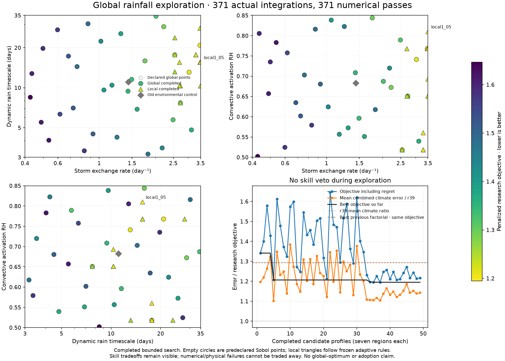
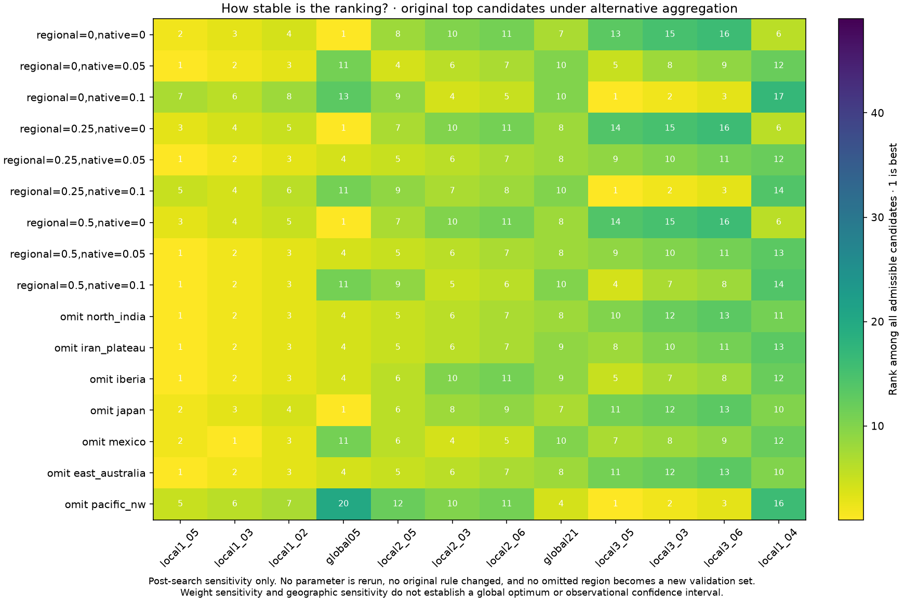

# Broader rainfall search with explicit tradeoffs — 28 October 2026

This is a new prospective research policy, following the user's request to
allow regional accuracy tradeoffs and investigate other parameter basins.
Previous campaigns and their failed acceptance decisions remain unchanged.
No adopted Earth or fantasy climate is replaced by this experiment.

The search retains the conservative, independently solved water layers,
corrected column convection and falling-rain recycling, fixed 6.0 K/km
environmental capacity profile and 7.5 m/s westerlies. The existing external
thermal/capacity reference must still qualify. No regional parameter, observed
humidity reset or planetary change is introduced.

Hard requirements cover numerical convergence, water/mass/branch equations,
conservative internal transfers, finite outputs, unchanged geography and native
footprints, declared actual parameters, and branch/column speed bounds.
Rainfall, temperature, native humidity/wind and modeled SST prediction errors
are separately reported objectives. A 2% prediction regression no longer
invalidates an otherwise admissible research candidate.

## Frozen design

`calibration/global_rain_20261028/plan.json` contains all 32 initial points,
objective weights, normalization scales, bounds, local-start selection and
adaptive proposal rules. Source, plan and tests are committed before new
Earth integrations. The original four controls rerun on each of seven regions,
with every archived main NPZ field and array reproduced exactly.

The 32 scrambled Sobol points use seed 20261028 and cover three shared axes:

| Coefficient | Range | Sampling |
|---|---:|---|
| Storm exchange rate | 0.4–3.5 per day, before the storm envelope | Logarithmic |
| Dynamic rain timescale | 3–35 days | Logarithmic |
| Convective activation RH | 0.50–0.85 | Linear |

These are empirical sensitivity ranges, not physical confidence intervals.
Storm exchange affects heat as well as water; temperature, sea state and
circulation respond. Every other actual per-case parameter must equal the
fresh environmental control.

After the global stage, select up to three physically admissible starting
points ordered by objective, separated by at least 0.35 in normalized
parameter space. Each receives six sequential coordinate proposals at a
normalized step of 0.12. The center moves only when the objective improves;
exact duplicate proposals reuse records and add no Earth integrations.
This is bounded local refinement, not a converged optimizer. At most 18 new
local profiles follow the 32 global profiles, for a maximum of 378 actual
Earth integrations including 28 controls. A two-hour campaign ceiling and
per-profile/completion source checks apply. Failures remain preserved.

## Objective and candidate advancement

Let each regional combined ratio be `S_i = 0.5*(TMAE/Tref + rainloss/rainref)`.
The main objective is the equal-region mean of these ratios, plus:

- `0.25 * mean(max(S_i - 1.05, 0)^2)` for regional damage;
- `0.05 * mean(max(native normalized error regression, 0)^2)`;
- `0.05 * mean(max(ocean normalized error regression, 0)^2)`.

Native errors compare the same wind, partial-water and humidity-shape metrics
on the same native footprints. Fixed denominator floors prevent near-zero
reference errors from dominating: 0.5 m/s, 1 mm and 0.02 for the dimensionless
shape error. Ocean-error normalization has a 0.1°C floor. These are objective
scales, not estimated observational uncertainties. Every raw component and
regional result remains available; none is hidden by the aggregate.

The Pareto front retains non-dominated combinations of mean combined error,
worst regional error and native regression. A research shortlist additionally
requires mean combined ratio ≤0.995, mean rain ratio ≤0.99, temperature ratio
≤1.02 and worst regional combined ratio ≤1.15. These new limits are fixed
before outcomes. A shortlist permits a separately planned broader validation;
it does not authorize adoption. No single-region veto is used to prune the
optimization path before that stage.

Any finalist still needs prospective full-region, ocean, finer-grid and
established-region checks, and a matched world assessment before replacement
of a normal atlas climate. The other 24 dev31 regions and sealed six are not
optimization inputs in this campaign; their historical use prevents calling
them wholly new independent observations.

## What the experiment can establish

Broader coverage and separated starting points reduce dependence on the old
parameter neighborhood. They cannot prove a global optimum. Report boundary
hits, different basin outcomes, invalid cases and all regional/native skill
tradeoffs. If systematic wet-coast/dry-monsoon errors persist throughout the
box, that motivates another transport or closure hypothesis; it does not by
itself establish that every possible parameterization must fail.

Status: complete; scientific source `3ec90ee`. All 371 regional integrations pass strict numerics; 28 archived main controls and four native companions reproduce exactly. No candidate qualifies for the research shortlist or adoption.

The machine-readable `physical_admissible` flag means that the declared numerical, structural, parameter-bound and reference requirements passed. It is not a claim of independently validated atmospheric physics. Older recorder metadata retains some historical skill-threshold fields for comparison; the new `objective` and `validation_shortlist` rules, rather than the old screening function, govern this campaign.

## Completed results

The 32 global profiles and 17 actual local profiles each ran seven regions,
plus 28 controls: **371 actual integrations, all passing numerics**. Eighteen
local proposals included one exact cached proposal. Four additional pairs
were indistinguishable at 1e-10 normalized parameter distance due to floating
round trips; those reruns count as actual work but do not add materially
distinct parameter-space coverage. There are 45 materially distinct sampled
candidate locations. No historical failure is removed.

All 236 frozen source hashes, seven reconstructed case identities, actual
parameters, raw NPZ hashes, complete control fieldsets/dtypes/arrays, native
companions, per-step certificates and every adaptive decision were verified.
The scalar objective was also reconstructed independently from raw errors.

| Diagnostic selection | Profile | Objective | Mean combined / r39 | Mean rain / r39 | Mean T / r39 | Worst region / r39 |
|---|---|---:|---:|---:|---:|---:|
| Lowest frozen objective | local1_05 | 1.19494 | 1.10445 | 1.18798 | 1.02093 | 1.57715 |
| Lowest mean combined climate error | global05 | 1.20661 | 1.10116 | 1.18967 | 1.01265 | 1.47964 |
| Lowest native squared regret | global28 | 1.36291 | 1.28249 | 1.47638 | 1.08860 | 2.09259 |

The best objective improves by about 7.6% over the best previous factorial
trial under this same newly frozen score. The best mean combined climate
ratio improves from 1.19021 for the environmental control to 1.10116, but is
still 10.1% above r39. Lower objective and lower average climate error are
reported separately. No trial passes the declared average-error and regional
shortlist conditions; none proceeds to adoption or normal-map replacement.

| Separated start | Best local endpoint | Start objective | End objective | Near parameter boundary |
|---|---|---:|---:|---|
| global05 | local1_05 | 1.20661 | 1.19494 | eddy_rate upper |
| global13 | local2_05 | 1.24688 | 1.20662 | eddy_rate upper |
| global12 | local3_05 | 1.27151 | 1.21379 | eddy_rate upper |

Each start improves during its bounded poll cycle, but this is not optimizer
convergence. The best endpoints remain near the upper storm-exchange limit;
the box does not establish an unconstrained optimum. Ranking sensitivity
across nine alternative weight combinations and seven region omissions has
four different winners. Region omissions are sensitivity checks on reused
development data, not a new validation set and not a reason to change the
frozen selection rule.

The water-equation diagnostic contrasts the best objective, best mean climate
and best native-regret cases. It uses original cropped domains, explicitly
retaining the East Australia347/358-cell distinction. Signed equation terms
are not independent causal shares. Regional regressions and native errors
remain in the full download rather than being removed by the aggregate.

The series now contains **1,396 actual Earth attempts, 1,392 passes and four
preserved original failures**. Post-search diagnostics add zero integrations.
All normal climate, FORGE, farming, population and headline data stay unchanged.

The conditional next experiment will test shared wind amplitude at the best
separated rain settings, using the same objective and planet. It addresses
persistent circulation error without simply extending storm exchange to ever
larger values. It must be separately declared and committed before any new
runs; no failed decision from this round is reclassified.
