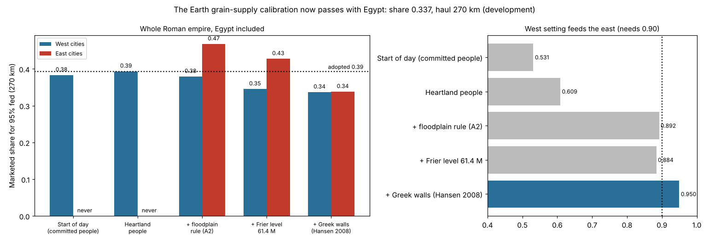

# Greek wall circuits: the Earth supply calibration passes with Egypt — 14 November 2026

Plan: `calibration/greek_walls_20261114/plan.json`, committed (0612e043) before output. Source: M. H. Hansen,
"An Update on the Shotgun Method", *GRBS* 48 (2008) 259–286 (PDF supplied by the owner; not committed).

## The correction

Hansen estimates Greek urban populations from intramural areas: 150 people per ha of inhabited space, with about
half of a circuit inhabited and "only a third" of the large ones (pp. 266–272: Eretria 81.5 ha, Himera 82, Phleious 60,
Tanagra 60 at half; Samos 103, Sikyon 175, Tegea 190, Thebes 350 at a third; Mytilene 140 ha is the exception at half).
He stresses these are minima. For the 58 AD 150 catalogue cities in Achaea, Macedonia and Epirus whose Hanson area is
a wall circuit, the city's size is taken as the inhabited share (half, or a third at 100 ha or more). The sliding density
is then applied to that inhabited area. Residents fall from 9.10 M to 8.37 M. Tegea, for example, drops from about 68,000 to an
inhabited 63 ha.

## Result: passes

| Variant (whole empire, floodplain rule, Frier 61.4 M) | e95 west / east | West→east / east→west | Passes |
|---|---|---|---|
| Control (no correction) | 0.35 / 0.43 | 0.884 / 1.00 | no |
| **Greece (primary)** | **0.34 / 0.34** (×1.003) | **0.950 / 0.951** | **yes, e95 0.337** |
| Greece and Asia Minor | ×1.03 | 0.945 / 0.959 | yes, 0.335 |
| Greece, Hansen's literal 150/ha | ×1.007 | 0.949 / 0.952 | yes, 0.338 |

The cited 270 km haul limit is now also the best-agreeing limit. Every step of the day is in the figure. The east
went from never 95% fed to agreeing with the west within 0.3%.

## What this is and is not

- **Development, not validation.** The floodplain rule, the people level and this correction were each made after
  seeing a failure, and Egypt's and Greece's populations are known. Each step is sourced and disclosed with its
  amendments.
- **The map's sizes are unchanged.** The correction is applied to the Earth calibration data only. The fantasy
  town sizes come from the size model fitted on all Hanson areas, including Greek wall circuits. If those circuits
  overstate size, the fitted model is slightly too large. Changing it is an owner decision.
- **The Earth-supported marketed share is now 0.337**, against the adopted 0.3923 (taken from the without-Egypt
  calibration). The two are within the ×1.25 robustness band. On the fantasy map, one third gave 85% of residents fed
  (41 towns short) and 0.39 gives 91% (29 short).

## Checks

The control matches the earlier Frier run to 2e-16 but not bit-for-bit: the level factor is computed in a different
order, as disclosed. A first run used the cell width instead of the cell area; it produced an impossible control
and was fixed before any valid result. The reviewer re-derives the 58 and 104 changed cities and their shares from
the raw areas table and rebuilds every e95 and decision (280 checks). A fresh run is byte-identical.
