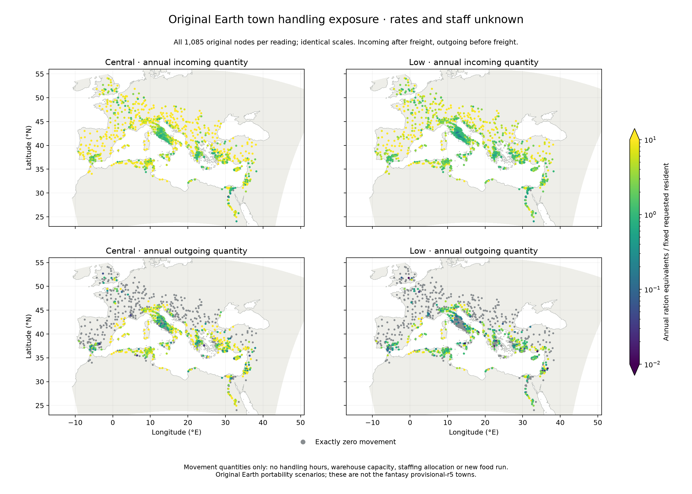

# Original Earth town handling exposure — 17 November 2026

All original grain movements now have a rate-free handling basis at every original town node. The audit covers both archived Earth portability cases, 1,085 towns each, retaining zero movements and the fixed original resident requests. It adds no food, work or warehouse simulation. The published fantasy provisional-r5 atlas remains unchanged.

## Quantities and timing

Incoming exposure `qin` is the original delivered `arrivals`, after freight loss. Outgoing exposure `qout` is the original paid `inter_exported`, before its freight loss. Both retain net-edible-kcal units. Incoming and outgoing are separate hypothetical handling events on funded grain; adding them would count work events, not newly produced or independently available grain. Arrivals also include grain later spoiled, left unused or exported, so throughput is not meals or a new fed population.

| Original reading | Town nodes | Requested residents | Incoming annual kcal | Outgoing annual kcal | Zero incoming / outgoing towns | Ordered shipments | Year-wrap shipments |
|---|---:|---:|---:|---:|---:|---:|---:|
| central | 1085 | 8,371,325 | 2.47972e+13 | 6.01831e+12 | 1 / 502 | 8173 | 712 |
| low | 1085 | 4,057,217 | 1.03984e+13 | 2.00903e+12 | 2 / 613 | 7723 | 651 |

Every original `direct + inter_received = arrivals` identity is exact. Every ordered shipment is reconstructed at its original sender/receiver: departure bin `m`, receipt bin `(m+1)%12`. All 1,363 December-to-January records are retained. No within-bin dates, service days, warehouse stops or travel paths are inferred.

## Work remains symbolic

For constant but unknown compatible rates, annual hours are `sum(qin)*h_in + sum(qout)*h_out`. Peak-bin hours are `max_m(qin[m]*h_in + qout[m]*h_out)`. The two separate quantity maxima can occur in different bins and cannot simply be added as a synchronized peak. Both rates remain **UNKNOWN hours/net-edible-kcal**, with no numeric default or conversion from crop-work slack. No task claims or staff assignments are generated.

Annual and peak-bin quantities are retained for all 2,170 town rows; all 26,040 town/bin pairs remain in the exact local exposure arrays. Ratios use fixed original resident requests only. All present requests are positive, so this cohort has zero undefined denominators; the export convention retains missing values for any nonpositive request. These ratios are neither observed per-capita handling nor revised population estimates.

## Figure and output limits

The four-panel map uses the predeclared shared positive log scale 0.01–10 annual ration equivalents per fixed requested resident, where one annual ration is the existing model unit 912,500 kcal. Exact zeros are gray. Values outside the colour scale remain unchanged in the arrays and CSVs. Central incoming/outgoing over-scale counts are 359/119; low counts are 144/28. Under-scale counts are 0/0 central and 0/4 low. This saturation means the figure cannot distinguish all high-throughput nodes; the full values remain in the exports. No handling-hour, storage-capacity or staffing map is implied.

Outputs: [all-town annual/peak quantities](../output/urban_handling_exposure_20261117/towns.csv), [monthly totals](../output/urban_handling_exposure_20261117/months.csv), [symbolic work specification](../output/urban_handling_exposure_20261117/symbolic_work.json), and [summary](../output/urban_handling_exposure_20261117/summary.json). `exposure.npz` is local/ignored and pinned in the result/qualification receipts; it is reproducible from the archived original fields.

## Verification and publication preservation

The separate scalar reviewer checks all 52,080 incoming/outgoing monthly quantities, all 15,896 ordered shipments, all-node annual/peak/ratio/geometry exports, summary totals, scale clipping and zero masks. Largest annual-sum difference against compensated summation is 0.0001220703125 kcal; the original full monthly quantities remain byte exact. The fresh run matches all six outputs and the complete result receipt byte for byte. Static import inspection confirms the producer imports no model/solver modules.

The original monthly, no-hold and crop-work-map qualifications supply 3,378 historical identity checks. Five intentionally changed r5 publication paths resolve ONLY to exact archived originals recorded by the r5 baseline. All other historical identities match their live files directly. The audit separately pins and rechecks 1,197 current identities, including the actual live r5 publication. Old receipts are unchanged, and no old-live-publication guard is silently marked passed against new files.

Recipes: `scripts/audit_handling_exposure.py`, `scripts/review_handling_exposure.py`, `scripts/seal_handling_exposure.py`. Completed results/reviews refuse overwrite. Use producer and reviewer `--out <isolated-directory>` for a fresh replay. The guard amendment is `calibration/urban_diagnosis_20261117/handling_exposure_release5_baseline.json`.

## Next evidence step

The quantity side is ready for explicit inputs; measured handling intensity, operation boundaries, complete baseline occupation timing, staff affiliation/travel, physical capacity and operational rights remain missing. The next bounded primary-source screen seeks one directly published manual-grain handling account with operation, crew, quantity and time. It must distinguish prescriptions or equipment capacity from empirical human timing and retain modern-to-ancient transfer limits. It supplies no coefficient automatically. No climate/steppe work, reserved city-size pools or site-survey workbook was opened.
