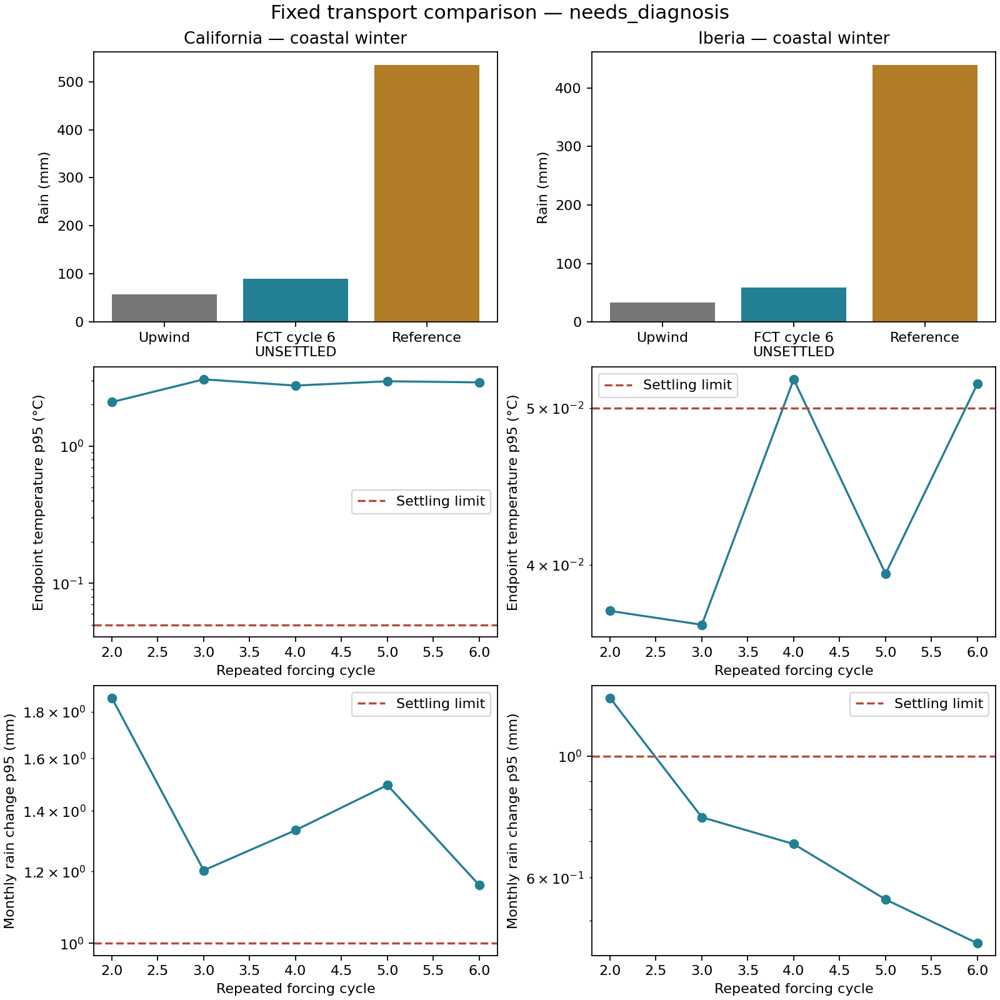

> Lightweight export: first read [START_HERE.md](../START_HERE.md). Some historical binary evidence is intentionally omitted; full-chain review/resume commands require the original workspace.

# Climate project handoff — 16 October 2026

Prepared at the user's request after the latest user-run experiment stopped.
This is the current entry point for a successor agent. Older reports preserve
their original protocols and commands; their “next run” sections may be obsolete.

Workspace: `<PROJECT_ROOT>`.
Python: `.venv/bin/python` (3.10). No Git repository or `AGENTS.md` was found.
Do not assume that an earlier assistant's narrative is stronger evidence than
the saved manifest, arrays, verified summaries and source fingerprints.

## Current decision

**Keep the existing V9 fantasy atlas. The V10 transport experiment stopped for
diagnosis at 6/8 cases; it is not a completed success or a new calibrated fit.**

All four upwind controls reproduce their parent physical fields and ledgers
exactly. The two completed FCT bulk-cloud candidates increase winter coastal
rain, but neither reaches the declared repeatable annual state. The subsequent
California FCT parcel-cloud candidate fails a water-availability guard before
its first monthly checkpoint. The Iberia FCT parcel candidate never starts.

The first useful successor work is to diagnose transport/cloud compatibility
and the large California year-end temperature changes, using saved data and
small controlled examples. There is **no new long command recommended at this
handoff**. Do not reset the failure status or repeat the stopped run unchanged.

Read these next:

1. [Verified latest results and convergence figure](../output/v10_regional_transport_review/review.md).
2. [Latest fixed experiment, including its original protocol](v10_regional_transport.md).
3. [Numerical transport laboratory](v10_flux_transport.md) and [cloud-process laboratory](v10_cloud_lab.md).
4. [Research strategy](research_strategy_20261015.md) and [comparison with other models](model_precipitation_research_20261016.md).
5. [Chronological development plan](near_term_plan.md), reading the newest section first.

## User preferences and scientific constraints

- **The user runs all real seasonal/annual simulations, calibrations and long
  tasks.** Prepare clear commands and realistic cost estimates when a new
  experiment is ready; do not launch those jobs on the user's behalf. Saved-data
  analysis, fast tests and manufactured examples are appropriate assistant work.
  Earlier development also used independent real-input probes of at most 60
  simulated seconds, not a chained seasonal integration.
- Preserve completed and stopped evidence. Never edit frozen source modules,
  runners, preparation tables, state files or fingerprinted reviewers to make an
  experiment resume. Put new physics in a separate module and new output folder.
  Some reviewers are themselves hashed dependencies of subsequent runners.
- **NOAA six-hourly fetching is paused after repeated HTTP 429 responses.** Do
  not retry downloads or restart a fetch loop. Cached monthly atmospheric
  climatology and the existing prepared weather tables are available.
- Main product concern: desert encroaching on the painted Mediterranean zone,
  while retaining credible cold-dry and hot-dry regions. The user chose to keep
  the atlas while investigating changes that damage cold-dry agreement.
- For future V9 promotion, the selected per-world Mediterranean dry-area limit
  is `max(anchor dry share, 0.05)`. Worst-world dryness must strictly improve on
  the development set and all five checked worlds. Allow at most 2 percentage
  points loss in cold-dry agreement, 3 in hot-dry, 1 overall, and 2 in
  Mediterranean Cs area. These are percentage-point losses, not relative %.
- Those fantasy acceptance rules differ from the small Earth mechanism screen.
  A passing Earth screen is not permission to publish its climate to the atlas.
  Do not alter target labels, choose the best weather seed, or add moisture just
  to obtain a better headline.
- Use bounded, resumable runs with monthly progress, explicit elapsed times and
  failure stops. An exhausted budget, numerical failure and settled completion
  must remain distinguishable. The user frequently requests progress and ETA.

## Production atlas and why development moved to V10

The world is a hand-drawn map about 2287 × 1058 miles, with pointy hexes of
15-mile side length. Source layers live under
`<PROJECT_ROOT>/data/source/`;
places, labels and hex definitions are in the adjacent data directory.

Production code is
`<PROJECT_ROOT>/rotclimate/`.
It combines seasonal energy balance, prescribed/thermal winds, column moisture,
terrain and Köppen classification, with parameter inference for latitude,
tilt, spin and the unknown exterior geography. Its broad storm exchange and
column-water advection are not a closed conservative atmospheric water model.
The [structural audit and original V10 proposal](new_physics_avenues_20261014.md)
explain why a different water-delivery representation became the priority.

Loose linear solves explained much of the earlier round-19 fine-grid collapse.
Later strict solves fixed that numerical issue without eliminating the
Mediterranean/cold-dry trade-off. A 64-setting overnight sweep shortlisted two
proposals; both failed cold-dry protection on development worlds. Other screened
settings did not all receive the same checks, so this is not proof of
infeasibility. See the [overnight review](overnight_final_20261014.md).

The atlas still uses the converged broad seasonal **retrograde anchor**, world
1, downsample 8, 25 seasonal dates/year and two warm-up years:

| Live atlas measure | Value |
|---|---:|
| Strict painted-zone agreement | 48.8734% |
| Mean fuzzy rule score, a different measure | 0.462293 |
| Painted Mediterranean classified dry | 11.5898% |
| Painted Mediterranean with Cs climate | 37.2745% |
| Cold-dry agreement | 68.0485% |
| Hot-dry agreement | 56.2745% |

Live strict accuracy and recalls were checked against
[atlas metadata](../atlas/data/atlas.json);
the dry/Cs shares come from the corresponding
[saved anchor result](../output/overnight_mediterranean/cases/anchor_warm2.json).
The selected physical/numerical settings are in
[selected parameters](../output/overnight_mediterranean/selected_params.json),
and [the publication record](../output/overnight_mediterranean/atlas_publication.json)
records the prior-atlas backup. A downsample-4 anchor converged, but increased
Mediterranean dry area to 13.00% and failed the declared publication guard.
World-402's later numerical retry converged; the earlier publication's
`fresh_checks_complete: false` is historical metadata, not evidence that the
retry was never done. Its evidence is separate from the original batch.

The requested atlas UI changes are already present in
[the atlas page](../atlas/index.html):
temperature/precipitation similarity weighting affects both the analogue list
and real-city search/map highlights; choosing an analogue selects its chart
comparison; comparison precipitation is drawn as outlined dashed bars.
Relevant existing tests:
[atlas comparison checks](../tests/test_atlas_comparison.cjs).
These features were inspected in source during handoff, not re-exercised in a
browser. To view the existing atlas without regenerating it, the user can run:

```sh
.venv/bin/python -m http.server -d atlas
```

Then open `http://localhost:8000`. Do not follow the README's historical
round-19 render command as the current publication procedure.

## V10 architecture and limitations

The base prototype lives in
`<PROJECT_ROOT>/rotclimate_v10/`.
Successive isolated candidates live in
`<PROJECT_ROOT>/experiments/`;
their fixed user-run experiments and saved-field reviewers are in the scripts
directory. Preserve older modules rather than consolidating them in place.

The current Earth laboratory uses California and an Iberia–western
Mediterranean–North Africa domain on 60 km grids. WorldClim rain/temperature/
terrain and OISST data are already cached under
`<PROJECT_ROOT>/data/v10_earth/`,
with source URLs/checksums in `sources.json`. Cached pressure-level monthly
NCEP atmospheric data live under
`<PROJECT_ROOT>/data/v10_atmosphere/`.
Older proposals saying the Earth grids are absent are now obsolete.

The latest branch has five fixed dry-air layers; conservative horizontal and
vertical exchanges; explicitly accounted boundary vapor/heat; surface
evaporation, soil/rain/runoff; pressure-aware thermodynamics and diagnostic
prescribed-flow work. Monthly atmospheric references constrain temperature;
the circulation and synthetic disturbances are prescribed, with no prognostic
momentum or radiative/latent-heating feedback on storms.

Thermodynamics uses constant dry-air `Cp=1004 J/kg/K`, `Lv=2.5e6 J/kg`,
`Rd=287.05 J/kg/K`, `g=9.80665 m/s²` and a liquid-only saturation law.
Cell energy is `m(Cp*T_K + g*z) + Lv*water`. Potential temperature and vapor
are transported; work is diagnosed against passive static-energy transport.
Condensate reaches soil/ocean immediately, under the declared zero exported
precipitation-enthalpy convention. This is an explicit approximate convention,
not full GCM energy closure. Step CFL is at most 0.6, with a 3600-second cap.

“Bulk” adjusts grid-mean supersaturation. “parcel_lower” diagnoses unmixed
ascending donor air through the first three interfaces before recipient
mixing. “parcel_all” includes the fourth interface but is not in the latest
eight-case comparison. The parcel rule is a diagnostic bound, not a prognostic
separate cloudy population. Neither bulk nor unmixed rain is a universal
physical upper/lower bound: physical mixing can either suppress condensation
or create fog.

Earth Köppen diagnostics combine simulated rain with **fixed observed surface
temperatures**. They isolate rainfall effects; they are not a fully simulated
Earth temperature/Köppen validation. Scores use equal scored model cells, not
independent spatial samples or exact spherical land-area weighting. Reused
regions, weather seeds and forcing years are development evidence, not
untouched validation or an ensemble of independent years.

## Latest experiment: verified results

Experiment: [state and case evidence](../output/v10_regional_transport/state.json).
Runner: [fixed regional comparison](../scripts/check_v10_regional_transport.py).
New saved-only reviewer: [review implementation](../scripts/review_v10_regional_transport.py).

The fixed eight jobs pair the same cached seed-67, lift-16, aligned circulation
and local-matched humidity. Incoming monthly gross vapor is held fixed. Four
controls replay a settled source year from its exact preceding-year state;
four candidate jobs start from paired settled final states and repeat 3–6
forcing cycles. Only internal transport changes to coupled flux-corrected
transport (FCT). External donor-cell inflow/outflow, cloud, thermal and soil
rules stay fixed. This is not a calibration or independent weather sample.

Actual stop: **54.35 invocation minutes**, including **53.80 saved integration
minutes**. Four one-year controls plus two six-year candidates give 16 complete
annual records. The originally estimated full-run duration is no longer an ETA:
there is a physical guard failure to resolve.

| Region/rule | Coast winter rain (mm) | Reference (mm) | Monthly land MAE (mm) | Target Med now arid | Annual state settled |
|---|---:|---:|---:|---:|---|
| California upwind bulk | 56.91 | 534.82 | 30.508 | 92.75% | Source replay |
| California FCT bulk, cycle 6 | 90.23 | 534.82 | 28.607 | 79.71% | **No** |
| Iberia upwind bulk | 33.26 | 439.18 | 33.527 | 97.47% | Source replay |
| Iberia FCT bulk, cycle 6 | 59.15 | 439.18 | 32.258 | 93.94% | **No** |
| California upwind parcel_lower | 92.96 | 534.82 | 27.074 | 78.26% | Source replay |
| Iberia upwind parcel_lower | 61.28 | 439.18 | 32.850 | 94.44% | Source replay |
| California FCT parcel_lower | Guard failure before first saved month | | | | Unknown |
| Iberia FCT parcel_lower | Not started | | | | Unknown |

The FCT bulk coast increases are +33.32 mm (+58.5%) and +25.89 mm (+77.8%).
These large relative gains start from severely dry baselines: final rain is
only about 16.9% and 13.5% of coastal winter reference. Aggregate MAE improves
by 1.901 and 1.269 mm/month; this does not establish correct rain placement.

Reference-arid summer cell/month MAE changes **13.348 → 13.307 mm** in
California, a small improvement, but **9.362 → 9.999 mm** in Iberia, a 6.8%
worsening. Iberia's positive summer error rises 0.500 → 1.298 mm/month while
its deficit falls slightly. Neither candidate passes the declared small
mechanism screen. All six cases also fail the underlying
minimum-rain-amount eligibility guard; temperature-departure guards pass.

### What has been independently checked

The reviewer reconstructs all six case summaries from saved arrays; verifies
case/config/checkpoint hashes, source/preflight identities and incoming
monthly vapor; checks every annual water, energy, atmospheric and gross/net
flow budget; checks signed temperature changes and parcel/total-rain splits;
and reproduces the first-eligible-settling logic. Four controls match their
parent arrays and ledger fields exactly, excluding runtime.

Largest independently reconstructed residuals across the 16 records:

| Account | Maximum absolute residual |
|---|---:|
| Total water | 3.64e-12 mm |
| Energy under declared convention | 1.69e-5 J/m² |
| Gross/net boundary water | 6.39e-11 mm |
| Atmospheric water | 6.65e-11 mm |
| Signed temperature ledger | 7.48e-11 °C |
| Monthly prescribed incoming vapor | 1.49e-11 mm |

The reviewer checked **1,921 protected files unchanged**, including atlas data
and the parent evidence chain. Closure establishes accounting consistency,
not climate accuracy or repeatability. Machine-readable results, cycle
histories and fingerprints are in
[review.json](../output/v10_regional_transport_review/review.json).

### The repeatability failure is substantial in California

Declared adjacent-cycle p95 limits are: monthly rain 1 mm, annual rain 5 mm,
layer water stores 1 mm, soil 1 mm, monthly temperature 0.05°C, endpoint
temperature 0.05°C. Rain/monthly-temperature masks use scored land; endpoint
temperature uses all layer cells. Do not relax the limits after seeing failure.

California cycle 5→6 changes are 1.159 mm monthly rain, 5.157 mm annual rain,
2.192 mm water store, 1.214 mm soil, 0.02395°C monthly temperature and
**2.90108°C endpoint temperature**. The endpoint p95 remains around 2–3°C
through cycles 2–6 rather than showing steady decay.

The saved-field localization identifies layer index 3, around **454 hPa** at
the worst cell. Its all-cell temperature-change p95 is **5.91°C**, scored-land
p95 **7.74°C**, and maximum **10.72°C**. The worst cell is scored land at
`(layer,y,x)=(3,11,28)`, with dry mass 3140.2 kg/m² and temperature
−30.70→−19.98°C. This is not an empty-layer or ocean-mask artifact. Across
cells whose endpoint changes exceed 0.05°C in both successive comparisons,
82.9% reverse change sign. This suggests oscillatory behavior, but does not
establish a period-two cycle, numerical instability or its unique cause.
Small monthly-mean changes can conceal large endpoint differences.

Iberia cycle 5→6 passes the other five criteria and narrowly fails endpoint
p95 at **0.05177085°C**, against 0.05°C. Its layer-3 scored-land p95 is
0.503°C and maximum 2.746°C, so the global near-threshold number also hides
localized change. More cycles might settle it, but this is not demonstrated,
and would not erase its separate summer-error worsening.



### The parcel failure is an operator-contract problem

Exact saved error: `Ascending parcel condensate exceeds transported water.`
The relevant guard is in
[the regional advance adapter](../experiments/v10_regional_transport.py:85).
The inherited [parcel dose](../experiments/v10_parcel_condensation.py:22)
uses the **old donor-cell vapor** and dry-air upward transfer. The new FCT
transport can deliver a different recipient vapor amount; subtracting the old
parcel dose can then require unavailable water. This compatibility risk was
explicitly retained in the prepared protocol, rather than hidden by clipping.

Only `config.json` exists for the failed case. No failed cell, date, timestep
or monthly physical state was saved, so the precise trigger is **unknown**.
It failed before the first monthly checkpoint, not necessarily on step one.
The sixteen preflight probes had passed on fixed saved states at dates
0/90/180/270 days with steps ≤60 seconds; they never established compatibility
through evolving seasonal states or full allowed timesteps.

Do not cap the diagnosed rain after the fact, add water, suppress the guard,
or describe the failed comparison as a validated FCT parcel climate.

## Findings from preceding branches that should not be lost

| Completed branch | Evidence and implication |
|---|---|
| Thermal/coordinate/forcing audits | Deep return exchange and assumed upper-temperature profiles caused misleading thermal/rain responses. More conservative bookkeeping does not alone establish realistic circulation. Source humidity above its observed coverage must stay explicit. |
| Five-layer and event experiments | Added vertical resolution, matched input comparisons, separate timing/lifting tests and repeatable weather seeds. The afternoon-delivery exploration remains paused at 51/100 jobs; do not automatically resume it. |
| Cloud mixing | 52 cases, 192 saved years, roughly 439 integration minutes. Lower-interface parcel condensation increases coast winter rain by tens of mm, but the main winter deficit persists and arid summer placement can worsen. It is an unmixed bound, not an accepted closure. |
| Water-source labels | Iberia-domain arid summer rain's last vapor entry is about 74.9% boundary, 16.9% ocean, 8.2% land. These are last-entry labels, not causal removal experiments or full soil ancestry. Land recycling is a lower priority than cloud/circulation. |
| Local boundary humidity | All 12 cases/28 years settled and verified. At equal actual monthly gross import, Iberia parcel summer rain falls 86.35→73.08 mm toward 57.17 mm reference, but coast winter only 59.10→61.28 mm against 439.18. California coast moves 91.83→92.96 mm and its Mediterranean-to-arid fraction worsens. Spatial supply helps, but does not solve winter ascent/delivery. |
| Cloud geometry | Four passive annual replays reproduce exactly. Iberia arid summer gets 93.1% of rain from the parcel operator; 94.9% of parcel rain first saturates beyond the interface, versus 47.3% on the winter coast; 99.8% enters a pre-step recipient with RH <70%. Onset within the recipient layer is not inherently invalid, and grid-mean environmental RH is not in-cloud RH. California shows similar signatures where summer is still too dry. |
| Cloud-process laboratory | 166 parcel paths, 18 closed columns, 10 periodic contacts. Refining an isolated ascent adds 0.49–3.89% condensate in wet cases. Finite environmental mixing can suppress or create condensate. Upwind numerical mixing creates rain in an exact inviscid periodic contact whose true rain is zero. |
| Closed FCT laboratory | 70 known-answer comparisons. Shared theta/vapor limiting reduces false-contact rain by 26–54%, and improves smooth transport substantially. The ascending closed column becomes wetter; its grid curve remains nonmonotonic. “Less rain” cannot be the numerical acceptance criterion. |
| Open FCT preflight | Known-answer wave error falls 75–90%; 133 focused tests and 16 independent short input probes passed. These justify commissioning the fixed regional test, not accepting its now-failed annual results. |

Detailed earlier evidence:
[humidity review](../output/v10_spatial_humidity_review/review.md),
[geometry review](../output/v10_cloud_geometry_review/review.md),
[closed numerical audit](../output/v10_flux_transport_lab/audit.md).

## Recommended next development, in order

1. **Diagnose the two failures before fitting.** Use the saved cycle fields to
   localize California's layer-3 oscillation further: pressure/thermal work,
   condensation, limiter activity, maximum local Courant number and forcing
   phase. Existing monthly ledgers are spatial averages and cannot uniquely
   attribute the endpoint pattern. A new diagnostic branch should capture a
   failing pre-step state, face transfers, timestep/date and water deficit in
   an exception-safe artifact. The current frozen runner does not do this.
   Construct a five-layer manufactured case with realistic mass/pressure
   contrasts and maximum allowed CFL before commissioning another Earth year.

2. **Define a conservative transport–cloud interface.** Expose the accepted
   vapor and theta transfers from the new transport and make cloud production
   consume a consistent finite transported population. Establish positivity,
   water/energy/thermal accounts and controlled limiting cases before choosing
   a closure. An FCT antidiffusive tracer correction is not automatically a
   physical parcel mass flux; simply dividing its vapor transfer by dry-air
   flux and clipping a concentration is not a justified repair. Retain exact
   upwind delegation. Compare bulk, unmixed and any finite-mixing candidate
   under identical forcing, pressure paths and numerical controls.

3. **Keep a separate coherent-weather investigation.** Even the latest
   wetter bulk outcomes deliver only a small fraction of observed winter
   rain. Prescribed projected flow with synthetic disturbances may lack
   organized winter storm ascent. The cross-model research identifies
   affordable dynamical models as counterexamples to “instant rain removal
   must be the main cause”: some use fast rain but evolve their circulation.
   This is a structural hypothesis, not proved attribution. Audit available
   ExoPlaSim provenance, planet settings, vector/spin conventions, pressure,
   cadence, units and mass/heat/water mapping before proposing it as a driver.
   Existing annual/monthly comparison exports are not subdaily weather input.
   Keep NOAA fetching paused; do not launch a new GCM just to obtain another map.

4. **Consider rain delivery only with a separate testable question.** A
   diagnostic falling-rain flux with bounded evaporation and latent cooling
   is cheaper than prognostic cloud/rain stores. It can test surface survival,
   but not horizontal drift during fallout. Cloud/rain stores require their
   own transport, sedimentation, energy and checkpoint contracts. Neither
   addition is presently demonstrated to fix winter drought. Do not gate all
   resolved ascent with a convection/CAPE rule or move latent heat to the
   eventual surface rain location.

5. **Return to calibration and fantasy inference after mechanism gates.**
   Use cost-aware staged experiments: cheap numerical controls, paired fixed
   mechanisms, settled regional climates, new weather/region validation, then
   fantasy exterior hypotheses and multi-world acceptance. Optimize continuous
   physical margins with hard feasibility guards, not just a fuzzy mean score.
   Keep geographically plausible larger ocean/continent/mountain hypotheses
   separate from cloud parameters; exterior uncertainty changes Mediterranean
   dryness more than many local adjustments. Avoid another broad optimizer
   that compensates for a failed or unvalidated operator.

This is how the October-15 strategy has been applied: physical attribution,
equal-supply controls, source labels, cloud-path diagnostics and known-answer
numerical tests precede fitting. The next agent should continue that chain,
not restart at an unbounded parameter sweep.

## Frozen identities, files and safe verification

Current regional code identity:
`f3645bbf52b60d8e266944070218d60397cf47774d1e626af816ca56b7cb40ae`.

| Evidence identity | SHA-256 |
|---|---|
| Latest regional state.json | `214f6eab204476ea517feba8289b1af0d00b46987f4ebad1cb882f3987561b4a` |
| Latest regional manifest.json | `b2ff6e8326fbd8cdca0859c3a5d625451019734972a87010728e4aa2ea95273c` |
| Live atlas.json | `fb2ad9bde71780b601a55116f2701fd22a0d648336999074606f8f611e00893a` |
| Live atlas.bin | `6b826c66bff203193b01c65f442d182abdde333f19648aaa82de6b9fb3860c23` |
| Live atlas index.html | `55520716f79b62fd55b736cca9938a1173587a4951685a2e0133d189c95c740f` |

Upstream code identities:

- Boundary humidity: `97afe7ac31cf7e9d9409f9d75b87a81314ec78a21a5c7c696717b38f4c2e662e`.
- Cloud geometry: `f4e611b7479154cfc0b7391bab9fe9e437de6d6d0e51f5082ac52b8e6da9634c`.
- Cloud source labels: `e307b56edc61e03b0313d2a9e93c924d4d9b3573e389191fc8239f00b99dd748`.
- Parcel-cloud comparison: `6eb5a1698f3be8d1529b528c11a57a002f5e46c7a97eae57eb8e5212c655e732`.

The latest runner's `source_id()` recursively incorporates the humidity chain,
closed numerical audit and current adapters. Its `prepare()` only reads and
validates existing inputs/evidence; it does not run a year. The latest review
also snapshots the protected evidence before and after checking.

Especially preserve the existing transport/cloud modules and these runners/
reviewers under the workspace's scripts directory: `check_v10_regional_transport.py`,
`audit_v10_flux_transport.py`, `audit_v10_cloud_lab.py`,
`check_v10_spatial_humidity.py`, `replay_v10_cloud_geometry.py`,
`replay_v10_cloud_sources.py`, `check_v10_cloud_mixing.py`,
`review_v10_spatial_humidity.py`, `review_v10_cloud_sources.py`, and
`review_v10_cloud_mixing.py`. This is not an exhaustive list of recursively
hashed dependencies. Read `source_id()` before modifying any existing
experiment file. Do not rerun completed older batch runners to “verify” them;
some rewrite state files and invalidate downstream hashes.

Transport implementation entry points are
[the closed/periodic FCT kernel](../experiments/v10_flux_transport.py),
[open-boundary extension](../experiments/v10_boundary_transport.py),
and [regional adapter](../experiments/v10_regional_transport.py).
One accepted face coefficient limits theta and vapor together; passive energy
and temperature reuse it for diagnosed work and thermal ledgers. Boundary
correction is zero. The closed kernel's 64-machine-epsilon field-scale
arithmetic allowance matters: tiny constant-theta noise otherwise vetoed vapor
correction. The vapor lower floor remains zero; do not replace this with
post-update scalar clipping. See the numerical report for known-answer tests.

Saved records are `(State, rain, temperature, reference, info)`. `State` has
water/energy arrays `(5,ny,nx)` and soil `(ny,nx)`; monthly rain is `(12,ny,nx)`
and monthly air/reference temperature `(12,5,ny,nx)`. Paired JSON/NPZ checkpoints
have array checksums. The latest review saves final rain and endpoint-difference
fields for further saved-only analysis.

Safe commands, from the workspace, **with no real climate integration**:

```sh
MPLCONFIGDIR=/tmp/rotclimate-cloud-lab-mpl .venv/bin/python scripts/review_v10_regional_transport.py
.venv/bin/python -m pytest -q tests/test_v10_regional_transport_review.py
```

The saved-only reviewer was actually run for this handoff. Six new review tests
pass, covering incomplete versus complete status, declared case order, rejection
of live/unknown evidence, output protection and scored-land endpoint semantics.
The 133 manufactured transport/cloud checks were run before the user's annual
attempt; they were not needlessly rerun during this documentation handoff.
The plotted handoff artifact was visually inspected.

The reviewer writes a separate folder:
`<PROJECT_ROOT>/output/v10_regional_transport_review/`.
It includes `review.md`, `review.json`, `fields.npz` and `convergence.png`.
The raw stopped experiment and live atlas are unchanged. No real simulation,
calibration, data download, atlas export, new agent/chat or scheduled job was
started during this handoff. The successor should begin with the diagnosis
above; the user does not need to launch anything new now.
