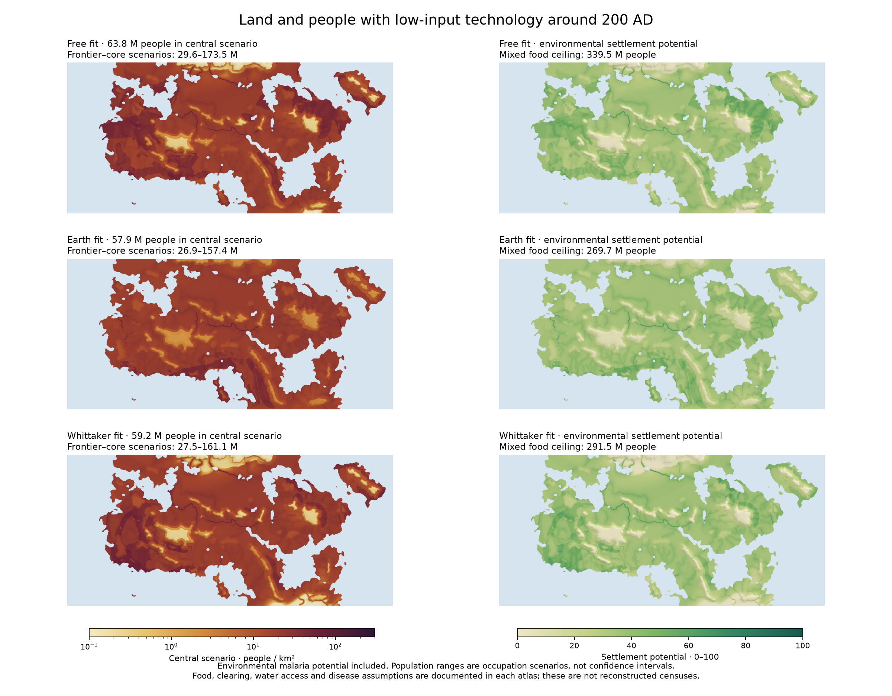

# Harvest, settlement and population in the climate atlases

This records the original Harvest integration and its original climate inputs.
The later Whittaker-coverage refinement regenerates its farming and population
outputs using the same Harvest assumptions; see
[the iteration report](ITERATION_20261022.md) for the updated results.

Harvest farming, ecology and campaign-sheet features are now integrated into
the normal free-fit, Earth-fit and separate Whittaker-fit atlases, alongside
combined settlement potential and population-density scenarios. The map selector
uses eight topics instead of a single wall of layer buttons. The climate and
calibration sources stayed frozen while the new analysis was developed in
`harvest/` and export scripts.

## Model choices

The base is the existing Harvest calculation: low-input wheat, barley, foxtail
millet, paddy rice and irrigated dates, with Hargreaves evaporation, a soil-water
bucket, crop temperature/heat requirements, FAO yield response to water, seed
retention, fallow and a calorie budget. The existing Han-plains calibration is
retained. Crops introduced in the Columbian Exchange and modern fertilizer
yield gains are not included. [FAO's crop-water relationship](https://www.fao.org/4/X5647E/x5647e0e.htm)
and the [Caloric Suitability Index](https://ozak.github.io/Caloric-Suitability-Index/)
support the production approach; our period yields remain explicit assumptions,
not GAEZ's modern yield raster.

Food capacity is distinct from realized population. [HYDE 3.2](https://doi.org/10.5194/essd-9-927-2017)
combines historical population totals and spatial allocation. [GLUES](https://doi.org/10.4000/geomorphologie.7756)
models population alongside technology, subsistence and resource availability.
Neither supplies a universal lookup from a biome to a census in 200 AD. The new
composite is therefore a declared settlement scenario, not a reproduction of
HYDE or GLUES or a validated demographic forecast.

Malaria's thermal component implements [Mordecai et al. (2013)](https://doi.org/10.1111/ele.12015),
equation 2 and all seven traits in Table 2. Daily survival is converted to
mortality using **−log(p)**; vector competence is converted from percent to a
probability. A fixed 0–45°C reference grid normalizes every map identically.
The rounded published coefficients give an optimum of 25.57°C, close to the
paper's reported 25°C, with negligible potential outside roughly 17–34°C.
[Ryan et al. (2015)](https://pmc.ncbi.nlm.nih.gov/articles/PMC4700390/) supports
mapping this relative physiological potential and seasonal duration, distinct
from infection incidence.

The thermal curve receives an explicit rainfall/irrigation moisture gate:
smooth rain response from 0 to 80 mm/month, or 0.75 of the irrigated fraction,
whichever is larger. The rainfall limits follow [Craig et al. (1999)](https://pubmed.ncbi.nlm.nih.gov/10322323/);
this hybrid is not the full MARA model. Annual potential averages the twelve
monthly values; season length counts months at least 25% of the optimum. It
does not presume that a cold winter eliminates all seasonal malaria.

## Population scenarios and settlement potential

The full parameter set is `data/harvest_model.json`; references are in
`data/harvest_sources.json`. Every atlas exports both, plus `crop_model.json` with the crop coefficients actually used.

Grazing is a separate forage-energy allowance on land reserved from cropping.
Miami NPP is converted from g dry matter/m²/year to kg/km²/year, multiplied by
an aboveground fraction, biome-dependent edible forage share, 25% sustainable
use, non-cropping land share, and 100 human kcal per kg consumed forage, then
divided by the same annual calorie need as crops. The [forage carrying-capacity
budget](https://doi.org/10.1002/ece3.5786) is published; the NPP partitions and
human-food conversion are uncertain scenario assumptions. Grazing is not added
on top of the land already reserved for fields.

Let C be crop capacity and G the grazing allowance, both in people/km².
Usable food is U = C × biome crop-realization factor + G. The biome factor
represents clearing and management effort, not a measured fertility value.
Outside-diagram biomes receive a neutral crop adjustment. River access A ranges
from 0.75 far away to 1 next to water, with a 20 km decay length. The health
factor H = 1 − 0.35 × annual malaria potential is an explicit population
scenario assumption, not a measured mortality relationship. An absent-malaria
scenario uses H = 1.

Expected density is **U × A × H × occupation fraction**. Frontier, central and
settled-core occupation fractions are the 20th, 50th and 80th percentiles of
historical population / crop-capacity ratios in the existing Earth comparison,
excluding the fitted Han plains. Geometric midpoints represent population
ranges, and ratios above one are clipped at one. The resulting fractions are
0.1365, 0.2938 and 0.7994. These are historical analogues, not statistical
confidence intervals; the same old Earth data do not validate this new model.

The dimensionless settlement-potential index is
**100 × U / (U + 100 people/km²) × A × H**. It combines food and environmental
constraints on a fixed scale, independent of the occupation scenario. It is
not a quality-of-life or human-development index.

The original crop-capacity ceiling remains available alongside mixed food
capacity, grazing, the combined index and density scenarios. Cities, imports,
fishing, soil nutrients, floods, wars and epidemic shocks are not modeled.

## Published maps and interactions

Each atlas adds thirteen layers: crop food capacity, mixed food capacity,
grazing allowance, food per hectare, growing season, irrigation reach, wild
productivity, rain/evaporation, malaria potential, malaria season, staple crops,
expected density and settlement potential. Farming and health/ecology have
separate map topics. Overview includes both composite maps alongside Köppen
and Whittaker biomes. Related climate controls, monthly playback and fit checks
remain available. The visible selector has at most seven layer buttons.

Frontier, central and settled-core occupation and environmental/absent-malaria
choices update the map, place card, global summary and province totals together.
The settlement-potential index does not depend on occupation. Shared links and
links between fits preserve the selected layer and scenarios. Density and index
maps use the same fixed colour limits across all three fits.

Place cards include all five staple yields, the winning crop, second-crop
availability, irrigation, growing period, NPP, aridity, food components, disease
potential and settlement scenarios. The actual winning crop pair now supplies
the labels; previously an improved pair could retain an unrelated single-crop
label. Province tables can be sorted by name, population, density, food or sheet
wealth; selecting a province highlights its hexes. Sheet settlement/wealth,
per-hex provenance, the inherited Earth crop reference, methods, assumptions and
CSV exports are included. Sheet values are not inputs to the model.

## Resolution, conservation and provenance

Each fit is derived from its own exported T12, P12 and D12 at native downsample 8.
Monthly bins begin at the winter solstice; the solar calculation therefore uses
solstice day 0, and the twelve seasonal lapse rates correct surface temperature.
The coarse sea-level fields are bilinearly interpolated to the 1,000 × 463 land
analysis grid. Station cards retain their existing nearest climate-bin lookup,
so a station and an interpolated land cell can differ slightly. This analysis
grid is coarser than the original Harvest grid; it does not add independent
simulated weather detail. Images are displayed at 2,000 × 926 source pixels.

Area totals retain the exact land fractions of each 2 × 2 source block. Province
and hex means are land-area weighted, and the province totals conserve the
map-wide food and population budgets. Fields use a separate packed Harvest
packet, mostly uint16 with per-field scale/offset; real zero is distinct from
missing/ocean. The core climate packet remains intact. Every atlas includes
source hashes, exact scenario coefficients, crop coefficients, historical
analogue inputs and downloads. Re-exporting checks climate/source fingerprints
and repairs missing derived files.

## Results

All fits cover **3.291 million km²** of drawn land. With environmental malaria
potential included, their scenario totals are:

| Fit | Mixed food ceiling, M | Frontier people, M | Central people, M | Settled-core people, M | Central with malaria penalty removed, M |
|---|---:|---:|---:|---:|---:|
| Free | 339.5 | 29.6 | 63.8 | 173.5 | 70.9 |
| Earth | 269.7 | 26.9 | 57.9 | 157.4 | 61.6 |
| Whittaker | 291.5 | 27.5 | 59.2 | 161.1 | 63.8 |

These wide ranges describe alternative occupation histories, not statistical
uncertainty intervals. Environmental conditions cannot reconstruct political
history or actual settlement by themselves.

## Checks

Seven focused tests pass: malaria thermal limits and fixed normalization,
rain/irrigation gating, food/disease budget bounds, correct crop-pair labels,
portable zero/ocean encoding, seasonal interpolation/lapse and coastal/province
area conservation with strict JSON serialization. Each atlas's exported packet
also passes finite-value/range checks, food budgets, exact scenario totals,
province conservation, image integrity, CSV totals and source fingerprints.

All three pages pass desktop/mobile Chromium checks, including scenario round
trips, map image changes, readouts, province sorting/highlights, deep-link reload,
monthly controls and no mobile page overflow or JavaScript errors. Fresh-checkout
checks ensure complete assets are committed and binaries survive Windows-style
line-ending conversion. Final evidence is in `output/three_fit_20261022/`.

These checks establish implementation and packaging consistency. They do not
independently validate the composite as a forecast of ancient populations.
