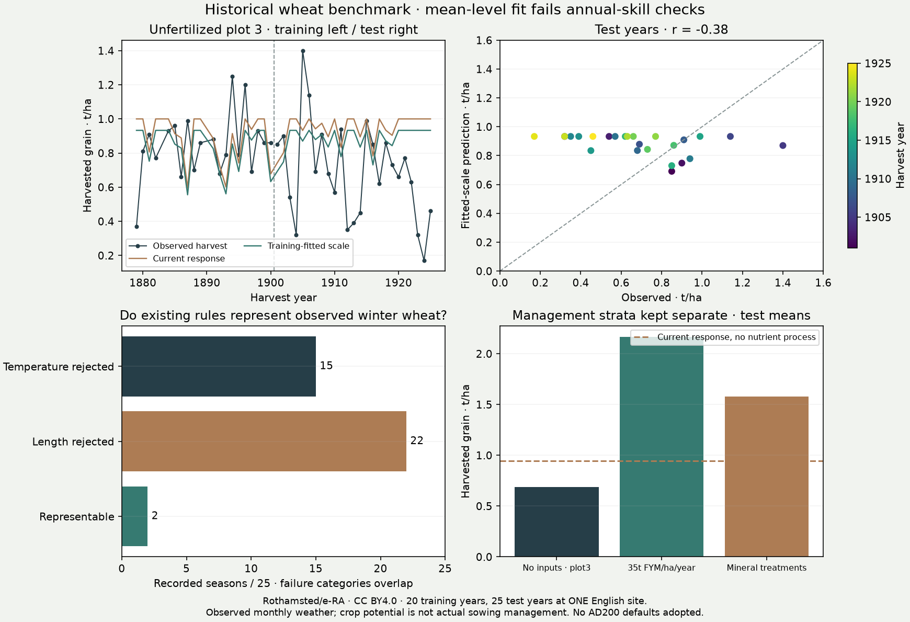

# Historical wheat: mean yield fitting fails the annual-response test

The first direct historical crop-yield benchmark **does not qualify a production
change**. On observed weather at Broadbalk, fitting a yield ceiling improves mean
absolute log error by 6.4%, but annual predictions correlate negatively with
recorded yields and perform worse than a constant training-period mean. This is
a crop-process test; it neither changes nor measures the climate simulator's
rainfall accuracy.

## Sources and matching

- Rothamsted Research (2021), *Broadbalk Wheat Experiment annual grain and straw
  yields 1852–1925*, [e-RA, DOI 10.23637/rbk1-1796346264-1](https://doi.org/10.23637/rbk1-1796346264-1).
- Perryman, S.A.M. & Scott, T. (2025), *Monthly and annual air temperatures at
  Rothamsted1878–2024*, [DOI 10.23637/rmsMAAirTemp1878-2024-01](https://doi.org/10.23637/rmsMAAirTemp1878-2024-01).
- Perryman, S.A.M. & Scott, T. (2025), *Total Monthly and Annual Rain at Rothamsted
  March1853–2024*, [DOI 10.23637/rmsTMArain1853-2024-01](https://doi.org/10.23637/rmsTMArain1853-2024-01).

All are Electronic Rothamsted Archive / Rothamsted Research distributions under
CC BY 4.0. The pinned [manifest](../calibration/low_input_yields_20261105/sources.json)
retains URLs, DOI, attribution, sizes and SHA256. Public static distribution URLs
are advertised in the provider's JSON-LD. No protected API, account or personal
information was used. These transformations and conclusions are ours.

Observed wheat grain is **already t/ha/year**, at field moisture, approximately
85% dry matter but not measured. This unit appears in the workbook's
`fields_metadata` even though the JSON field schema omits it. We do not divide
it by area again or deduct seed, milling, storage or calories. Subplot means are
area-weighted within treatment/year. The predicted edible-energy output is
converted back using its own seed/edible/energy factors, leaving gross grain.
The model's grain moisture basis is itself an approximate period assumption;
this is not a precise dry-matter calibration.

Plot3 is the primary, continuously unfertilized comparison; every FYM, rape-cake
and mineral factor must be `nil`. FYM-only, mineral-only and other treatments are
separate diagnostic strata and never enter parameter selection. Annual 35 t/ha of
FYM is intensive organic fertilization, not a generic ancient low-input analogue.
Current-input labels on other plots do not establish their historical nutrient
stocks. Long-term continuous unfertilized cultivation differs from rotations,
fallowing, livestock integration and organic recycling around AD200.

## Frozen protocol and disclosed amendment

The [original protocol](../calibration/low_input_yields_20261105/plan.json) and
source identities were committed in `0ffa8aac` before numerical yield inspection
or scoring. A complete-temperature-record rule left only 15 eligible training
years, below the declared 20-year minimum; selection refused to run. Availability
checks found mostly single missing daily readings in provider monthly means,
and an impossible source date: harvest 1883, sowing 1886-11-06. That date is excluded,
not silently corrected to an inferred year.

The [metadata-only amendment](../calibration/low_input_yields_20261105/amendment.json)
was committed in `0e016777`, still before numerical yield inspection/scoring. It
accepts provider monthly temperature means with at most one daily reading missing
per month and retains a complete-record test subset without refitting. The fold
dates, input strata,20-year minimum, candidate bounds and qualification rules are
unchanged. This is a disclosed pre-scoring revision, not a claim that the initial
protocol passed unchanged. Training selection, code and complete identities were
committed in `67b7aa1c` before evaluation.

There are 20 eligible primary training years during 1879–1900 and 25 evaluation years
during 1901–1925. Years 1883 (invalid source dates) and 1890 (incomplete temperature)
are excluded. All treatments in a year share a fold. The same physical plot is
observed in both periods: this is **temporal transfer at one site**, not spatial
or household-panel independence. These 45 years are not 180 independent weather
experiments merely because there are four management aggregates per year.

Monthly temperature means use the **Mean** block in each of the mean, maximum
and minimum temperature worksheets. Using monthly extremes for diurnal range
would substantially overestimate Hargreaves evaporation. Rainfall retains the
provider's documented RAIN5 substitution during 1880–1914. Missing daily rain counts
are flagged: the provider says many gaps are traces below 0.05mm, but we do not
assert all gaps are traces. `0.05 × missing days` is a conditional trace-only
sensitivity bound, not a guaranteed rainfall error bound. Missing temperature
days are exposed separately.

## What is actually modeled

Observed weather drives existing wheat temperature, heat-sum and water-response
equations. Earth tilt 23.44°, winter-solstice day 355, observed mean daily Tmax–Tmin
and the existing Hargreaves implementation supply reference evaporation. The
100 mm reference-soil bucket runs chronologically from half-full in January 1878.
It is not a root-specific crop-water ledger and evaporation is not station-observed.

Every crop-year contains **September of the preceding year through August of the
harvest year**. Candidate 4–9-month windows cannot wrap past the end or recycle a
future autumn into the previous sowing period. This adapts the current response
to chronological observations; it is not a byte-identical invocation of the
production cyclic-climatology schedule. The best-window output is environmental
capacity, not a prediction conditional on the observed sowing/harvest dates and
not a prospective forecast. One observed test harvest falls outside the fixed
crop-year; that mismatch is disclosed, not fixed after scoring.

The candidate fits only one positive grain multiplier over 401 logarithmically
spaced values from 0.25 to 4. Absolute log10 error floors both observed and predicted
yield at 0.05t/ha, retaining zero outcomes. Every declared value is scored on the
training years; ties favour proximity to 1. The optimum is global **over that
finite one-dimensional set only**. It says nothing about the global optimum of
the climate/coupled model or the adequacy of its equations.

## Complete primary result

The selected multiplier is **0.933**, with a training mean observation of 0.8445t/ha.

| Evaluation: 25 unfertilized wheat years | Current response | Training-fitted scale |
|---|---:|---:|
| Mean absolute log10 error |0.2129|0.1993|
| Mean absolute error, t/ha |0.3369|0.3054|
| RMSE, t/ha |0.4084|0.3691|
| Pearson correlation |−0.378|−0.378|
| RMSE skill against constant training mean |−27.6%|−15.3%|
| Within a factor of two |76%|76%|
| Observed mean, t/ha |0.6876|0.6876|
| Predicted mean, t/ha |0.9455|0.8821|

The minimum sample sizes and 5% log-error improvement pass. Positive correlation
and positive RMSE skill fail. **The candidate is rejected even as the specified
temporal comparator.** This avoids qualifying a mechanism merely because its
average moved closer. The 23 complete-temperature test years also have negative
correlation (−0.358) and negative fitted-model RMSE skill (−14.5%).



Observed sow-to-harvest months expose a separate structural limitation. Only
**2/25** test seasons fit the existing wheat temperature/length/heat rules.
Twenty-two exceed the 4–9-month length bound and 15 fail the requirement that every
month stays between 3°C and 24°C; these groups overlap. Monthly boundaries and
partial sowing/harvest months limit precision. This is not a daily phenology
validation, nor proof that dormancy alone explains the negative yield correlation.

The same site's evaluation means are 0.688t/ha unfertilized, 2.165t/ha FYM-only and
1.578t/ha across mineral-only treatments. These contrasts motivate explicit
management processes; they do not identify a universal nutrient multiplier or
justify assigning modern fertilized yields to AD200. All stratum scores, including
their deterioration under the unfertilized scale, remain in the result packet.

## Next physics work and adoption boundary

The useful next change is a **chronological crop-water budget**, before another
yield multiplier: one evolving store, crop transpiration separated from bare-soil
evaporation, explicit drainage, and stress applied to transpiration. Allen et al.
(1998), *Crop evapotranspiration*, FAO Irrigation and Drainage Paper 56,
[Chapter 8](https://www.fao.org/4/x0490e/x0490e0e.htm), equations 80–85, distinguishes
root-zone available water, readily available water and transpiration stress.
[Chapter 9](https://www.fao.org/4/x0490e/x0490e0f.htm) explains sparse vegetation and
why exposed-soil evaporation can remain important when crop cover is reduced.
Those are published relationships, not calibrated coefficients for our world.

First verify water conservation and the inability to spend the same soil water
twice. Then test timing/phenology against actual winter seasons: a dormant month
cannot simply invalidate an otherwise viable winter cereal, but the previously
failed chilling-clock candidate is not reinstated by this result. Documented
soil, sowing, cultivar, nitrogen/manure and weed histories should constrain the
next candidate. Waterlogging or nutrient limitation are hypotheses to test,
not post-hoc explanations established here.

This Broadbalk pool is now spent evaluation data. Later mechanism development
may use it explicitly as development data. The pinned Woburn wheat/barley files
remain **unscored**, pending matching local weather: Rothamsted station weather
must not silently become observed local weather at Woburn. Public Hoosfield
aggregate means were seen during source discovery and cannot be called untouched.
Reserved climate set f is not accessed.

No production crop, climate, demographic, settlement or control defaults change.
When a replacement process qualifies, its retained grain must feed the existing
shared rural/resident/institutional allocation, not an independent population map.

## Reproduction

```sh
python -I scripts/benchmark_earth_yields.py --stage fetch
python -I scripts/benchmark_earth_yields.py --stage prepare
python -I scripts/benchmark_earth_yields.py --stage select
# Selection and producer code must be committed before evaluating.
python -I scripts/benchmark_earth_yields.py --stage evaluate
python -I scripts/check_earth_yields.py --raw data/cache/era_low_input_20261105
python -I scripts/publish_earth_evidence.py
python -I scripts/build_fit_hub.py
```

The [public replay packet](../atlases/earth_evidence/data/yields/cases.json.gz),
[scores](../atlases/earth_evidence/data/yields/evaluation.json),
[selection](../atlases/earth_evidence/data/yields/selection.json) and
[CSV](../atlases/earth_evidence/data/yields/observations.csv) are in the normal
atlas bundle. Independent metric/grid replay matches both periods and all
management strata; optional raw matching checks provider grain, hectares and
dates. It does not claim independent verification of every physical equation.
The original frozen producer code remains in Git 67b7aa1c.
