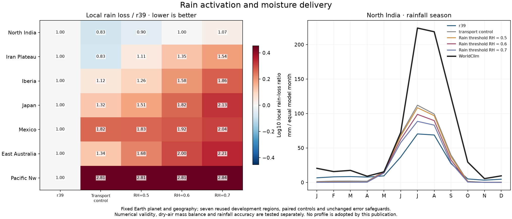
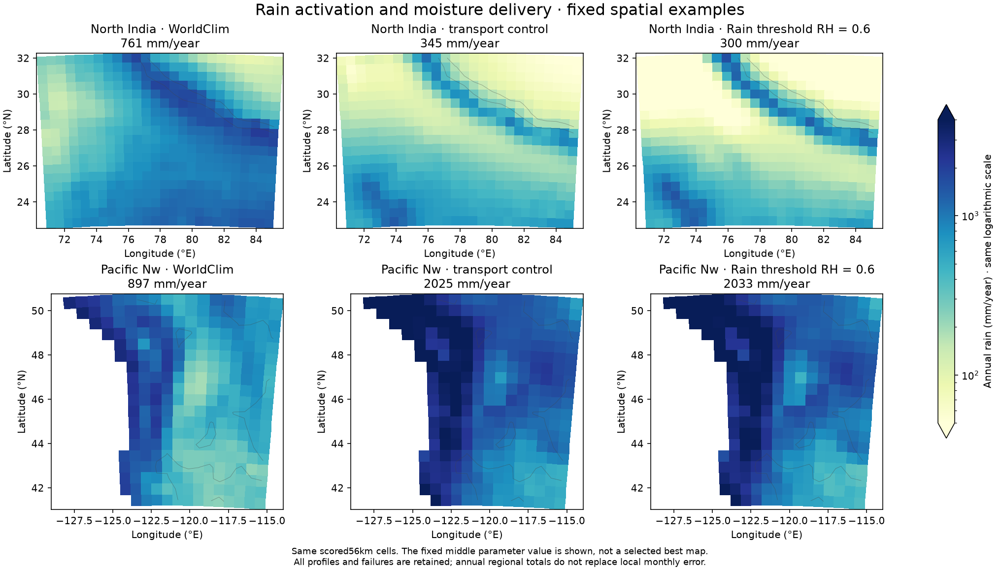

# Bounded rain-activation trial on common-mass transport

Raising the generic rain-activation humidity threshold does not solve the
remaining rainfall problem. The fixed transport control gives43.67mm local
monthly rain MAE in North India; thresholds.5/.6/.7 worsen it to45.41–49.76mm
and leave regional regressions elsewhere. No candidate qualifies for adoption.

This follow-up was declared before the preceding common-mass pilot completed.
It fixes that transport's middle upper/lower specific-humidity ratio.2 and1km
lower thermal shear. Only `rh_threshold` changes from.3677449 to the three
fixed values. There is no regional multiplier, new humidity ratio, precipitation
timescale change or altered Earth planetary forcing. The generic threshold
uses the model's approximate saturated-column capacity; it is not a measured
cloud-base relative humidity. The purpose was to test actual coupled moisture
delivery after delayed rainout, rather than rescale old rainfall offline.

All35 integrations pass strict numerical checks:7 original r39 controls and7
common-mass transport controls reproduce their archived fields exactly, then21
candidate integrations run. Three native wind controls are included in the
original controls. All non-original profiles use the same declared.05/1024
numerical work at unchanged.01 moisture-residual/linear/temperature tolerances.
Mass, branch speed, common-tracer, ocean, outside-wind and regional rain/T
protections remain. No full31/fine/established6 stage runs after failed screens.

Plan `calibration/humidity_gate_20261026/plan.json`; unchanged core source
`38bc4e1`; results/hashes `output/humidity_gate_20261026/`. The focused model
suite remains164 passing tests, with no core change during these trials.
Earlier failures and the previous pilots remain intact. These are reused
development regions, not an independent validation set or new city/global
accuracy headline. Adopted r39 and the r38 fantasy Earth atlas remain unchanged.

The result motivates calibrating shared wind/pressure/friction parameters on
the corrected water equations rather than compensating through rain thresholds
or changing the planet away from Earth. A separate fixed eight-point design
uses bounded drag, trade/westerly speed and temperature-pressure amplitudes,
keeping water/rain settings and Earth forcing fixed. It retains every current
qualification gate and stops if frozen sources change. Eight combinations are
an exploratory design, not proof of an optimum.

