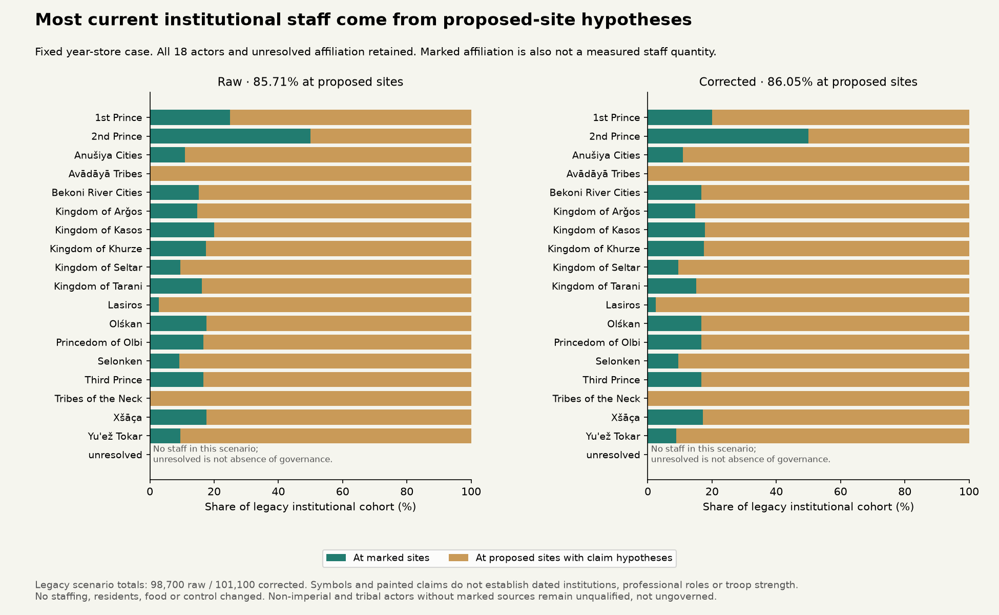

# Provider assumptions and Earth institution evidence, 11 November 2026

The current service illustration is dominated by hypothetical providers:
85.71% / 86.05% of year-store institutional staff in the raw/corrected atlas are
assigned to proposed settlements with painted-claim affiliations. Better routes
alone would preserve that assumption. Provider types, evidence and staffing need
qualification before these service calculations become operational control maps.
This audit changes no residents, food, staff, settlements or physics (still r44).

Protocol [831d0b11](../calibration/institution_evidence_20261111/plan.json) preceded
new provider fields and Polaris workbook values. It declares source preparation
and an assumption audit, **not** institution fitting or model-score evaluation.

## What the current atlas assumes

|Year-store scenario|Raw climate|Corrected climate|
|---|---:|---:|
|Existing marked/proposed sites|1,034|1,053|
|Marked sites|151|151|
|Unresolved affiliations|12|12|
|Legacy institutional cohort|98,700|101,100|
|At marked sites|14,100|14,100|
|At proposed sites with claim hypotheses|84,600|87,000|

The legacy allocator reserves a 100-person institutional cohort at an affiliated
candidate if the same food pool can also support a civilian community. Food
feasibility does not establish that the institution exists, has that workforce
or emits political authority. Marked affiliation likewise is not a measured
staff quantity. A monastery is not automatically a garrison, a fortified town
is not necessarily a professional military unit, and a proposed settlement does
not prove an administrative office.

All 18 actors and unresolved affiliation are retained, including tribal and
non-imperial actors. A group lacking marked institutional sources remains
unqualified, not ungoverned. Source channels can overlap; they are not quantities
of independent institutions or inhabitants. Binary patrol reach currently lacks
an explicit labour claim, and collection throughput lacks explicit crew/draft
hours. Neither activity can silently reuse a service workforce for free.

## New Earth source: what can be calibrated

Turchin et al. (2018), *Quantitative historical analysis uncovers a single
dimension of complexity that structures global variation in human social
organization*, PNAS 115:E144–E151,
[10.1073/pnas.1708800115](https://doi.org/10.1073/pnas.1708800115), describes
separate settlement, administrative, military and religious hierarchy variables
and specialist positions. Its polity unit includes independent local communities
through empires. We use that variable separation and source practice here, not
a single complexity score to rank the fictional world's societies or predict
their technological development from climate.

The [Seshat codebook](https://seshatdatabank.info/methods/code-book) makes distinctions
that matter directly to this model. Administrative hierarchy counts people or
decision levels, so it must not simply copy settlement hierarchy. Full-time
bureaucrats can be absent where generalists perform administrative work. Buildings
alone do not establish professional bureaucracy. Unknown, inferred evidence and
uncertain or disputed transitions have distinct meanings; they cannot all become
zero. Relevant codebook and article sections were checked against pinned private text copies.
Exact identities are in the [source manifest](../calibration/institution_evidence_20261111/sources.json).

The official [data page](https://seshatdatabank.info/data) links Polaris2026.xlsx.
Repository commit `55ca5fbc2b563ddbbc1a3413071d4bd243d0a5fa` is pinned. The
2,899,093-byte workbook contains eight sheets and 626 unique polity keys.
Ten institutional/hierarchy variables contribute 5,007 preparation records.
Every target record joins to its exact polity key; no fuzzy name matching occurs.

|Variable|Records|Missing explicit time bounds|Unmapped codes or malformed values|
|---|---:|---:|---:|
|Professional military officers|472|439|1|
|Professional soldiers|499|446|1|
|Professional priesthood|463|453|1|
|Full-time bureaucrats|492|470|3|
|Specialized government buildings|478|470|0|
|Administrative levels|570|526|0|
|Religious levels|445|435|0|
|Military levels|448|422|1|
|Settlement hierarchy|563|528|0|
|Largest settlement population|577|322|2|

The preparation preserves presence codes, inferred states, numeric ranges,
missing values, flags and separate observations. It does not take range midpoints
or assign an ancient workforce from a presence indicator. Coded professional
absence is not absence of governance or service activity.

## Gates before a dated comparison

There are 4,511 records without a complete explicit row-level time interval. The release
notebook copies API year fields, but that does not establish whether null bounds
mean a whole-polity scope or missing chronology. We retain them without silently
inheriting parent dates. Literal exported intervals covering positive year 200
are diagnostic counts, not a validated AD200 sample. BCE/zero-year conventions
are not harmonized. Next resolve the source/API default-date semantics and
narrative provenance before defining dated development/transfer comparisons.

Six categorical codes (`SA` and `A~P`) remain unresolved by this adapter.
Transition-like values must not become ordinary unknowns or point probabilities
without verifying the export convention. One population range is reversed; one
population and one military-level record have incomplete/unhandled value shapes.
Ten explicit intervals extend outside the exported parent span. Repeated
observation keys and differing flags/values are preserved rather than treated as
duplicate errors or collapsed. These are review items, not outcome-tuned exclusions.

The Variables sheet also maps canonical `professional_military_officer` to
“Professional Lawyers” in its legacy Equinox alias column. That suspicious
cross-release mapping is not used for joins. Canonical current variable/API names
remain explicit. The pinned release code was inspected as text and not executed.

The repository licence says MIT for software and associated documentation. That
wording alone is not taken as a separate raw-data redistribution licence: the
workbook, third-party text and release code stay in the private cache. Only our
aggregate audits and provenance are published. Preparation exposure is recorded;
this source is not labelled sealed, independently validated or scored.

## Checks and downstream work

The independent review reconstructs all eight sheet counts and all 5,007 target
state/date/duplicate summaries, verifies 38 actor/cohort records across both
climates and compares four atlas inputs byte-for-byte with d27700b2. Parser tests
keep unknown/inferred/absence distinct, preserve numeric intervals and reject
silent date filling. These are preparation and accounting checks, not calibration.

Next resolve the Earth source gates, compile provider role/evidence/time separately
from staffing quantities, and declare actual institutional development/transfer
comparisons before scoring. Scenario bounds can retain hypothesized providers
without presenting them as observed institutions. Monthly provider routes and
shared collection/patrol/service commitments follow that distinction. All future
qualified settlement/control consumers must share the same people, food and staff
ledger. The complete S1c/d/e and S2–S5 programme remains on the roadmap, including
unaffiliated, mobile and nonstate communities.
