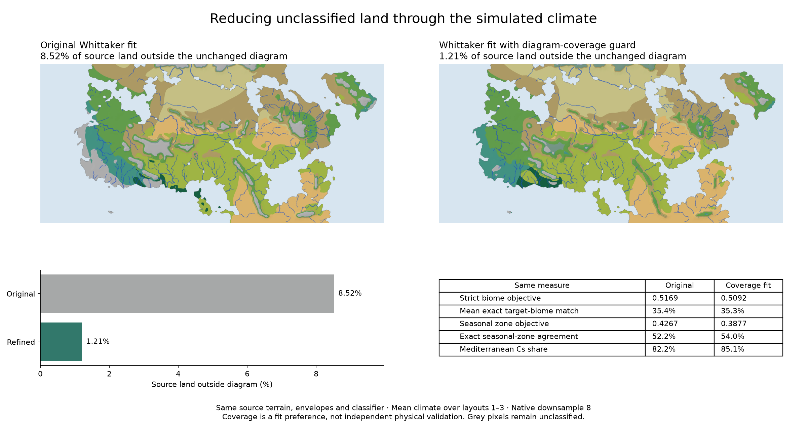

# Iterative improvements after the three-fit publication

## Milestone 1: certify every direct linear solve

The SciPy-only backend previously marked any finite result as converged, even
when its residual exceeded the requested tolerance. It also did not enforce
`solver_require_convergence`. The direct recovery used by the Numba backend
already checked the interior equation, but omitted an explicit boundary check.

Both direct paths now use the same certificate: maximum diagonal-scaled interior
equation residual and prescribed-boundary error, bounded by the original
boundary-scaled requested tolerance plus the existing floating-point roundoff
allowance. No physical constants, discrete operator or tolerance were changed.
Failed certificates remain failed in observed numerical diagnostics. Strict
runs raise; permissive runs warn once. Nonfinite direct answers record failure
before raising.

47 focused checks pass, including manufactured variable-flow solutions for both
transport stencils, deliberately inaccurate interior and boundary results,
nonfinite outputs, capped-sweep recovery, temperature retries and existing core
checks. Evidence: `output/iteration_20261022/solver_certificate.json`.

The published nine main-map layouts used no direct solves. Their climate assets
and original provenance stay unchanged; this milestone does not claim new fit
accuracy or rerun the completed calibration campaign. Existing frozen campaign
manifests correctly retain the sources of their original builds.

## Milestone 2: make Whittaker diagram coverage a selection constraint

The published Whittaker fit leaves **8.5215%** of source-map land outside the
unchanged diagram (5.9778% on its coarser model grid). Its former objective
measured target-biome match and had no explicit penalty for total map coverage.
The outside pixels include cold/wet mountains and wet mild lowlands; their
median annual rainfall is 3,223 mm and their median elevation 2,346 m. The full
baseline diagnosis is `output/iteration_20261022/outside_baseline.json`.

`whittaker-covered` is a separate objective. It retains the strict crosswalk
score and subtracts an all-land outside-area penalty plus capped distance debt
to the union of the original polygons. Its coverage includes unpainted land
and source-resolution terrain. The annual interpolation is algebraically
identical to the renderer's monthly-field average, without allocating twelve
full-size maps; it exactly reproduces the published baseline outside share.
Old objectives and biome classification remain unchanged. No fields are clipped
or grey cells assigned a nearest biome.

Coefficients and publication gates are explicit in `data/whittaker_coverage.json`:
1% outside allowance, area weight 2, distance weight 0.1, and publication gates
of at most 2% outside land with a strict biome objective at least 0.46. These
are scenario-selection preferences, not physical laws or newly observed data.
25 focused coverage, crosswalk, classifier and calibration checks pass,
including invalid land, unpainted land, distance gradients, annual rendering
and per-layout objective aggregation.

The bounded physical screen in `scripts/refine_whittaker_coverage.py` compares
seven predeclared humidity/lapse/orography profiles over layouts 1–3 at ds32,
then two profiles at ds16. It preserves source and parameter hashes, numerical
certificates and failed cases. Native ds8 verification and atlas publication
are separate gates; the existing atlas stays active until they pass. The free
and Earth fits are unchanged. Training layouts are reused, so this measures
fit and scenario sensitivity rather than independent predictive validation.

## Milestone 3: resolution checks and a bounded follow-up candidate

All seven coarse scenarios and both ds16 refinements completed with successful
observed numerical certificates. The three-layout *mean climate* is classified
in these comparisons; scores are not averages of per-layout classifications.

| Candidate | Weather grid | Source land outside | Strict biome objective | Coverage-aware score |
|---|---:|---:|---:|---:|
| Baseline | ds32 | 6.5670% | 0.529402 | 0.413401 |
| RH 0.78, lapse 4.5 | ds32 | 0.9400% | 0.526837 | 0.526763 |
| RH 0.72, lapse 4.0, orography 1.75 | ds32 | 0.0012% | 0.486326 | 0.486326 |
| RH 0.78, lapse 4.5 | ds16 | 1.9008% | 0.520525 | 0.500882 |
| RH 0.72, lapse 4.0, orography 1.75 | ds16 | 0.2788% | 0.492701 | 0.492551 |

The original screen winner remains recorded as RH 0.78 / lapse 4.5. Its coverage
worsens with grid refinement and nearly exhausts the 2% publication ceiling.
A follow-up native candidate therefore uses RH **0.75** (between the screened
0.72 and 0.78), lapse **4.5 K/km**, and the original orography coefficient.
This is an adaptive next experiment, not a retroactive change to the frozen
screen protocol or a claim that this exact midpoint passed ds16 already.
Native ds8 verification must meet the same coverage and strict-biome gates.
The chosen lapse is close to the retained Earth r29 lapse, 4.414 K/km; the Earth
fit itself is untouched.

The complete cases, source hashes, selection record and explicit follow-up
parameters are under `output/whittaker_coverage_20261022/`. Sources of the frozen
screen are captured at commit `03e7d56`. Native publication now has explicit
`--max-outside` and `--minimum-biome-score` gates. The standalone verifier
correctly rejects the old 8.52% atlas against a 2% limit. The comparison hub
also shows actual source-land outside shares for all three fits.

## Milestone 4: native diagram coverage with a small biome-score tradeoff

The follow-up RH 0.75 / lapse 4.5 K/km candidate passes the unchanged native
publication gates on the mean climate over layouts 1–3 at downsample 8.
Only ocean-source humidity and lapse rate change from the original Whittaker
fit. Terrain, elevation tiers, painted targets, all other physical parameters,
envelopes and classifier are retained. Free and Earth atlas files are unchanged
from the original publication (`9a0a456`).

| Same native measure | Original Whittaker fit | Coverage fit |
|---|---:|---:|
| Source land outside diagram | 8.5215% | **1.2104%** |
| Outside source pixels / 971,849 land pixels | 82,816 | **11,763** |
| Strict biome objective | 0.516885 | 0.509173 |
| Mean exact allowed-biome agreement | 35.3520% | 35.3130% |
| Seasonal zone objective | 0.426672 | 0.387694 |
| Exact seasonal-zone agreement | 52.2112% | 53.9600% |
| Mediterranean Cs share | 82.1977% | 85.1035% |

Outside area falls **85.80%**. The strict objective falls 0.00771 and exact
allowed-biome agreement changes only −0.039 percentage points. The seasonal
zone objective falls despite improved exact zone agreement: its continuous
climate-rule rewards measure a different property. This fit prioritizes annual
biomes and diagram coverage, rather than improving every seasonal measure.
The covered objective is 0.502426; it should not be compared directly with
the original strict objective, which omits the coverage penalty.

The unchanged source terrain provides a direct area comparison. **71,053**
formerly outside pixels now fall inside an envelope, mostly temperate rain,
temperate seasonal and boreal forest. No previously covered pixel becomes
outside in this pair of fits. The outside share below 500 m falls from 4.17%
to 0.25%; above 1,500 m it falls from 57.89% to 11.73%. Residual grey land has
a median elevation of 2,776 m. These are alternative simulated climates and
potential biome classifications, not a vegetation-change forecast.

The native layouts record **11,938** checked linear solves and **99** temperature
steps including spinup, with zero failed linear, temperature or moisture
certificates. Maximum reported temperature update is 0.04998°C, below the
unchanged 0.05°C criterion. Ten capped SOR solves recover through plain
Gauss–Seidel; no direct solve is needed. Full observed records are in
`output/whittaker_coverage_20261022/native_metrics.json`; same-terrain area
transitions and checkpoint hashes are in `field_diagnostics.json` alongside it.
As with the screen, these are reused fitting layouts, not independent
physical validation.

The promoted Whittaker atlas regenerates every climate, farming, health and
settlement layer, station series and seasonal animation from this climate.
The c.200 AD Harvest assumptions are unchanged. Its mixed food ceiling changes
from 291.5 M to 267.2 M; endemic-malaria population scenarios change from
27.5 / 59.2 / 161.1 M to **25.4 / 54.6 / 148.7 M** for frontier / central /
settled core. The central scenario without malaria changes from 63.8 M to
58.4 M. These are scenario capacities rather than reconstructed censuses.

Before promotion, export verification passes all 63 layer images, 11 climate
and 26 Harvest binary fields, 152 named places, 38 provinces and 2,227 campaign
hexes. All five seasonal animations decode with 25 frames. The native and
separate surroundings simulations both pass observed convergence checks.
Publication also verifies exact selected parameters and current source,
map-input, export and Harvest hashes. The predecessor is preserved locally;
the immutable original campaign artifacts and report tables are retained.

Desktop and 390 px mobile browser checks pass for all three active atlases and
the comparison hub, with zero page errors. They exercise biome and monthly
maps, place lookup, population scenarios, province controls and restored links.
A fresh Git-index checkout with `core.autocrlf=true` preserves all **253**
scientific binary, JSON and image assets byte-for-byte and serves through the
standard-library launcher. The same atlas and hub browser checks pass there.
Evidence is under `browser/`, `fresh_browser/` and `fresh_checkout.json` in
`output/whittaker_coverage_20261022/`.

