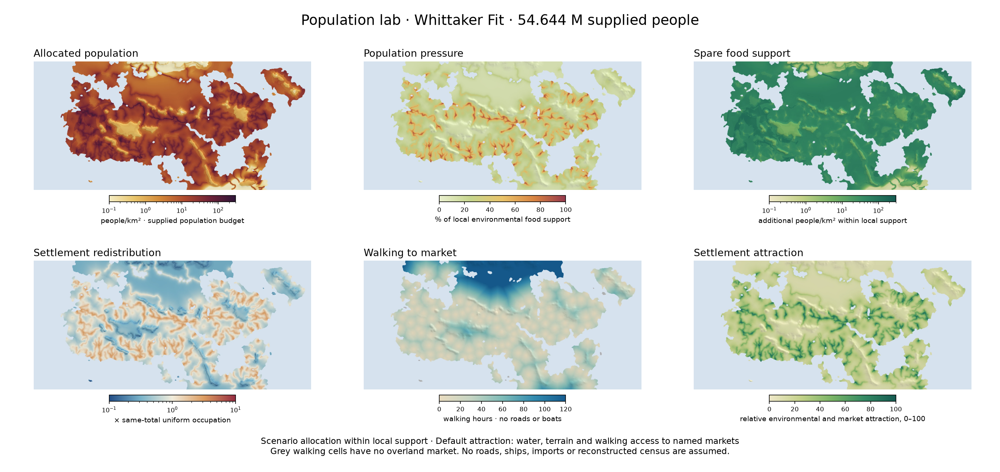

# Atlas and population development — 23 October 2026

## Milestone 1: controls follow the selected map

Occupation now appears only where changing frontier / central / settled core
changes the selected map. Expected density shows both occupation and malaria;
settlement potential shows malaria alone. Climate, crops and other static maps
hide both. Choices remain saved when controls disappear and survive shared links.
The rule compares the actual image variants rather than maintaining a list of
special layer names.

Each atlas also displays the outside-diagram percentage read from its loaded
metadata. The current repository's Whittaker data and local HTTP browser both
show **1.21%**, and the local launcher sends `Cache-Control: no-store`.
This identifies the loaded dataset; it does not claim that a separate hosted
copy or an older extracted bundle has been updated. The user confirmed the
Windows launcher and supplied an 8.5% screenshot: the loaded page or its local
data are old. The launcher now prints its actual folder and data percentages;
it never implicitly pulls Git or replaces a local bundle.

Desktop and mobile browser checks pass for all three active atlases, including
selector visibility, hidden-state persistence, population scenarios, province
controls and saved links. Evidence is in `output/iteration_20261023/`.

## Milestone 2: a population budget and six new maps

The Population topic adds allocated residents, population pressure, spare food
support, redistribution, walking to markets and settlement attraction. The
atlases now have 41 / 41 / 43 modes for free / Earth / Whittaker, grouped into
nine topics. Occupation stays hidden on these budget maps, where the total is
supplied directly; malaria appears only on the four maps whose support changes
with it. Budget and pattern controls disappear on the two static maps.

[HYDE 3.2 section 3.1](https://doi.org/10.5194/essd-9-927-2017) motivates
separating population totals from environmental allocation. This implementation
uses the fictional world's food support and explicit preference weights;
it imports neither an Earth raster nor HYDE coefficients.
[Tobler's walking model](https://escholarship.org/uc/item/05r820mz) supplies
signed-slope speeds with a 0.6 off-path factor. Shortest paths run **toward**
named markets, with directed uphill/downhill costs. The land graph excludes
water cells and blocked diagonal corners. Travel hours exclude rest, ships,
roads, bridges and seasonal closures. Coarse land cells cannot resolve every
small river crossing. Market names are fixed anchors, not inferred city sizes.

Each cell has support `C = Harvest environmental support × land area` and a
positive attraction `a`. Allocation solves `people = min(C, lambda × C × a)`
for the supplied total. Even occupation, water/terrain and market-access
patterns share the same local caps. A requested total above eligible support
is split into allocated and explicitly unallocated people. Pressure is the
allocated/support ratio; spare support is their difference. Redistribution is
relative to uniform occupation with the **same supported total**. These identities
prevent people or spare food being invented by switching maps.

The initial budgets are the existing central occupation estimates rounded to
1,000 people. They can be replaced freely in the browser. Province totals,
highlights, current-census CSVs, map copies and saved links follow the choices.
The hub links all fits with a common 50 M budget for direct comparison.

| Fit | Initial supplied population | Environmental support, malaria included |
|---|---:|---:|
| Free | 63.777 M | 217.086 M |
| Earth | 57.853 M | 196.921 M |
| Whittaker | 54.644 M | 185.998 M |

Support comes from the unchanged low-input c.200 AD food/biome/access/health
model. Its coefficients and this new allocation's preferences remain scenario
assumptions. Imports, urban densities above local support, historical political
change and epidemics are not simulated. This is an allocation experiment,
not a reconstruction or independent validation of ancient population.

Climate and original Harvest binary packets, fit parameters and summaries
remain byte-identical to `6d9435e`. Whittaker outside-diagram land stays at
**1.2104%**. The new packet records input and model hashes and checks its binary
SHA-256 before use. The native build pipeline also exports the population lab
after farming data, so future climate builds regenerate it.

Nine Python and four JavaScript model checks pass, covering analytic allocation,
conservation, caps, zero and excess budgets, invalid input, walking direction,
water barriers and duplicate market anchors. Data validation exercises 18
budget/pattern/disease combinations per atlas. Browser checks exercise all six
maps, 10 M / 20 M / 500 M budgets, CSV conservation, province selection, disease,
saved links and mobile layout in every fit. Existing climate and Harvest browser
checks also pass. Evidence is under `output/iteration_20261023/`.

A fresh staged checkout with `core.autocrlf=true` preserves all **280** scientific
binary, JSON and image assets byte-for-byte. Its standard-library launcher
reports 41 / 41 / 43 modes and **1.21%** Whittaker outside land. The complete
population browser suite also passes against this independent copy, including
the expanded province table on a 390 px mobile viewport. The portable archive
contains all three complete atlases and the updated Windows/macOS launchers.

