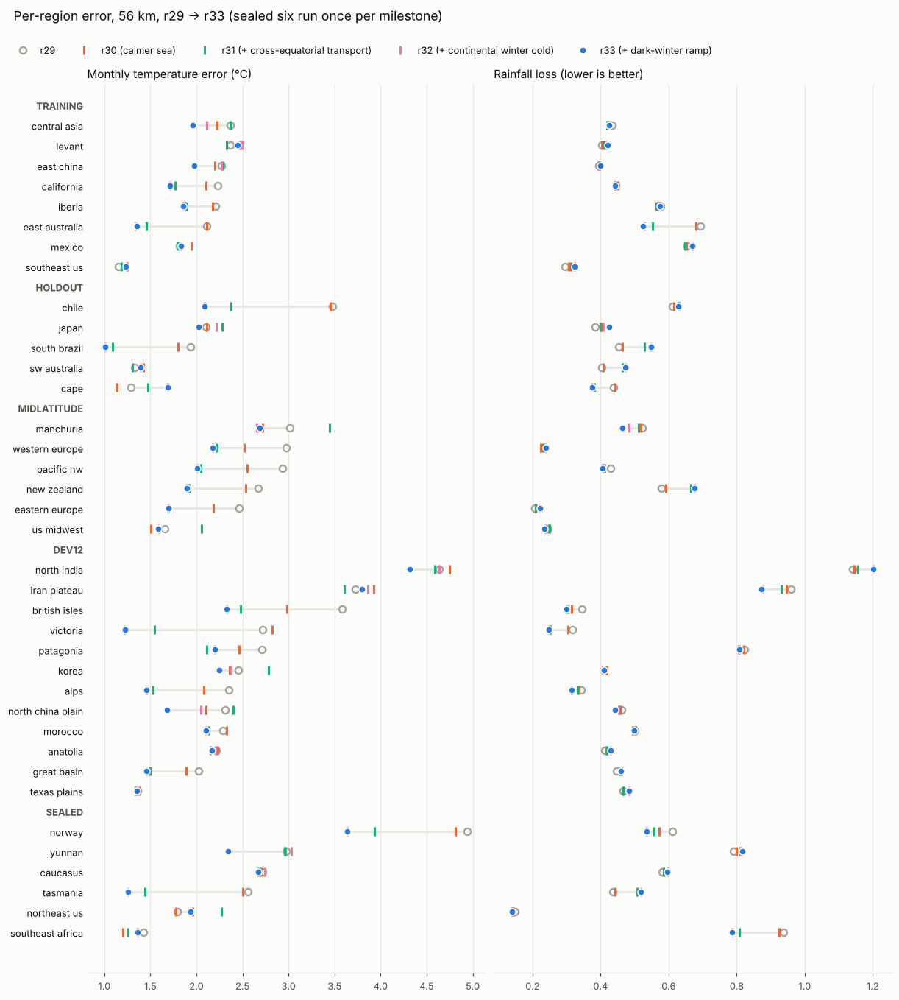
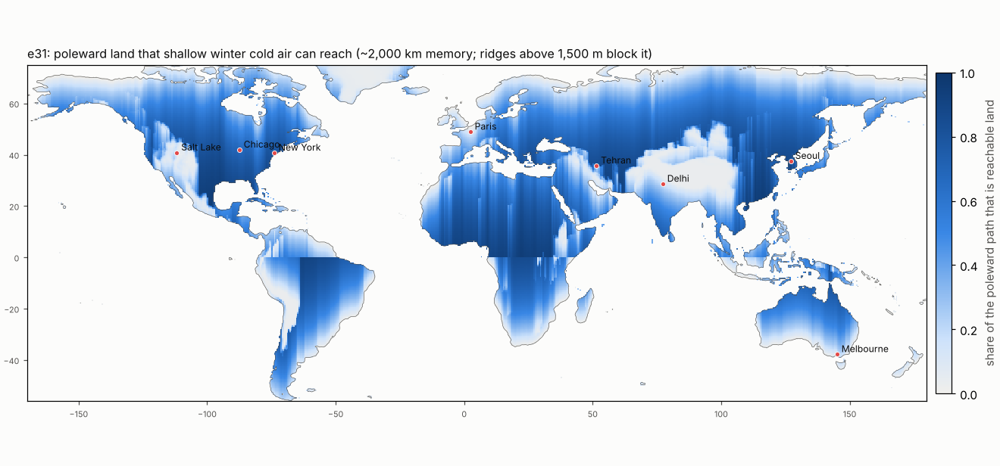
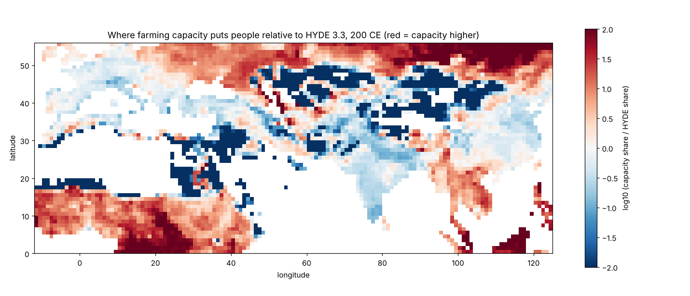

# Local accuracy iterations — 23 October 2026

Plan: [PLAN_LOCAL_ACCURACY_20261023.md](PLAN_LOCAL_ACCURACY_20261023.md). Gate:
`calibration/local_accuracy_20261023/policy.json` (score S = half monthly
temperature error, half rainfall loss, each relative to r29; adopt only if S
improves by 0.5 % over all 19 regions and in no group gets worse).

## Iteration 1: seasonal timing of temperature

The largest temperature error is the seasonal shape (55 % of squared monthly
error). Fitting the first annual harmonic per cell, the model's seasons peak
late in mid-latitudes: by 37 days in New Zealand, 35 in western Europe, 20
in the Pacific Northwest, 15 in eastern Europe, 13 in Chile and the Cape.
Western Europe's spring is 4–5 °C too cold.

Tried, all rejected by the gate (`output/local_20261023/`):

| Candidate | S all | S training | S holdout | S mid-latitude | Temperature | Rainfall loss |
|---|---|---|---|---|---|---|
| land heat capacity 0.7 (existing setting) | 0.9944 | 1.0223 | 1.0010 | 0.9625 | −1.4 % | +0.3 % |
| land–air coupling 0.65 days (existing) | 1.0112 | 1.0103 | 1.0256 | 1.0036 | +0.3 % | +2.0 % |
| e28 maritime land centre 1 + coupling 0.65 d | 1.0044 | 1.0390 | 0.9971 | 0.9765 | −0.3 % | +1.2 % |
| e28 0.5 + coupling 0.65 d | 0.9994 | 1.0206 | 0.9856 | 0.9881 | −1.6 % | +1.4 % |

- **e28** (`maritime_mean`, new, off by default) centres a maritime land's seasonal swing on
  the nearby sea's annual mean instead of the latitude's continental one
  (Siberia and Canada at 49° N). It shifts means (Chile 3.48 → 2.89 °C monthly error)
  but does not move the timing, and it cools California and Iberia toward
  their cold coastal water.
- A lower land heat capacity speeds maritime seasons but swings the dry
  interiors harder, and they already swing 13–19 % too much.

## Iteration 2: the sea is the hidden part of the error

A trace at Brest shows the model's sea at 3.3 °C in winter and 19.7 in
summer, against 10.4–16.7 in the World Ocean Atlas 2018. The latitude-mean
energy-balance ocean is ~5 °C too cold at 49° N in winter, the global sea
offset is −2.2 °C, and the enclosed-sea term pulls coastal water toward the
frozen latitude-mean land.

**Observed sea in place of the model's** (`sst_source="observed"`, WOA18
monthly SST via `scripts/build_woa_sst.py` and `earth.observed_sst`; a
diagnostic, Earth only):

| | r29 (model sea) | Observed sea |
|---|---|---|
| Monthly temperature error | 2.230 °C | 2.237 °C |
| Annual-mean temperature error | 1.58 °C | 1.47 °C |
| Rainfall loss | 0.442 | 0.499 (+12.8 %) |

Seasonal swings collapse in maritime regions with the real sea (western
Europe −6.8 °C too small, SW Australia −6.4, Iberia −5.9, New Zealand −5.4),
and rain rises over warmer real winter seas. The model's over-swinging sea
has been compensating too-weak land–air coupling, and the atmosphere
settings were tuned around both errors. They have to be fixed together: the
sea against observed sea temperature (Stage B), then the atmosphere with
that sea (Stage A).

**Stage B, the sea fitted directly** (`scripts/fit_sst.py`). The model's sea
surface is computed exactly as in a run, without the winds' upwelling, at
every ocean cell of the 19 region grids and compared with WOA18. Eight
settings: the sea offset, the cold and subpolar currents, enclosed-sea
warming, lake coupling, winter mixing (e19), ocean heat transport (e27)
and a new `ocean_heat_capacity` (mixed-layer depth; 1 = ~26 m).

| Sea-surface monthly error | Fitting regions | Unseen regions |
|---|---|---|
| r29 settings | 3.06 °C (19) | |
| fitted on fold A (10 regions) | 2.76 → 2.02 | fold B: 3.39 → 2.38 |
| fitted on fold B (9 regions) | 3.39 → 2.17 | fold A: 2.76 → 2.17 |
| fitted on all 19 | 3.06 → 2.14 | |

The fit transfers between folds, as expected from thousands of ocean cells
against eight settings. Settings (all 19): offset −0.74 °C (was −2.19), cold
currents 2.6 (6.3), subpolar currents 7.4 (10), winter mixing 1.0 (0), mixed
layer 1.87× (~49 m), ocean transport 0.17 (0), enclosure 6.6, lakes 0.69
(`calibration/sst_20261023/`). Most regions' seas swung 1.5–2.7 times too
much over the year; the Black Sea, the Mediterranean and western Europe
were 3–5 °C too cold.

With the fitted sea and the old atmosphere the land benchmark gets worse
(S 1.060; temperature +3.6 %, rainfall loss +8.3 %), as with the observed
sea: annual biases shrink in 12 of 19 regions, but maritime seasonal swings
become 3.5–5.3 °C too small, and Mediterranean winters 45–84 % too wet over
the warmer winter sea. **Stage A** refits eight atmosphere settings with
the fitted sea held fixed (`scripts/fit_local.py`; land–air coupling in
sun and in darkness via the new `land_radiative_days`, coupling exponent,
continentality, land offset and amplitude, sea-air humidity, rain
threshold). It is fitted on fold A and judged on the unseen fold B against
the gate.

**Stage A result: rejected without the cross-check.** After 151 evaluations
the best score on its own fitting fold is 1.0487: worse than r29 even where
it was fitted (California's rainfall loss 0.44 → 0.67 over the warmer winter
sea; SW Australia's temperature error 1.32 → 2.14 °C). The rain settings
themselves (storm, convection, rain timescale) were tuned around the cold
sea, so eight coupling and humidity settings cannot absorb it.

**The sea one setting at a time**, each with r29's atmosphere:

| Single sea change | S all | S training | S holdout | S mid-latitude | Temperature | Rainfall loss |
|---|---|---|---|---|---|---|
| mixed layer ×1.4 | 0.9885 | 0.9939 | 1.0069 | 0.9707 | −2.5 % | +0.2 % |
| mixed layer ×1.87 | 0.9894 | 1.0040 | 1.0055 | 0.9649 | −2.7 % | +0.6 % |
| mixed layer ×1.2 | 0.9915 | 0.9942 | 1.0036 | 0.9803 | −1.8 % | +0.1 % |
| cold currents 4.5 | 0.9990 | 0.9866 | 1.0207 | 0.9974 | −0.5 % | +0.3 % |
| sea offset −1.5 / −0.74 | 1.0125 / 1.0368 | | | | +1.8 / +4.6 % | |
| subpolar currents 7.4, ocean transport 0.17 | 1.0050, 1.0042 | | | | | |
| mixed layer ×1.4 + darkness coupling 15 days | **0.9857** | 0.9951 | 1.0026 | 0.9643 | −3.2 % | +0.4 % |
| mixed layer ×1.4 + coupling 1.0 day | 0.9869 | 0.9922 | 1.0079 | 0.9672 | −3.5 % | +0.9 % |

A deeper mixed layer (a smoother sea) is the sea correction the current
atmosphere tolerates best. Monthly temperature error falls by 9.5 % in New
Zealand, 8.9 % in Central Asia, 7.5 % in Manchuria and 4–5 % in the Pacific
Northwest, western and eastern Europe. It fails only on the former holdout
group, by 0.3–0.7 %:

- **SW Australia** becomes more maritime (+16 %). Its real coast has the
  warm Leeuwin Current, which the model's west-coast cold-current rule gets
  backwards.
- **Japan's** already too-wet winter gets wetter over a warmer winter sea
  (rainfall loss +6 %).

**e29, a seasonal mixed layer** (`ocean_mixed_seasonality`, new, off by
default). Real mid-latitude mixed layers are ~20 m deep in late summer and
~100 m in late winter, so the sea warms fast and cools slowly. In the
energy-balance ocean the heat capacity is × (1 − m·w·s), with s = +1 a month
after the local summer solstice and w ramping in over 0–30° of latitude. A
deepening layer entrains water at the previous year's annual-mean
temperature; a shoaling one keeps its temperature. A first version that
kept the temperature on deepening created heat and raised the sea error to
4.1 °C. Against WOA18 with a ×1.4 layer, m = 0.2 lowers the sea-temperature
error from 2.86 to 2.72 °C (0.4: 2.89; 0.6: 3.30).

**The full sea fit with e29** (all 19 regions, 480 evaluations,
`calibration/sst_20261023/all19_e29/`) reaches a sea-surface error of
2.10 °C, against 2.14 without e29 and 3.06 for r29. Its sea is very deep
and very seasonal: mixed layer × 3.6, seasonality 0.65. Its sea offset is
+0.72 against r29's −2.19, which says how much r29's cold sea was carrying.

## Iteration 3: a calmer sea, with the warming taken back out → r30

The seasonal layer alone fails the land gate badly:

| Change from r29 | S all | S training | S holdout | S mid-latitude | Temperature | Rainfall loss |
|---|---|---|---|---|---|---|
| layer × 1.4, seasonality 0.2 | 1.0336 | 1.0074 | 1.1353 | 0.9907 | +5.2 % | +1.5 % |
| layer × 2, seasonality 0.4 | 1.0253 | 1.0076 | 1.1364 | 0.9674 | +3.4 % | +1.7 % |

The cause is not timing. Annual bias moves by about +1 °C in every region:

- the sea gains heat in the shallow summer layer;
- it loses less in winter;
- the land follows.

Taking the warming back out with the two offsets (land −1.0 °C, sea
−1.0 °C) turns it into the best change so far:

| From r29 | S all | S training | S holdout | S mid-latitude | Temperature | Rainfall loss |
|---|---|---|---|---|---|---|
| layer × 1.4 + darkness coupling 15 d (iteration 2) | 0.9857 | 0.9951 | 1.0026 | 0.9643 | −3.2 % | +0.4 % |
| + seasonality 0.2, offsets −1 | 0.9768 | 0.9897 | 1.0054 | 0.9449 | −4.7 % | +0.0 % |
| same, sea offset only −0.5 | 0.9843 | 0.9971 | 1.0212 | 0.9443 | −3.3 % | +0.2 % |
| same, land offset −1.5 and sea unchanged | 0.9939 | 1.0271 | 1.0101 | 0.9426 | −1.9 % | +0.7 % |
| **offsets −1, sea-air humidity 0.710** | **0.9775** | **0.9964** | **0.9987** | **0.9427** | **−4.6 %** | **+0.1 %** |
| offsets −1, humidity 0.714 | 0.9783 | 1.0001 | 0.9959 | 0.9421 | −4.6 % | +0.2 % |
| offsets −1, humidity 0.720 | 0.9801 | 1.0060 | 0.9925 | 0.9420 | −4.5 % | +0.6 % |

With the cooler sea the rain fell by about 4 % everywhere. That hurt the
regions that were already too dry:

| Region | Rainfall loss |
|---|---|
| Japan | +8 % |
| SW Australia | +5 % |
| South Brazil | +5 % |
| New Zealand | +6 % |

Sea-air humidity 0.702 → 0.710 gives the moisture back. Higher values start
flooding the regions that are too wet (east Australia, Mexico). This is the
only setting chosen by looking at the groups, so the 28 km check and the
sealed regions below are the real test.

**The adopted change, r30** (`calibration/local_accuracy_20261023/r30_params.json`,
r29 plus `candidate_r30_sea.json`):

| Setting | r29 | r30 |
|---|---|---|
| mixed layer (heat capacity scale) | 1.0 | 1.4 |
| mixed-layer seasonality (e29) | 0 | 0.2 |
| darkness coupling of land air | 30 days | 15 days |
| land offset | +0.83 °C | −0.17 °C |
| sea offset | −2.19 °C | −3.19 °C |
| sea-air humidity | 0.702 | 0.710 |

The checks the gate requires, run in order:

| Check | Result |
|---|---|
| 56 km gate, 19 development regions | S 0.9775 (training 0.9964, holdout 0.9987, mid-latitude 0.9427); temperature −4.6 %, rain +0.1 %: **passes** |
| paired 28 km check (California, western Europe, Japan, New Zealand) | S 0.9759; temperature 2.58 → 2.41 °C, rain loss 0.414 → 0.422: **passes** |
| sealed six, run once (Norway, SE Africa, Caucasus, Yunnan, NE US, Tasmania) | S 0.9810; temperature 2.735 → 2.660 °C, rain loss 0.584 → 0.578 |

Sealed regions, each:

| Region | Temperature error, °C | Rainfall loss |
|---|---|---|
| Norway | 4.94 → 4.81 | 0.612 → 0.572 |
| SE Africa | 1.43 → 1.20 | 0.937 → 0.926 |
| Caucasus | 2.72 → 2.70 | 0.580 → 0.585 |
| Yunnan | 2.97 → 2.97 | 0.791 → 0.800 |
| NE US | 1.79 → 1.77 | 0.149 → 0.144 |
| Tasmania | 2.56 → 2.50 | 0.437 → 0.442 |

Where the gain is, across the 19 regions:

- **Maritime mid-latitudes, temperature:** western Europe 2.98 → 2.50 °C,
  the Pacific Northwest 2.94 → 2.54, eastern Europe 2.46 → 2.16, Manchuria
  3.01 → 2.73, the Cape 1.29 → 1.13.
- **Worse, temperature:** the humid subtropics, about +6 %
  (SE US 1.16 → 1.24, Mexico 1.82 → 1.93); also SW Australia 1.32 → 1.43,
  where the Leeuwin Current runs against the model's west-coast rule.

**The 12 predeclared development regions**
(`calibration/local_accuracy_20261023/regions_dev12.json`) had not been run
before r30 was chosen, so they are a second out-of-sample check:

| 12 new regions | r29 | r30 |
|---|---|---|
| S (paired) | 1 | **0.9809** |
| temperature monthly error | 2.699 °C | 2.610 °C |
| rainfall loss | 0.552 | 0.549 |

| Region | Temperature error, °C | Annual bias, °C | Range error, °C | Rainfall loss | Rain, mm: observed / simulated |
|---|---|---|---|---|---|
| Anatolia | 2.22 → 2.23 | −0.6 | +6.1 | 0.412 → 0.416 | 560 / 360 |
| Iranian plateau | 3.73 → 3.93 | −3.5 | +1.7 | 0.958 → 0.947 | 232 / 529 |
| North India | 4.64 → 4.75 | −3.8 | +6.9 | 1.142 → 1.145 | 761 / 177 |
| North China Plain | 2.31 → 2.10 | +1.4 | +3.5 | 0.463 → 0.457 | 601 / 762 |
| Korea | 2.46 → 2.36 | +2.0 | +0.9 | 0.410 → 0.419 | 1,257 / 1,306 |
| Texas plains | 1.36 → 1.38 | −0.2 | +1.9 | 0.466 → 0.466 | 739 / 635 |
| Great Basin | 2.02 → 1.89 | −1.4 | −1.3 | 0.447 → 0.462 | 337 / 447 |
| British Isles | 3.58 → 2.99 | −3.0 | +1.0 | 0.345 → 0.315 | 1,083 / 841 |
| Alps | 2.35 → 2.08 | −1.9 | −0.7 | 0.343 → 0.336 | 992 / 714 |
| Morocco | 2.29 → 2.33 | −2.0 | −2.7 | 0.501 → 0.504 | 198 / 209 |
| Patagonia | 2.71 → 2.47 | +1.2 | +0.5 | 0.823 → 0.821 | 744 / 656 |
| Victoria | 2.72 → 2.83 | +2.7 | −0.0 | 0.316 → 0.303 | 640 / 782 |

Bias, range and rain amounts are r29's.

They expose failures the 19 did not show:

- **North India.** No monsoon: 177 mm simulated against 761 observed, a
  seasonal range 7 °C too wide and 3.8 °C too cold.
- **The Iranian plateau.** Too wet (529 against 232 mm) and 3.5 °C too cold.
- **The British Isles.** 3.0 °C too cold.

**The sea under r30** (`scripts/fit_sst.py score`, now with
`--region-specs`) is 3.5–4.7 °C too cold in every enclosed or semi-enclosed
sea:

| Sea, through its region | Annual bias, °C |
|---|---|
| Mediterranean (Iberia, Levant, Morocco, Alps) | −3.5 to −4.0 |
| Black Sea (eastern Europe) | −4.7 |
| Caspian (Central Asia) | −3.6 |
| Arabian Sea and Bay of Bengal (north India) | −3.5 |
| around Britain (British Isles) | −2.7 |
| around western Europe | −2.9 |

r30 leaves out winter overturning (e19, `sea_winter_mixing` 0), so the
enclosed seas follow the cold winter land. The sea fit wanted 0.89. That
setting was never tried on the land gate.

**Gate v2** (`calibration/local_accuracy_20261023/policy_v2.json`, frozen
before any candidate on r30):

- the same rules over all 31 development regions
  (`benchmark_local.py --regions dev31`);
- the 12 new regions form a fourth group, which must not worsen either;
- the reference is r30's own 31-region run;
- the sealed six stay sealed until the next adoption.

## Iteration 4: on r30, gate v2 (31 regions)

r30's own 31-region run is the reference: temperature 2.314 °C, rainfall
loss 0.4841.

**Winter overturning of the enclosed seas** (e19, `sea_winter_mixing`):

| On r30 | S all | training | holdout | mid-latitude | dev12 | Temperature | Rainfall loss |
|---|---|---|---|---|---|---|---|
| overturning 0.5 | 1.0008 | 0.9961 | 1.0030 | 1.0106 | 0.9990 | −0.4 % | +0.5 % |
| overturning 0.9 | 1.0058 | 0.9964 | 1.0082 | 1.0277 | 1.0021 | −0.5 % | +1.7 % |

At 0.9 the Mediterranean regions improve:

| Region | Rainfall loss | Temperature error |
|---|---|---|
| Anatolia | −28 % | −9 % |
| Alps | −13 % | |
| Levant | −8 % | −6 % |

The warmer winter seas then flood other regions, which already had too much
winter rain:

| Region | Rainfall loss |
|---|---|
| eastern Europe | +23 % |
| Korea | +19 % |
| Iran | +11 % |
| Manchuria | +10 % |

It is the same lesson as iteration 2: the rain settings were tuned around
cold seas.

**The southern hemisphere runs warm.** Annual bias under r30:

| Region | Bias, °C |
|---|---|
| Chile | +3.4 |
| Victoria | +2.7 |
| New Zealand | +2.1 |
| east Australia | +1.7 |
| south Brazil | +1.6 |
| Patagonia | +1.2 |

The southern seas themselves are nearly unbiased (−1.1 to +1.7 °C), while
the northern ones are 0.5–4.7 °C too cold. The zonal energy balance gives
the mirrored southern hemisphere a 1.5–2 °C warmer land background than the
northern one at the same latitude. Annual land at 37.5° is 18.8 °C in the
south against 16.9 °C in the north. Real Earth is the reverse: the north is
about 1.2–1.5 °C warmer, because the Atlantic overturning carries about
0.4 PW across the equator (Feulner et al. 2013; Marshall et al. 2014).

**e30, cross-equatorial ocean heat transport**
(`cross_equatorial_transport`, PW, off by default):

- A northward transport Ψ0 (1 − x²), with x = sin(latitude), converges as
  2 Ψ0 x / (2πR²) W m⁻² over the whole column. At 0.4 PW that is ±1.9 W m⁻²
  at 37°.
- Mirrored southern regions take the southern sign.
- At 0.4 PW the land background at 37.5° moves from 16.9 / 18.8 °C
  (north / south) to 17.5 / 18.3 °C; at 0.8 PW, to 18.1 / 17.7 °C.

On the fantasy map, which takes Earth's northern profile, it adds the
northern share.

| On r30, gate v2 | S all | training | holdout | mid-latitude | dev12 | Temperature | Rainfall loss |
|---|---|---|---|---|---|---|---|
| e30 0.4 PW | 0.9717 | 0.9660 | 0.9706 | 0.9983 | 0.9641 | −5.6 % | −0.1 % |
| e30 0.8 PW | 0.9617 | 0.9515 | 0.9559 | 1.0218 | 0.9442 | −7.8 % | +0.1 % |
| e30 0.8 PW, offsets −0.5 °C | **0.9508** | 0.9401 | 0.9452 | 0.9940 | 0.9413 | **−9.2 %** | **−0.7 %** |

At 0.8 PW with the offsets lowered, temperature error falls:

| Region | Temperature error |
|---|---|
| Victoria | −45 % |
| south Brazil | −40 % |
| Chile | −31 % |
| east Australia | −31 % |
| the Alps | −27 % |
| New Zealand | −24 % |
| eastern Europe | −22 % |
| Pacific Northwest | −20 % |

The northern regions that were already too warm get warmer:

| Region | Temperature error | Bias, °C |
|---|---|---|
| US Midwest | +37 % | +1.2 → +2.0 |
| Manchuria | +27 % | +2.5 → +3.4 |
| Korea | +18 % | |
| North China Plain | +14 % | |

More settings, on the same r30 reference:

| On r30, gate v2 | S all | training | holdout | mid-latitude | dev12 | Temperature | Rainfall loss |
|---|---|---|---|---|---|---|---|
| 0.6 PW, offsets −0.25 | 0.9589 | 0.9520 | 0.9492 | 0.9945 | 0.9514 | −7.8 % | −0.4 % |
| 0.8 PW, offsets −0.5, humidity 0.715 | 0.9513 | 0.9442 | 0.9400 | 0.9937 | 0.9418 | −9.2 % | −0.6 % |
| 1.0 PW, offsets −0.75 | **0.9482** | 0.9310 | 0.9600 | 0.9971 | 0.9345 | −9.6 % | −0.7 % |
| 1.0 PW sea-only (e30b), offsets −0.75 | 0.9607 | 0.9650 | 0.9514 | 0.9820 | 0.9548 | −7.8 % | −0.1 % |
| 1.0 PW half sea-only, offsets −0.75 | 0.9522 | 0.9451 | 0.9544 | 0.9868 | 0.9427 | −9.1 % | −0.5 % |
| 1.2 PW sea-only, offsets −0.75 | 0.9578 | 0.9565 | 0.9591 | 0.9897 | 0.9474 | −8.7 % | +0.3 % |

**e30b** (`cross_transport_ocean`) releases the heat into the sea column
only, so it reaches land only through the sea air. That spares the
interiors and helps the mid-latitude group, but loses overall. The
whole-column form stays.

**The candidate for r31 is 0.8 PW with offsets −0.5 °C.** 1.0 PW scores
slightly better (0.9482 against 0.9508), but 0.8 is closer to the observed
transport, for nearly the same skill.

**r31 adopted** (`calibration/local_accuracy_20261023/r31_params.json`:
r30 + `candidate_r31_cet.json`, i.e. cross-equatorial transport 0.8 PW,
land offset −0.67 °C, sea offset −3.69 °C).

| Check | Result |
|---|---|
| gate v2, 31 regions | S 0.9508 (training 0.9401, holdout 0.9452, mid-latitude 0.9940, dev12 0.9413); temperature −9.2 %, rain −0.7 %: **passes** |
| paired 28 km (California, western Europe, Japan, New Zealand) | S 0.9697; temperature 2.41 → 2.16 °C, rain loss 0.422 → 0.439: **passes** |
| sealed six, run once | S 0.9461; temperature 2.660 → 2.420 °C, rain loss 0.578 → 0.568 |

Sealed regions, each:

| Region | Temperature error, °C | Annual bias, °C | Rainfall loss |
|---|---|---|---|
| Norway | 4.81 → 3.93 | −4.6 → −3.5 | 0.572 → 0.556 |
| SE Africa | 1.20 → 1.26 | +0.5 → −0.6 | 0.926 → 0.807 |
| Caucasus | 2.70 → 2.67 | | 0.585 → 0.586 |
| Yunnan | 2.97 → 2.96 | | 0.800 → 0.809 |
| NE US | 1.77 → 2.27 | +1.2 → +2.0 | 0.144 → 0.140 |
| Tasmania | 2.50 → 1.44 | +2.5 → +0.9 | 0.442 → 0.507 |

The north-east US repeats the development regions' lesson: the east coasts
and interiors of the northern continents were already too warm, and the
northern share of the transport warms them further.

From r29 to r31 the 19 original regions' monthly temperature error goes
2.230 → 2.127 (r30) → 1.947 °C (r31). On the full 31 regions: 2.314 (r30) →
2.101 °C (r31). The rainfall loss is level: 0.484 → 0.481.

The figure is drawn by `scripts/plot_local_progress.py`.

The gate for the next candidate is policy v2 with r31's 31-region run as
the reference (`output/local_20261023/v2_cet0.8_off-0.5`: T 2.101 °C,
rain loss 0.4810).

Eastern continental cold (east coasts, outflow from the winter
continent) is the next missing piece. 0.8 PW is twice the observed ocean
transport, so the setting also stands in for the Antarctic cold the
energy balance lacks: no ice-sheet height, no circumpolar isolation.

## Iteration 5: on r31, continental winter cold (e31)

Rainfall development on r31 runs in parallel in another session
([RAINFALL_R31_20261023.md](RAINFALL_R31_20261023.md),
[STORM_RAINOUT_20261023.md](STORM_RAINOUT_20261023.md)). That session made
`benchmark_local.py` and `gate_local.py` verifiable: frozen parameters,
source and observation hashes, and per-case identities. This track uses
those tools unchanged.

**The pattern under r31.** Errors by month, °C:

| Region | Jan | Apr | May | Jul | Oct | Annual bias |
|---|---|---|---|---|---|---|
| Korea | +0.5 | +5.3 | +5.5 | +1.2 | +4.1 | +2.5 |
| North China Plain | | +3.1 | +4.2 | | | +1.9 |
| Manchuria | | | | | | +3.4 (warm all year) |
| US Midwest | +3.1 | | | | | +2.0 |

- In East Asia the spring and autumn excess (+3 to +5.5 °C) is the
  annual-mean centre showing. The winter cold comes from the amplitude, and
  the summer warmth is held down by wet cooling.
- The west coasts run cold: western Europe −0.4, Pacific Northwest −1.0,
  Iberia −1.4 °C.
- Real east coasts are about 4 °C colder in annual mean than west coasts at
  the same latitude (Seoul 12.5 °C against Lisbon 17 °C; New York 12.9 °C
  against Naples 16 °C).
- The model's centre is the zonal land mean plus an amplitude that is
  symmetric about it. Nothing lowers the annual mean where long winter
  nights build pools of cold air that drain toward the equator.

**e31 (`continental_mean`, °C, off by default).** The annual-mean centre
of land temperature falls by

    continental_mean × darkness ramp (25 → 45°) × poleward land × continental share of the air (chi)

- The poleward land is the share that shallow cold air can reach:
  `earth.pole_fetch`, with a 2,000 km memory along the meridian toward the
  pole on WorldClim's 0.5° grid.
- Ground above 1,500 m passes exp(−excess / 1,000 m) per step, so the
  Himalaya, Tibet, the Alborz and the Rockies block the path.
- Other grids march toward their own pole with the same barrier.

| Place | Poleward reachable land |
|---|---|
| Seoul | 0.87 |
| Beijing | 0.85 |
| New York | 0.80 |
| Chicago | 0.68 |
| Tehran | 0.33 |
| Delhi | 0.16 |
| Paris | 0.11 |
| Salt Lake City | 0.09 |

Without the barrier, Tehran and Delhi would be 0.85 and 0.91.

**Protocol.** The plan was frozen before any result
(`calibration/continental_cold_20261023/plan.json`):

- candidates `continental_mean` 3 and 5 °C on r31, all else fixed;
- r31 was rerun on all 31 regions under the new source fingerprint, and
  every regional metric matches the storm-rainout reference exactly;
- policy v2 rules are unchanged.

### e31 results and r32

| On r31, gate v2 | S all | training | holdout | mid-latitude | dev12 | Temperature | Rainfall loss |
|---|---|---|---|---|---|---|---|
| e31 3 °C | 0.9934 | 1.0146 | 0.9906 | 0.9498 | 1.0024 | −1.4 % | +0.1 % |
| e31 5 °C | 1.0013 | 1.0389 | 0.9911 | 0.9337 | 1.0146 | −0.1 % | +0.3 % |
| e31 3 °C, land offset +0.4 | 0.9878 | 1.0002 | 0.9979 | 0.9597 | 0.9905 | −2.8 % | +0.3 % |
| e31 5 °C, land offset +0.7 | 0.9851 | 1.0057 | 1.0028 | 0.9414 | 0.9880 | −3.7 % | +0.7 % |
| e31 3 °C, transport 1.0 PW | 0.9842 | 0.9969 | 0.9951 | 0.9552 | 0.9871 | −3.3 % | +0.2 % |
| **e31 4 °C, transport 1.1 PW** | **0.9810** | 0.9963 | 0.9989 | 0.9452 | 0.9835 | **−4.1 %** | +0.3 % |

Three plans, each frozen before its results
(`calibration/continental_cold_20261023/plan*.json`):

1. **e31 alone** cut its targets' error by 16–28 % (US Midwest, Manchuria,
   Korea, North China Plain). It also cooled every region a little, and the
   regions already too cold got worse.
2. **A higher uniform land offset** gave back the mean, but warmed the
   southern regions as well. They have little reachable poleward land and
   were already warm.
3. **More cross-equatorial transport** warms the north and cools the south,
   the shape needed. Both of its candidates pass.

**r32 adopted** (`calibration/local_accuracy_20261023/r32_params.json`:
r31 + `continental_mean` 4 °C + cross-equatorial transport 1.1 PW).

| Check | Result |
|---|---|
| gate v2, 31 regions | S 0.9810, temperature 2.102 → 2.016 °C, rain loss 0.4810 → 0.4822: **passes** |
| paired 28 km (California, western Europe, Japan, New Zealand) | S 0.9961; temperature 2.159 → 2.104 °C, rain loss 0.439 → 0.447: **passes** |
| sealed six, run once | S 0.9787; temperature 2.420 → 2.331 °C, rain loss 0.568 → 0.564 |

Sealed regions, each:

| Region | Temperature error, °C | Annual bias, °C |
|---|---|---|
| NE US | 2.27 → 1.96 | +2.0 → +1.3 |
| Norway | 3.93 → 3.64 | |
| Tasmania | 1.44 → 1.26 | |
| SE Africa | 1.26 → 1.36 | |
| Caucasus | 2.67 → 2.74 | |
| Yunnan | 2.96 → 3.03 | |

The NE US was the target and was never used for tuning.

Biggest changes over the 31 development regions:

| Region | Temperature error |
|---|---|
| Manchuria | −23 % |
| US Midwest | −23 % |
| Victoria | −21 % |
| Korea | −15 % |
| North China Plain | −15 % |
| Chile | −12 % |
| Central Asia | −11 % |
| the Cape | +15 % |
| SW Australia | +7 % |
| the Levant | +7 % |
| Iran | +7 % |

From r29 to r32, the monthly temperature error over the 19 original
regions goes 2.230 → 1.947 (r31) → 1.856 °C (r32). Over all 31 regions it
goes 2.314 (r30) → 2.102 (r31) → 2.016 °C (r32).

### Next: e32, deep-continent seasons only where winters are dark

Under r32 the subtropical interiors still swing too far:

| Region | January error, °C |
|---|---|
| north India | −8 |
| Iran | −5 |
| the Levant | −3 |
| Anatolia | −3 |

The Levant and Anatolia are also 2–3 °C too hot in summer. Their deep
westward land is the Sahara and Arabia, but e23 widens the seasons as if
that air were Siberian. e32 (`continental_depth_lat`, off by default) ramps
e23's amplification in from that latitude to +20°. The plan
(`calibration/continental_range_20261023/plan.json`) tests 25° and 30° on
r32. r32's own 31-region rerun under the e32 fingerprint is identical to
the adoption run.

| On r32, gate v2 | S all | training | holdout | mid-latitude | dev12 | Temperature | Rainfall loss |
|---|---|---|---|---|---|---|---|
| e32 from 25° | 0.9905 | 0.9881 | 0.9942 | 0.9987 | 0.9867 | −1.9 % | −0.0 % |

At 25° the seasonal-range error falls:

| Region | Temperature error | Range error, °C |
|---|---|---|
| North China Plain | −12 % | +3.4 → +2.2 |
| eastern China | −12 % | +3.3 → +1.6 |
| Japan | −6 % | |
| north India | −5.5 % | +7.4 → +5.8 |
| Korea | −4 % | |

The Levant (+4.8 °C range error) and Anatolia (+5.7) barely move. Their
excess swing comes mostly from the advected continentality term, not
from e23.

| On r32, gate v2 | S all | training | holdout | mid-latitude | dev12 | Temperature | Rainfall loss |
|---|---|---|---|---|---|---|---|
| e32 from 25° | 0.9905 | 0.9881 | 0.9942 | 0.9987 | 0.9867 | −1.9 % | −0.0 % |
| **e32 from 30°** | **0.9873** | 0.9853 | 0.9917 | 0.9967 | 0.9821 | **−2.5 %** | −0.1 % |

**r33 adopted** (`calibration/local_accuracy_20261023/r33_params.json`:
r32 + `continental_depth_lat` 30°).

| Check | Result |
|---|---|
| gate v2, 31 regions | S 0.9873: **passes** |
| paired 28 km | S 0.9925; temperature 2.104 → 2.054 °C, rain loss 0.447 → 0.451: **passes** |
| sealed six, run once | S 0.9723; temperature 2.331 → 2.200 °C, rain loss 0.5644 → 0.5650 |

Of the sealed six, Yunnan carries the gain: 3.03 → 2.34 °C, its range error
+8.5 → +6.0 °C. It is a subtropical highland whose winter air is not
Siberian. The Caucasus moves 2.74 → 2.67 °C; the rest are unchanged.

Monthly temperature error, step by step:

| Version | 31 development regions | 19 original regions |
|---|---|---|
| r29 | | 2.230 °C |
| r30 | 2.314 °C | |
| r31 | 2.102 °C | |
| r32 | 2.016 °C | |
| r33 | 1.966 °C | 1.822 °C |

Rainfall loss over the 31 regions is 0.4810 at r31 and 0.4819 at r33.

### e33: the same ramp for the advected continentality (rejected)

e33 (`continentality_lat`, off by default) ramps in with latitude the
widening that the advected continentality gives to continental air (chi
above 0.5). The plan is in
`calibration/continentality_range_20261023/plan.json`; r33's own rerun is
identical to its adoption run.

| On r33, gate v2 | S all | training | holdout | mid-latitude | dev12 | Temperature | Rainfall loss |
|---|---|---|---|---|---|---|---|
| e33 from 25° | 0.9964 | 0.9936 | 0.9994 | 1.0119 | 0.9895 | −1.0 % | +0.3 % |
| e33 from 30° | 1.0055 | 1.0062 | 1.0065 | 1.0216 | 0.9968 | +0.5 % | +0.6 % |

At 25° the subtropical interiors improve:

| Region | Temperature error | Range error, °C |
|---|---|---|
| Anatolia | −16 % | +5.7 → +3.9 |
| Mexico | −12 % | |
| Central Asia | −11 % | |
| Levant | −10 % | +4.5 → +2.0 |
| north India | −10 % | +5.4 → +2.0 |

Texas and the SE US improve as well.

The regions whose seasons were already too narrow narrow further:

| Region | Temperature error | Range error, °C |
|---|---|---|
| east Australia | +18 % | |
| SW Australia | +9 % | |
| California | +7 % | |
| Morocco | +6 % | |
| Iberia | +4 % | −3.2 → −4.4 |

Manchuria and the US Midwest also narrow further. The range errors have
opposite signs at the two ends of the continentality scale: too wide
inland, too narrow on the coasts. That points at the slope itself. The
next plan
(`calibration/continentality_balance_20261023/plan.json`) lowers
`continentality` and widens the dark-winter interiors through e23's
deep-continent term, which r33 limits to latitudes above 30°.

## Population side track

Research: [population_density_research_20261023.md](../research_notes/population_density_research_20261023.md).

**HYDE 3.3 comparison harness** (`scripts/hyde_compare.py`; HYDE 3.3 portal
rasters, population count per 5′ cell). HYDE before 1500 is itself
modern-country totals spread by suitability weights, so this is a
consistency check, not validation. The Earth food-capacity run
(`output/land_people/earth/earth.npz`, 0–56° N, 12° W–125° E) against HYDE,
1° land blocks:

| | Rank correlation | People to move | log10 density error |
|---|---|---|---|
| Capacity, 0 CE | 0.506 | 58.4 % | 0.458 |
| Capacity, 200 CE | 0.529 | 58.0 % | 0.453 |
| Uniform over land, 200 CE | 0.070 | 65.5 % | 0.528 |

Capacity totals 2.58 billion against HYDE's 204 million in the window, as a
potential should. The pattern differences are systematic:

- **Capacity far above HYDE** in tropical Africa, Siberia's forest and
  Borneo: farmable in principle, thinly settled in fact (forest clearance,
  disease, frontier).
- **Capacity far below HYDE** in the Sahara margins, Arabia, Iran, the
  Central Asian deserts, Mongolia and Tibet: there is no herding population
  in the model.
- By latitude, capacity puts 45 % of people at 0–20° N (HYDE 17 %) and
  25 % at 20–35° N (HYDE 54 %).

**The atlas model on Earth.** The Earth check above used crops alone. The
atlases' settlement model (`harvest.models.settlement_fields`) adds biome
clearance, herding from grassland productivity, river access and a malaria
penalty. Run on the Earth inputs (`scripts/harvest_earth_hyde.py`; biomes
from annual climate, river distance recovered from the irrigation field,
MARA malaria in place of the atlas's Mordecai index):

| Stage, 200 CE, against HYDE 3.3 | Rank correlation | People to move |
|---|---|---|
| crops only | 0.529 | 58.0 % |
| × clearance + herding | 0.562 | 57.0 % |
| + river access | 0.565 | 56.7 % |
| + malaria (settlement base) | 0.575 | 55.8 % |

**The Han census of AD 2** (`scripts/han_census_check.py`) is the
independent test: a real count inside one state, so one technology and one
tax system. The source is Zheng & Wu (2026), Sci. Data 13:876, CC BY 4.0:
103 commandery polygons, 57.7 M people. The Earth run's 5′ cells are projected
into the dataset's Albers projection (Krasovsky ellipsoid, Snyder's formulas)
and summed per commandery. 98 commanderies lie at least 90 % inside the
Earth window.

| Against the AD 2 census, 98 commanderies | Rank correlation | People to move | log10 density error |
|---|---|---|---|
| crops only | 0.104 | 59.5 % | 0.630 |
| × clearance + herding | 0.188 | 58.2 % | 0.615 |
| settlement base (+ rivers, malaria) | 0.286 | 56.4 % | 0.591 |
| uniform over land | −0.177 | 55.5 % | 0.615 |
| HYDE 3.3, 0 CE | 0.716 | 45.5 % | 0.466 |

Inside Han China the environmental model is barely better than a uniform
spread, and HYDE does much better. The errors are a north–south split:

- **North China Plain, under-predicted ~10×.** Jiyin, Yingchuan,
  Zhending, Lu, Dongping and Gaomi have 160–250 people per km² recorded
  against 14–19 modelled.
- **Southern frontier, over-predicted 10–25×.** Cangwu, Wuling,
  Zangke, Hepu, Nanhai and Yulin have 1–3 per km² recorded against
  13–29 modelled.

The plain's recorded density is above the model's maximum low-input
capacity there (~45 per km²: 1 t/ha, fields on 60 % of arable land,
fallow). The Han core was farmed far more intensively than the low-input
assumption: continuous cropping, manure, canal irrigation well beyond 6 km
from the big rivers. That is Boserup's intensification: dense cores push
yields up, frontiers stay far below capacity.

Soil leaching is not the missing factor. A low-input yield penalty for
leached soils (water surplus 300–1,200 mm, up to 75 %, the scale of FAO
GAEZ's nutrient constraint; `--leaching`) moves the census rank correlation
only 0.286 → 0.310 and leaves HYDE unchanged.

The allocation needs an intensification term tied to core status (people
can exceed low-input capacity several-fold where the state's core is), not
only an occupation share of capacity. That term is historical, not
environmental: on the map it should come from the campaign's provinces and
cores.

The repository's own regional estimates (`data/settlement_reference_regions.json`)
show the same signal. It is not distance to the current capital. The ratio
of recorded population to low-input capacity is above 1 in old cores (Egypt
1.37, Roman Syria 1.07), 0.6–0.75 in Roman Italy and the Wei valley, and far
lower on younger frontiers (Gaul 0.15, Iberia 0.17, Sichuan 0.09, Hunan and
Jiangxi 0.03). Mesopotamia's alluvium (0.18) is an old core in decline. The
variable is how long and how intensively a land has been farmed and governed
(Earth datasets: state antiquity, agricultural-transition timing). On the
fantasy map that is a worldbuilding input, which provinces are old cores,
and the allocation model should take it as one.

### Old cores: distance from the first states

`scripts/population_cores.py` multiplies the settlement base by a core term,
max over cores of exp(−D / L), where D is the great-circle distance to a core.
The core sets were declared before scoring:

- **cradles:** the four Old World river-valley states, at Uruk, Memphis,
  Harappa and Zhengzhou (the Shang city of the Central Plain);
- **cradles + Rome**, and **cradles + Rome + a Han capital** (Chang'an,
  or Luoyang).

Each setting is scored three ways:

- against HYDE 3.3 at 1°. HYDE's country totals carry historians'
  estimates, so this tests the term against the historical record as HYDE
  spreads it;
- against the Han AD 2 census by commandery;
- by the spread of the 11 historical regions of `scripts/land_people_earth.py`:
  the standard deviation of log10(recorded / modelled) after removing the
  median.

| Core term | HYDE 0 CE: rank / people to move | HYDE 200 CE: rank / to move | Han AD 2: rank / to move | Regions: spread |
|---|---|---|---|---|
| none (settlement base) | 0.553 / 57 % | 0.575 / 56 % | 0.286 / 56 % | 0.457 |
| cradles, L 600 km | 0.644 / 46 % | 0.638 / 50 % | 0.826 / 42 % | 0.786 |
| cradles, L 1,000 km | 0.659 / 44 % | 0.660 / 46 % | 0.802 / 47 % | 0.554 |
| **cradles + Rome, L 600 km** | **0.747 / 41 %** | **0.745 / 44 %** | **0.826 / 42 %** | **0.413** |
| cradles + Rome, L 800 km | 0.743 / 40 % | 0.744 / 42 % | 0.818 / 45 % | 0.409 |
| cradles + Rome + Chang'an, L 600 km | 0.750 / 42 % | 0.746 / 44 % | 0.736 / 45 % | 0.429 |
| HYDE 3.3 itself, on the census | | | 0.716 / 46 % | |

What the table shows:

- **Distance from the oldest farmed and governed land is the missing
  variable.** Inside Han China one core at the Central Plain takes the census
  rank correlation from 0.29 to 0.83, above HYDE's own 0.72. Before the term,
  the ratio of recorded to modelled people fell from 5.1 within 300 km of the
  plain to 0.17 at 1,300–1,800 km.
- **The core is the old heartland, not the capital.** Chang'an as an extra
  core lowers the census score (0.83 → 0.74). Rome as an extra core raises
  HYDE (0.66 → 0.75) because Rome *was* Italy's heartland.
- **One scale fits all three tests:** L ≈ 600–800 km. Across Eurasia, HYDE
  0 CE and 200 CE need about 10 % fewer people moved.
- **What remains:**
  - Hunan and Jiangxi are still about 9× too full; the Han south was a
    frontier beyond what any distance scale gives.
  - The Mesopotamian alluvium is worse. It is an old core in decline under
    the Parthians: salinised and depopulated.

**A core rule that needs no history** (`dry_river_cores`). The first states
rose on irrigable river land in dry climates (Carneiro's circumscription).
The rule:

1. counts the settlement-base people on land within reach of a big river
   (irrigation field > 0.3) where rain is under 65 % of potential
   evaporation;
2. smooths over ~216 km;
3. keeps the strongest peaks at least 1,000 km apart.

On Earth its ten peaks, in order, are:

1. lower Mesopotamia;
2. the Inner Niger Delta (Jenné-Jeno);
3. the Nile confluence near Meroë;
4. the Indus at Mohenjo-daro;
5. the Nile delta at Memphis;
6. the upper Euphrates by Göbekli Tepe;
7. the Ganges at Varanasi;
8. the lower Danube;
9. the Irrawaddy dry zone;
10. the Fen–Yellow River confluence by Taosi.

Every one is an early state or an early complex society, and the four
cradles are all among them.

| Rule cores | HYDE 200 CE: rank / to move | Han AD 2: rank / to move | Regions: spread |
|---|---|---|---|
| top 10, L 800 km | 0.669 / 53 % | 0.730 / 49 % | 0.477 |
| top 10, L 1,000 km | 0.665 / 53 % | 0.722 / 50 % | 0.443 |
| top 4 or 6 (no China peak), any L | ≤ 0.56 | < 0.12 | ≥ 0.47 |

The rule gives about half the gain of hand-placed cores. It over-weights
the Sahel's floodplains, where HYDE has few people. Only the tenth peak
reaches China.

For the fantasy map:

- cores should be a worldbuilding input: each nation's old heartland,
  with L ≈ 700 km;
- the rule is the fallback when none are given;
- a core term multiplies the settlement base as a share of capacity. It
  should not create people above the core's intensified capacity.

These two figures come from `scripts/plot_population_cores.py`, using
cradles + Rome with travel cost (forest × 2, relief 1 per km, L 800 km).

- **Removed by the cores:** the large overfill of tropical Africa, South-east
  Asia and the Sahel.
- **What remains too full:** Siberia's forest; the Mesopotamian alluvium,
  which was depopulated under the Parthians; the Yangtze; Korea.
- **Too empty:** southern India, which is far from any listed core but
  dense in HYDE.

**Travel cost instead of straight-line distance**
(`population_cores.py --travel`; cradles + Rome).

The core term uses the cheapest path, on an 8-neighbour Dijkstra over
15′ cells. Each km costs:

- 1 on open land;
- × the forest factor in forest (biome share);
- × the sea factor at sea;
- plus the relief factor × local relief in km.

| Travel cost, L = 800 km | HYDE 200 CE: rank / to move | Han AD 2: rank / to move | Regions: spread |
|---|---|---|---|
| great circle (above) | 0.744 / 42 % | 0.818 / 45 % | 0.409 |
| no friction, sea = land | 0.741 / 42 % | 0.823 / 45 % | 0.406 |
| forest × 3 | 0.723 / 46 % | 0.843 / 39 % | **0.353** |
| relief 1 per km (L 600) | **0.759 / 45 %** | 0.831 / 39 % | 0.417 |
| **forest × 2, relief 1 per km** | 0.746 / 44 % | **0.843 / 39 %** | 0.372 |
| forest × 2, sea × 3 | 0.724 / 45 % | 0.835 / 41 % | 0.396 |

- Slow forests help where they should. Hunan and Jiangxi go from 8×
  too full (−0.89 in log10) to 4× (−0.57) with forest × 3. Gaul goes from
  −0.28 to −0.21.
- Mountains help HYDE.
- A slow sea hurts: Mediterranean shipping tied the Roman provinces
  together.
- The gain over the straight line is modest. The straight line already
  carries most of it.

**Roman towns of AD 150, an independent test** (`scripts/roman_cities_check.py`).

The source is Hanson (2016), the OxREP cities database: 1,388 sites with
urban characteristics, with coordinates, dates and, for 885 of them, an
area. The towns standing in AD 150 are counted per 2° land block over the
empire's footprint: 213 blocks, 1,243 towns. Towns without an area take
the median of their Barrington rank. The core settings were fixed on Han,
HYDE and the reference regions before this file was opened.

| Against Roman towns, AD 150 | Town count: rank / to move | Town area: rank / to move |
|---|---|---|
| uniform over land | −0.097 / 54 % | 0.059 / 58 % |
| settlement base | 0.189 / 54 % | 0.197 / 57 % |
| × cores (cradles + Rome, great circle, L 800) | 0.525 / 46 % | 0.539 / 48 % |
| × cores (travel: forest × 2, relief 1 per km, L 800) | **0.616 / 42 %** | **0.636 / 44 %** |
| HYDE 3.3, 200 CE | 0.641 / 44 % | 0.672 / 42 % |
| × rule cores (top 10, great circle, L 800) | 0.196 / 63 % | 0.238 / 62 % |
| × rule cores (top 10, travel, L 800) | 0.163 / 67 % | 0.210 / 66 % |

Rank correlations here and below average tied ranks (`scipy.stats.spearmanr`).
Town counts have many ties; with continuous fields, as for HYDE blocks and
Han commanderies, the values are unchanged.

The history-free rule does not carry over to Rome. Its western cores
(Mesopotamia, the Nile, the upper Euphrates, the lower Danube) pull towns
east and north, and none sits in Italy or Greece. On a map, the rule is a
weak fallback: the gain needs the cores a history supplies.

Inside the Roman empire the environment alone barely predicts where the
towns were (0.19). The old-core term, carried over unchanged, raises it to
0.62–0.64, close to HYDE's 0.64–0.67. Urban life was densest in the old east:
Greece, Asia Minor and Syria, then Italy. It thinned toward Gaul,
Britain and the Danube, whatever the soil.

**The rule on the fantasy map** (Earth-fit atlas fields, 3.7 km cells):

- Its first two cores fall in the Ayauda River Valley, in the province the
  campaign calls *The Heartlands*, and in Old Arǧos. A third falls in
  Mazdahyu; two more are beyond the hex map.
- Against the sheet's settlement levels (2,227 hexes, unweighted pixel
  means, tied ranks averaged), the rank correlation rises from 0.298 with
  the settlement base to 0.334 with five cores at L = 700 km. One core alone
  lowers it.
- The sheet is mostly levels 10 and 20, so the ranks are coarse.
- **The campaign's 151 settlements** (`ravages/data.json`, from the Capital
  City Aēnaha down to towns), counted in ~150 km blocks, follow the
  settlement base (rank 0.40). Five rule cores do worse (0.31), and so does
  the capital with the two major cities as cores (0.27). The towns were
  spread over the farmland rather than crowded toward the heartland.

Next population steps:

- A core input in the Harvest export (opt-in, default unchanged): occupation
  = core term × the regional ratio, keeping the atlas's scenario totals.
- An occupation discount for forest and disease frontiers (the Han south,
  tropical Africa).
- City sizes and transport costs (research note, recommendation 3).
