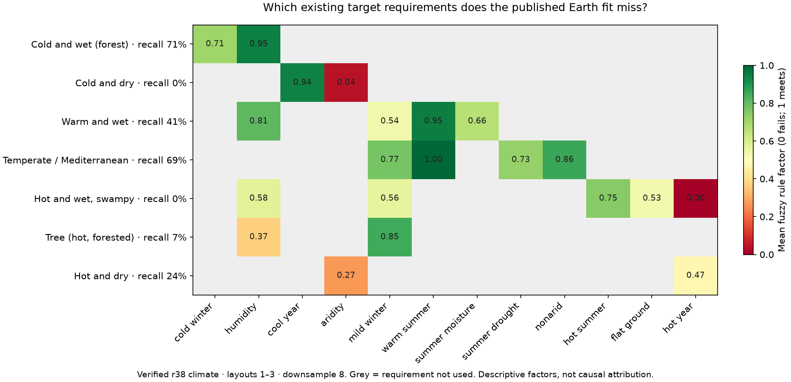

# Improving the joint fit within an Earth-like envelope

The useful problem is to fit unknown geography while retaining physical
parameters that reproduce Earth, rather than rewarding any invented-world
score large enough to pay a penalty for worse Earth performance.

## Current constraints and failure modes

The published r38 Earth-fit world has zonefit 0.18281 and 34.99% strict target
agreement across layouts 1–3 at downsample 8. Cold-dry and swamp recalls are
zero; tree recall is 6.79%. Its Mediterranean band is 74.55% Cs and 6.41% dry.
These are different target rules from the Whittaker-fit objective. More overall
agreement must not conceal the loss of another target zone.

Radius, gravity, rotation-rate magnitude, year length and solar input are
Earth-like. The current world nevertheless rotates retrograde and has a
33.50-degree tilt; this is not modern Earth's rotation/orientation. The first
pilot holds that existing planet fixed. A modern-Earth-orientation scenario
would be a separate comparison, with a different control, not an implicit
change to this baseline.

## Order of work

1. **Fit coherent unknown geography first.** Latitude/orientation, plausible
   terrain heights, continent extent, connected sea basins and mountain
   continuations affect the moisture source, cold-air source and seasonal
   heating without changing physical laws. The present six-scenario pilot
   changes only declared off-map geography. It holds mapped land, height,
   latitude and targets byte-identical, uses three matched layouts and
   requires observed numerical convergence. Its screen protects strict
   agreement, every zone's recall and Mediterranean moisture. A coarse winner
   must transfer to downsample 8 and additional layouts before publication.
   Procedural exterior land and the global Earth land-by-latitude profile are
   currently separate approximations; a future basin reconstruction should
   make those consistent rather than claiming a complete planet from local
   land-share knobs.
2. **Improve mountain precipitation before expanding its tuning range.**
   North India's July rain remains about 76 mm against 224 mm observed in the
   existing diagnosis, with excessive rain on the plateau instead of the
   Himalayan front. A matched-footprint terrain audit finds a 24.6% change in
   the prescribed-wind ascent factor from 56 to 14 km. Replace the relief
   proxy with a consistent resolved/unresolved decomposition, examine crest
   airflow and leeward drying, and account for condensation as a vapor sink.
   The geometric prototype has known-answer tests but is not yet a validated
   rainfall closure. A higher map score alone cannot establish its physics.
3. **Retune a small shared physical block under hard Earth limits.** Rain
   removal timescale, evaporation/recycling, eddy moisture exchange and
   terrain response should be shared between the invented world and Earth.
   Keep temperature, rainfall amount/seasonality and spatial allocation
   visible, with equal-region means and the established regional groups.
   Screen on the 31 development regions; require the existing fresh gate
   (S <= 0.995, no group worse, component limits), paired 28 km transfer and
   the established six-region check. Those six have already been reused and
   should not be presented as a fresh independent holdout. Add a declared
   SST protection before the next search: r38 improved land but its reported
   ocean error rose from 2.79 to 2.87 degrees C. This new protection cannot be
   retroactively used to redefine the currently running search.
4. **Add measured land-surface heterogeneity.** Soil storage, rooting depth,
   vegetation and wetland drainage can represent actual differences in
   geology and hydrology. Use independently motivated fields and mass/energy
   accounting. Do not assign a free soil or evaporation parameter to each
   painted target to manufacture a match. Wetland hydrology may explain a
   swamp without making it tropical, but any change to the intended target
   meaning must be explicit and separately scored.
5. **Treat orbital and ocean-basin alternatives as declared scenarios.**
   Modest eccentricity/perihelion changes can alter seasonality while holding
   radius, gravity, day length and year length fixed. Cross-equatorial ocean
   heat transport should follow a plausible basin configuration. In the
   earlier r35 probes, northern continents and increased ocean heat transport
   sometimes helped; summer perihelion often breached the hot/humid guard.
   These results are hypotheses for r38, not transferable gains. Keep the
   existing hot-summer guard. Avoid large radius changes, arbitrary uniform
   temperature shifts or unconstrained current strengths as fitting escapes.

## A joint optimizer needs two parameter objects

Maintain `theta` for shared physical parameters, `world` for invented-world
geography/planet properties, and fixed observed Earth geometry/forcing. Run
Earth with `(theta, Earth)` and the invented map with `(theta, world)`. A world
with a different stellar flux must not silently change the star in the Earth
benchmark. Some existing `earth_params` overrides reset tilt/spin/orbit but do
not reset every world property (notably solar flux, greenhouse forcing or
radius); the new runner must explicitly separate them.

The existing `scripts/joint_calibrate.py` uses a six-region soft climate-distance
penalty and defaults that relax convergence. It is historical tooling, not a
sufficient acceptance gate for this round. Preserve it for reproducibility and
build a new constrained runner. Infeasible Earth candidates must never become
eligible merely because the fantasy map gains more points. Prefer a small
Pareto set of feasible map/Earth tradeoffs over a single opaque weighted score.

Freeze physical bounds, regional protections, the SST criterion and the number
of fine-grid finalists before new results. Evaluate shared-physics candidates
once on Earth and cache by complete physics/input identity; changing only
world geography must not incur another identical Earth run. Optimize physical
and geographical blocks in alternation, then examine a small joint neighborhood
for interactions. Use the same layouts for paired differences, new layouts
for transfer, and report per-zone continuous margins alongside hard classes.

## Running experiment

`calibration/earthlike_geography_20261025/plan.json` freezes the geography pilot.
`scripts/check_earthlike_geography.py` records input identities, convergence,
mapped-geography checks and result checkpoints. `output/earthlike_geography_20261025/`
contains its progress and, on completion, selection review and rainfall maps.
No result of that coarse pilot alone is an atlas update.

## Current target diagnosis from the published climate

The saved ds8, layouts 1–3 checkpoint reproduces the atlas strict accuracy
exactly. Its scientific-source, map-input and parameter identities match the
current files; no model integration or fitting is involved.

| Target | Current mean climate | Weakest mean rule factor | Useful direction to investigate |
|---|---|---|---|
| Cold-dry | 14.3 °C annual; 774 mm/year; aridity ratio 2.20 | Aridity 0.040 | Less moisture reaching the interior; additional cooling is not the main deficit |
| Warm-wet | Coldest month 1.27 °C; 971 mm/year | Mild winter 0.537 | Milder coastal winters while retaining summer moisture |
| Tree | Coldest month 6.24 °C; 544 mm/year; aridity ratio 1.47 | Humidity 0.369 | More moisture locally; winter warmth is already adequate |
| Hot-dry | 17.65 °C annual; 725 mm/year; aridity ratio 1.54 | Aridity 0.266 | Drier conditions, with modest additional annual warmth |
| Swamp | 15.57 °C annual versus the current 21 °C requirement | Hot year below 0.001 | A 5.4 °C annual deficit cannot be addressed casually without checking colder neighbors |

A fuzzy factor is a graded rule satisfaction, not a probability or a strict
classification recall. Group averages conceal local variation, and strict
labels also require compatible Köppen classes and competition among rules.
These are descriptive priorities, not measured parameter response derivatives.
The target definitions are unchanged. In particular, the swamp is currently an
explicitly **hot** swamp; drainage physics alone cannot satisfy its heat rule.

The new `scripts/diagnose_world_fit.py` performs these checks and exports the
factor means, medians, limiting-factor shares and current climate statistics.
The diagnostic strengthens the case for regional moisture pathways: the cold
interior needs drying while the southeastern forest needs more water. A uniform
precipitation multiplier cannot do both.
