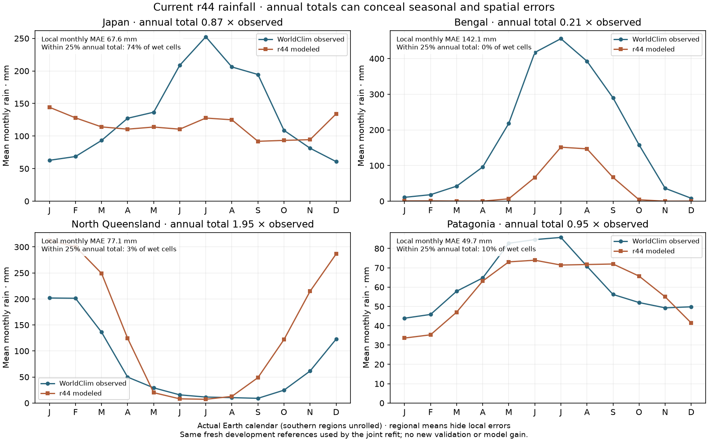
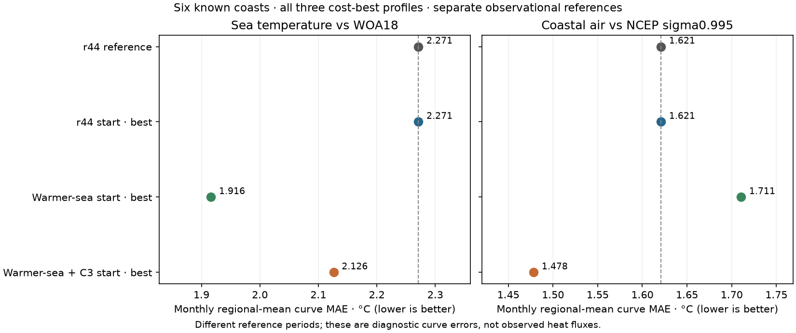

# Joint ocean/land response refit — 10 November 2026

**Completed search and development checks. Saved 2026-11-10 12:01 UTC; 51/51 evaluations. r44 remains adopted.**

Three frozen starts receive equal budgets of one starting control plus two CMA generations of eight:
r44, a +1.5 K SST-offset/-1.5 K current-strength start, and the same warmer sea with previously rejected
C3 exchange. The searched shared parameters are SST offset/current strength and land equilibrium offset,
seasonal amplitude, thermal time and radiative time. Earth orbital/radiative forcing, regional geography,
modeled SST/winds and numerical acceptance criteria stay fixed. These are existing phenomenological
responses, not a resolved coupled ocean energy budget. The regional monsoon-descent driver remains
conditional on existing observed large-scale rainfall information.

The existing v3 objective gives equal weight to normalized aggregate temperature MAE and rainfall loss
over all 49 development regions. Only aggregate component penalties affect the optimizer; groups are
reported without vetoes. Cost-best profiles must meet S49 <= 0.995 and both aggregate component changes
<= +1% before the declared additional checks. Numerical failures remain in the trial logs at cost 99.

| Start | Evaluations | Best T MAE, °C | Best rain loss | S49 | Search cost | Development screen |
|---|---:|---:|---:|---:|---:|---|
| r44 start | 17/17 | 1.861975 | 0.487956 | 1.000000 | 1.000000 | Does not clear development screen |
| Warmer-sea start | 17/17 | 1.881691 | 0.495714 | 1.013243 | 1.026217 | Does not clear development screen |
| Warmer-sea + C3 start | 17/17 | 1.831191 | 0.492253 | 0.996136 | 0.996136 | Does not clear development screen |

The illustrative baseline regions show distinct errors: Japan is too wet in winter and dry in summer;
Bengal has a large annual moisture shortage; North Queensland is too wet; Patagonia's nearly correct
regional annual total hides large local errors. These reused examples diagnose failures, not a new test
pool or a replacement objective. Curves use stored float32 monthly fields, restoring southern regions
to the actual Earth calendar; canonical local metrics remain the original full-precision summary values.

The baseline is freshly paired: T MAE 1.861974515852 °C, rainfall loss
0.487956196884. Forty-eight regional pairs reproduce the historical r44 scores.
Tripolitania uses the recovered 182-cell footprint documented on 2 November, instead of the archived
195-cell footprint. A direct WorldClim rebuild exactly reproduces the current cached land fraction,
elevation and climate fields. The original historical scores are retained, not rewritten. The fresh
reference prevents an input-footprint change from becoming a free model gain.

The frozen campaign and starts are in `calibration/joint_ocean_land_20261110/`. Search inputs, code,
policy and software versions are hashed. Actual per-case inputs are checked against reference hashes
before every scored solve. NumPy random state is restored across staged resumes; the generation-boundary
resume test reproduces uninterrupted trial records exactly. Output receipts are under
`output/joint_ocean_land_20261110/`. The public JSON contains every completed trial and regional error pair.

All three cost-best profiles receive the same six-coast marine diagnosis. Qualifiers receive fresh paired
49-region replay, four-region 28-km checks and all spent-h regions as stress. No alternative finalist is
substituted after those results. h/f/g remain spent; this campaign opens no independent pool and adopts
no new physics. A later qualified replacement would require a separately declared independent milestone
before retraining corrections and rebuilding the physical atlas.

This is an early bounded multistart refit, not a convergence test or a global-optimum proof. Different seeds
and starting profiles compare attainable candidates under equal budgets; they cannot isolate starting-point
effects from random-seed effects. Agreement within two generations cannot exclude other basins. C3 is also
a distinct fixed exchange branch rather than a continuous variable of the same search.

| Profile | Coastal SST curve MAE, °C | Coastal air curve MAE, °C |
|---|---:|---:|
| r44 reference | 2.271243 | 1.620890 |
| r44 start | 2.271243 | 1.620890 |
| Warmer-sea start | 1.916357 | 1.710532 |
| Warmer-sea + C3 start | 2.126232 | 1.478385 |

No cost-best profile cleared the 0.5% development threshold with the aggregate component guards. Accordingly, no additional 28-km or spent-h stress runs were triggered. All 24 predeclared marine runs passed numerical checks. No new independent pool was opened and r44 remains adopted.

The best C3 profile improves aggregate temperature MAE by about 1.65%, while rain loss worsens about 0.88%; the combined gain is about 0.39%. Its six-coast SST and air curve errors are lower, but this does not establish a qualified new climate or a global optimum. The earlier unwarmer C3 already passed development and finer checks before failing the then-unseen h test; this is not the first C3 development gain, and h remains spent. These new profiles use fresh paired inputs, including the recovered Tripolitania footprint.
