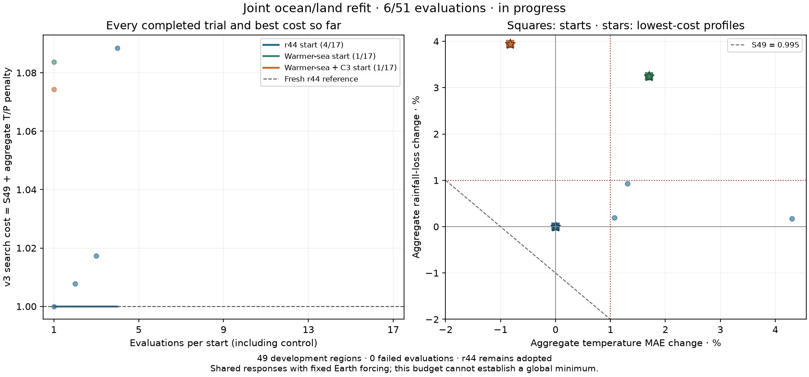

# Joint ocean/land response refit — 10 November 2026

**Calibration in progress. Saved 2026-11-10 10:20 UTC; 6/51 evaluations. r44 remains adopted.**

Three frozen starts receive equal budgets of one starting control plus two CMA generations of eight:
r44, a +1.5 K SST-offset/-1.5 K current-strength start, and the same warmer sea with previously rejected
C3 exchange. The searched shared parameters are SST offset/current strength and land equilibrium offset,
seasonal amplitude, thermal time and radiative time. Earth orbital/radiative forcing, regional geography,
modeled SST/winds and numerical acceptance criteria stay fixed. These are existing phenomenological
responses, not a resolved coupled ocean energy budget. The regional monsoon-descent driver remains
conditional on existing observed large-scale rainfall information.

The existing v3 objective gives equal weight to normalized aggregate temperature MAE and rainfall loss
over all 49 development regions. Only aggregate component penalties affect the optimizer; groups are
reported without vetoes. Cost-best profiles must meet S49 <= 0.995 and both aggregate component changes
<= +1% before the declared additional checks. Numerical failures remain in the trial logs at cost 99.

| Start | Evaluations | Best T MAE, °C | Best rain loss | S49 | Search cost | Development screen |
|---|---:|---:|---:|---:|---:|---|
| r44 start | 4/17 | 1.861975 | 0.487956 | 1.000000 | 1.000000 | Does not clear development screen |
| Warmer-sea start | 1/17 | 1.893630 | 0.503807 | 1.024742 | 1.083711 | Does not clear development screen |
| Warmer-sea + C3 start | 1/17 | 1.846609 | 0.507189 | 1.015581 | 1.074409 | Does not clear development screen |

The baseline is freshly paired: T MAE 1.861974515852 °C, rainfall loss
0.487956196884. Forty-eight regional pairs reproduce the historical r44 scores.
Tripolitania uses the recovered 182-cell footprint documented on 2 November, instead of the archived
195-cell footprint. A direct WorldClim rebuild exactly reproduces the current cached land fraction,
elevation and climate fields. The original historical scores are retained, not rewritten. The fresh
reference prevents an input-footprint change from becoming a free model gain.

The frozen campaign and starts are in `calibration/joint_ocean_land_20261110/`. Search inputs, code,
policy and software versions are hashed. Actual per-case inputs are checked against reference hashes
before every scored solve. NumPy random state is restored across staged resumes; the generation-boundary
resume test reproduces uninterrupted trial records exactly. Output receipts are under
`output/joint_ocean_land_20261110/`. The public JSON contains every completed trial and regional error pair.

All three cost-best profiles receive the same six-coast marine diagnosis. Qualifiers receive fresh paired
49-region replay, four-region 28-km checks and all spent-h regions as stress. No alternative finalist is
substituted after those results. h/f/g remain spent; this campaign opens no independent pool and adopts
no new physics. A later qualified replacement would require a separately declared independent milestone
before retraining corrections and rebuilding the physical atlas.

This is an early bounded multistart refit, not a convergence test or a global-optimum proof. Different seeds
and starting profiles diagnose some start dependence. Agreement within two generations cannot exclude
other basins, and C3 is a distinct exchange branch rather than a continuous variable of the same search.
