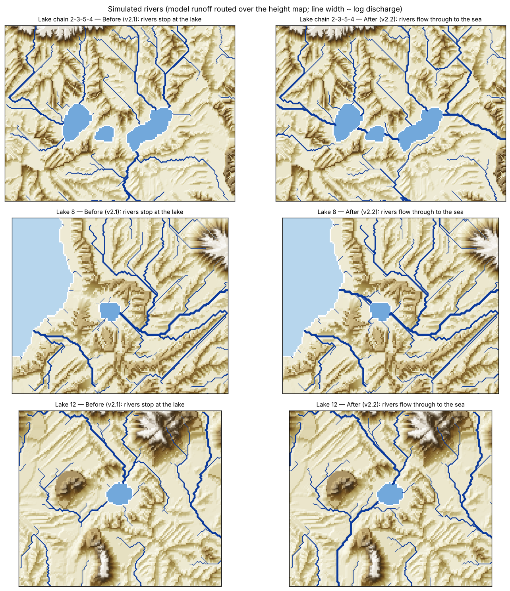
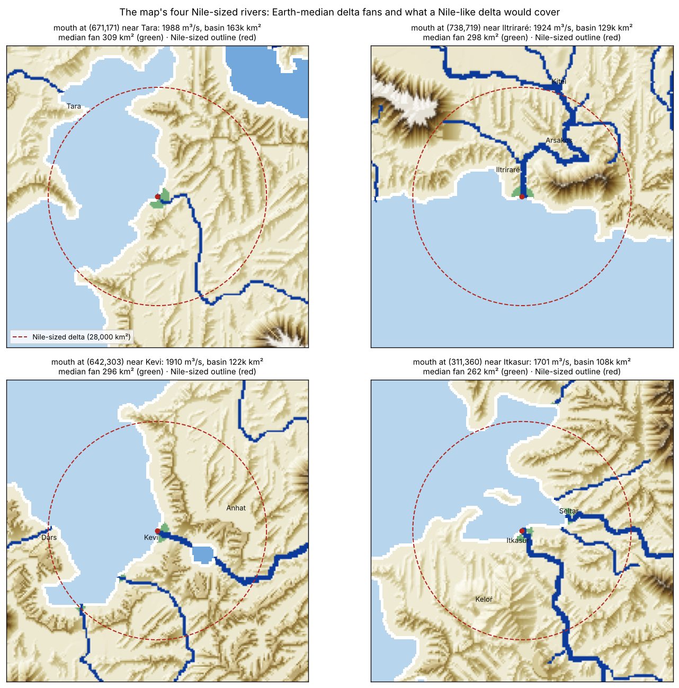

# Rivers through lakes, and deltas at the river mouths — 8 November 2026

## The owner's requests

* *"There's a number of cases on the drawn map where a river goes into a lake then goes back to a river — in the
  erosion map, they always end at the lake and don't re-start to the sea."*
* *"I don't see why we couldn't have a Nile-like delta in our world, we shouldn't prevent it."*

## 1. Rivers through lakes: height map v2.2 (plan_R1 amendment 5)

**Cause.** The river conditioning (`scripts/terrain_rivers.py`) ordered each drawn river by its distance along the
drawing to the nearest water, and it counted lakes as river ends just like the sea. A river leaving a lake for the
sea therefore had water at both ends and split in the middle: its upper half drained back into the lake. Lakes also
had no level of their own.

On the released v2.1 a lake-aware check fails: none of the 11 lakes rivers pass through drains out, and 655 steps
along their outflows climb.

**Change.**
* **Lake network.**
  * The map's 14 lakes and the sea are joined by the drawn rivers.
  * 11 lakes connect to the sea, some in chains (2 → 3 → 5 → 4 → sea). They are now pass-through: a river's distance
    to its mouth runs through the lake and on down the outflow.
  * Lakes 1, 9 and 10 have no route to the sea. They stay terminal (endorheic), and lake 11 drains into 10.
* **Lake levels.** Each pass-through lake is flat at the head of its outflow, 2–29 m, stored as `lake_level`. Shores
  stay at least 3 m above the lake.
* **Strict check.** It now takes the lake levels into account, and also requires every pass-through lake to drain out.

**Result** (`output/terrain_erosion_20261107/map_height_v22.npz`).
* **The strict check passes:** every lake drains out, no step climbs, and all 107 river systems drain.
* **Other gates unchanged from v2.1:** tier bands, climate scale (+0.11 m) and lowland slope.
* **33,000 cells change by more than 0.5 m.** Half lie along the lake systems. The other half are low basins whose
  filled level follows a river bed that changed. The same composition conditioned without lakes reproduces v2.1
  exactly, so all of it comes from the lake handling.

**Simulated rivers** (`rotclimate/routing.py`). Lakes with a level are now part of the drainage, so their outflows
carry the inflows' water:

| Lake | Outflow before | Outflow after |
|---|---|---|
| 8 | 9 m³/s | 1,830 m³/s |
| End of the 2–3–5–4 chain | 7 m³/s | 1,069 m³/s |

## 2. Deltas (plan `calibration/delta_fans_20261108`)

A height rule ("low land near a mouth") cannot find deltas here: this map's coasts sit at about 1 m everywhere. A delta
belongs to a river's mouth and the water and sediment it brings.

**Earth data.**
* **Deltas:** the Edmonds et al. (2020) global delta atlas, 2,174 deltas (CC BY 4.0).
* **Discharge:** HydroRIVERS mean discharge at each mouth.
* **Basins:** relief and temperature from the full HydroRIVERS network, about 8.5 million reaches.
* **Fit and check:** fitted on the Old World deltas; checked on the Americas and Oceania.

| Model | Held-out RMSE (log10 area) |
|---|---|
| A constant | 1.431 |
| **Discharge alone, A = 0.102 Q^1.055 km²** | **1.283** (R² 0.20) |
| Discharge + BQART sediment load (Syvitski & Milliman 2007) + wave exposure | 1.336 |

* **Discharge predicts little.** At the Nile's discharge the typical (median) delta is 300 km². The Nile's is 28,345
  km², about the 94th percentile.
* **The added drivers do not help.** Sediment load and wave exposure did not beat discharge alone on the held-out
  deltas.
* **Owner's decision:** *"If we can't predict it at all then let's not force anything."*

**On the map.**
* **Fans.** Every drawn river that ends at the sea or in a terminal lake builds the Earth-median fan for its simulated
  discharge: a half disc of area A at the mouth.
* **Irrigation inside a fan.** The irrigable share is 0.46 × exp(−H / 5 m), where H is the height above the nearest
  drawn river. The 0.46 is the Nile delta's share of land equipped for irrigation in 1900 (HID 1900).
* **Combined rule.** The map takes the larger of the fan and the river-distance rule (`harvest/deltas.py`,
  `data/delta_fan_model.json`).
* **Preview.** 84 fans with about 3,750 km² of irrigable fan land. The four rivers as large as the Nile get about 300
  km² each.

## 3. Release

To be filled in when the release finishes. The climate check on v2.2 runs against v2.1 with the same gate: corrected
strict agreement may not fall by more than 0.5 points.
