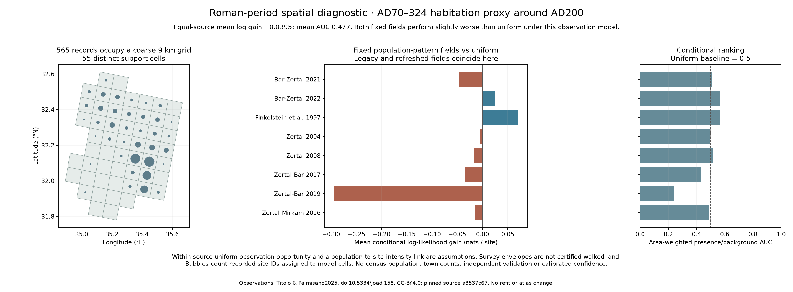

# South Levant conditional spatial diagnostic — 17 November 2026

The fixed population-pattern field **does not beat uniform model-land opportunity** on this declared within-source comparison. Across all eight survey sources the equal-source mean log-likelihood gain is −0.03950 nats per recorded site; the area-weighted presence/background AUC is0.4770, versus0.5 for uniform. The legacy and refreshed input fields are exactly equal on this support. No parameter is refitted and no atlas change is adopted.

This result measures conditional recorded-habitation spatial signal under explicit observation assumptions. It is not a calibrated AD200 population error, a proof that uniform population is historically correct, or an independent geographical validation. The source records the broad70–324AD phase.

## Same observations, support and model scale

The [source review](ROMAN_REGIONAL_SOURCES_20261117.md) fixes565 unique source site IDs in eight own-reference survey envelopes. Exact period/date/type/quality and identity rules are unchanged. Every observation lies on the existing model grid and land mask: zero off-grid or off-land exclusions.

The original Roman grid has9km cells. The clipped envelopes yield93 source/cell pairs but only55 distinct cells; overlapping source support is represented separately within each conditioned comparison. Many observations consequently share one model value. These565 records are not565 independent spatial trials, and source-cell pairs are not additional physical land or people. No p-value or calibrated confidence is reported.

| Source | Retained site IDs | Land support cells | Occupied cells | Refreshed log gain/site | Refreshed AUC |
|---|---:|---:|---:|---:|---:|
| Bar-Zertal 2021 | 123 | 5 | 4 | -0.04661 | 0.5096 |
| Bar-Zertal 2022 | 38 | 4 | 4 | +0.02586 | 0.5691 |
| Finkelstein et al. 1997 | 6 | 22 | 3 | +0.07072 | 0.5633 |
| Zertal 2004 | 73 | 15 | 11 | -0.00429 | 0.4970 |
| Zertal 2008 | 63 | 16 | 11 | -0.01758 | 0.5162 |
| Zertal-Bar 2017 | 114 | 13 | 11 | -0.03574 | 0.4315 |
| Zertal-Bar 2019 | 79 | 6 | 3 | -0.29428 | 0.2399 |
| Zertal-Mirkam 2016 | 69 | 12 | 10 | -0.01408 | 0.4895 |

Two sources have positive likelihood gain and six negative. Zertal-Bar2019 is the clearest negative case. Every source remains in the primary equal-source summary; no source, cell or phase is dropped based on a score. The pooled-site mean gain is−0.06025 nats/site and is secondary, because source totals differ for archaeological reasons. Baseline numerical gain is zero within floating-point roundoff.

## Fixed fields and exact recipe controls

Uniform baseline weights every retained model-land square kilometre equally. Legacy uses the existing Roman density field. Refreshed replays the already reviewed floodplain settlement-base input recipe with its original occupation factor and static arithmetic sampler. All original centre-hinterland totals and full-window people totals match the archived recipe exactly before interpretation. This is a replay of fixed covariates, not a new population allocation or climate/harvest/food/work/route solve. The two fields happen to coincide here; neither is retuned to the new observations.

The underlying population-pattern covariate is tested against habitation context. The city/town generator is not scored against every farmstead. Treating proportional person density as proportional recorded-site intensity is an explicit working assumption, not an established observation conversion. Source area/population estimates are never used as outcomes or weights.

## Geometry and score definitions

Source EPSG32636 geometries are transformed to the original spherical azimuthal-equidistant grid centred40N17E, radius6371km. All original model-grid centres match the projection within1e-6m. Source boundaries are densified at1km before transforming; every source polygon is clipped against native cells and the existing land mask. Source UTM area and model-projection area are retained separately. No site buffers, convex hulls, whole bounding-box support, alternate resolution or nearest-land relocation is introduced.

Each source conditions on its own retained observations. For celli, opportunity ai and fixed field wi, the comparison uses `p_i = a_i*w_i / sum_j(a_j*w_j)`. Uniform useswi=1. Gain is the mean conditional log probability relative to uniform. A genuinely zero-intensity occupied cell would retain negative-infinite likelihood; no pseudocount is added. No such zero occurs in this dataset. A model with zero total support is refused, not replaced with uniform.

The AUC compares recorded-site-weighted cell scores with source-area-weighted background scores, using half credit for ties. Background includes observed cells and is not observed absence. AUC therefore describes a presence/background ranking, not census classification accuracy.

Uniform within-source observation opportunity remains unqualified. The source paper documents heterogeneous walking, preservation and recording. Polygons are published survey envelopes rather than certified walked hectares. Broad phase chronology, varying site-size composition and coarse resolution further limit interpretation. The fixed density field has no demonstrated added conditional spatial skill here; the data do not identify a new population parameter or separate these causes.

## Verification and decision

The independent reviewer uses closed-form spherical projection for every observed point, separate cell-intersection reconstruction, scalar compensated probability/log-gain sums and a separate background-concordance calculation. It checks565 grid assignments,93 source/cell pairs, all120 per-source score values and aggregate metrics. GEOS intersection and the canonical density recipe remain reused components; the reviewer does not claim an independent reconstruction of the entire agricultural/population engine.

All five exports and the result receipt reproduce byte for byte in a fresh run. Four focused tests verify uniform equivalence with unequal cell areas, an exact two-cell likelihood calculation, structural zeros and refusal of all-zero support. Both source and previous Roman benchmark qualifications remain unchanged, as does the live provisional-r5 atlas.

The earlier [city-size benchmark](ROMAN_BENCHMARK_20261117.md) found modest conditional size skill. This different spatial test adds no supporting skill claim for the within-region population pattern. Keep both findings. Do not refit a density parameter or add fine warehouse mechanisms to make this diagnostic pass.

Next frozen task: `calibration/roman_benchmark_20261117/annual_assumption_impact.json`. Use the already reviewed annual scenario packets to isolate the large density, extraction and field-work effects at matched settings, and identify which period-appropriate evidence could constrain them. Missing factorial combinations stay unavailable; sensitivities are not empirical uncertainty. This moves the annual economy forward without new model sweeps or a return to truck/handling-rate research.

Recipes: `scripts/levant_spatial_diagnostic.py`, `scripts/review_levant_spatial_diagnostic.py`, `scripts/render_levant_spatial_diagnostic.py`, `scripts/seal_levant_spatial_diagnostic.py`. Derived NPZ andfresh/ remain local/ignored and pinned; completed stages refuse overwrite. [Source/cell data](../output/levant_spatial_diagnostic_20261117/cells.csv), [support](../output/levant_spatial_diagnostic_20261117/support.csv), [all scores](../output/levant_spatial_diagnostic_20261117/scores.csv) and [summary](../output/levant_spatial_diagnostic_20261117/summary.csv) are tracked. Observations: Titolo and Palmisano2025, doi10.5334/joad.158, CC-BY4.0, source commit a3537c67; original authors do not endorse this interpretation.

The optional GIS dependency group is `requirements-roman-benchmark.txt`. The atlas launcher does not require it; regional diagnostic tests skip explicitly when this optional group is absent.
