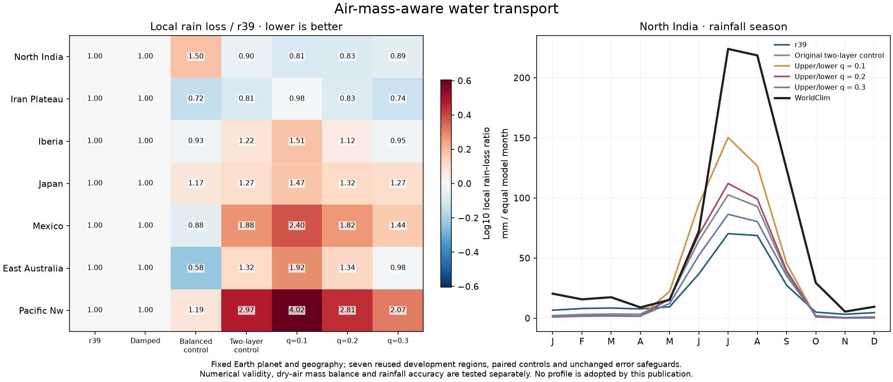
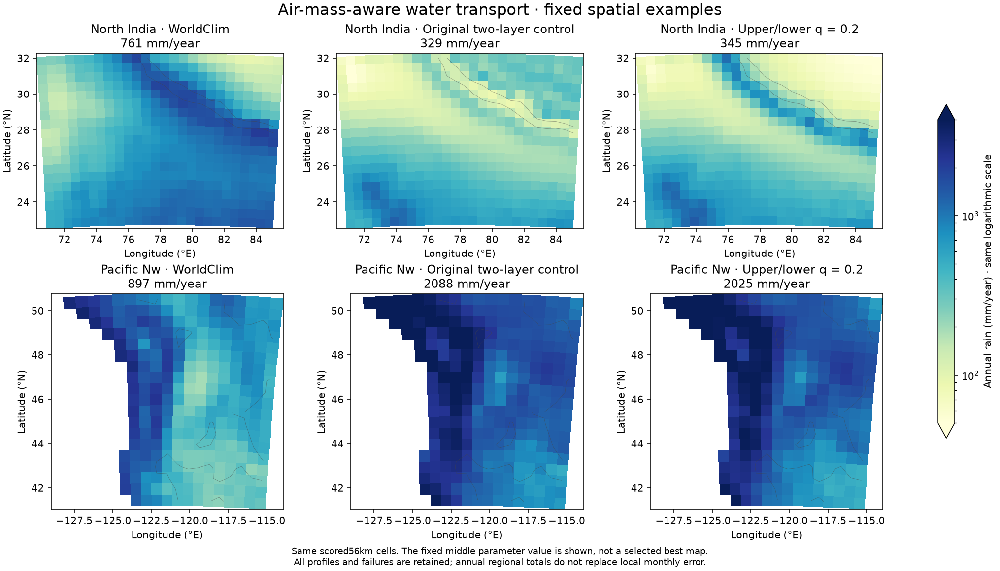
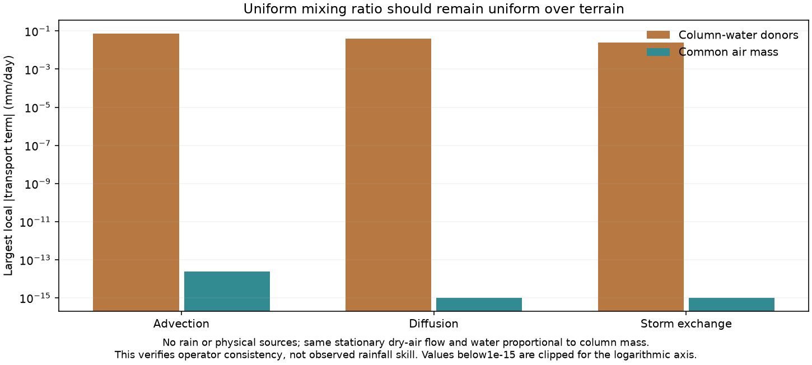

# Common air mass for vapor transport over terrain

This experiment fixes a tracer-consistency defect in the opt-in mass-balanced
transport. Dry-air mass balance used arithmetic face air mass, while water
upwinded donor column amounts directly. That combination can redistribute an
initially uniform water mixing ratio over terrain, even with stationary air,
no rain and no sources. Total boundary-accounted water still conserved; the
defect was incorrect tracer redistribution rather than creation of water.

New shared `moisture_mass_tracer=False` leaves all existing paths unchanged.
When enabled, each branch advects `M_face*U_face*(W/M)_donor`. Diffusion uses
`-K*M_face*grad(W/M)`. Conservative storm exchange uses the identical relative
column mass in its symmetric pair conductances. The solver matrix, actual
local residual and boundary ledgers all use those same mass-aware faces.
The column mass remains the preceding fixed hydrostatic approximation
`M proportional exp(-terrain/8000m)`; no planetary parameter is changed.

Known-answer single/two-branch tests preserve uniform specific humidity with
advection, diffusion and storm exchange active over varying terrain. Random
matrix/face identities independently verify signs, reaction accounting and
boundary telescoping. A coupled nonlinear model test checks the actual vapor
certificate. Old disabled controls must reproduce every saved array field.
The current focused suite passes164 tests. Uniform-q equilibrium requires
equal specific humidity in both branches; unequal vertical humidity can
legitimately give moisture convergence despite zero dry-column convergence.

The new fixed49-run plan repeats the same upper/lower humidity ratios.1/.2/.3,
all with1km lower thermal shear and lower dry-mass fraction.25. It first runs
28 exact controls, including the preceding uncorrected.2 transport, then21
new corrected profiles. Numerical work stays.05/1024 outside the original
reference, with unchanged.01 moisture residual and original linear/T tolerances.
Rain, temperature, regional, ocean, outside-wind and branch-speed guards remain.
Every subsequent full31/ocean/fine/established stage now checks branch and
common-mass certificates too, before any possible profile adoption.

Source `38bc4e1`, plan `calibration/mass_tracer_20261026/plan.json`, results
`output/mass_tracer_20261026/`. New core/helper changes require a new source
epoch; never bypass old campaign guards to reuse changed inputs. Numerical
validity and consistency are not evidence of improved observed climate.

The model still has a single W state with an imposed vertical humidity shape,
not independent vertical thermodynamics/momentum or humidity states. Branch
upwinding has grid-dependent mixing. Surface winds still drive surface heat,
evaporation and terrain lift. Hydrostatic mass, flat-grid geometry, prescribed
remote descent, reanalysis partial-column/period limitations and the need for
matched-world transfer qualification remain. Headline city/global scores and
the three normal atlas climate/economic datasets are unchanged by publication.

The separate rain-activation follow-up was committed before this pilot ended:
it fixes transport at the middle ratio.2 and tests only RH thresholds.5/.6/.7.
Those are sensitivity values of the model's approximate column capacity, not
measured cloud-base humidity. It adds no humidity ratio after seeing these
outcomes, and retains all existing accuracy/numerical guards.

## Completed paired results

All49 integrations pass;28 control runs reproduce exactly. No candidate passes the unchanged fixed safeguards, so no full31/fine/established6 stage runs.

| Upper/lower q | NI annual mm | NI monthly MAE mm | Seven-region S | Rain-loss ratio | T-MAE ratio |
|---|---:|---:|---:|---:|---:|
|0.1|446.45|44.845|1.3373|1.6825|0.9921|
|0.2|345.06|43.673|1.1535|1.3217|0.9852|
|0.3|276.64|44.944|1.0484|1.1195|0.9772|

These are ratios on seven reused development regions, not updated31-region/city accuracy or percentages. Local NI monthly errors improve over r39, but wet coastal and other regional errors still reject every candidate. The consistency correction is retained as opt-in research code; adopted r39/r38 atlas fields stay unchanged.
