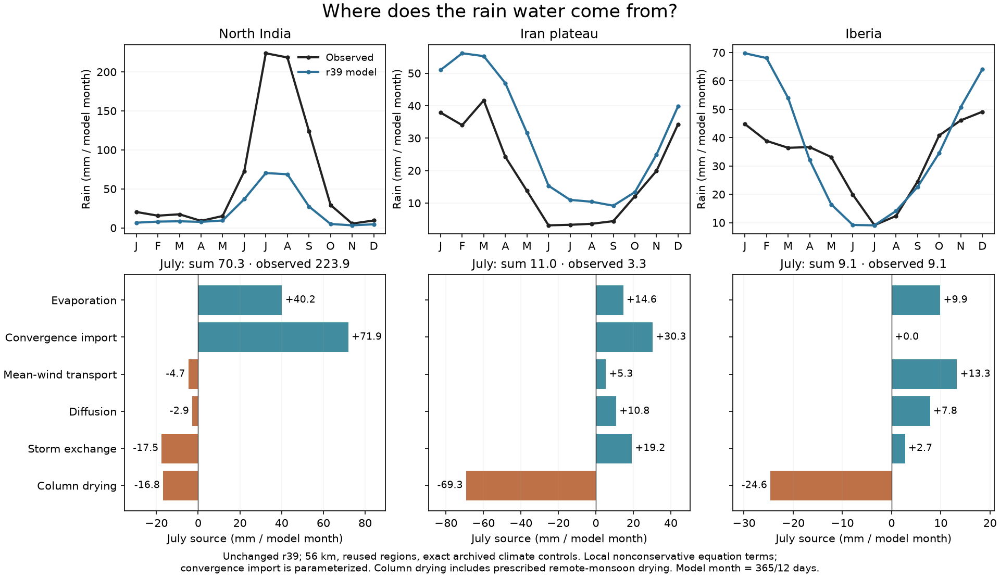
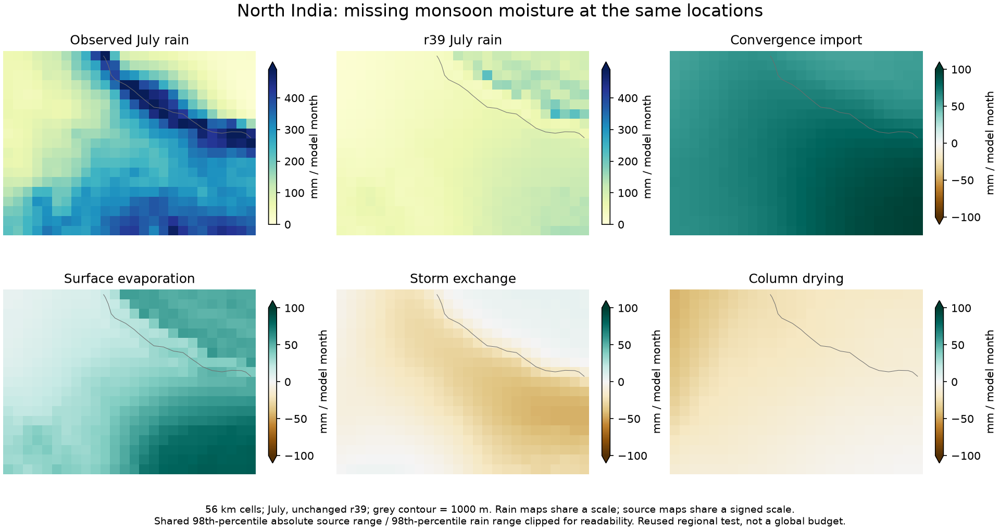

# r39 moisture-source audit: diagnosing the missing monsoon water

All three runs reproduce the adopted r39 archived monthly temperature, rain
and observation arrays exactly at their stored float32 precision. Active
physical/numerical/planet inputs and derived Earth geography hashes match.
All per-step numerical checks pass. The new explicit joint Earth profile and
expanded diagnostics therefore preserve the measured reference climate.

This is a fixed, three-region 56 km diagnostic with reused development
regions, not a new calibration or independent holdout. No physical parameter,
forcing field, atlas climate or economic data is adopted or replaced.

| July, equal model month | North India | Iran plateau | Iberia |
|---|---:|---:|---:|
| Observed rain | 223.95 | 3.31 | 9.13 |
| Simulated rain | 70.29 | 11.00 | 9.07 |
| Surface evaporation | +40.17 | +14.63 | +9.90 |
| Parameterized convergence import | +71.94 | +30.31 | +0.00 |
| Mean-wind advection | −4.70 | +5.29 | +13.29 |
| Diffusion | −2.85 | +10.85 | +7.81 |
| Storm exchange | −17.45 | +19.20 | +2.74 |
| Total column drying | −16.81 | −69.29 | −24.65 |
| Monsoon subset of drying, **do not add again** | −3.04 | −51.73 | −0.80 |

All entries are mm per equal model month (365/12 days), averaged over the
same scored land cells. Signed sources sum to simulated rain plus a small
equation residual. The maximum difference between the exported monthly
component sum and its independently stored residual is below 0.0001 mm/month
in every case. Absolute instantaneous residuals are retained before averaging.
These are local concentration-advection equation terms; they are not a closed
global water budget or a tracer attribution of the rain's ultimate origin.

## What it tells us

North India's annual rain remains 256 versus 761 mm observed. The below-1000 m
cells receive 62 mm in July against 239 observed, with mean column relative
humidity 0.572. Storm exchange removes 22 mm/month there, rather than importing
the missing monsoon moisture. Convergence-driven import is already a major
source. The measured balance does not support a simple regional rain multiplier
as a physical solution. Rain efficiency can alter gradients, recycling and
circulation, so only new integrations can establish its net response. Supply,
transport and their interactions need testing; this diagnosis does not establish
which intervention will work or validate every existing source parameterization.

Iran's prescribed remote-monsoon term removes 52 mm in July, while the
simulated North India source is much too weak. Earth's regional descent is
derived from observed **global** rain, whereas the fantasy world's is generated
from its simulated domain. This difference can affect transfer of an otherwise
qualified Earth parameter set. It does not prove that it caused every rejected
world fit. Removing the prescribed field would also lose remote sources beyond
the regional window, so that is not an equivalent coupled-global experiment.

Iberia's regional July mean is close (9.07 versus 9.13), but its annual total
is still 445 versus 392 mm, and the spring/winter shape differs. A single good
monthly mean must not be called accurate rainfall at individual locations.

The next useful physical experiment should address monsoon moisture delivery
and consistent remote forcing, preserving distant source coverage. Keep the
observed Earth envelope separate from world geography, retain the Earth
regional/SST protections, and test matched resolutions and surroundings.
Neither larger arbitrary planetary forcing nor tuning each painted target's
rain independently is an acceptable replacement for a shared physical model.

## Reproduction and publication

Source/input identities and the predeclared scope are frozen in
`calibration/moisture_sources_20261026/plan.json` and
`output/moisture_sources_20261026/protocol.json`. Runner source is in commit
`a82374c`; use a new output directory after any source change. Failed or changed
controls cannot be reused. All three JSON records and the completed review
are retained. Optional local NPZ arrays are regenerated by the runner; their
SHA-256 values are recorded, and they are not needed to browse.

The launcher hub links the self-contained HTML companion
[`atlases/climate_accuracy/`](../atlases/climate_accuracy/index.html). Its two
PNGs and summary JSON are portable assets, included by the three-atlas bundle
packager. The publication script rechecks the frozen audit sources, actual
array hashes, strict certificates and historical calibration profile before
exporting. Its page explicitly distinguishes r39 Earth skill, the published
r38 world, reused city sampling, and hypothetical 200 AD population scenarios.

