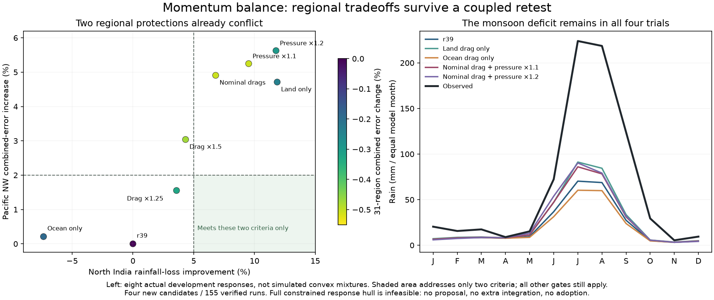

# Momentum balance and constrained proposals

A separately frozen four-candidate experiment follows the rejected surface-drag
pilot: nominal drag over land only; nominal drag over ocean only; both nominal
drags with thermal-pressure amplitudes increased10% or20%. All values stay
inside the pre-existing e5 bounds. Stellar/greenhouse/radius/orbital inputs,
geography and all other physical/numerical settings stay fixed.

All155 integrations pass numerical checks. The31 fresh r39 reference regions
reproduce archived temperature/rainfall errors within1e-10 and exact derived
geography hashes. All regions have already been inspected in development;
none is represented as an independent new holdout.

| Candidate | Combined S | Mean rain-loss change | Original policy_v2 gate | Complete new criteria |
|---|---:|---:|---|---|
| Land drag only | .997598 | −1.334% | fails | fails |
| Ocean drag only | .998118 | −0.059% | fails | fails |
| Nominal drag + pressure×1.1 | .994936 | −1.640% | passes | fails Japan, Mexico, Pacific NW protections |
| Nominal drag + pressure×1.2 | .997048 | −1.514% | fails | fails |

The10% pressure candidate improves every group on the old combined metric but
worsens individual protected regions. The20% candidate also worsens the former
holdout group. The full declared plan rejects every candidate. No integrated
ocean-finalist, fine-grid or established-six stage runs, and no r40 profile
is created. The previous failures and criteria are retained unchanged.

## Does interpolation offer an eligible next candidate?

The new constrained proposal tool checks all seven actual momentum candidates
plus the r39 baseline from the two completed development campaigns. It verifies
paired benchmark source hashes, actual case identities, exact reference
agreement, numerical certificates and every saved cell-file checksum. Only
the four shared pressure/drag fields may differ. The geographic, planetary,
numerical and other physical blocks must match.

An LP chooses nonnegative weights summing to1 to minimize predicted combined
error. It requires every original group/component constraint, the overall
improvement threshold and every extra regional protection simultaneously.
Weights would propose a physical parameter vector inside the sampled hull;
they would **not** constitute an integrated mixed climate or measured skill.
Any feasible proposal would still need actual full Earth and ocean/fine gates.

The strict LP is infeasible. A separately declared diagnostic omitting only
the overall-improvement threshold is also infeasible. That diagnostic cannot
select a candidate. Consequently no parameter proposal or extra climate
integration is generated. There is no attempt to pay for a failed region with
a larger average score or to loosen a guard after results.

This is evidence about a linear response surrogate in the sampled momentum
neighborhood, not a mathematical bound on the nonlinear simulator. It does
not establish that other physical blocks, structural changes or unsampled
settings cannot improve the model. It does suggest that more small interpolated
momentum trials alone are a poor next use of integrations under these limits.

## Reproduction and data preparation

- Plans: `calibration/momentum_balance_20261026/plan.json` and
  `calibration/momentum_hull_20261026/plan.json`.
- Actual runs: `scripts/check_surface_momentum.py --plan ... --out ...`;
  declared runner source at commit`908edf6`.
- Proposal analysis: `scripts/propose_momentum_balance.py`; all input hashes
  are frozen under `output/momentum_hull_20261026/`.
- Records: `output/momentum_balance_20261026/` preserves every region and
  the failed review. Optional NPZ arrays are local research caches bound by
  their record hashes; the browser companion uses independent portable assets.

`scripts/prepare_woa18.py` makes the full ocean reference reproducible. Default
operation checks all twelve raw-source checksums against the assembled SST
cache, its coordinates, coverage and temperature range. `--download` fetches
missing public NOAA files, checks gzip integrity and atomically builds a missing
cache through the existing builder. It does not silently replace an existing
cache after a source change; `--rebuild` makes that deliberate revision explicit.
The checks here leave the active dataset unchanged. Browsing `.bat` atlases
still requires only Python's standard library, not these scientific tools.

Three completed climate experiments in this round total307 integrations
(28 column shear,124 surface momentum,155 momentum balance), all numerically
verified. No qualified physical gain is claimed. The60 focused wind/model/gate
tests, six ocean-preparation checks and six constrained-proposal checks pass.

All normal atlas climate, food, population and trade fields remain unchanged.
The launcher hub's Climate accuracy page includes all three results, charts
and JSON downloads. It continues to distinguish qualified r39 Earth physics
from the separately published r38 fantasy-world atlas.

