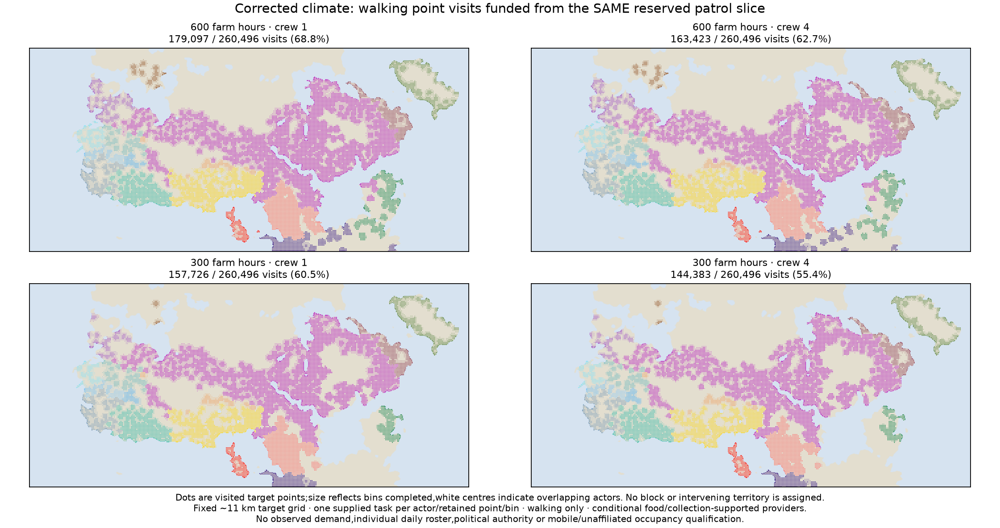
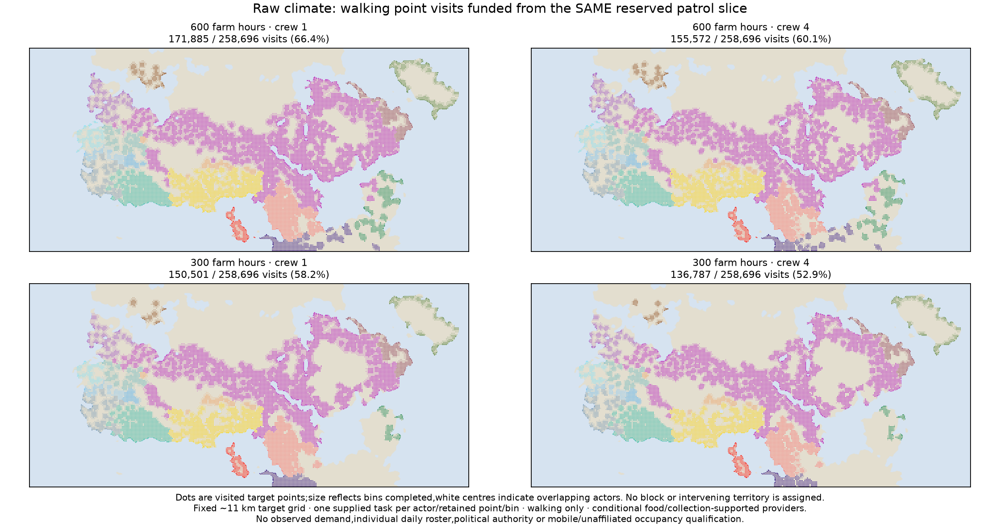
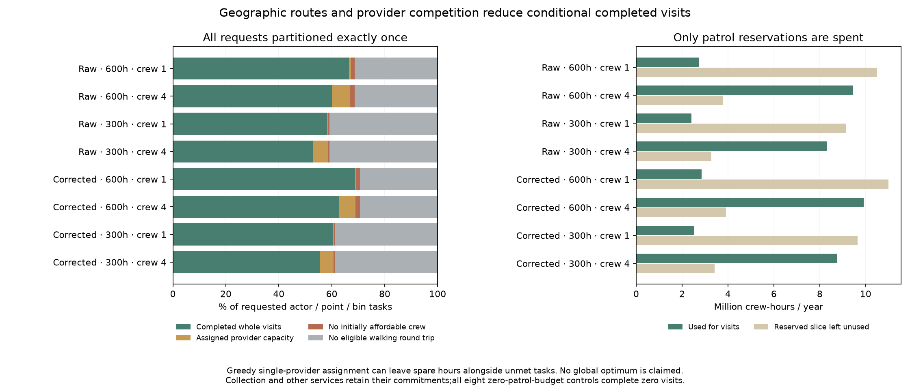

# Conditional walking point visits on the shared staff ledger

Declaration `9c3e7420` preceded target, route, assignment and task outputs.
This advances the geographic duty implementation in release 3/S4. It does not
qualify observed demand, occupation, actual patrols, institutional functions,
resident sizes or political authority, and changes no production default.

The eight scenarios use the four existing threshold-checked raw/corrected,
600/300 farm-hour, 120,000 kcal/load, all-open parent cases, with one- and
four-person visit crews. People, farming, food, collection and non-patrol
commitments remain those of the independently checked parent plans.

## Targets, routes and conditional demand

Tile the majority-land raster into 3×3 cells from the upper-left corner. Each
nonempty tile contributes its land cell nearest the clipped tile centre;
lowest global grid ID resolves ties. All 27,843 target IDs are identical across
climates. Actual cell size is 3.68025 km; nominal block edge is 11.04074 km.
Points are selected without population, roads, actor outcomes or residuals.
Their represented land areas are recorded but never converted to held land.

For each actor, retain points covered in at least one bin by its original
checked all-source/full-network reference. Each retained actor/point requests
one visit in every bin, including bins when it cannot be reached. This gives
258,696 raw and 260,496 corrected actor/point/bin tasks. These are supplied
opportunities, not observed service demand or a worldwide occupation census.
Other points and unaffiliated, mobile and missing-inventory contexts are
unscored, not evidence of absent organization.

Reconstruct original sites, land, roads/tracks and seasonal walking costs.
Exclude ferries and all auxiliary sea, river and harbour edges. Outward and
return paths must use the same provider, each take at most two graph days,
and total at most four days including one on-site hour divided by seven.
Conditions are frozen within each bin. Every eligible walking land cell is
within its earlier source-specific full-network footprint; all recorded
target paths also pass independent directed-edge and endpoint checks.

## One reserved hour pool and whole tasks

Only `work_secondary_hours[0]`, the parent's already-reserved neutral patrol
slice, funds visits. Collection and services A/B retain their hours. Unused
gross staff hours and other work channels cannot be borrowed. Task cost is
crew × [7 × (outward days + return days) + 1 on-site hour], with crew no larger
than the supported institutional cohort. All accepted visits are integers.

Per actor/target/bin, choose the cheapest initially affordable active provider,
breaking ties by source index. Assign once. Each provider completes its tasks
in cost/target order until the slice is exhausted. No rerouting or global
coverage optimum is claimed. Spare hours may coexist with unmet tasks.

Every request belongs to exactly one of: completed, no eligible walking route
from active providers, route exists but no initially affordable crew/provider,
or assigned provider capacity exhausted. The zero-patrol-budget controls
complete zero tasks while preserving route possibility. Collection + other
services + actual visits never exceeds the original gross monthly budget;
new unused hours equal previous unused hours plus the unspent patrol slice.

## Results

|Climate|Farm hours|Crew|Completed / requested|Completed|
|---|---:|---:|---:|---:|
|Raw|600|1|171,885 / 258,696|66.4%|
|Raw|600|4|155,572 / 258,696|60.1%|
|Raw|300|1|150,501 / 258,696|58.2%|
|Raw|300|4|136,787 / 258,696|52.9%|
|Corrected|600|1|179,097 / 260,496|68.8%|
|Corrected|600|4|163,423 / 260,496|62.7%|
|Corrected|300|1|157,726 / 260,496|60.5%|
|Corrected|300|4|144,383 / 260,496|55.4%|

The actor colors identify the actor with most completed bins at a point;
white centres indicate overlapping actors. Dot size reflects completed bins.
Use the actor masks/downloads for all overlaps; the raster does not assign the
surrounding block or intervening land. Under these tasks, walking connectivity
causes most unmet requests. Four-person crews expose more provider competition.
The original potential-access maps retain their own meaning and remain intact.

## Review, publication and remaining work

The independent reviewer imports neither the allocator nor target selector.
It reconstructs target geometry, checks every recorded path against rebuilt
directed graph edges and hashes, reproduces scalar provider choice and whole
task completion, and verifies all actor/bin partitions and monthly ledgers.
This validates recorded routes; it is not an independent shortest-path
algorithm or proof of global allocation optimality. Fresh path packets,
results and fields are byte exact. Eleven focused allocator/search tests pass.

The existing **Supply-supported reach** selector has eight optional “Funded
walking point visits” entries under Experimental & diagnostics. Point CSVs
retain all requested actor/targets, completed bins, all four deficit masks and
chosen provider indexes by bin. Provider CSVs add monthly completed tasks and
reserved/used/unused patrol hours. Full arrays are downloadable. All earlier
map packets and defaults remain preserved. Browser checks cover all eight
maps, exact downloads, five packet families, reload, small screens, themes
and optional manifest/grid failures.

Monthly aggregate staff hours do not establish daily food issues, individual
crew schedules, absence durations or competing real institutional roles.
On-site time, crew and frequency are supplied stress units. Complete diets,
household and draft work, dated provider/occupation/resident evidence,
prospective transfer and actual mobile/nonstate/unaffiliated occupancy remain
open throughout releases 2–4 and S1–S5. Before broad geographic service claims,
test target-grid sensitivity and quantify the greedy-assignment restriction
under a separately committed declaration. Do not infer new authority from
successful task accounting.

The full historical evidence publisher still requires an omitted private
Vidarbha Earth cache. This addition uses its reviewed direct publisher and
preserves existing evidence panels; no full historical rebuild is claimed.
