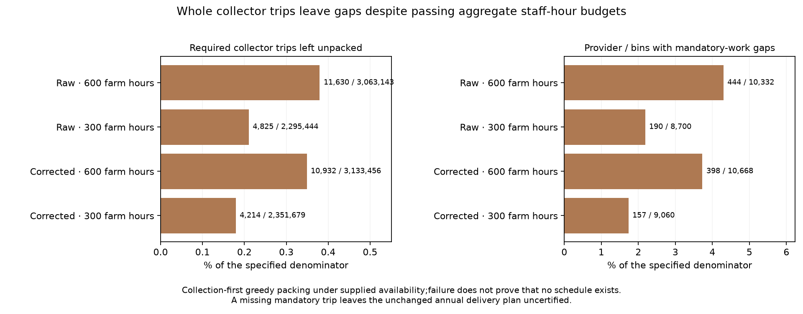
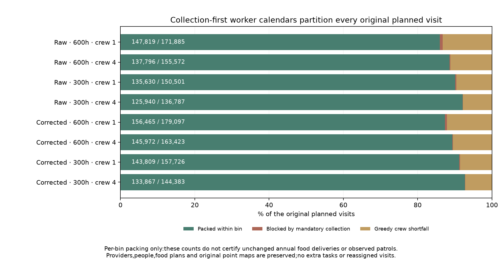
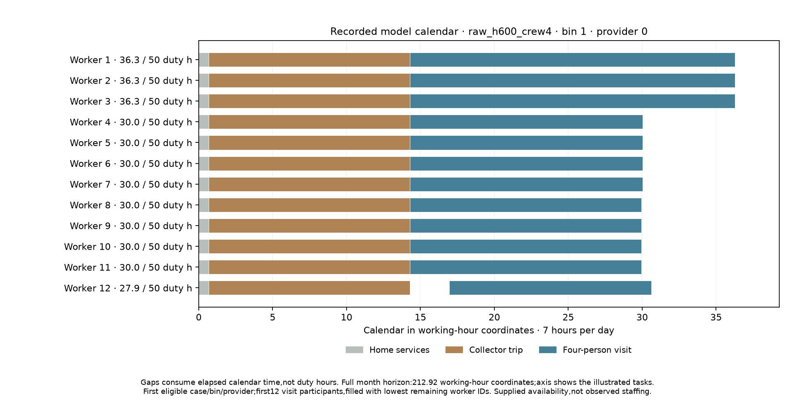

# Worker-calendar audit and publication — 12 November 2026

Declaration `bdd6135c` preceded outputs. The computational checkpoint was saved
in `a60e853f`; its reviewed results are now published in the normal Earth evidence
atlas. Existing point maps and defaults retain their previous scope.

The same four food/collection parents and eight original b3_p0 point-visit plans
are retained. Integer supported workers have 50 duty hours per bin and a common
7×365/12-hour calendar. Mandatory divisible home services are shared equally.
Whole collector trips are packed first, longest duration first, using earliest
available workers. Original visits then use synchronized supported crews at
their original providers. Collection failure blocks visits in that provider/bin.
No extra visits, worker-hours, food, people, providers or reassignment is allowed.

Seven manufactured controls pass. All 144 schedule packets and results reproduce
byte exactly in a fresh run. Independent sorted-list reproduction and explicit
interval, task-identity, crew, duty-cap and monthly-ledger checks are implemented
in scripts/review_visit_calendars.py. Its passed certificate checks 10,812,121
collector trips, 1,259,374 planned visits and 7,752,000 worker-bins. The preserved
result, review, replay and prior declaration are downloadable from the atlas.

## Collection packing

|Parent|Required trips|Unpacked trips|Mandatory-failed / relevant provider-bins|
|---|---:|---:|---:|
|raw_h600_load120000_all_open|3,063,143|11,630|444 / 10,332|
|raw_h300_load120000_all_open|2,295,444|4,825|190 / 8,700|
|corrected_h600_load120000_all_open|3,133,456|10,932|398 / 10,668|
|corrected_h300_load120000_all_open|2,351,679|4,214|157 / 9,060|

## Original planned visits

|Case|Planned|Packed within bin|Blocked by mandatory collection|Greedy crew shortfall|
|---|---:|---:|---:|---:|
|raw_h600_crew1|171,885|147,819|1,209|22,857|
|raw_h600_crew4|155,572|137,796|387|17,389|
|raw_h300_crew1|150,501|135,630|469|14,402|
|raw_h300_crew4|136,787|125,940|167|10,680|
|corrected_h600_crew1|179,097|156,465|886|21,746|
|corrected_h600_crew4|163,423|145,972|263|17,188|
|corrected_h300_crew1|157,726|143,809|367|13,550|
|corrected_h300_crew4|144,383|133,867|113|10,403|

These are per-bin packing results, not a new annual food-supported visit map.
Any missing mandatory collector trip means this constructed annual schedule
does not certify the unchanged food deliveries. Greedy failure is not proof
that no schedule exists: collection-first packing can fragment workers' spare
hours before longer visits are attempted. Test any alternative ordering under
a separately committed declaration; do not label these gaps physical collapse.

Availability and divisible services are supplied assumptions. Individual task
intervals are constructive under those assumptions; actual staff functions,
daily food issues, observed visits, dated occupation/sizes, prospective transfer,
complete diets/household/draft work and mobile/nonstate/unaffiliated resources
remain open. No authority or calibrated default is inferred.

## Recorded worker-calendar illustration

The illustration takes the first eligible four-person case/bin in canonical
order and its lowest-index provider with both collection and packed visits.
It shows the first twelve workers participating in visits, filled with the
lowest remaining worker IDs. This is an explicit illustration selection, not
a scored cohort. Worker numbers in the figure start at one; the downloadable
CSV preserves zero-based worker/provider indices from the schedule packets.
A shared visit is recorded once per crew member so each person's duty hours
can be checked. Empty calendar gaps consume elapsed time, not duty hours.

The calendar axis uses seven working hours per day; the full bin horizon is
212.92 such hours. The figure zooms to the shown tasks. Each worker's fifty-hour
limit applies to duty time, not the position of their final calendar event.
Home services remain divisible supplied duties; this does not establish actual
service job identities or complete staffing rosters.

## Publication and continuation

The normal evidence atlas now includes the four collection and eight visit
rows, three figures, all results/review/replay/prior-declaration downloads and
the shown worker/task CSV. Full source schedule packets remain preserved under
`output/network_visit_calendar_20261112`. Earlier evidence panels and all 163
protected map files are retained byte for byte. No new Earth data were exposed.

Whole-programme dependencies remain in
SETTLEMENT_CONTROL_ROADMAP_20261110.md. Before treating packing gaps as resource
limits, declare and compare a different packing order on the same jobs and
worker caps; preserve every original result and distinguish bin-level packing
from annual mandatory-delivery qualification. No alternative-ordering scores
are included in this publication. Dated provider/occupation/resident evidence,
prospective transfer, complete diets/household/draft work and mobile/nonstate/
unaffiliated resource integration remain open.

The historical full evidence rebuild still needs an omitted private Vidarbha
Earth cache. This addition uses its reviewed direct publisher and preserves
all earlier panels; it does not claim a full historical rebuild.
