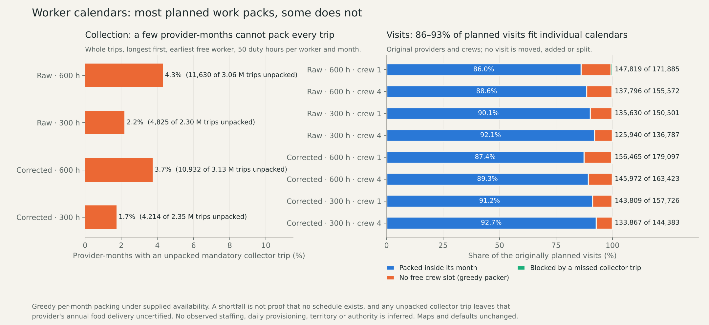
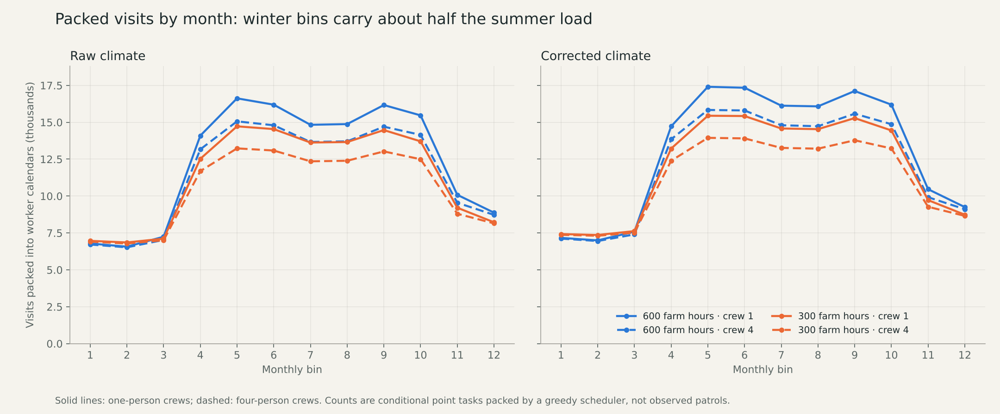

# Worker-calendar packing audit

Declaration `bdd6135c` preceded all outputs. The audit asks whether the monthly
hour budgets behind the eight published point-visit plans can be turned into
individual, non-overlapping worker calendars. Existing maps and defaults are
unchanged, and no new map family is created.

## Method

The same four food and collection parents and the eight original `b3_p0`
point-visit plans are retained. Each provider has a whole number of supported
workers, each with 50 duty hours per monthly bin on a common 7×365/12-hour
calendar. Mandatory, divisible home services are shared equally first. Whole
collector trips are then packed, longest first, onto the earliest free worker.
Original visits follow, each needing a synchronized crew of one or four at its
original provider. A provider that cannot pack every collector trip in a month
has its visits for that month blocked. No visit, worker-hour, food, person or
provider is added, moved or split.

## Collection packing

|Parent|Required trips|Unpacked trips|Provider-months failing / relevant|
|---|---:|---:|---:|
|raw_h600_load120000_all_open|3,063,143|11,630|444 / 10,332|
|raw_h300_load120000_all_open|2,295,444|4,825|190 / 8,700|
|corrected_h600_load120000_all_open|3,133,456|10,932|398 / 10,668|
|corrected_h300_load120000_all_open|2,351,679|4,214|157 / 9,060|

Between 0.18% and 0.38% of collector trips do not fit, concentrated in 1.7% to
4.3% of the provider-months that have collection work.

## Original planned visits

|Case|Planned|Packed within month|Packed|Blocked by collection|Greedy crew shortfall|
|---|---:|---:|---:|---:|---:|
|raw_h600_crew1|171,885|147,819|86.0%|1,209|22,857|
|raw_h600_crew4|155,572|137,796|88.6%|387|17,389|
|raw_h300_crew1|150,501|135,630|90.1%|469|14,402|
|raw_h300_crew4|136,787|125,940|92.1%|167|10,680|
|corrected_h600_crew1|179,097|156,465|87.4%|886|21,746|
|corrected_h600_crew4|163,423|145,972|89.3%|263|17,188|
|corrected_h300_crew1|157,726|143,809|91.2%|367|13,550|
|corrected_h300_crew4|144,383|133,867|92.7%|113|10,403|

Between 86.0% and 92.7% of the planned visits fit inside their month.
Most of the remainder is a greedy crew shortfall: collection is packed first
and fragments workers' spare hours before longer visits are tried. Visits
blocked by a missed collector trip are 0.1% to 0.7% of the plan.

## What this does and does not show

These are per-month packing results from one greedy, non-preemptive rule under
supplied worker availability. A shortfall is not proof that no schedule exists;
a different ordering might pack more, and any such test needs its own prior
declaration. Any unpacked mandatory collector trip means this constructed
schedule does not certify that provider's unchanged annual food delivery.

No actual staff functions, daily food issues, observed visits, territory or
authority are inferred. Dated sizes and occupation, prospective transfer,
complete diets, household and draft work, and mobile, nonstate and unaffiliated
resources remain open.

## Review and reproducibility

Seven manufactured controls pass. The independent reviewer
(`scripts/review_visit_calendars.py`) rebuilds the schedules with sorted lists
rather than the producer's allocator and checks 10,812,121 collector-trip
intervals, 1,259,374 planned visits and 7,752,000 worker-months for
identity, non-overlap, duty caps, distinct synchronized crews and whole monthly
ledgers. All 144 schedule packets and the results reproduce byte for byte in a
fresh run. 163 published map files are verified unchanged.

The normal evidence atlas now carries both tables, both figures and the
results, review, replay and prior declaration as downloads. Full schedule
packets stay under `output/network_visit_calendar_20261112` in the repository.
