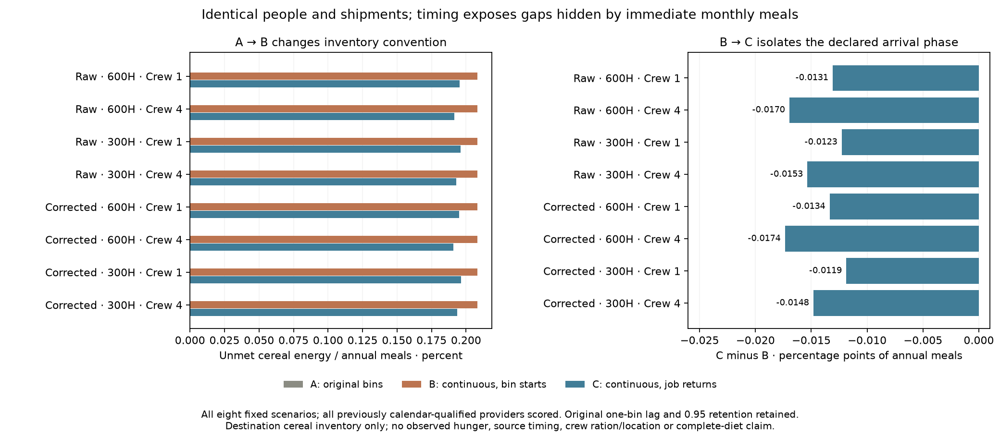
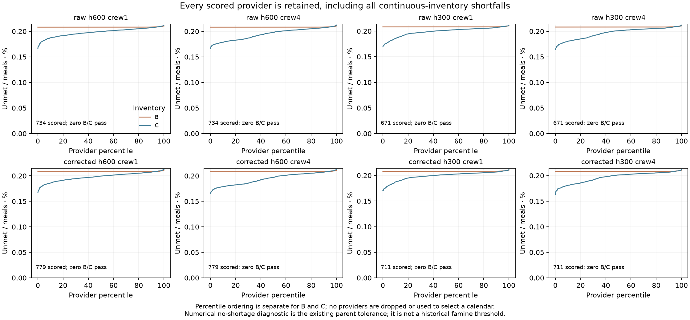
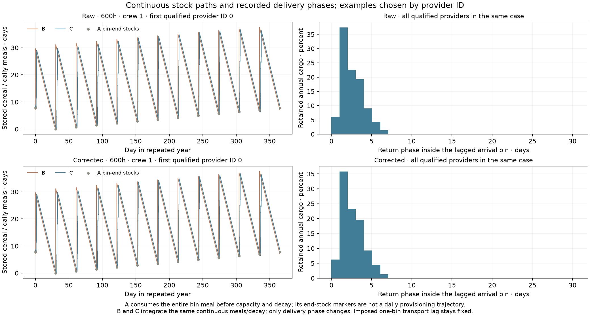

# Destination inventories under fixed collector delivery times

Declaration `970bd428` preceded production outputs. This is a destination-only
cereal accounting audit on exposed development scenarios. It does not supply
new historical observations or qualify source food timing,crew-carried rations,
food location,complete diets,actual hunger or political authority.

## Matched comparison and actual finding

All eight coherent provider-year scenarios retain EVERY already-qualified
provider. Other providers remain explicitly unscored;their exclusion is not an
absence-of-community claim. Original residents,staff,origin owners,shipments,
selected calendars,90-day destination storage,2500 kcal/person/day,365-day year
and 5% annual stored-food loss stay fixed. Institutional people are included in
the same parent resident count once. The original imposed ONE-BIN dispatch lag
and 0.95 transport retention remain;retention is applied ONCE.

* A replays the exact original twelve-bin inventory:all of a bin's meals are
  eaten immediately after supply,capacity is applied to what remains,then
  storage loss is charged. Its residual energy gaps satisfy the original
  parent no-shortage tolerance for every scored provider.
* B uses continuous constant meals and exponential stored-food decay,with the
  same shipments pulsed at their original destination-bin starts. Capacity
  clips immediately after supply. A-to-B changes the inventory convention;
  it is NOT a pure delivery-phase effect.
* C keeps B's continuous inventory but pulses cargo at the selected collector
  job's return phase INSIDE its already-lagged destination bin. Only B-to-C
  isolates the declared delivery-phase change.

Every provider fails the same numerical no-shortage diagnostic in B and C.
Aggregate unmet cereal is about 0.2083% of annual meals in B and0.1909–0.1964%
in C. Recorded phases reduce the accounting gaps in all eight cases but do
not eliminate them. A complete twelve-bin worker calendar therefore does not
establish destination food sufficiency under this continuous accounting.
This does not prove an unavoidable physical shortfall:shipments/residents and
the parent's meal/stock convention were frozen,not jointly replanned here.

The source plans are tightly matched to the original meals-first recurrence.
Continuous meals keep cereal in storage during the bin and charge decay on
that stock. Later delivery can reduce storage exposure. This explains why
A-to-B must be shown separately from B-to-C. No extra supplies or externally
borrowed initial reserve are inserted to repair the result.

## All 24 declared rows

No-shortage means unmet <=1e-8*max(1,annual needed kcal),the unchanged parent
numeric diagnostic. This is not a fitted famine or historical significance
threshold. Empty days in B/C integrate time after stock depletion;A's days
remain its original coarse-bin diagnostic. Summed peak stocks and empty days
are per-provider quantities,not a simultaneous regional stock or outage.

|Climate|Farm h|Crew|Inventory|Providers|No-shortage|Unmet kcal|Unmet %|Mean empty days|
|---|---:|---:|---|---:|---:|---:|---:|---:|
|Raw|600|1|A|734|734|17.478|0.000000|0.0000|
|Raw|600|1|B|734|0|517,408,296.656|0.208277|0.7602|
|Raw|600|1|C|734|0|484,913,683.057|0.195197|0.7230|
|Raw|600|4|A|734|734|17.478|0.000000|0.0000|
|Raw|600|4|B|734|0|517,408,296.656|0.208277|0.7602|
|Raw|600|4|C|734|0|475,276,478.689|0.191318|0.7109|
|Raw|300|1|A|671|671|15.150|0.000000|0.0000|
|Raw|300|1|B|671|0|445,587,947.145|0.208280|0.7602|
|Raw|300|1|C|671|0|419,338,368.790|0.196010|0.7266|
|Raw|300|4|A|671|671|15.150|0.000000|0.0000|
|Raw|300|4|B|671|0|445,587,947.145|0.208280|0.7602|
|Raw|300|4|C|671|0|412,751,784.720|0.192932|0.7173|
|Corrected|600|1|A|779|779|18.820|0.000000|0.0000|
|Corrected|600|1|B|779|0|557,997,269.760|0.208286|0.7602|
|Corrected|600|1|C|779|0|522,225,216.191|0.194933|0.7225|
|Corrected|600|4|A|779|779|18.820|0.000000|0.0000|
|Corrected|600|4|B|779|0|557,997,269.760|0.208286|0.7602|
|Corrected|600|4|C|779|0|511,512,940.610|0.190935|0.7100|
|Corrected|300|1|A|711|711|15.783|0.000000|0.0000|
|Corrected|300|1|B|711|0|471,720,682.450|0.208273|0.7602|
|Corrected|300|1|C|711|0|444,850,133.382|0.196410|0.7271|
|Corrected|300|4|A|711|711|15.783|0.000000|0.0000|
|Corrected|300|4|B|711|0|471,720,682.450|0.208273|0.7602|
|Corrected|300|4|C|711|0|438,182,109.796|0.193465|0.7181|

## Cargo,periodicity and independent review

For each selected collector trip,original origin/month/serial identifies
cargo=min(120000,max(0,original departures-120000*serial)). Retained cargo is
0.95 times that amount. Delivery time=((origin month+1)*365/12+recorded return
hours/7) modulo365days. Every original trip identity,cargo remainder,owner,
arrival-bin total and annual destination total is checked. Event downloads
combine simultaneous deliveries at the same provider/time and retain their
trip counts;source schedule hashes retain the underlying trip identities.

Between pulses,ds/dt=-daily meals-hazard*s until depletion,with
hazard=-log(0.95)/365. Pulses spill immediately above the unchanged capacity.
The annual inventory map is a clipped affine map;its smallest repeating stock
is calculated without assuming a free inherited reserve. A periodic shortage
can repeat,so convergence is distinct from sufficiency.

Ten manufactured controls ran before production:closed-form decay/depletion,
zero loss/demand/capacity,minimum repeating reserve,periodic shortage,overflow,
split/combined simultaneous pulses,meal/capacity convention,input preservation,
retained delay/year wrap/retention once,and invalid cargo/serial/clock inputs.
Random controls compare the analytic fixed point against scalar bisection.
The independent production reviewer imports neither inventory nor cargo model.
It reconstructs every original trip,uses scalar integration and independently
solves all periodic stocks by bracketing. It checks consumed+unmet=needed and
initial+supply=consumed+spoilage+overflow+final,every provider CSV field,all 18
actor rows in each scenario,and the matched inputs. Fresh results,fields,
provider CSV and eight aggregated event exports are byte exact.

Independent review checked 17,427,262 original trip identities, 2,532,803 aggregated events and 17,370 provider/accounting inventories.

## Publication and remaining programme

All existing atlas packets,point maps and defaults stay byte unchanged.
The coherent-year maps describe a necessary worker scheduling gate;they are
not retroactively replaced by this separate destination accounting audit.
Normal research publishes all 24rows,the figures and all output downloads.

Replanning must keep the same finite source/food/work ledger and then recheck
source availability,integer collector jobs and actual worker intervals.
An unchanged-shipments demand-headroom diagnostic is a bounded next step;it
would not reallocate people or qualify actual populations. Dated occupancy,
settlement sizes/provider functions,prospective transfer,mobile/nonstate and
unaffiliated resources,source within-bin availability,crew rations/location,
complete diets and household/draft work remain open across release1–4/S1–S5.
No calibrated default or empirical adoption is made. The full historical
publisher still needs an omitted private Vidarbha cache;this direct publisher
preserves the earlier research page and does not claim a full rebuild.
