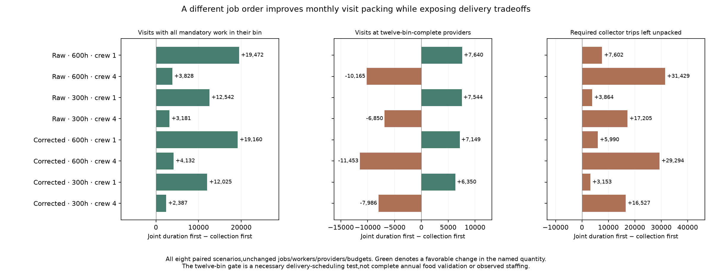
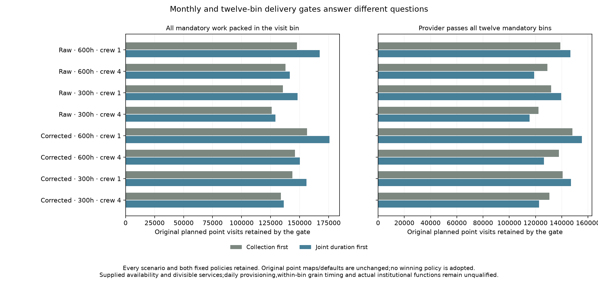
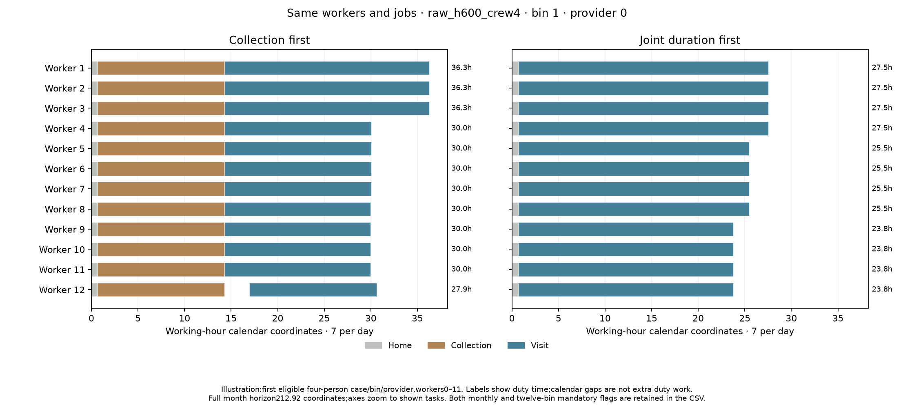

# Fixed job-order comparison and necessary delivery gates

Declaration `e4d274da` preceded outputs. Eight original scenarios are compared
under two fixed policies,all sixteen rows retained. Original targets,visits,
providers,collector trips,food plans,staff,worker caps and maps are unchanged.
This is a constructive scheduling experiment with no winning-policy adoption.

## Frozen alternative and distinct gates

Home services remain divisible and equally shared first. The alternative
merges collection and visit jobs by decreasing per-worker duration;collection
wins equal-duration ties,then origin/trip serial or actor/target resolves ties.
Workers have the original fifty duty hours per bin and212.92 working-hour
calendar horizon. Collector jobs use the earliest available eligible worker;
visits synchronize the earliest eligible supported crew. All jobs are whole.
Grouping identical-origin jobs preserves exact serial order and only saves
memory/runtime. Calendar idle is not additional duty time.

A visit can be physically scheduled before collection later fails. Its actual
worker intervals and hours remain charged. Bin qualification requires ALL
mandatory collection/home work at that provider in the bin. The twelve-bin gate
additionally requires an originally active provider to complete every mandatory
bin. It is a necessary delivery-scheduling test,not daily provisioning,within-bin
grain timing,complete annual food validation or evidence of observed staffing.
Inactive/missing-inventory,unaffiliated and mobile contexts remain unscored.

## All outcomes

|Climate|Farm h|Crew|Order|Physical visits|Bin-qualified|Twelve-bin-gated|Collector trips unpacked|Providers passing twelve bins|
|---|---:|---:|---|---:|---:|---:|---:|---:|
|raw|600|1|Collection first|147,819|147,819|138,905|11,630|734 / 861|
|raw|600|1|Joint duration first|171,761|167,291|146,545|19,232|715 / 861|
|raw|600|4|Collection first|137,796|137,796|129,049|11,630|734 / 861|
|raw|600|4|Joint duration first|155,315|141,624|118,884|43,059|631 / 861|
|raw|300|1|Collection first|135,630|135,630|131,918|4,825|671 / 725|
|raw|300|1|Joint duration first|150,427|148,172|139,462|8,689|658 / 725|
|raw|300|4|Collection first|125,940|125,940|122,266|4,825|671 / 725|
|raw|300|4|Joint duration first|136,593|129,121|115,416|22,030|599 / 725|
|corrected|600|1|Collection first|156,465|156,465|148,143|10,932|779 / 889|
|corrected|600|1|Joint duration first|178,980|175,625|155,292|16,922|755 / 889|
|corrected|600|4|Collection first|145,972|145,972|137,822|10,932|779 / 889|
|corrected|600|4|Joint duration first|163,198|150,104|126,369|40,226|668 / 889|
|corrected|300|1|Collection first|143,809|143,809|140,608|4,214|711 / 755|
|corrected|300|1|Joint duration first|157,657|155,834|146,958|7,367|697 / 755|
|corrected|300|4|Collection first|133,867|133,867|130,678|4,214|711 / 755|
|corrected|300|4|Joint duration first|144,196|136,254|122,692|20,741|634 / 755|

The mixed order raises bin-qualified visits in all eight scenarios,but leaves
more required collector trips unpacked. For raw600h/four-person crews,the
bin-qualified count rises137,796→141,624 while the twelve-bin-gated count falls
129,049→118,884. Corrected600h/four-person counts similarly rise145,972→150,104
within bins but fall137,822→126,369 through the twelve-bin gate. With one-person
crews,the gated visit count increases even though fewer providers complete all
twelve mandatory bins. These are different quantities;none can substitute for
the other. Every gain and loss is preserved rather than selecting a policy.

## Review,publication and remaining work

Nine manufactured controls cover collection-first fragmentation recovery,
scheduled visits with later collection failure,equal-duration priority,
synchronized crews,idle/duty separation,post-idle collector eligibility,
empty/zero-resource cases,deterministic ties,nonmutation and invalid inputs.
The earlier seven worker-calendar controls also pass.

The independent reviewer imports no new allocator. It reproduces the mixed
order using scalar sorted worker lists and checks every collector job identity,
worker interval,crew,provider,task duration,calendar/duty cap and monthly channel
ledger. Physically scheduled work remains charged when mandatory collection
fails. Both policies' twelve-bin flags and all actor/bin summaries are derived
again from individual bins. Original baseline schedules remain byte exact;
all96mixed monthly packets plus results and qualification fields replay freshly
byte for byte. Failure under either greedy rule is not proof of impossibility.

The normal evidence atlas includes all sixteen rows,three figures and the
result/review/replay/prior-declaration and matched-worker CSV downloads. The
illustration selects the first eligible four-person case/bin and lowest
provider with both policies scheduling visits and collection,workers0–11.
The CSV preserves bin and twelve-bin flags alongside each worker interval.
This illustrative subset is not a selected evaluation cohort.

Next predeclare any provider-wise combination or other construction before its
outputs. A complete year must use a coherent schedule at each provider;mixing
individual job successes from different calendars can double-use workers. Keep
annual mandatory-delivery gates explicit and retain original results. No
combined-policy map or default is part of this experiment.

The entire release1–4/S1–S5 programme remains active. Dated provider functions,
occupation/resident sizes,prospective transfer,complete diets/household/draft
work,daily provisioning and mobile/nonstate/unaffiliated resources remain open.
No new Earth observations or empirical authority qualification are introduced.
The historical full evidence rebuild still needs an omitted private Vidarbha
cache;this reviewed direct publisher preserves all earlier panels.
