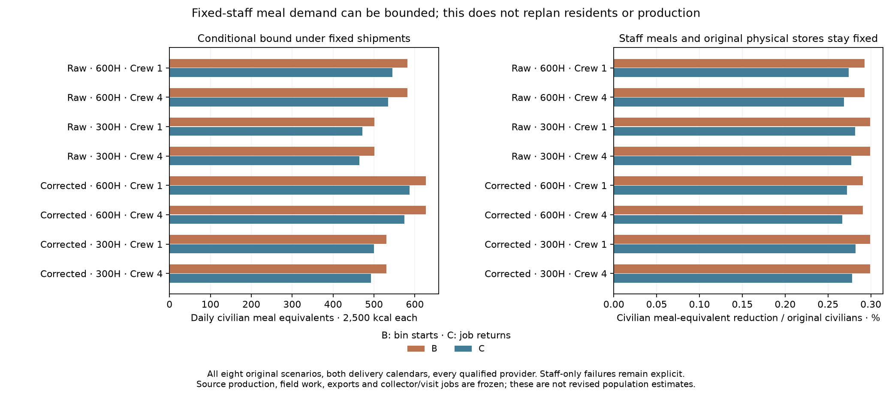
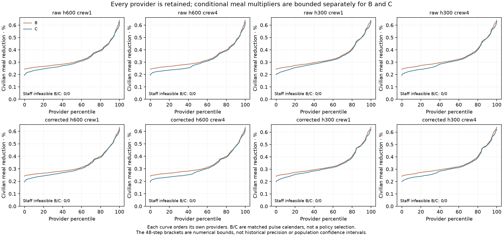

# Fixed-staff civilian meal bounds under unchanged shipments

Declaration `ed6ae653` preceded production outputs. The destination timing
audit exposed small continuous-inventory cereal gaps in the existing resident
plans. This follow-up bounds civilian meal demand under those SAME shipments;
it does not replan residents, production or worker jobs.

## What stays fixed

Every provider already qualified by a complete worker calendar remains in
scope for all eight scenarios and both pulse calendars B/C (16 rows). B pulses
at the original destination-bin starts;C retains selected collector return
phases inside the already-lagged arrival bins. The original one-bin lag and
0.95 transport retention stay unchanged;cargo is not retained a second time.

Institutional residents and their meals stay fixed. Only original civilian
meals are multiplied by alpha in [0,1]. Trial demand is
2500*(original institutional residents + alpha*original civilians) kcal/day.
Storage keeps its ORIGINAL physical capacity: 90 days of the parent total
resident meals. It is not reduced as alpha decreases. Stored-food loss stays
5%/year;the year stays 365 days. No grain,source production,staff,job,provider
assignment or policy is added or removed.

The two population components are checked against the original total;staff
meals are included exactly once. Sources retain monthly availability assumptions.
No crew-carried food or food location is tracked. A bound on destination meals
does not validate source within-bin availability or complete provisioning.

## Frozen numeric rule and all outcomes

Score alpha=0 and1 first. A staff-only failure has NO feasible civilian bound;
it remains explicit,not a fictitious zero-population solution. Full-demand
success keeps alpha=1. Otherwise,48 deterministic bisections retain a passing
and failing alpha. Each trial finds the smallest repeating nonnegative stock,
without an externally borrowed initial reserve. The same parent diagnostic is
used throughout: unmet <=1e-8*max(1,annual needed kcal).

These fine brackets are numeric solver bounds,not historical precision or
population confidence intervals. The independent scalar review uses a separate
24-step bracket and reports its resolution and floating-point ledger tolerance.
It explicitly records final endpoints that lie within scalar grain roundoff
of the no-shortage threshold;no independent bit-level agreement is claimed.

There are 0 staff-only failures and 0 full-demand passes across the 16 rows.

|Climate|Farm h|Crew|Pulse model|Providers|Staff infeasible|Full demand passes|Civilian meal-equivalent reduction|Reduction %|
|---|---|---|---|---|---|---|---|---|
|Raw|600|1|B|734|0|0|581.429|0.29240|
|Raw|600|1|C|734|0|0|544.931|0.27405|
|Raw|600|4|B|734|0|0|581.429|0.29240|
|Raw|600|4|C|734|0|0|534.105|0.26860|
|Raw|300|1|B|671|0|0|500.715|0.29920|
|Raw|300|1|C|671|0|0|471.225|0.28158|
|Raw|300|4|B|671|0|0|500.715|0.29920|
|Raw|300|4|C|671|0|0|463.824|0.27716|
|Corrected|600|1|B|779|0|0|627.013|0.29070|
|Corrected|600|1|C|779|0|0|586.821|0.27207|
|Corrected|600|4|B|779|0|0|627.013|0.29070|
|Corrected|600|4|C|779|0|0|574.783|0.26649|
|Corrected|300|1|B|711|0|0|530.098|0.29931|
|Corrected|300|1|C|711|0|0|499.914|0.28226|
|Corrected|300|4|B|711|0|0|530.098|0.29931|
|Corrected|300|4|C|711|0|0|492.412|0.27803|

“Civilian meal-equivalent reduction” sums original civilian count*(1-alpha)
where a feasible staff-preserving bound exists. It is not a census reduction,
migration,mortality or a valid revised population estimate. Staff-infeasible
providers are counted separately and never assigned a fabricated feasible bound.

## Verification and reproducibility

Six new controls ran before production alongside the ten continuous inventory
controls:fixed staff,unchanged physical stores,staff-only failure,full-demand
pass,tight intermediate bounds,minimum repeating reserve,determinism and input
preservation are covered. Every output retains the staff/full-demand/final
passing/final failing inventory fields and validity flags. All actor summaries
retain their complete scored cohorts. Unqualified sources remain unscored.

The independent reviewer imports neither meal solver nor food-event primitive.
It uses scalar continuous integration and a separate stock root search to
bracket each demand bound;it checks every final inventory,cargo/staff/capacity
input,provider CSV field and actor summary. Conservation and periodicity are
separate from food sufficiency. Fresh results,fields and provider CSV are byte
exact. Existing atlas packets,point maps and defaults remain unchanged.

Independent review checked 11,580 provider/accounting bounds and 46,320 endpoint inventories.

## What this does and does not advance

The bound shows how small a destination-only meal adjustment can close the
declared numeric accounting gaps while preserving staff meals. It is NOT a
valid resident rebuild:changing actual civilian residents also changes field
work,rural meals,source exports and integer collector jobs. Those remain frozen
here,so the meal equivalents cannot be exported as a new population map.

The next model step is a versioned continuous destination-bin inventory inside
the finite source/food/work resident feedback,with all previous code preserved.
Its own controls and declared comparison must precede production outputs.
Any later map needs fresh source/cargo/calendar checks and a return-phase audit;
a bin-start food pass alone cannot qualify a different arrival calendar.

The whole release1–4/S1–S5 programme remains open:dated occupation,compatible
settlement sizes/provider functions,prospective transfer,source within-bin
availability,crew food/location,complete diets and household/draft work,and
mobile/nonstate/unaffiliated resources remain unresolved. No calibrated default
or empirical population/authority adoption is made. Normal research publishes
all outcomes and downloads;the direct publisher preserves earlier panels.
The full historical publisher still needs the omitted private Vidarbha cache.
