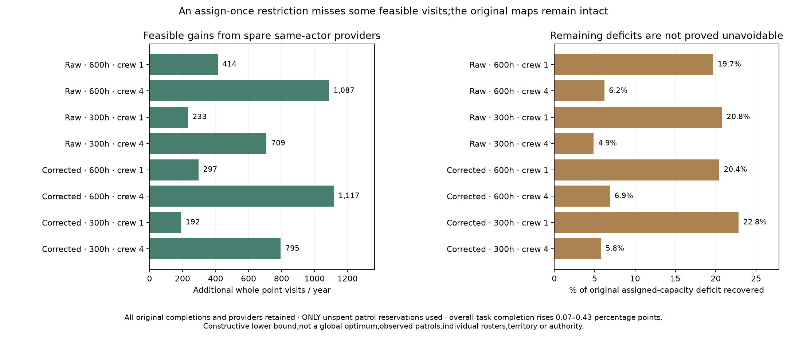

# A constructive spare-provider visit extension

Declaration `75e7fd16` preceded these outputs. All eight existing walking
point-task scenarios are retained; no new data, targets, routes, people, food,
institutional staff or work hours are introduced. This is an allocation
diagnostic, not a new point-map version or empirical qualification.

Keep every original completed task and its provider immutable. Begin with the
same provider's unspent patrol reservation, not unused gross hours. Only
original assigned-capacity-unmet tasks can be added. Retain valid walking
routes from active, crew-supported, same-actor providers. Order pending tasks
by cheapest eligible crew-hour cost, then actor and target. For each once,
choose the cheapest provider whose current spare slice affords the whole task,
breaking provider ties by index. Debit its exact crew-hours. Do not reroute
original visits, borrow collection/service work, split tasks or cross bins.

|Climate|Farm hours|Crew|Original visits|Added|Extended visits|Capacity still unmet|
|---|---:|---:|---:|---:|---:|---:|
|Raw|600|1|171,885|414|172,299|1,690|
|Raw|600|4|155,572|1,087|156,659|16,460|
|Raw|300|1|150,501|233|150,734|888|
|Raw|300|4|136,787|709|137,496|13,831|
|Corrected|600|1|179,097|297|179,394|1,157|
|Corrected|600|4|163,423|1,117|164,540|15,065|
|Corrected|300|1|157,726|192|157,918|649|
|Corrected|300|4|144,383|795|145,178|12,942|

Overall completion rises by 0.07–0.43 percentage points of the conditional
requests. One-person cases recover 19.7–22.8% of their smaller assigned-capacity
deficits; four-person cases recover 4.9–6.9%. Unreachable and initially
unaffordable-crew partitions cannot improve through spending only remaining
hours and remain identical. This constructive gain proves that some original
misses are caused by assignment restrictions. It neither proves global
optimality nor makes the remaining deficits physically unavoidable.

Six manufactured controls cover recovery, actor isolation, original-task
exclusion, crew multiplication/support, deterministic order/ties, zero/tiny
budgets, overflow and input preservation. The independent scalar reviewer
imports no new allocation code. All eight cases reproduce exactly, every added
task belongs to original capacity-unmet demand, route costs belong to its
specific provider, and original completions/providers remain intact. All
actor/bin partitions and monthly patrol/full-provider ledgers pass. Fresh
result/field files are byte exact. Zero spare-budget controls add no visits.

All original point maps and earlier packet files remain byte unchanged. The
normal evidence atlas publishes the eight-case table, chart, results, review,
replay and prior declaration. The extension remains a diagnostic. A different
map family would need a separate declaration and publication checks.

Next test the arbitrary target-grid spacing and phase under a prior declaration,
with matched original allocation and full actor/request/route/work checks.
Individual daily rosters and provisioning, observed demand/provider functions,
dated sizes/occupation, prospective transfer, complete diets/household/draft
work and mobile/nonstate/unaffiliated resource integration remain open across
the entire release 1–4/S1–S5 programme. No political authority or calibrated
default is inferred from successful task accounting.
