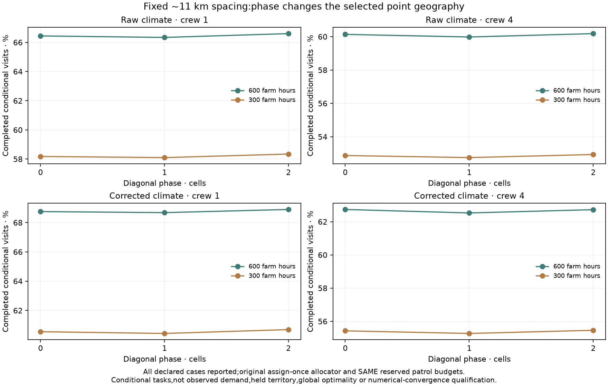
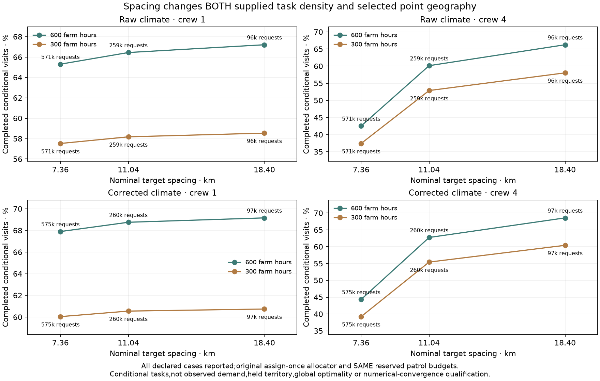
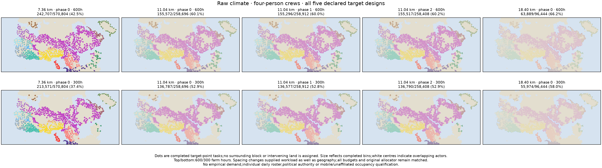
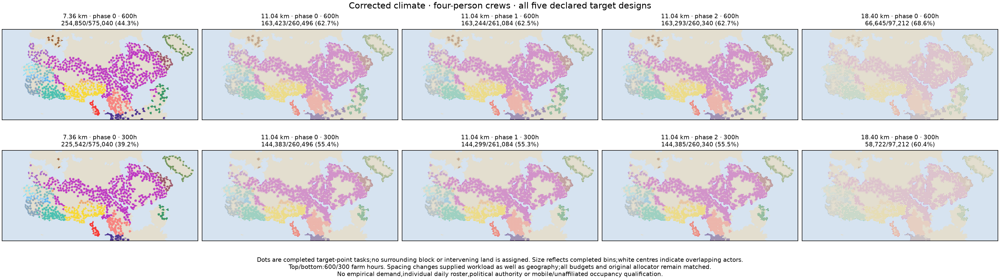

# Target-grid spacing and phase audit

Declaration `4f592bfe` preceded all outputs. Five designs × eight original
raw/corrected,600/300 farm-hour,crew1/4 scenarios produce forty reported cases.
Every scenario uses the original assign-once allocator and SAME reserved patrol
slice;the spare-provider extension is excluded to isolate grid definitions.
All original point maps,other packet files and production defaults are retained.

## Geometry and matched physical checks

The declared designs are block2/3/5 with phase0,plus block3 with diagonal phases
1 and2. Nominal edges are 7.3605,11.0407 and18.4012 km. Tile from negative phase
offsets in block-size steps,clip at raster bounds,and select the majority-land
cell nearest each clipped tile's geometric centre;lowest global grid ID breaks
ties. Every land cell belongs to one represented tile. Target IDs match exactly
between climates. Neither population,roads,actors nor outcomes select targets.

Retain the original conditional actor/point demand definition and one task per
bin,including unreachable bins. Same directed walking graphs,seasonal costs,
two-day leg/four-day roundtrip-plus-on-site limits,crew support,integer work and
collection/service commitments apply. No ferries or sea/river auxiliary edges
are introduced. Raw/corrected paths use the same graph hashes as the original.

## Findings and scope

At fixed nominal11.04km spacing,the three declared phases change completed
fractions by 0.185–0.265 percentage points across the eight scenarios. This
measures these three diagonal phases only;it does not establish invariance to
all target placements or unseen occupations.

Spacing changes workload strongly. In corrected600h/four-person scenarios,
7.36km targets request575,040 tasks and complete254,850(44.319%);11.04km requests
260,496 and completes163,423(62.735%);18.40km requests97,212 and completes66,645
(68.556%). Finer spacing completes more total tasks while meeting a smaller
fraction of its larger request set. This combines supplied task-density and
geographic-sampling effects;it is not numerical-convergence evidence or a
reason to choose the coarsest grid. All forty cases follow.

|Design|Climate|Farm hours|Crew|Targets|Completed / requested|Completed|No route|No affordable crew|Capacity unmet|
|---|---|---:|---:|---:|---:|---:|---:|---:|---:|
|b2_p0|raw|600|1|61,584|372,742 / 570,804|65.301%|178,716|8,292|11,054|
|b2_p0|raw|600|4|61,584|242,707 / 570,804|42.520%|178,716|10,264|139,117|
|b2_p0|raw|300|1|61,584|328,347 / 570,804|57.524%|232,858|3,212|6,387|
|b2_p0|raw|300|4|61,584|213,571 / 570,804|37.416%|232,858|3,928|120,447|
|b2_p0|corrected|600|1|61,584|390,424 / 575,040|67.895%|168,424|8,098|8,094|
|b2_p0|corrected|600|4|61,584|254,850 / 575,040|44.319%|168,424|10,201|141,565|
|b2_p0|corrected|300|1|61,584|345,241 / 575,040|60.038%|221,910|2,777|5,112|
|b2_p0|corrected|300|4|61,584|225,542 / 575,040|39.222%|221,910|3,710|123,878|
|b3_p0|raw|600|1|27,843|171,885 / 258,696|66.443%|80,959|3,748|2,104|
|b3_p0|raw|600|4|27,843|155,572 / 258,696|60.137%|80,959|4,618|17,547|
|b3_p0|raw|300|1|27,843|150,501 / 258,696|58.177%|105,597|1,477|1,121|
|b3_p0|raw|300|4|27,843|136,787 / 258,696|52.876%|105,597|1,772|14,540|
|b3_p0|corrected|600|1|27,843|179,097 / 260,496|68.752%|76,332|3,613|1,454|
|b3_p0|corrected|600|4|27,843|163,423 / 260,496|62.735%|76,332|4,559|16,182|
|b3_p0|corrected|300|1|27,843|157,726 / 260,496|60.548%|100,712|1,217|841|
|b3_p0|corrected|300|4|27,843|144,383 / 260,496|55.426%|100,712|1,664|13,737|
|b3_p1|raw|600|1|27,910|171,761 / 258,912|66.340%|81,276|3,717|2,158|
|b3_p1|raw|600|4|27,910|155,296 / 258,912|59.980%|81,276|4,601|17,739|
|b3_p1|raw|300|1|27,910|150,424 / 258,912|58.099%|105,930|1,422|1,136|
|b3_p1|raw|300|4|27,910|136,577 / 258,912|52.750%|105,930|1,734|14,671|
|b3_p1|corrected|600|1|27,910|179,315 / 261,084|68.681%|76,698|3,623|1,448|
|b3_p1|corrected|600|4|27,910|163,244 / 261,084|62.525%|76,698|4,595|16,547|
|b3_p1|corrected|300|1|27,910|157,771 / 261,084|60.429%|101,210|1,262|841|
|b3_p1|corrected|300|4|27,910|144,299 / 261,084|55.269%|101,210|1,659|13,916|
|b3_p2|raw|600|1|27,922|172,104 / 258,408|66.602%|80,389|3,749|2,166|
|b3_p2|raw|600|4|27,922|155,517 / 258,408|60.183%|80,389|4,637|17,865|
|b3_p2|raw|300|1|27,922|150,760 / 258,408|58.342%|105,032|1,480|1,136|
|b3_p2|raw|300|4|27,922|136,790 / 258,408|52.936%|105,032|1,782|14,804|
|b3_p2|corrected|600|1|27,922|179,366 / 260,340|68.897%|75,874|3,694|1,406|
|b3_p2|corrected|600|4|27,922|163,293 / 260,340|62.723%|75,874|4,663|16,510|
|b3_p2|corrected|300|1|27,922|158,011 / 260,340|60.694%|100,208|1,281|840|
|b3_p2|corrected|300|4|27,922|144,385 / 260,340|55.460%|100,208|1,705|14,042|
|b5_p0|raw|600|1|10,338|64,815 / 96,444|67.205%|29,914|1,412|303|
|b5_p0|raw|600|4|10,338|63,889 / 96,444|66.245%|29,914|1,764|877|
|b5_p0|raw|300|1|10,338|56,457 / 96,444|58.539%|39,294|562|131|
|b5_p0|raw|300|4|10,338|55,974 / 96,444|58.038%|39,294|687|489|
|b5_p0|corrected|600|1|10,338|67,228 / 97,212|69.156%|28,340|1,356|288|
|b5_p0|corrected|600|4|10,338|66,645 / 97,212|68.556%|28,340|1,730|497|
|b5_p0|corrected|300|1|10,338|59,045 / 97,212|60.738%|37,579|450|138|
|b5_p0|corrected|300|4|10,338|58,722 / 97,212|60.406%|37,579|619|292|

## Independent review and reproducibility

Four manufactured geometry controls check clipping,phases,ties,full land/area
coverage,input preservation and exact original zero-phase geometry. The
independent reviewer imports neither the new selector nor allocation code.
It groups land cells independently,rebuilds directed graphs,checks every path
edge/cost/endpoint,recomputes eligible source-target sets and confirms all
walking land footprints remain within the old full-network reference. It uses
the same established SciPy shortest-path algorithm,not a second path algorithm.
Scalar assignment,whole tasks,all actor/bin partitions,zero-budget controls and
full monthly provider ledgers pass for every scenario.

The original b3_p0 targets,recorded paths and all allocation arrays reproduce
exactly;its complete NPZ is byte identical to the original eight-case packet.
Fresh route/target packets,results and all five field bundles are byte exact.
Route packets are split by month/design to bound memory and individual file
sizes. No failed design is dropped and no source/food/work gate is relaxed.

The normal evidence atlas includes all forty cases,four figures,results,
review,replay,summary and prior declaration. Full source/route/allocation arrays
are preserved under output/network_visit_target_grid_20261112 in the repository.
Earlier optional point maps and all normal defaults remain unchanged.

This remains conditional monthly staff-hour accounting. Observed demand,
institutional functions,dated residents/occupation,prospective transfer,
individual crew calendars and daily provisioning remain unqualified. Complete
diets,household/draft work and mobile/nonstate/unaffiliated resource integration
remain open throughout release1–4/S1–S5. No territorial authority is inferred.
