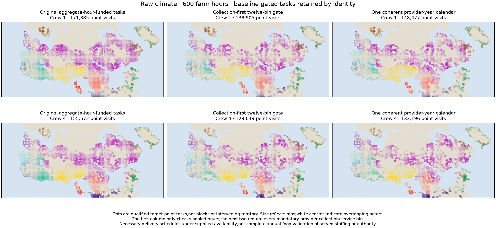
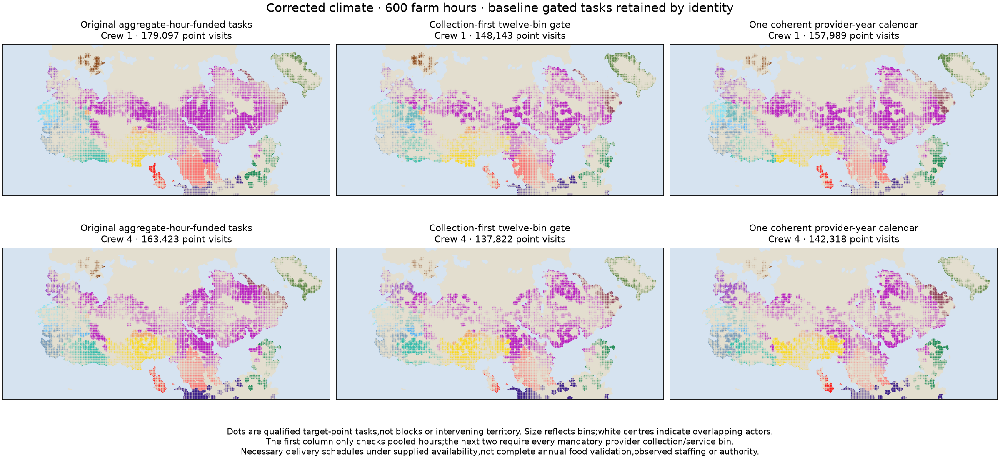
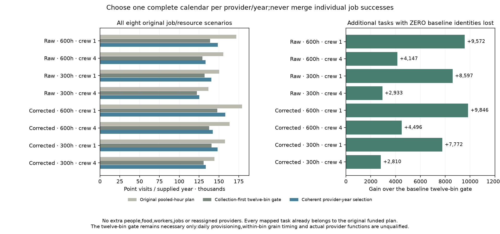

# Point visits from coherent provider-year calendars

Declaration `00d70d62` preceded outputs. This is development on exposed resource
scenarios,not a blind Earth test or a calibrated policy choice. All eight
original b3_p0 scenarios,food plans,people,staff,roads,requests and jobs remain
fixed. A provider uses ONE checked calendar across ALL twelve bins;individual
job successes from conflicting calendars are never combined.

## Frozen selection and necessary gate

Keep a baseline provider-year that completes all mandatory work unless the
joint-duration year also completes it,contains EVERY baseline packed
actor/target/bin identity,and adds at least one task. Equal sets or any lost
baseline identity retain the baseline. If only the joint year completes all
mandatory work,choose it. If neither passes,retain the baseline as an unqualified
physical trace and map no qualified visits from that provider. Inactive sources
cannot pass through empty obligations.

Qualified visits must be physically scheduled by the chosen provider-year and
belong to the original funded point plan. Every mandatory collector trip and
home-service bin must be packed for that source across all twelve bins.
Selected physical work remains charged even at unqualified providers. Worker
caps,patrol reservations,collection/service commitments and original source-food
gates remain intact. The year flag is a NECESSARY delivery-scheduling gate under
the unchanged monthly food model,not daily provisioning,within-bin grain timing,
complete annual food validation,observed provider roles or political authority.

## All eight cases

|Climate|Farm h|Crew|Original funded|Baseline twelve-bin|Selected qualified|Added|Qualified providers|Joint-order provider-years|
|---|---:|---:|---:|---:|---:|---:|---:|---:|
|raw|600|1|171,885|138,905|148,477|+9,572|734|294|
|raw|600|4|155,572|129,049|133,196|+4,147|734|215|
|raw|300|1|150,501|131,918|140,515|+8,597|671|222|
|raw|300|4|136,787|122,266|125,199|+2,933|671|167|
|corrected|600|1|179,097|148,143|157,989|+9,846|779|325|
|corrected|600|4|163,423|137,822|142,318|+4,496|779|243|
|corrected|300|1|157,726|140,608|148,380|+7,772|711|227|
|corrected|300|4|144,383|130,678|133,488|+2,810|711|170|

The qualified-provider flags happen to equal the baseline flags in all eight
cases. Gains are additional tasks within the same qualified cohorts;this is
not a general invariance theorem or evidence of additional institutions.

Gains range from2,810 to9,846 point visits. Every baseline twelve-bin-gated task
is retained elementwise,and every final task is already in the original funded
plan. The selected counts remain below that pooled-hour plan:whole worker jobs
and mandatory collection still constrain the result. Candidate residents and
their parent food ledgers are not reallocated when calendar qualification fails.

## Review and exports

Nine new controls check strict-superset choice,rejection of higher counts that
lose a baseline identity,ties,baseline failure/joint recovery,neither year
complete,inactive providers,original funded-task bounds,twelve-bin coherence
and input preservation. Independent review imports no selector. It reconstructs
policy choices from task identities and individual completion bins,checks both
source physical certificates and selected worker-ledger blocks,and verifies all
actor/bin request partitions. Original calendar files and maps remain unchanged.
Fresh result/field files and22point-map/model/CSV/field exports are byte exact.

The independent export review checks all actor/target masks,visited-point pixel
colors,provider policies,worker hours,unchanged conditional resident/food ledgers
and every point CSV record. Requests partition into qualified visits,calendar
unqualified originally funded jobs,and the unchanged route/initial-crew/capacity
deficits. Baseline masks are subsets of final masks;final masks are subsets of
the original funded plan. Each point CSV preserves original funded providers
by bin,their single year policy and mandatory-year flag. Providers may differ
between a point's bins under the original assignment rule;none are reassigned.

## Atlas and remaining programme

Under Experimental & diagnostics → Supply-supported reach,choose “Complete-year
collection schedule”. Eight distinct optional maps show qualified POINTS,not
blocks or intervening territory. Fourteen provider readouts include selected
year policy and the twelve-bin flag. Provider CSVs retain monthly physical work
even when unqualified;point CSVs retain all requests and five deficit masks.
Full choices/point fields are downloadable. All earlier map families and defaults
remain available. Unaffiliated,mobile and missing-inventory contexts stay
unscored;unrostered providers do not establish absent communities.

The normal research atlas publishes all eight rows,three figures and the
result/selection-review/export-review/fresh-replay/prior-declaration downloads.
Further scheduling diagnostics do not replace dated size/occupation/provider
evidence,prospective transfer,complete diets/household/draft work,daily food or
mobile/nonstate/unaffiliated resource integration. The whole release1–4/S1–S5
programme remains open and no calibrated default is adopted.

The historical full evidence publisher still needs an omitted private Vidarbha
Earth cache. This reviewed direct publisher preserves every earlier panel and
does not claim a full historical rebuild.
