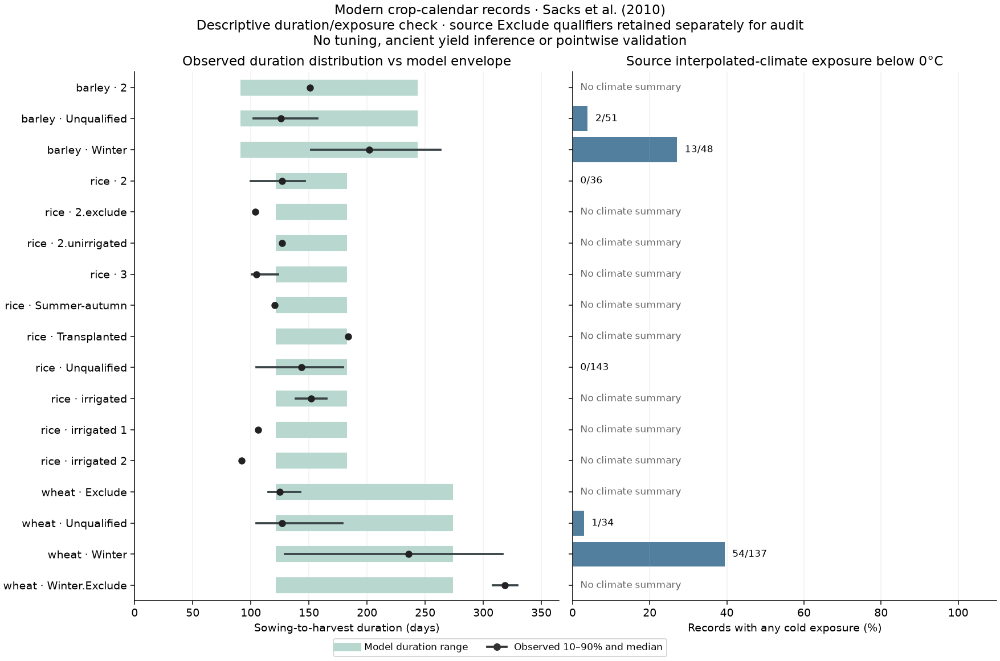

# Observed crop calendars: duration and winter exposure

The fixed diagnostic uses the authors' public CSV accompanying
[Sacks et al. (2010)](https://doi.org/10.1111/j.1466-8238.2010.00551.x).
Its plan was committed before inspecting group distributions or model comparison
results: `calibration/crop_calendar_observations_20261103/plan.json`.
No parameters were changed or fitted.

Of 1,510 raw records, 481 mapped wheat, barley and rice records pass basic date
and unique-ID checks. Nine have an original source `Exclude` qualifier; these
stay in separate flagged groups for audit, leaving 472 unflagged records.
Four mapped records lack usable dates/duration. Generic millet is not silently
equated to the model's foxtail millet. Original winter, secondary-season and
other qualifiers are retained rather than pooled.

## Findings

| Selected unflagged group | Records | Duration outside model envelope | Still outside with a full-bin (30.4-day) margin | Below-zero seasonal climate exposure |
|---|---:|---:|---:|---:|
| Winter wheat | 138 | 55 | 22 | 54 /137 available climate summaries |
| Winter barley | 49 | 13 | 2 | 13 /48 |
| Unqualified rice | 145 | 36 | 2 | 0 /143 |

The plot and downloadable data retain every qualifier group, including author
flags. Missing climate summaries are labelled unavailable, rather than counted
as no cold exposure. Counts concern calendar records; regions and successive
seasons can overlap, so no independent confidence intervals are implied.

## What this establishes

Our existing crop duration bounds and all-window search cannot represent every
observed season duration, particularly some winter-wheat seasons. Passing the
duration envelope is only necessary: it is not a predicted planting date,
harvest-date error or yield validation. The reported cold summary comes from
source interpolated climatology and is not a daily frost-extreme count. It
highlights missing overwintering behavior, but its fraction is **not** an exact
model-rejection rate at our climate-bin resolution.

The production evaluator requires every growing-bin mean temperature to remain
inside one crop window and contains no explicit winter dormancy, vernalization
or photoperiod development. Simply moving the selected season or widening the
duration bound does not supply those processes. A suitable next reference is
[Schaphoff et al. (2018), LPJmL4 Part 1](https://doi.org/10.5194/gmd-11-1343-2018),
which distinguishes spring/winter varieties and represents vernalization and
photoperiod effects. Since this diagnostic, an isolated clock has been
[implemented and conditionally evaluated](CEREAL_DEVELOPMENT_20261103.md).
Generic chilling did not improve that test; full crop-model validation remains pending.

These are modern calendars and regional climate summaries, not 200 AD crop
varieties or pointwise climate observations. The next development should test
published phenology with a separate cultivar/date evaluation before changing
yield, food storage or population layers. No atlas production model was adopted
from this diagnostic; no Earth climate holdout was used.

## Reproduce

Run `.venv/bin/python scripts/check_observed_crop_durations.py --download`.
The optional download fetches the declared authors' CSV only if absent and
requires its exact SHA256. `output/observed_crop_durations_20261103/result.json`
contains all retained records, exclusions, groups, source hash and the committed
protocol identity. The browser copy includes the source URL and complete data.
