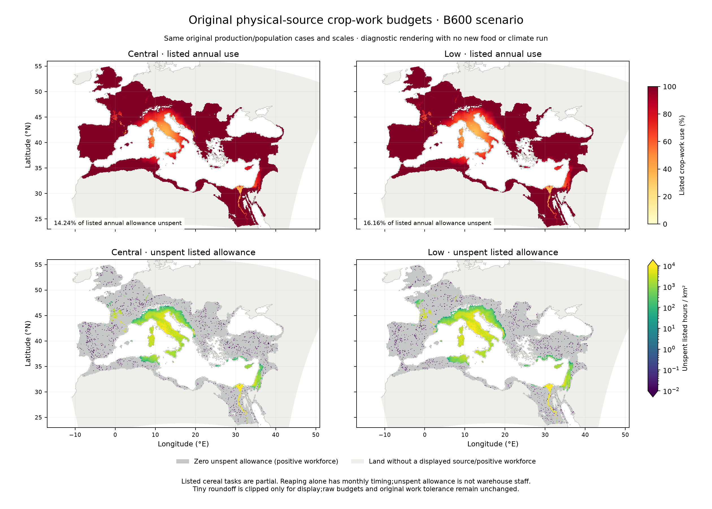

# Original crop-work constraints are now visible spatially

The new inspection figure maps the two already-qualified B600 cases at their
original physical source cells. It shows listed annual crop-work use and
unspent listed allowance on identical scales. There is no new crop,food,
climate,staff or settlement calculation.

| Original case | Positive-workforce sources | At annual listed-work limit | Aggregate unspent allowance |
|---|---:|---:|---:|
| Central | 53,265 | 45,935 | 14.24% |
| Low | 53,265 | 44,726 | 16.16% |

Each case retains56,378 source cells;3,113 have no positive workforce and thus
undefined utilization. Cell area remains81km². Unspent listed hours are shown
per physical source area,not transferred to towns or ports. The pattern is a
partial cereal-work scenario and cannot identify warehouse handlers or prove
that other duties can be rescheduled.

## Values and display choices

The upper scale is0–100% of the source's supplied annual listed-work allowance.
The lower positive scale is fixed at0.01–10,000 unspent listed hours/km² for
both readings;exact zero has a separate gray color. Land without a displayed
source/positive workforce has another background. Small positive quantities
below the log floor,including roundoff,remain in the lowest color;they are not
meaningful available staffing. Above-ceiling quantities use the endpoint color.

Raw negative unused values are tiny floating residuals within the original work
tolerance. Only display copies are clipped to zero;similarly,percent overflow
is clipped for color display. The source arrays/budgets/tolerances are unchanged.

| Display-only diagnostic | Central | Low |
|---|---:|---:|
| Negative unused values clipped | 1,610 | 1,459 |
| Percent values clipped | 4,027 | 3,837 |
| Positive allowance below log floor | 1,569 | 1,471 |
| Positive allowance above log ceiling | 364 | 428 |

The original total unspent listed allowances remain1.812804040billion and
2.223721789billion hours. These are neither a complete occupation budget nor
available logistics staff. Reaping alone has monthly placement in the original
component archives;84.62%of listed task hours do not. The newly examined
Columella calendar supports conditional task prescriptions without filling that
complete baseline or supplying a measured handling rate.

## Verification and scope

The independent reviewer checks **112,756 source values**,their masks,original
cell area,undefined utilization and every display formula/clipping count against
the archived arrays. Both aggregate fractions and annual-limit counts reproduce
the previous work audit. The figure was visually inspected. All1103 protected
identities remain exact. See [summary](../output/urban_original_work_map_20261117/summary.csv),
[review](../output/urban_original_work_map_20261117/review.json) and
[qualification](../output/urban_original_work_map_20261117/qualification.json).
The approximately2MB derived plot array cache is local/ignored and reproducible
from the pinned existing inputs;the compact summary and PNG are tracked.

This is an inspection artifact,not an updated settlement atlas or an estimate
of actual leisure,staffing or institutional capacity. No food/work/graph/weather
solver,new Earth case,fit or main-atlas/default adoption occurs. Columella's
digital/printed variant and source-edition limits remain in their source packets.
Reserved pools and site-survey workbook remain unopened;climate/steppe deferred.

## Next: rate-free handling exposure

The [next declaration](../calibration/urban_diagnosis_20261117/warehouse_handling_exposure.json)
uses only existing funded baseline arrivals and exports to show where handling
claims would arise at original model town nodes. Incoming/outgoing grain will
form a symbolic work basis with unknown rates;no staff will be drawn from the
unspent rural allowance. This moves toward spatial work integration while
preserving missing task units,complete schedules,affiliation/travel,capacity and
access inputs. It adds no new grain or food scenario.

For fresh replay use an empty isolated OUT with
`scripts/plot_original_work_budgets.py`, `scripts/review_original_work_budgets.py`
and `scripts/seal_original_work_budgets.py`. Completed packets refuse overwrite.
