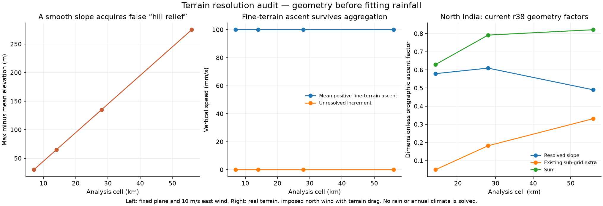

# Terrain resolution before another rainfall fit

The frozen geometry audit (`calibration/orographic_resolution_20261025/plan.json`)
tests whether max-minus-mean elevation is an adequate proxy for unresolved
upslope motion. No climate integration or production model edit is involved;
the active rainfall search remains unchanged.

## Known-answer geometry

On a smooth plane of slope 0.01, a prescribed 10 m/s eastward wind produces
0.1 m/s upward motion. There are no opposing unresolved slopes. The current
max-minus-mean proxy nevertheless grows from **30 m at 7 km cells** to
**275 m at 56 km cells**. The resolved slope already contributes ascent,
so treating that additional variation as unresolved hills risks counting it
again. The measured elevation range is real; its interpretation as extra
unresolved ascent is the issue.

The separate `experiments/orographic_moments.py` prototype evaluates positive
ascent on a common fine terrain grid before aggregation. Its decomposition is

    mean(max(w, 0)) = max(mean(w), 0) + unresolved positive increment.

The last term is nonnegative by convexity. On a plane it is exactly zero;
averaged positive ascent stays 0.1 m/s at every tested cell size. Sinusoidal
hills match their analytic positive-mean uplift, and the same fine terrain
preserves its mean positive ascent under all tested block aggregations.
Northward coordinate signs, calm air, descending air and invalid geometry
are tested. **Eight tests pass.** This is not a condensation model, a water
budget or proof that coupled rainfall will improve.

## Current r38 North India geometry

The unchanged r38 constructor is evaluated at three resolutions with a
prescribed 10 m/s northward wind subjected to its terrain drag. The table
reports only resolved and sub-grid geometric ascent factors, before the
other seasonal rain controls and without solving precipitation.

| Cell size | Native scored land cells | Mean unresolved proxy | Resolved factor | Sub-grid extra | Sum |
|---|---:|---:|---:|---:|---:|
| 56 km | 494 | 273.8 m | 0.4901 | 0.3312 | 0.8213 |
| 28 km | 2,160 | 147.5 m | 0.6098 | 0.1819 | 0.7917 |
| 14 km | 8,346 | 46.6 m | 0.5792 | 0.0498 | 0.6290 |

The sampled native scoring masks also differ in area (about 1.55 versus
1.69 million km² at 56 and 28 km), so these real-terrain mean differences
cannot be attributed uniquely to the ascent formula. The manufactured plane
establishes the proxy problem independently. A fixed-footprint area-weighted
comparison is the next diagnostic before interpreting the regional magnitude.

The prototype is not wired into the moisture solver. A future coupled closure
must use a consistent resolved/unresolved decomposition and account for its
rain as a sink of solved vapor, then pass the full development and finer-grid
gates. Existing 50 km terrain smoothing cannot simply be combined with an
unrelated fine-grid increment without checking that decomposition.
