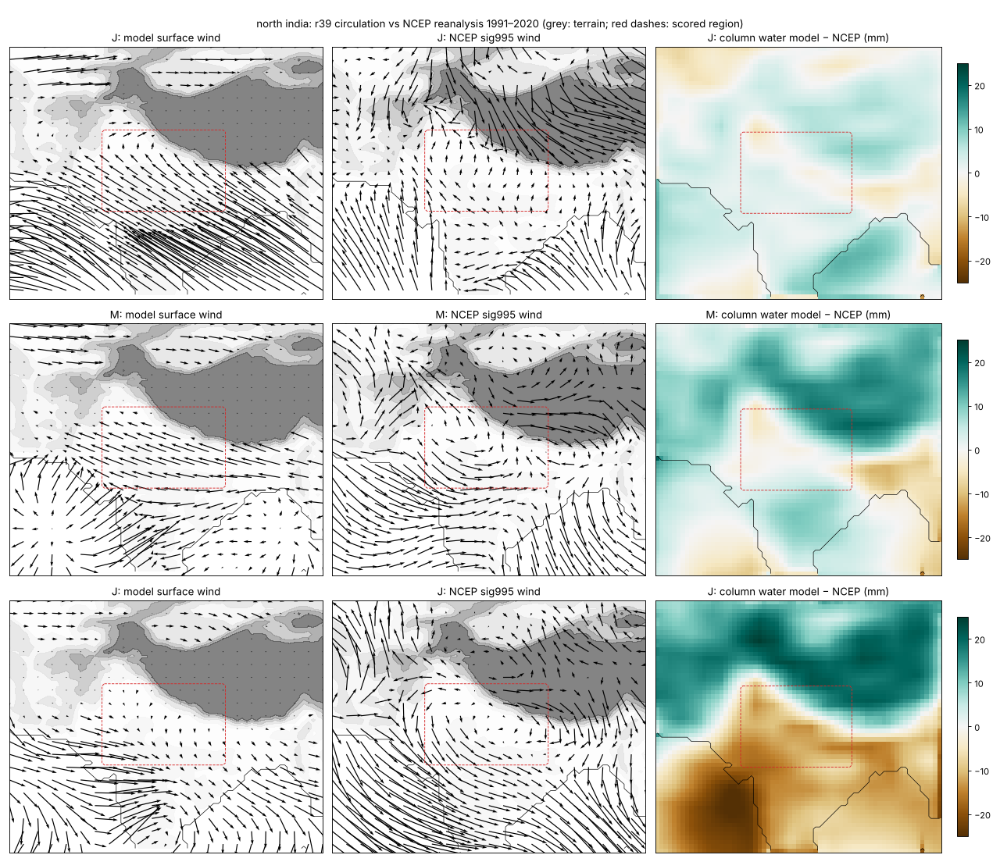
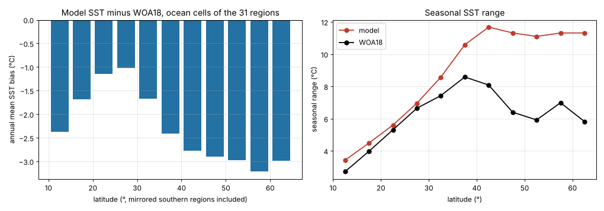
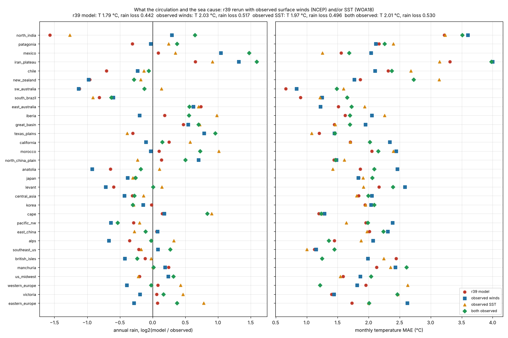
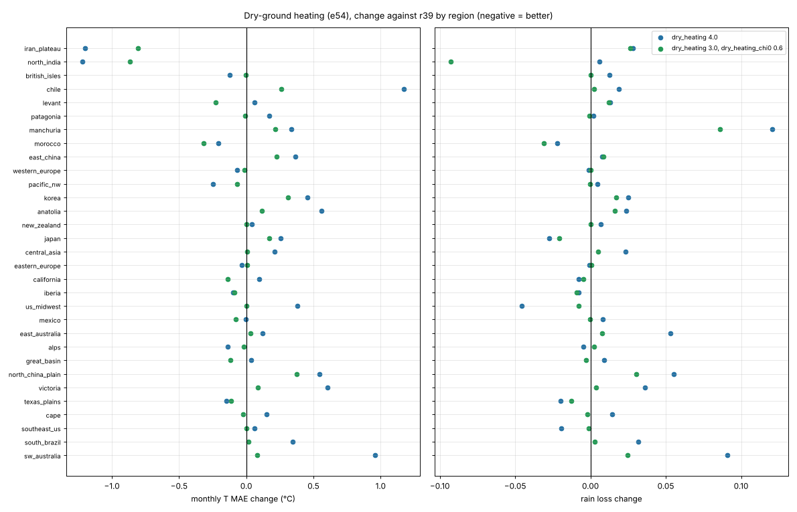
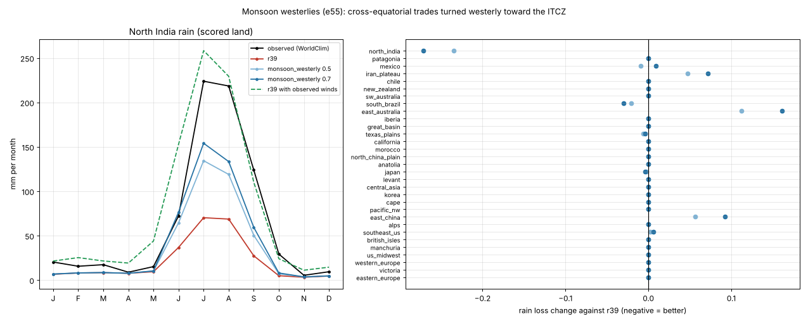
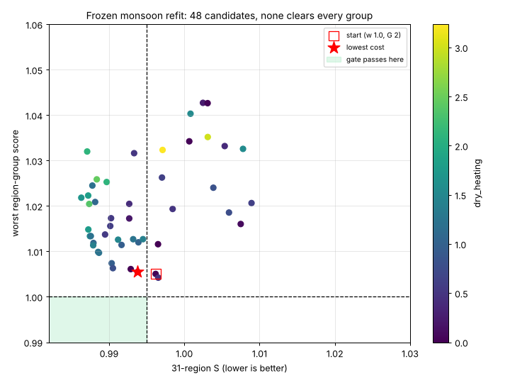
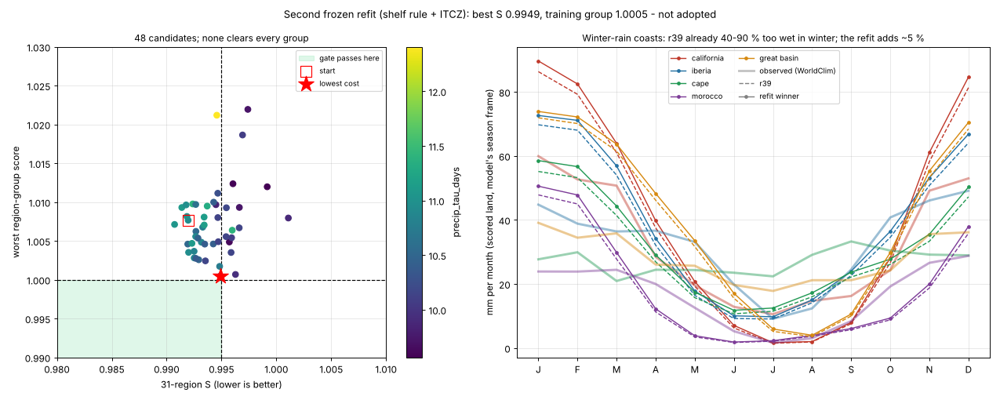
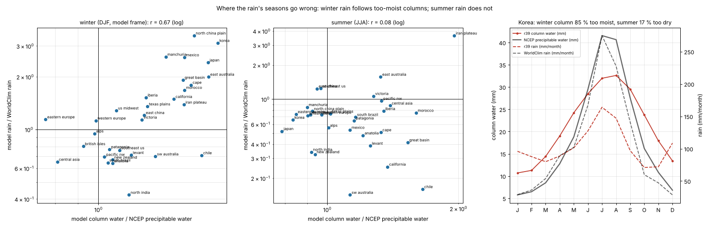

# What causes North India's large errors: circulation, sea and land heating, 30 October 2026

**Result.** North India is r39's worst region: 256 mm of rain a year against
761 observed (rain loss 0.942) and 3.2 °C monthly temperature error, about
3–5 °C too cold outside the monsoon. Tracing the model and comparing it with
reanalysis shows the rain gap is mainly the **circulation**. Rerunning r39 with
observed monthly surface winds gives North India **933 mm**, with no other
change. Correct winds plus observed SST also remove most of the month-late
seasons on maritime coasts (British Isles 2.44 → 1.25 °C, western Europe
1.95 → 1.21 °C). The rest of the physics was fitted around the model's winds,
though: given real winds, Mexico, Texas and Iran become far too wet. The
circulation therefore has to be fixed together with a recalibration of the
rain settings. Separately, the land equilibrium has no dry-ground heating
(North India and Iran ≈ 3 °C too cold); a new opt-in term (e54) fixes much of
that but fails the region-group gates. A first circulation fix (e55, monsoon
westerlies) roughly doubles North India's rain (256 → 482 mm) but wets East
Australia, East China and Iran, because the model has one planet-wide ITCZ.
Gating it by the model's own poleward pressure fall (e55b) removes most of
that damage; a frozen 48-candidate refit with dry heating, rain efficiency and
monsoon descent reaches S 0.9938 (rain −1.5 %, North India 256 → 380 mm,
28 km check passed) but fails the training (1.0055) and mid-latitude (1.0005)
groups. A second frozen refit adds a shelf rule for warm currents (e56, which
removes East Asia's 3–5 °C too-warm spring seas) and the ITCZ's reach: S
0.9949, rain −1.7 %, North India 374 mm, East Asia better, 28 km passed, but
the training group is 0.05 % worse (California, Iberia: winter rain that r39
already has 50–90 % too high). Nothing is adopted; r39 is unchanged and its
runs reproduce bit for bit with every new switch off.

## 1. Inside North India (lowland cells below 1,000 m, 56 km)

| month | T obs | T model | land equilibrium | rain obs | rain model | column water | column RH | wind u, v (m/s) |
|---|---:|---:|---:|---:|---:|---:|---:|---|
| Jan | 15.5 | 11.3 | 14.1 | 15 | 3 | 12.8 | 0.55 | −2.4, −1.9 |
| Apr | 29.4 | 24.4 | 26.1 | 6 | 2 | 20.7 | 0.41 | −2.6, −1.3 |
| May | 33.1 | 28.5 | 30.1 | 13 | 3 | 25.5 | 0.40 | −3.1, −1.1 |
| Jul | 29.8 | 29.7 | 31.5 | 239 | 62 | 38.5 | 0.57 | 0.8, 0.7 |
| Aug | 28.8 | 28.2 | 29.9 | 236 | 63 | 38.2 | 0.61 | 0.4, 0.3 |
| Oct | 26.0 | 22.8 | 24.8 | 29 | 2 | 19.6 | 0.42 | −4.7, −2.2 |

(land equilibrium is sea-level equivalent; mean ground 274 m, so subtract ~1.2 °C to compare.)

* **Temperature.** The air sits close to its land equilibrium, and the
  equilibrium itself is too cold. Turning off eddy heat mixing warms the plain
  by only 0.3–0.7 °C, and Tibet's sea-level-equivalent air is at most 3.6 °C
  colder than the plain's, so mixing across the Himalaya is not the cause. The
  energy-balance land column at 27.5 °N matches WorldClim's latitude-mean land
  (April 26.3 against 24.3 °C), but North India is far above that mean (April
  30.6 °C at sea level, +6.3 °C; January +2.8 °C). Nothing in r39 puts a dry
  interior above its latitude's mean: wet ground cools (`wet_cooling`), dry
  ground only couples faster (`dry_coupling`), and the clear-sky sunshine term
  is off (`cloud_radiation` 0; earlier sessions found it overheats the
  too-dry modelled monsoon).
* **Rain.** The monsoon column is 57–61 % saturated and the mean wind brings
  almost no water; a parameterised convergence import supplies most of it
  (earlier moisture-source audit). Winds blow from the east or north-east
  most of the year; observed spring flow is westerly off the Thar.

## 2. Against NCEP/NCAR reanalysis (new reference)

`scripts/prepare_ncep_reference.py` fetches the global 1991–2020 monthly
surface winds (σ 0.995), sea-level pressure, relative humidity and
precipitable water through NOAA PSL OPeNDAP. Over the plain:

| | Jan | Apr | May | Jul | Aug | Oct |
|---|---:|---:|---:|---:|---:|---:|
| model u, v | −2.4, −1.9 | −2.6, −1.3 | −3.1, −1.1 | 0.8, 0.7 | 0.4, 0.3 | −4.7, −2.2 |
| NCEP u, v | −0.3, −1.3 | 0.8, −1.0 | 1.3, −0.3 | 0.7, 1.3 | 0.7, 0.9 | −0.4, −0.8 |
| model column water | 12.8 | 20.7 | 25.5 | 38.5 | 38.2 | 19.6 |
| NCEP precipitable water | 11.9 | 19.8 | 24.7 | 48.7 | 47.9 | 23.0 |

Over the domain's Arabian Sea and Bay of Bengal (12–24 °N):

| | Jan | May | Jul | Sep |
|---|---:|---:|---:|---:|
| model SST / WOA18 (°C) | 21.7 / 26.0 | 23.6 / 29.6 | 25.1 / 28.3 | 25.7 / 28.0 |
| model column water / NCEP (mm) | 27.4 / 23.0 | 34.9 / 34.4 | 38.4 / 52.1 | 38.9 / 44.7 |
| model wind / NCEP (u, v) | −11.3, −4.8 / −1.9, −3.8 | 0.7, −0.6 / 3.2, 2.3 | 2.6, 2.3 / 6.9, 5.1 | 1.0, 0.9 / 3.8, 2.2 |

The south-westerly monsoon over the Arabian Sea has about a third of its
observed strength in July; the winter trades are several times too strong.
Over Tibet the model holds ~20 mm too much column water and rains 122 mm in
July against 86 observed, while the Himalayan front stays dry.



**Across all 31 regions:**

* Mean surface winds over land are on average **1.8×** NCEP's speed;
  mid-latitude westerlies are worst (eastern Europe mean vector 6.8 against
  0.5 m/s, western Europe 6.5 against 1.1, British Isles 7.0 against 2.2).
* Winter trades at 10–22 °N are 2–6× too strong in the Asian and American
  domains (North India −11.6 against −2.0 m/s, Iran −13.4 against −1.8, Japan
  −15.0 against −5.5).
* Structural cause: `ClimateModel.zonal_wind` uses one planet-wide ITCZ
  latitude (20.6 °N in July) and continues the southern trades as easterlies
  north of the equator. Air crossing the equator is really turned by the
  Coriolis force into the south-westerly monsoon, and the ITCZ sits near
  25 °N over Asia but 8–10 °N over the Atlantic.
* Model SST is too cold at every latitude (−1.0 to −2.4 °C in the subtropics
  and tropics, −2.4 to −3.2 °C poleward of 35 °), and its seasonal range is
  far too large at mid-latitudes (11.7 against 8.1 °C at 40–45 °). r39's global
  `sst_offset` is −4.4 °C.



## 3. Attribution with observed winds and sea

`scripts/attribute_observed_forcing.py` reruns every region with the
reanalysis winds in place of the model's (new diagnostic switch
`wind_source="observed"`; the model reads `grid.obs_wind`), with WOA18 SST
(existing `sst_source="observed"`), and with both. All fitted settings stay.

| 31 regions | monthly T MAE | rain loss |
|---|---:|---:|
| r39 | 1.793 | 0.442 |
| observed winds | 2.031 | 0.517 |
| observed SST | 1.970 | 0.496 |
| both | 2.010 | 0.530 |

| annual rain (mm) | observed | r39 | observed winds | observed SST | both |
|---|---:|---:|---:|---:|---:|
| North India | 761 | 256 | **933** | 316 | 1193 |
| Patagonia | 744 | 600 | 728 | 882 | 961 |
| Chile | 489 | 300 | 417 | 446 | 469 |
| New Zealand | 1685 | 865 | 853 | 1485 | 1381 |
| Mexico | 537 | 569 | 1105 | 682 | 1491 |
| Texas plains | 739 | 599 | 1273 | 566 | 1434 |
| Iran | 232 | 365 | 578 | 437 | 700 |

| monthly T MAE (°C) | r39 | both observed |
|---|---:|---:|
| British Isles | 2.44 | 1.25 |
| western Europe | 1.95 | 1.21 |
| Alps | 1.45 | 1.36 |

Reading: North India's moisture physics can deliver the monsoon when the
winds are right, so its rain gap is the circulation. Real winds and sea fix
the maritime lag (§2 of the correction report traced it to sea-controlled
air). The overall scores worsen because the rain and heat settings were fitted
to the model's own winds and sea: Mexico, Texas and Iran flood, and the
temperature fit loses its compensations. A better circulation must therefore
be followed by a recalibration of those settings; plugging in observations is
not itself a model for an invented map.



## 4. Dry-ground heating (e54, opt-in, not adopted)

`dry_heating` warms the land equilibrium by dry_heating × (1 − soil wetness)
× insolation / 480 W m⁻². Soil wetness is the existing bucket's, as
`wet_cooling` uses it. `dry_heating_chi0` keeps it to continental air:
× clip((χ − χ0)/(1 − χ0), 0, 1), with χ the advected land share (on coasts
the sea air keeps replacing the heated layer). Both default to 0, and r39
reproduces bit for bit (cells hashes of California and North India checked).

North India lowland means at strength 6: April 29.1 (observed 29.4), May
33.4 (33.1), January 13.9 (15.5) °C; its monthly error falls from ~3.3 to
~1.3 °C, but the too-dry modelled monsoon overheats (July 33.0 against 29.8).

| 31 regions | T MAE | rain loss | S | training | former holdout | mid-latitude | dev12 |
|---|---:|---:|---:|---:|---:|---:|---:|
| dry_heating 2 | −0.3 % | +1.2 % | 1.0045 | | | | |
| dry_heating 4 | +6.2 % | +3.2 % | 1.0468 | | | | |
| dry_heating 6 | +17.8 % | +5.8 % | 1.1183 | | | | |
| 3, χ0 0.6 | −1.8 % | +0.4 % | **0.9933** | 0.993 | **1.038** | **1.027** | 0.968 |
| 5, χ0 0.8 | −0.6 % | +0.7 % | 1.0005 | 1.006 | 1.040 | 1.047 | 0.969 |

With χ0 0.6: North India −0.87 °C and rain loss −0.093 (a hotter pre-monsoon
heat low strengthens the inflow), Iran −0.80 °C, Morocco −0.32, Levant −0.23,
California −0.14. Worse: humid East Asia (North China Plain +0.37, Korea +0.31,
Manchuria +0.21 °C, Manchuria rain loss +0.086, downwind of the Gobi) and
Chile (+0.26). The policy needs every group to improve, so it is not adopted.
The energy-balance column is already 5–7 °C too warm in July at 37–52 °N
(against WorldClim's latitude-mean land), which the mid-latitude regions
compensate elsewhere; e54 should be revisited after the circulation and sea.



## 5. Monsoon westerlies (e55, opt-in, not adopted)

Splitting the observed winds by area locates the lever. North India's annual
rain with r39's own winds held fixed is 241 mm; observed winds over the ocean
only give 598, over land only 576, and **only in the band south of the scored
region (Arabian Sea, peninsula, Bay of Bengal) 664**; everywhere 933. The
missing piece is the monsoon inflow from the south.

`monsoon_westerly` (w, 0–1) turns trades that cross the equator toward the
ITCZ into westerlies: on the equator side of the ITCZ the zonal wind becomes
(1 − w)·u_trade + w·trade·sin(π·lat/φ_ITCZ), and the flow keeps crossing the
isobars toward the trough at the boundary layer's own angle
(northward speed tan(cross_isobar_deg) × the turned speed, never slower than
the trades' inflow). Another opt-in switch, `itcz_shift_ocean`, blends the
ITCZ's seasonal shift between open ocean and broad land; it pulled the ITCZ
south over the Arabian Sea and halved North India's rain, so it is not used.
Both default off and r39 reproduces bit for bit.

North India lowland rain at w = 0.7: June 67, July 150, August 130,
September 54 mm (observed 77, 239, 236, 135; r39 28, 62, 63, 23); column
relative humidity 0.72–0.75 (r39 0.57–0.61); July column water 45 mm (NCEP
48.7). Arabian Sea July wind 6.4, 3.4 m/s (NCEP 6.9, 5.1; r39 2.6, 2.3).

| 31 regions | T MAE | rain loss | S | training | former holdout | mid-latitude | dev12 | North India annual mm |
|---|---:|---:|---:|---:|---:|---:|---:|---:|
| w 0.5 | +0.9 % | −0.4 % | 1.0024 | 1.028 | 0.995 | 1.000 | 0.991 | 425 |
| w 0.7 | +1.2 % | +0.2 % | 1.0073 | 1.045 | 0.993 | 1.000 | 0.992 | 482 |
| w 1.0 | +1.7 % | +1.8 % | 1.0174 | 1.078 | 0.989 | 1.000 | 0.997 | |
| w 0.7, itcz_shift 18 | +2.2 % | +1.6 % | 1.0190 | 1.061 | 0.987 | 1.000 | 1.013 | 537 |

North India's rain loss falls by 0.235–0.282 and South Brazil improves. The
losses are where one planet-wide ITCZ puts monsoon flow that is not there or
adds water to regions already too wet: East Australia +0.113 to +0.204
(the Coral Sea has south-east trades in summer), East China +0.057 to +0.105
(already too wet), Iran +0.047 to +0.213 (in the monsoon's descent). North
India's temperature error also rises slightly (+0.21 to +0.37 °C: the
wetter monsoon now cools the plain below observed in July–September).



## 6. Gating the monsoon by the model's own pressure (e55b)

Trades blow because pressure rises toward the subtropical high. Where a summer
heat low lies poleward instead, the meridional gradient reverses and so does
the zonal wind. In July over the 10–22 °N ocean cells:

| region | model poleward pressure change | NCEP | NCEP wind u |
|---|---:|---:|---:|
| North India (Arabian Sea, Bay of Bengal) | −2.8 | −5.5 | +7.0 |
| Iran (Arabian Sea) | −1.4 | −5.5 | +6.9 |
| East Australia (Coral Sea) | +0.9 | +1.7 | −2.5 |
| southeast US (Caribbean) | +0.3 | +3.3 | −4.5 |
| East China | +0.2 | −1.3 | +0.6 |
| Mexico | −1.5 | +1.1 | −0.7 |

(hPa per 1,000 km.) The model's July pressure pattern is poor over South Asia
(correlation with NCEP −0.33; its heat low sits over Tibet), but its sign of
the poleward gradient in the monsoon band agrees with NCEP on 92 % of North
India's cells. `monsoon_pressure_hpa` (G) therefore scales the turning by
clip(poleward fall / G, 0, 1), using last step's pressure smoothed over
500 km. Mexico is the one region where the model's sign is wrong.

| 31 regions | T MAE | rain loss | S | training | former holdout | mid-latitude | dev12 | North India mm |
|---|---:|---:|---:|---:|---:|---:|---:|---:|
| w 0.7, G 2 | +0.5 % | −1.4 % | 0.9957 | 1.003 | 1.000 | 1.000 | 0.988 | |
| **w 1.0, G 2** | +0.7 % | −1.5 % | **0.9962** | 1.005 | 1.000 | 1.000 | 0.988 | 441 |
| w 1.0, G 1 | +1.0 % | −1.4 % | 0.9979 | 1.012 | 0.999 | 1.000 | 0.988 | 542 |
| w 1.0, G 4 | +0.4 % | −1.2 % | 0.9961 | 1.002 | 1.000 | 1.000 | 0.990 | |

The collateral damage of §5 nearly disappears (w 1.0, G 2: East Australia
+0.002 rain loss against +0.161 ungated, Iran +0.008, East China +0.026), while
North India keeps most of its gain (rain loss −0.235). Two things still fail
the gate: North India's temperature (+0.24 °C: the wetter monsoon cools the
plain while its dry season stays 3–5 °C too cold) and the training group
(S 1.005: East China rain, Mexico temperature). With a wet monsoon, the
dry-ground heating of §4 should no longer overheat it, so the two are now
refitted together (§7).

## 7. Frozen refit: no candidate clears every group

`calibration/monsoon_refit_20261030/plan.json`, committed before any result:
`scripts/gate_calibrate.py` (CMA-ES, the gate's own score plus 2× every
group's worsening and 2× any T or P worsening beyond 1 %) over
monsoon_westerly [0.3, 1], monsoon_pressure_hpa [0.5, 5], dry_heating [0, 5],
dry_heating_chi0 [0.5, 0.95], precip_tau_days [8, 14] and monsoon_descent
[0, 0.03], from the w 1.0 / G 2 point, 48 evaluations (about 4.5 hours).

* Many candidates reach S 0.986–0.990, all with dry heating, and all worsen
  a group: dry heating warms humid East Asia (Manchuria, North China Plain,
  Korea, East China +0.1 to +0.24 °C, from the Gobi), rain-efficiency changes
  hurt SW Australia, New Zealand and Anatolia. Across all 48 the best worst
  group is 1.0042 (S 0.9965).
* Lowest cost (the last candidate): monsoon_westerly 0.934,
  monsoon_pressure_hpa 2.95, dry_heating 0.09 (≈ off), dry_heating_chi0 0.53,
  precip_tau_days 10.93 (r39 11.08), monsoon_descent 0.0211 (r39 0.0154).

**Validation as declared** (`scripts/validate_monsoon_refit.sh`; fresh paired
runs with identical sources reproduce the search's numbers exactly):

| check | result |
|---|---|
| development gate (`gate_local.py`, policy v2) | S **0.9938** (needs ≤ 0.995); T +0.30 %, rain −1.54 %; training **1.0055**, former holdout 0.9990, mid-latitude **1.0005**, dev12 0.9819 → **fails** (two groups) |
| paired 28 km | S 0.9984 → passes |
| sealed six | not run (only for a candidate that passes both) |

| region | annual rain r39 → candidate (observed) | rain loss | monthly T MAE |
|---|---|---|---|
| North India | 256 → 380 (761) | 0.942 → 0.745 | 3.22 → 3.35 |
| Iran | 365 → 344 (232) | 0.598 → 0.552 | 3.31 → 3.22 |
| East China | 1339 → 1404 (1281) | 0.320 → 0.335 | 2.01 → 2.02 |
| Texas plains | 599 → 632 (739) | 0.475 → 0.469 | 1.20 → 1.27 |
| East Australia | 1068 → 1075 (641) | 0.552 → 0.559 | 1.51 → 1.51 |
| Manchuria | 690 → 697 (582) | 0.291 → 0.297 | 2.13 → 2.13 |

Nothing is adopted; r39 stays. The search shows the structural limit rather
than a tuning gap: every candidate that helps North India and Iran puts a
little rain or heat into East China, Texas or Manchuria, which are already
too wet or too warm for reasons outside these six settings (their warm,
wet East Asian summers and the energy-balance column's mid-latitude summer
being 5–7 °C above WorldClim's latitude mean).



## 8. East Asia's warm seas: warm currents off the shelves (e56, opt-in)

The energy-balance land column is defined as deep continental air, so its
gap to WorldClim's all-land latitude mean (§4) overstates a bias. East Asia's
warm spring is instead its sea. Coastal SST minus WOA18:

| | Jan | Mar | Apr | May | Jul | Aug |
|---|---:|---:|---:|---:|---:|---:|
| East China | +3.8 | +4.3 | +3.7 | +2.9 | +1.1 | +1.3 |
| Korea | +2.4 | +3.9 | +3.9 | +3.2 | +0.3 | −1.1 |
| Manchuria (Yellow Sea, Bohai) | +2.8 | +4.5 | +5.0 | +4.5 | +1.2 | −1.0 |
| Japan | +1.4 | +2.3 | +2.2 | +1.6 | −0.8 | −2.0 |

Over the East China Sea cells the subtropical warm-current term adds +3.9 °C
all year (Korea +2.2); the Kuroshio runs along the continental slope, while
the broad shelf holds water cooled by the winter monsoon. e50 already knows
the shelves (WOA18 depth on Earth, distance from the coast elsewhere) but
used them only for winter mixing. `shelf_warm_currents` scales the warm
subtropical current by 1 − s·(1 − deep-sea share); the subpolar drift into
the North Sea is untouched. At s = 1 East China's annual coastal bias falls
from about +2.6 to +0.6 °C; the Gulf of Mexico coasts cool from about −1 to
−1.9 °C.

| 31 regions | T MAE | rain loss | S | training | former holdout | mid-latitude | dev12 |
|---|---:|---:|---:|---:|---:|---:|---:|
| s 0.5 | −0.2 % | −0.2 % | 0.9979 | **0.990** | 1.010 | **0.994** | 1.000 |
| s 1.0 | −0.4 % | +0.1 % | 0.9989 | 0.984 | 1.022 | 0.990 | 1.002 |
| first refit winner + s 0.5 | +0.1 % | −1.9 % | **0.9912** | 0.994 | **1.009** | 0.994 | 0.981 |
| first refit winner + s 1.0 | 0.0 % | −1.6 % | 0.9916 | 0.987 | 1.021 | 0.989 | 0.983 |

The shelf rule fixes exactly the groups that blocked the first refit, but
cooler seas take rain from South Brazil (+0.030 rain loss) and Japan (+0.015),
which are already much too dry (713 against 1,256 mm; 1,330 against 1,601).

## 9. Second frozen refit: one group short by 0.05 %

`calibration/monsoon_refit2_20261030/plan.json`, committed before any result:
the same search and gate over monsoon_westerly [0.5, 1], monsoon_pressure_hpa
[1, 5], shelf_warm_currents [0, 1], itcz_shift [11, 17] (a more poleward
summer ITCZ helped South Brazil and Japan in §5), precip_tau_days
[9.5, 12.5] and monsoon_descent [0.008, 0.03], starting from the first
winner with s 0.5; dry heating dropped. 48 evaluations (about 4.5 hours).

* No candidate clears every group. The start point fails the former holdout
  group (1.0077, South Brazil and Japan); the search fixes that mostly with a
  shorter rain residence time (precip_tau_days 10.9 → 10.1), which wets every
  winter-rain coast a little more.
* Lowest cost (candidate 37): monsoon_westerly 0.935, monsoon_pressure_hpa
  3.29, shelf_warm_currents 0.62, itcz_shift 14.43 (r39 13.93),
  precip_tau_days 10.08 (r39 11.08), monsoon_descent 0.0190 (r39 0.0154).

**Validation as declared** (`OUT=output/physics_gaps_20261030/refit2`; the
fresh paired runs reproduce the search's numbers exactly):

| check | result |
|---|---|
| development gate (`gate_local.py`, policy v2) | S **0.9949** (needs ≤ 0.995); T +0.68 %, rain −1.70 %; training **1.0005**, former holdout 0.9991, mid-latitude 0.9920, dev12 0.9899 → **fails** (training) |
| paired 28 km | S 0.9962 → passes |
| sealed six | not run (only for a candidate that passes both) |

| region | annual rain r39 → candidate (observed) | rain loss | monthly T MAE |
|---|---|---|---|
| North India | 256 → 374 (761) | 0.942 → 0.752 | 3.22 → 3.39 |
| Iran | 365 → 362 (232) | 0.598 → 0.588 | 3.31 → 3.29 |
| East China | 1339 → 1300 (1281) | 0.320 → 0.302 | 2.01 → 1.97 |
| Manchuria | 690 → 684 (582) | 0.291 → 0.289 | 2.13 → 2.09 |
| Texas plains | 599 → 647 (739) | 0.475 → 0.468 | 1.20 → 1.29 |
| South Brazil | 713 → 684 (1256) | 0.562 → 0.576 | 0.90 → 0.89 |
| California | 467 → 489 (392) | 0.461 → 0.482 | 1.70 → 1.72 |
| Iberia | 445 → 468 (392) | 0.521 → 0.542 | 1.62 → 1.63 |

Nothing is adopted; r39 stays. The shelf rule removed the East Asian blockers
of the first refit (East China, Manchuria and the North China Plain now
improve), and the binding regions moved to the winter-rain coasts: California
(region score 1.027) and Iberia (1.023) in the training group, with Cape,
Morocco and the Great Basin worse outside it. Their r39 winter rain is
already 50–90 % too high and the refit's shorter residence time adds about
5 %; their summer change is negligible. Every candidate that gives South
Brazil and Japan back their rain does the same, so the trade-off is set by
r39's winter-wet bias, not by the monsoon or shelf rules.



## 10. Land friction on the zonal belts (e57, opt-in, not adopted)

NCEP's January surface westerlies over land are 1–2 m/s (Iberia 0.9, central
Europe 1.3–1.7, US Midwest 2.0); r39's are 4–7 (its belts peak at 11 m/s in
winter and only the pressure-driven part has a land drag), and with observed
winds California's, Iberia's and Morocco's winter rain comes out right (158,
117, 64 mm against 166, 133, 77; r39 247, 202, 129). `zonal_land_friction`
slows the belts by that share on land smoothed over 300 km.

| 31 regions | T MAE | rain loss | S | training | former holdout | mid-latitude | dev12 |
|---|---:|---:|---:|---:|---:|---:|---:|
| e57 0.3 | −0.3 % | +0.7 % | 1.0019 | 1.014 | 0.991 | 0.989 | 1.006 |
| e57 0.5 | 0.0 % | +1.8 % | 1.0088 | 1.030 | 0.987 | 0.992 | 1.014 |
| e57 0.7 | +1.1 % | +3.4 % | 1.0225 | 1.054 | 0.988 | 1.007 | 1.027 |
| second refit winner + e57 0.5 | +0.7 % | −0.7 % | 0.9998 | 1.027 | 0.984 | 0.978 | 0.999 |

The US Midwest (T ×0.86, seasonal range −4.1 → −3.2 °C), western Europe, the
Great Basin, Mexico, Cape and California improve; the interiors that live on
westerly water and sea air lose both: Central Asia, Anatolia and the Levant
(rain −9 to −17 %, seasonal ranges that are already too large grow by up to
1.7 °C), the Pacific Northwest and the Alps. The model's one wind is both the
surface wind (heat) and the transport wind (water at ~850 hPa, which friction
barely slows); r39's strength is a compromise between them, not an error by
itself.

## 11. Winter columns too moist (e58, opt-in)

`scripts/compare_column_water.py` sets r39's monthly column water beside
NCEP's precipitable water over each region's scored land. In winter the
column is 1.3–1.85× NCEP in 14 regions (Korea 11.8 against 6.4 mm, Japan
14.7/8.3, North China Plain 9.6/5.9, East Australia 23.3/13.2, Cape, Mexico,
Morocco, California, Great Basin), and the winter rain error follows the
column (r 0.67 in log across 31 regions). In summer the columns are close
(East Asia 0.8–0.9×) while the rain is 0.5–0.8× and does not follow them
(r 0.08): summer rain is a rain-making problem, not a supply one. (Mountain
regions read high against a 2.5° reanalysis that sees lower ground.)



The sea's column target is 80 % of saturation at the SST, while the column
capacity that sets rain uses 0.4 SST + 0.6 the air over ~300 km. Under cold
continental air (the Yellow Sea at 8–14 °C under −5 °C air) the sea column
held more than the air above can, and the surplus rained or mixed onto the
coasts. `ocean_column_air` saturates the sea column at the column
temperature where that is colder than the sea (b × min(T_col − SST, 0)); a
two-sided first form also moistened columns over cold upwelling seas (warm
air over the California Current) and was replaced on that ground.

| 31 regions | T MAE | rain loss | S | training | former holdout | mid-latitude | dev12 |
|---|---:|---:|---:|---:|---:|---:|---:|
| e58 0.5 | −0.2 % | 0.0 % | 0.9989 | **0.988** | 1.021 | 0.993 | 0.999 |
| e58 1.0 | −0.3 % | +2.3 % | 1.0099 | 0.984 | 1.057 | 1.000 | 1.010 |
| second refit winner + e58 1.0 | +0.3 % | +0.1 % | 1.0021 | 0.988 | 1.049 | 0.986 | 0.997 |
| (two-sided form 0.5) | +0.1 % | −0.7 % | 0.9971 | 0.992 | 1.011 | 0.990 | 0.997 |

| region | winter rain (observed) r39 → 0.5 → 1.0 | annual (observed) | rain loss |
|---|---|---|---|
| Korea | (94) 292 → 155 → 57 | (1257) 1241 → 1037 → 897 | 0.375 → 0.369 → 0.427 |
| Japan | (192) 464 → 255 → 101 | (1601) 1330 → 1034 → 827 | 0.399 → 0.453 → 0.568 |
| Manchuria | (19) 49 → 32 → 21 | (582) 690 → 650 → 619 | 0.291 → 0.250 → 0.224 |
| East China | (117) 141 → 95 → 69 | (1281) 1339 → 1231 → 1147 | 0.320 → 0.310 → 0.321 |
| East Australia | (105) 210 → 185 → 162 | (641) 1068 → 946 → 837 | 0.552 → 0.433 → 0.338 |
| British Isles | (313) 251 → 216 → 184 | (1083) 1001 → 834 → 693 | 0.295 → 0.344 → 0.435 |
| South Brazil | (222) 143 → 131 → 120 | (1256) 713 → 646 → 584 | 0.562 → 0.609 → 0.663 |

East Asia's winters, East Australia and Manchuria improve strongly and the
training group, the second refit's blocker, moves to 0.988. The cost is
annual rain in regions already short of it in summer (Japan, South Brazil,
the British Isles, where r39's winter column was right): the summer rain
deficit, not e58, is what those need.

## 12. Third frozen refit (in progress)

`calibration/monsoon_refit3_20261030/plan.json`, committed before any
result: the second refit's knobs plus ocean_column_air [0, 0.6] and a wider
precip_tau_days [8.5, 12.5], from the second winner with e58 at 0.25,
56 evaluations. Validation as in §7 into `output/physics_gaps_20261030/refit3/`.

## Plan for the next physics milestone

1. **East Asia's summer and the mid-latitude land column.** The refit is
   blocked by East China, Manchuria, Korea and the North China Plain being
   too warm and wet already; the energy-balance land column is 5–7 °C above
   WorldClim's latitude mean in July at 37–52 °N and the model compensates
   region by region. Fixing that baseline (and the over-strong mid-latitude
   westerlies) is now the precondition for adopting e55b and e54.
2. **Circulation.** e55b (pressure-gated monsoon westerlies) is the working
   mechanism for the monsoon inflow (North India 256 → 380–441 mm with little
   collateral damage). Remaining: weaker surface winds over land (mean speed
   1.8× too strong; winter trades 2–6×) and NCEP winds as a circulation gate
   (vector RMSE and direction by region and season).
3. **Sea.** Fix the energy-balance ocean's latitude profile and mid-latitude
   seasonal range instead of a −4.4 °C global offset; the air-coupled sea
   swing (e53, earlier report) is one ingredient.
4. **Tibet.** Over high plateaus the column holds and rains too much water;
   the plateau's saturation profile and the Himalayan front's uplift need a
   look once the monsoon flow reaches the plain.
5. **Land heating.** Revisit e54 (and the clear-sky sunshine term) after 1.

## Reproduce

```sh
python -I scripts/prepare_ncep_reference.py --download
python -I scripts/attribute_observed_forcing.py --params calibration/local_accuracy_20261023/r39_params.json --out output/physics_gaps_20261030/attribution_r39.json
python -I scripts/benchmark_local.py --fit calibration/local_accuracy_20261023/r39_params.json --regions dev31 --set '{"dry_heating": 3.0, "dry_heating_chi0": 0.6}' --out output/physics_gaps_20261030/dry_heating_dh3c6
python -I scripts/physics_gap_figures.py attribution output/physics_gaps_20261030/attribution_r39.json
python -I scripts/physics_gap_figures.py sst
python -I scripts/physics_gap_figures.py circulation north_india 1,5,7
python -I scripts/physics_gap_figures.py dryheat output/physics_gaps_20261030/dry_heating_dh4 output/physics_gaps_20261030/dry_heating_dh3c6
python -I scripts/benchmark_local.py --fit calibration/local_accuracy_20261023/r39_params.json --regions dev31 --set '{"monsoon_westerly": 0.7}' --out output/physics_gaps_20261030/monsoon_westerly_mw07
python -I scripts/physics_gap_figures.py monsoon output/physics_gaps_20261030/attribution_r39.json output/physics_gaps_20261030/monsoon_westerly_mw05 output/physics_gaps_20261030/monsoon_westerly_mw07
python -I scripts/gate_calibrate.py --plan calibration/monsoon_refit2_20261030/plan.json --out calibration/monsoon_refit2_20261030/search
OUT=output/physics_gaps_20261030/refit2 BEST=calibration/monsoon_refit2_20261030/search/best_params.json bash scripts/validate_monsoon_refit.sh
python -I scripts/physics_gap_figures.py refit calibration/monsoon_refit2_20261030/search precip_tau_days output/physics_gaps_20261030/refit2 "Second frozen refit (shelf rule + ITCZ): best S 0.9949, training group 1.0005 - not adopted"
python -I scripts/benchmark_local.py --fit calibration/local_accuracy_20261023/r39_params.json --regions dev31 --set '{"zonal_land_friction": 0.5}' --out output/physics_gaps_20261030/landfric_lf0.5
python -I scripts/compare_column_water.py --params calibration/local_accuracy_20261023/r39_params.json --out output/physics_gaps_20261030/column_water_r39.json
python -I scripts/physics_gap_figures.py columnwater output/physics_gaps_20261030/column_water_r39.json
python -I scripts/benchmark_local.py --fit calibration/local_accuracy_20261023/r39_params.json --regions dev31 --set '{"ocean_column_air": 0.5}' --out output/physics_gaps_20261030/oca_0.5
python -I scripts/gate_calibrate.py --plan calibration/monsoon_refit3_20261030/plan.json --out calibration/monsoon_refit3_20261030/search --hours 3
```

The dry-heating and monsoon runs kept here hold each run's summary and
protocol (per-cell arrays are reproducible and not committed). The screen ran
with an earlier form of the e55 inflow that differs only within ~4 ° of the
equator; every region's grid stays poleward of 10 °, and rerun cells of North
India and East Australia are byte-identical. `tests/test_physics_switches.py`
checks that the new switches default off, are classified as shared physics,
refuse invalid settings and turn only the cross-equatorial trades.
