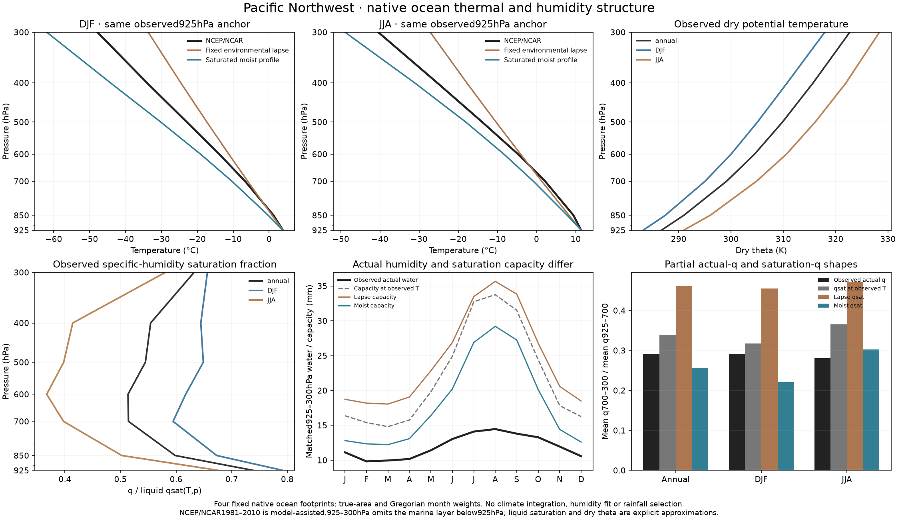

# Pacific Northwest native thermal and humidity profiles — 27 October 2026

The observed temperature profile and its actual humidity have separate vertical
structures. On the four existing PNW ocean footprints, the observed upper/lower
partial specific-humidity ratio is **0.291**, while saturation at those observed
temperatures gives **0.339**. Extending the fixed environmental lapse gives a
saturation ratio of **0.462**; the saturated moist profile gives **0.257**.
Neither saturation curve is an actual humidity prediction or a selected fit.

This standalone diagnostic adds **zero climate integrations**. Its source and
plan were committed as `a012505` before acquisition and calculation. The frozen
plan is `calibration/pnw_vertical_20261027/plan.json`; the complete protocol,
arrays, figure and results are in `output/pnw_vertical_20261027/`. No model
coefficient, humidity state, rainfall score or atlas climate changes.

## Fixed observations and footprint

NOAA PSL NCEP/NCAR Reanalysis 1 provides 1981–2010 monthly-normal air temperature,
specific humidity and geopotential. Only the air-temperature subset is new:
native 2.5-degree latitude/longitude indices `[14:22, 92:102]`. Its 250,858-byte
response has SHA256
`8c7e99312cc5af725dca782e8810196ec2fd0a091ff793eafb64d3ac4671109b`.
The existing `air.das` metadata is reused only after verifying its original URL,
hash and units, then copied into the separate
`data/cache/pnw_vertical_20261027/` cache. That cache has its own URL/hash/byte
manifest and records the metadata's original provenance. Existing humidity and
geopotential remain the unchanged, verified circulation-reference inputs.

The exact mask and physical areas come from
`output/pnw_transport_20261027/reference.npz`, verified against its passed record
and independent protocol. The four native flat indices are **34, 35, 45, 46**:
47.5°N and 45°N at 232.5°E and 235°E. Their covered physical areas total
**191,165.858 km²**. No new coastal, terrain or outcome-based selection is made.
There is no accepted PNW land footprint. Their earlier selection required at
least 80% inmap coverage, at most 20% model land and 925 hPa above modeled
terrain in every month; unavailable native below-ground flags remain a limit.

Before deriving any profile outcome, the script freezes the exact plan,
scientific sources and dependencies, fixed r39 lapse input, independent archive
and record/protocol, original and separate download manifests, and every actual
reference payload. Saved outputs and failures cannot be silently overwritten.

## Matched calculations

All observed and predicted profiles use the same nodes:
925, 850, 700, 600, 500, 400 and 300 hPa. Each predicted profile receives only
its native footprint/month's observed 925 hPa temperature. Higher temperatures
and all humidity are withheld. The environmental lapse remains
4.4142078309475306 K/km; the alternative uses the existing saturated moist
thermodynamic helper. No effective RH or humidity multiplier is applied.

The existing constrained reader returns air temperature in °C and humidity as
mixing ratio `r`. The calculation adds 273.15 once and recovers specific
humidity as `q = r / (1 + r)`. Liquid Bolton saturation is

```
es(T) = 611.2 exp(17.67 Tc / (Tc + 243.5)) Pa
qsat(T,p) = 0.622 es / (p - (1 - 0.622) es)
theta(T,p) = T (100000 / p)^(Rd / cp)
```

Here `T` is kelvin, `Tc` is °C, `p` is Pa, `Rd = 287.05 J/(kg K)` and
`cp = 1004 J/(kg K)`. The plotted `q/qsat` is a specific-humidity saturation
fraction; it is not exactly vapor-pressure relative humidity and is not
clipped at one.

For either actual `q` or capacity `qsat`, partial water is
`W = integral(q dp) / g`, with `g = 9.80665 m/s²`. Every integral uses the
same seven-node trapezoidal pressure quadrature. The lower interval is
925–700 hPa and the upper is 700–300 hPa. The partial shape ratio is

```
R = [integral(30000 to 70000, q dp) / 40000]
    / [integral(70000 to 92500, q dp) / 22500]
```

The existing RK4 helper supplies predicted temperatures at these nodes; its
separate RK4 water integral is discarded so it cannot introduce a quadrature
advantage over the observed data. The lapse profile follows hydrostatic
`dT/dx = -(Rd Gamma/g) T`, where `x = ln(92500/p)` and `Gamma` is K/m.
The moist option follows the existing liquid saturated pseudoadiabatic
approximation with constant `cp` and latent heat. Its environmental temperature
is a hypothesis, not an observed saturated plume.

Lower and upper actual-water/saturation-capacity fractions use saturation at
the **observed** temperature profile. Ratios and fractions are formed per
native footprint/month before averaging. Monthly profiles use physical area;
annual, DJF and JJA profiles additionally use Gregorian month lengths. DJF is
December/January/February. These means generally differ from a ratio of two
regional means. All underlying quantities remain in the JSON and NPZ.

Temperature-shape MAE excludes the observed anchor: it is the pressure-
trapezoid mean of `abs(Tpred-Tobs)` over 850–300 hPa, divided by 55,000 Pa,
then averaged over the same native areas and month durations.

## Measured results

All structural, provenance and exact-reference checks pass. The same four
footprints reproduce the earlier observed humidity shape. No new Earth solve
is needed for the calculations or figure.

| Temperature profile | Annual saturated 925–300 hPa capacity mm | Annual partial saturation q ratio | Withheld 850–300 hPa temperature MAE K |
|---|---:|---:|---:|
| Observed temperature | 22.008 | 0.339 | — |
| Fixed environmental lapse | 24.423 | 0.462 | 4.365 |
| Saturated moist profile | 18.171 | 0.257 | 5.238 |

Actual observed partial water is **11.989 mm**, with **7.900 mm** in the lower
and **4.090 mm** in the upper interval. Its ratio is **0.291**, separate from
the saturation ratios in the table.

| Period | Actual partial water mm | Capacity at observed T mm | Actual q ratio | Saturation q ratio at observed T | Lower water/capacity | Upper water/capacity |
|---|---:|---:|---:|---:|---:|---:|
| Annual | 11.989 | 22.008 | 0.291 | 0.339 | 0.605 | 0.526 |
| DJF | 10.530 | 16.025 | 0.291 | 0.318 | 0.678 | 0.621 |
| JJA | 13.874 | 30.522 | 0.281 | 0.366 | 0.507 | 0.391 |

The anchored saturated moist profile becomes too cold aloft: annual 300 hPa
temperature is **−56.150 °C**, compared with observed **−44.432 °C**. The lapse
profile is too warm there at **−30.730 °C**. A moist saturation ratio closer to
actual `q` does not establish closer environmental temperatures. The observed
temperature-capacity ratio lies between both hypotheses, and the differing
actual layer saturation fractions add a separate humidity contrast.

Observed annual dry theta rises from **286.704 K** at 925 hPa to **290.984 K**
at 850 hPa and **322.697 K** at 300 hPa. The 925–850 hPa rise is **4.211 K** in
DJF and **5.070 K** in JJA. This measures dry stability over those pressure
levels; it does not identify a marine inversion below 925 hPa or determine
moist convective stability. No predicted node reaches the helper's prescribed
200 K floor; minimum predicted temperatures are 238.288 K for lapse and
209.210 K for moist.



The independent-reservoir PNW partial actual-q ratio of about 0.234 versus
observed 0.291, and Iberia's approximately 0.275 versus observed 0.243, remain
opposite errors from the earlier coupled studies. This new reference audit
does not recompute those climates or prove their cause. It shows why thermal
capacity, actual humidity and the broad model-layer approximation must be
distinguished before imposing any universal profile adjustment.

## Limits and publication

Four coarse ocean footprints provide a narrow diagnostic, without accepted
land cells, a new rainfall score or global validation. Reanalysis is
model-assisted. Its 1981–2010 monthly normals differ from WorldClim's
1970–2000 rainfall period. Applying saturation to monthly mean temperature
and dividing monthly mean humidity omits submonthly covariance and is not
an instantaneous RH observation or exact vapor flux.

The pressure window excludes air below 925 hPa, including a possible marine
inversion, and above 300 hPa. An observed 925 hPa anchor is external information,
not a freely predicted climate state. Liquid saturation at cold levels,
constant dry heat capacity and latent heat, ideal-gas hydrostatic mapping and
the prescribed upper temperature floor remain approximations. Ice,
entrainment, clouds, fallout, environmental latent-energy feedback and
pressure-resolved momentum are not solved. Partial pressure-layer ratios do
not equal full-column dry-layer ratios.

The one figure and full native/monthly/annual/DJF/JJA data are nested inside
the existing shared-westerly study, before its results download. This is no
additional standalone study topic. The publisher verifies frozen sources,
protocol identity, raw-array/JSON equality and the original image before
copying assets. It selects no profile, fits no humidity and replaces no atlas
climate. Scientific source: `a012505`; publication source is recorded separately.
