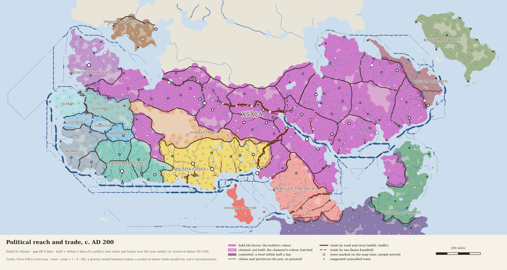
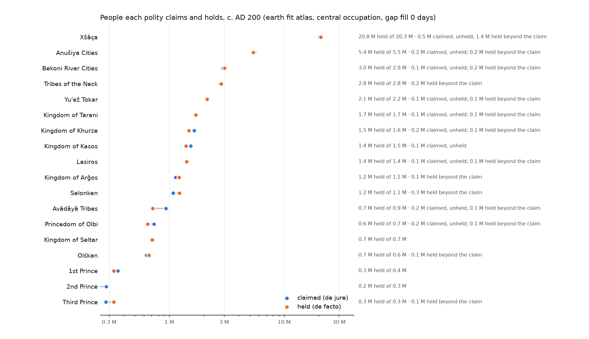
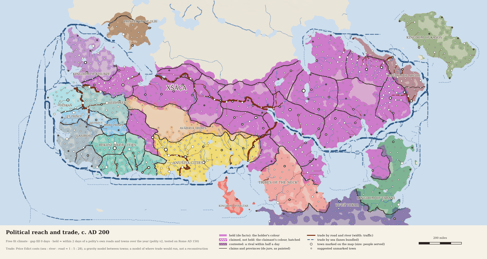
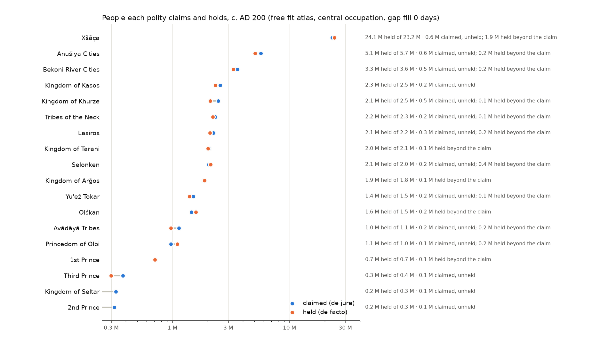
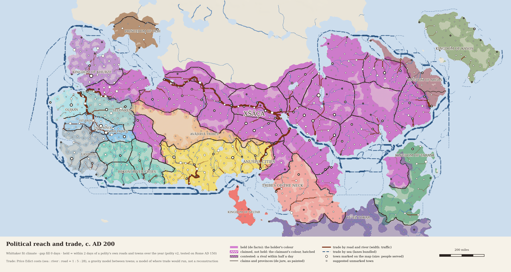
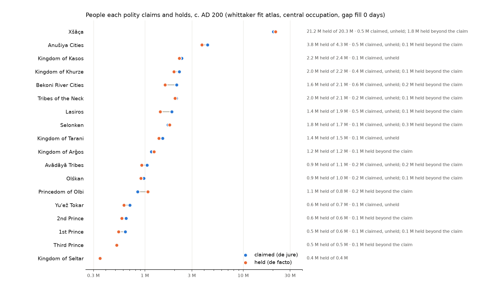

# Polity v3: de facto against de jure, people per polity, trade routes, vector map data

2026-10-25. Plans frozen before any result: `calibration/polity_20261025/plan_fill.json` (the gap
fill) and `plan_trade.json` (trade). Code: `polity/defacto.py` (held land, the gap fill, the
categories and the people per polity), `polity/trade.py` (goods costs, market access, gravity
routes), `polity/render.py` (the de facto / de jure rendering), `polity/vectors.py` and
`polity/mapdata.py` (GeoJSON and SVG), `scripts/polity_fill_check.py` and
`scripts/polity_trade_check.py` (Earth), `scripts/render_political_plate.py` (the plate).
Results: `calibration/polity_20261025/{fill,trade}.json`; figures `output/polity_earth/fill_check.png`
and `trade_check.png`.

## De facto and de jure

*De jure* is the painted claim of each polity (the fill and border layers of the campaign map).
*De facto* is the land within 2 days of a polity's own roads and towns over the year (polity v2,
tested on the Roman empire of AD 150), each place going to the polity whose network is nearest.
Every land cell falls in one of six classes: held by its claimant, claimed but unheld, held by
another polity, held but unclaimed, contested (a rival within half a day), neither.

**The gap fill.** Held land comes in patches around towns and roads. The fill is a closing in
travel time: add the land within *r* days on foot of held land, then take back what is within *r*
days of the land the dilation did not reach. Gaps narrower than about 2*r* days close; larger unheld
regions (a desert interior, a mountain block) stay open.

**Earth test.** Against Cliopatria's Roman empire of AD 150 (fit west of 20 E, test east) and the
Han commanderies of AD 2 (balanced accuracy over land within 15 days of the network):

| fill (days) | Rome west (fit) | Rome east (test) | Han (test) |
|---|---|---|---|
| 0 | **0.831** | 0.811 | 0.796 |
| 1 | 0.829 | 0.814 | 0.796 |
| 2 | 0.830 | 0.819 | 0.797 |
| 4 | 0.818 | 0.818 | 0.802 |
| 6 | 0.810 | 0.824 | 0.799 |

The west prefers no fill, so the plan adopts 0 days; the tests pass trivially at 0. The east and
Han gain a little from wide fills (Egypt's and Syria's desert margins, south China's hills), the
west loses (the fill reaches over the frontiers into Germania and the Sahara routes). Up to 2 days
the differences are under 0.01: historians' extents neither ask for a fill nor rule one out. On the
map the default is no fill and the atlas offers ½, 1 and 2 days as a cartographic choice.

## Trade

**Costs of goods.** Each month's network re-priced in road-km equivalents (the cost of hauling a
load one km by wagon): sea : river : road = 1 : 5 : 28 per km (Diocletian's Price Edict, AD 301),
upriver twice downriver (the Edict's river tariffs). Ships cost by the day at sea (a fair-wind day
= 222 km = 7.9 road-km), so headwinds and the storm months raise the cost; walking and pack edges by
the day (30 road-km a day); four months stand for the four seasons.

**Earth test (failed in substance).** Market access (people within reach, discounted by
exp(-cost / scale)) against the area of 1,115 Roman towns of AD 150 (Hanson 2016). The plan's
criterion was met by its letter (east Spearman 0.00 against -0.05 for the hinterland alone), but
both are near zero, the west's best R² is 0.04, and the market-access coefficient is negative at
every scale; without the 424 towns that carry Hanson's default areas (20 or 30 ha) the correlation is
negative throughout (-0.10 to -0.19). Reading (decided after the result, recorded in `trade.json`):
neither hinterland nor market access in this model says which Roman towns were large. Where access
is good there are more towns, not larger ones. So the map does not size towns by it, and the cost
scale is not identified by these data.

**The scale, set rather than fitted.** Hauling wheat 148 km by land cost 55 % of its value
(Duncan-Jones 1982, p. 368), so road haulage eats a staple's whole value at about 270 km. Trade
falls by e per 270 road-km (the same initial slope).

**Routes.** A gravity model: trade between two towns grows with the people each serves (every
cell goes to its cheapest town) and falls by e per 270 road-km of cost; it is routed along each
season's cheapest paths from the 300 largest towns to every town and averaged over the seasons.
Route classes: the busiest 20 %, 5 % and 1 % of route segments. A model of where trade would run,
not a reconstruction.

## Map results

All three repository atlases now include political v3, the claimed-land trade correction, four de facto gap-fill variants, per-polity CSV/metadata tables, GeoJSON layers and layered SVGs. Hosted claude.ai artifacts remain unchanged; this environment has no tool for updating those artifact URLs.

Central occupation scenario, no gap fill; people in millions. These are modelled environmental/settlement scenarios, not historical censuses. Held population can exceed claimed population when a polity reaches beyond its painted frontier.

| Atlas | All modelled people | In claims | Held | Claimed, unheld |
|---|---:|---:|---:|---:|
| Earth Fit | 59.57 | 46.12 | 46.14 | 1.90 |
| Free Fit | 68.14 | 54.77 | 53.65 | 3.87 |
| Whittaker Fit | 56.53 | 45.45 | 44.24 | 3.74 |

The all-land total includes the settlement scenario on unclaimed land. Trade catchments exclude unclaimed land, where the model’s farming-based density is not a defensible count of mobile herders. Political reach and population occupancy are separate assumptions.

Claimed / held people per polity, in millions:

| Polity | Earth fit | Free fit | Whittaker fit |
|---|---:|---:|---:|
| Xšāça | 20.285 / 20.754 | 23.175 / 24.107 | 20.318 / 21.250 |
| Anušiya Cities | 5.509 / 5.365 | 5.693 / 5.081 | 4.338 / 3.791 |
| Bekoni River Cities | 2.930 / 3.028 | 3.583 / 3.307 | 2.109 / 1.607 |
| Tribes of the Neck | 2.758 / 2.834 | 2.324 / 2.215 | 2.085 / 2.025 |
| Yu'ež Tokar | 2.161 / 2.134 | 1.508 / 1.400 | 0.704 / 0.613 |
| Kingdom of Tarani | 1.734 / 1.694 | 2.060 / 2.011 | 1.519 / 1.391 |
| Kingdom of Khurze | 1.648 / 1.475 | 2.466 / 2.100 | 2.238 / 1.972 |
| Kingdom of Kasos | 1.539 / 1.394 | 2.548 / 2.321 | 2.366 / 2.242 |
| Lasiros | 1.408 / 1.413 | 2.242 / 2.082 | 1.878 / 1.430 |
| Kingdom of Arǧos | 1.135 / 1.217 | 1.847 / 1.876 | 1.167 / 1.237 |
| Selonken | 1.082 / 1.221 | 2.035 / 2.111 | 1.720 / 1.779 |
| Avādāyā Tribes | 0.934 / 0.715 | 1.136 / 0.972 | 1.054 / 0.926 |
| Princedom of Olbi | 0.736 / 0.646 | 0.971 / 1.097 | 0.845 / 1.070 |
| Kingdom of Seltar | 0.707 / 0.707 | 0.328 / 0.203 | 0.351 / 0.350 |
| Olśkan | 0.632 / 0.665 | 1.452 / 1.586 | 0.978 / 0.913 |
| 1st Prince | 0.356 / 0.329 | 0.713 / 0.706 | 0.631 / 0.541 |
| 2nd Prince | 0.282 / 0.225 | 0.318 / 0.174 | 0.642 / 0.582 |
| Third Prince | 0.281 / 0.329 | 0.377 / 0.298 | 0.512 / 0.517 |

Figures:

Each atlas also has a plate at one-day gap fill (`*_political_fill10.png`). The browser checks exercise all four gap-fill options, persistence after reload, trade rendering, conditional controls, farming scenarios, search and the mobile layout. All 371 referenced layer assets and 48 GeoJSON files verify. All 216 CSV polity rows match their full-precision metadata tables within their declared rounding, and all population partitions balance. Food and population binary/provenance checks pass on all three atlases. Evidence: `output/atlas_r38/political_publication.json` and `food_population_checks.json`.

These exports preserve the historical outward catchment and one-direction gravity rules. A subsequent directed-trade audit is documented separately in `reports/DIRECTED_TRADE_20261025.md`; no demographic predictive gain is inferred from these political exports.
