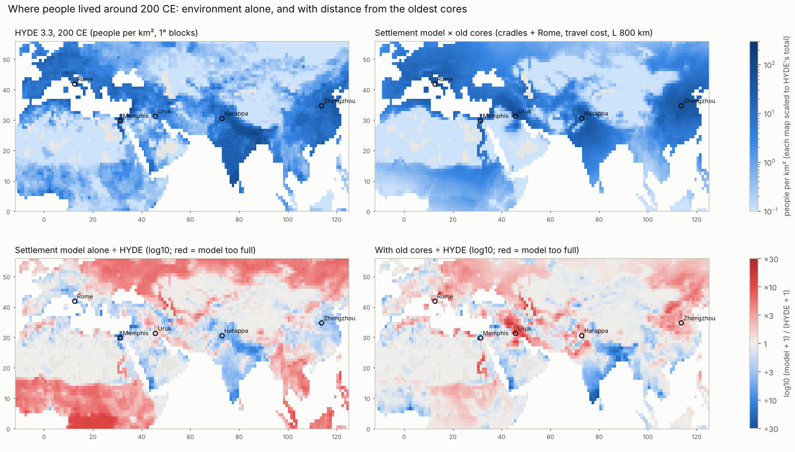
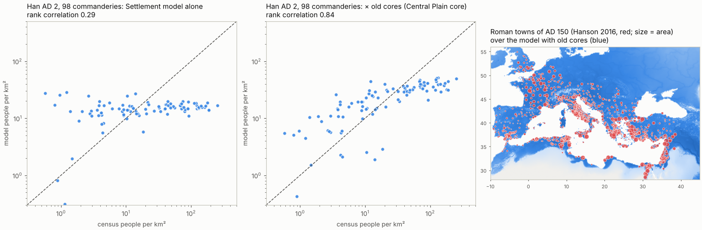
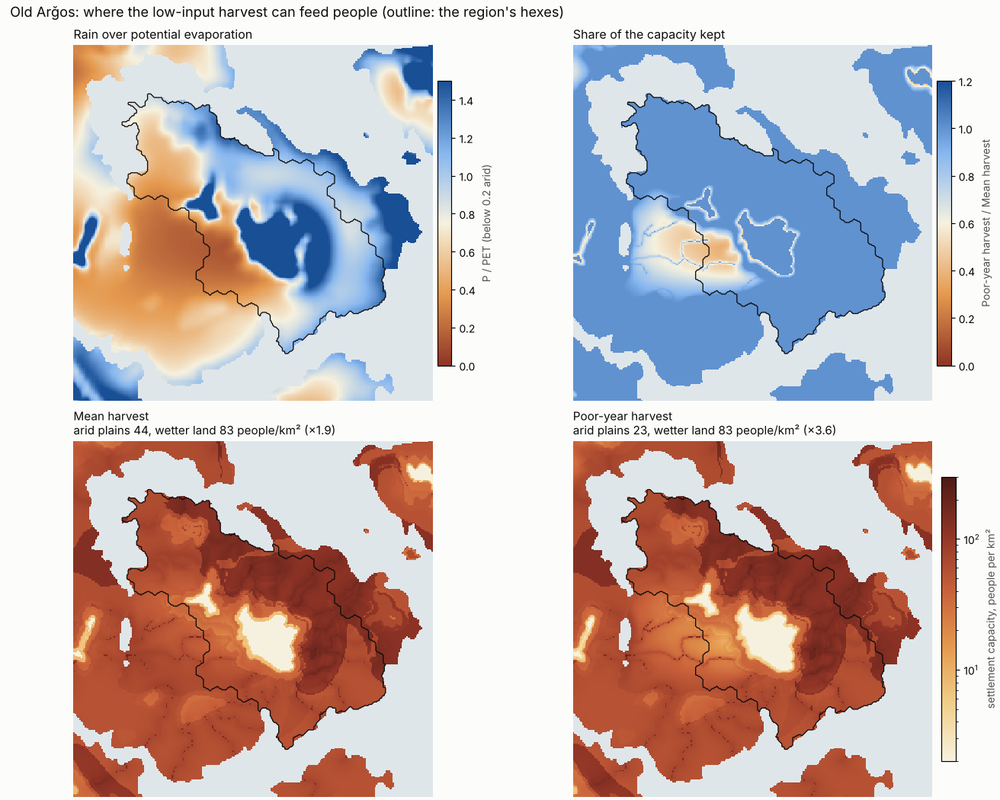
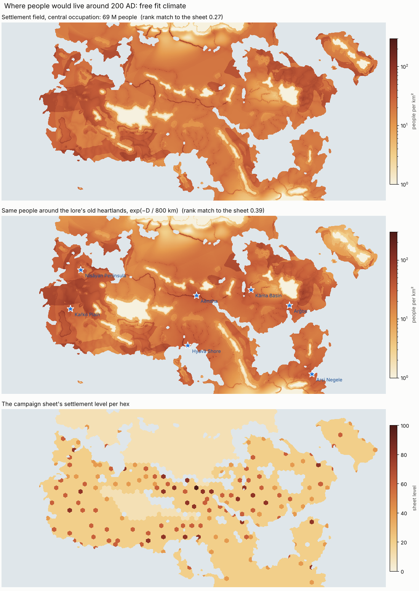

# Predicting where people lived: what the Earth tests say

This report covers the population side track of 23 October 2026. The
research behind it is in
[population_density_research_20261023.md](../research_notes/population_density_research_20261023.md),
and the step-by-step log in
[ITERATION_LOCAL_20261023.md](ITERATION_LOCAL_20261023.md).

The atlases' settlement model (`harvest.models.settlement_fields`) turns
climate into low-input food capacity: crops, herding, clearance, river
access and malaria. That capacity is then occupied at a uniform share. The
question here: how well does that predict where people actually lived
around 1–200 CE, and what is missing?

## Tests

| Test | What it is | Independent? |
|---|---|---|
| HYDE 3.3, 0 and 200 CE, 1° blocks | Historians' country totals spread by HYDE's own suitability weights | Partly. Country totals carry history; the pattern within a country is a model like ours. |
| Han census, AD 2 | 98 commanderies with recorded populations (Zheng & Wu 2026) | Yes: a real count inside one state |
| Roman towns, AD 150 | 1,243 towns with urban features (Hanson 2016, OxREP), 2° blocks | Yes, and never used to choose any setting |
| 11 historical regions | Rome, Han, Parthia, from published estimates | Only the ranking is used |

All scores are rank correlations of density, with tied ranks averaged, plus
the share of people that would have to move to turn one map into the other.

## Results

| Model | HYDE 200 CE | Han AD 2 | Roman towns AD 150 |
|---|---|---|---|
| uniform over land | 0.03 | −0.18 | −0.10 |
| crops only | 0.53 | 0.10 | |
| settlement base (crops, herding, clearance, rivers, malaria) | 0.575 (56 % to move) | 0.29 (56 %) | 0.19 |
| × old cores, straight-line distance, L 800 km | 0.744 (42 %) | 0.82 (45 %) | 0.53 |
| × old cores, travel cost, L 800 km | 0.746 (44 %) | **0.84 (39 %)** | **0.62** |
| HYDE 3.3 itself | | 0.72 (46 %) | 0.64 |

The settings were fixed on Han and HYDE before the Roman towns were opened:

- **Cores:** the four river-valley cradles (Uruk, Memphis, Harappa,
  Zhengzhou) plus Rome.
- **Core term:** exp(−D / L), where D is the distance to the nearest core.
- **Travel cost:** each km costs 2× in forest, plus 1 per km of relief;
  the sea costs the same as land.





## What this means

1. **Environment sets the ceiling; history sets the share filled.** Inside a
   single state, low-input capacity barely ranks places: 0.29 for Han China,
   0.19 for Roman towns. The share of capacity actually occupied falls with
   distance from the oldest farmed and governed land:
   - about 5× capacity within 300 km of the Central Plain;
   - about 0.17× at 1,300–1,800 km;
   - in Rome's empire, Egypt and Syria at about 1× capacity, Gaul and
     Iberia at about 0.15×.
2. **The core is the old heartland, not the capital.** Adding Chang'an as a
   core lowers the Han score from 0.83 to 0.74. Rome helps because it was
   Italy's heartland.
3. **One scale works across empires:** L ≈ 600–800 km.
4. **Forests and mountains slow the frontier, and the sea does not.**
   - Slow forests halve the remaining overfill of the Han south.
   - Making the sea slow hurts, because Mediterranean shipping tied the
     provinces together.
5. **A history-free rule only half works.** Taking the strongest
   concentrations of irrigable river land in dry climates as cores finds real
   early states on Earth: Mesopotamia, the Nile, the Indus, the Yellow River
   at Taosi, Meroë, Jenné-Jeno, Varanasi. It lifts HYDE (0.575 → 0.67) and
   Han (→ 0.73), but not Rome (0.19 → 0.20). Its western cores lie east of
   the Roman heartland.
6. **What still fails:**
   - the Han south (Hunan and Jiangxi about 4–9× too full);
   - the Mesopotamian alluvium, which was in decline;
   - Siberia's forest;
   - southern India, which is too empty: far from any listed core but dense
     in HYDE.

## Poor-year harvests on cold and dry margins

Old Arǧos's arid plains looked hardly emptier than the land around them. Earth
shows a general flaw behind it. Across the Old World's dry belt (15–50° N, away
from rivers), the settlement base held about twice HYDE's density on land
with a 30–90-day growing season. It held too few people where the season
lasts 120–180 days.

Split by temperature and dryness, the excess is mostly on cold land
(Tibet, Mongolia, the high plateaus: 2.2–3.7× HYDE). Warm dry land with
30–120 growing days is 1.3–1.8× too full.

Low-input farmers live at the harvests of the poor years. Frost and a short
frost-free season cut harvests on cold land, failed rains on dry land, and
herding takes over where farming fails.

| Plan (frozen before results) | Rule | HYDE 200 CE | Han AD 2 | Mean | Outcome |
|---|---|---|---|---|---|
| none | | 0.746 | 0.843 | 0.794 | |
| 1 | yield × a ramp in growing-season length | 0.758–0.779 | 0.28–0.77 | ≤ 0.762 | rejected: the Han north's short summer-rain season is dense |
| 2 | yield × clip((T − t0)/(t1 − t0)) × clip((P/PET − a0)/(a1 − a0)) | 0.812 | 0.833 | 0.823 | chosen: cold −2…10 °C, dry 0…0.35 |
| 2, inside the crop model | the dry factor on the rain-fed share only | 0.811 | 0.834 | 0.822 | adopted |

The first form of plan 2 multiplied each cell's whole capacity. That
penalised irrigated floodplains twice, because irrigation access in the
crop model is a share of the cell. Egypt's capacity halved (3.46 → 1.72
M). Inside the crop model, the dry factor scales only the rain-fed share and
the cold factor the whole yield. Egypt is then 3.29 M, Roman Syria's
dry-farmed steppe falls 5.45 → 3.89 M, and the Mesopotamian alluvium 7.50 →
5.79 M.

Held out, read once for the adopted rule:

| | Before | After |
|---|---|---|
| Roman towns AD 150, full model | 0.616 | 0.652 |
| Roman towns AD 150, settlement base | 0.189 | 0.277 |
| Great cities in the settlement base's top decile | 0 % | 15 % |
| Great cities, full model, median percentile | 95 % | 94 % |

The rule is in `data/harvest_model.json` (version 2,
`margin_reliability`). The occupation scenarios are re-derived from the
reference regions recomputed with it (central share 0.294 → 0.325). On
the free-fit climate, Old Arǧos's arid plains fall from 44 to 23 people per
km² against 83 on its wetter land, a contrast of 1.9× → 3.6×. Irrigated river
lines keep their harvest. The Earth-fit climate never makes those plains
arid, which is the climate model's known failure to dry the painted arid
zones.



Scripts:

- `scripts/population_reliability.py`: both plans;
- `scripts/land_people_earth.py --crop-margins`: the Earth crop model with the
  margins;
- `scripts/plot_region_population.py`: the figure.

## Cores for the map: the lore, not the richest land

Can a map's old cores come from its own settlement score? On Earth
(`scripts/population_core_rules.py`), with the poor-year margins, a travel
cost and L 800 km, scored as the mean rank of HYDE 200 CE, the Han census
and the Roman towns:

| Cores | HYDE 200 CE | Han AD 2 | Roman towns | Mean |
|---|---|---|---|---|
| none | 0.658 | 0.328 | 0.277 | 0.421 |
| declared: cradles + Rome | 0.811 | 0.834 | 0.652 | **0.766** |
| peaks of the settlement score, top 4–10 | 0.50–0.66 | −0.14 to −0.05 | 0.38–0.48 | 0.28–0.33 |
| peaks of dry irrigable river land, top 4–10 | 0.47–0.71 | −0.09 to 0.77 | 0.21–0.29 | 0.23–0.57 |

The settlement-score peaks fall in the humid tropics (the Congo, Cameroon,
Liberia, Bengal, south China, Vietnam, Sumatra), none of them an old state
around 200 CE. They score below no cores at all. Old cores follow history.
The map therefore takes its cores from the campaign lore
(`data/lore_cores.json`), as Earth takes them from the record:

| Core | Since | Lore |
|---|---|---|
| Aēnaha | before year 0 | the Sémih Kingdom's capital at the Ayauda estuary, conquered by Avesta and the Empire's capital since |
| Kāma Basin | year −450 | where the Mahistva, founders of the Empire, settled |
| Arǧos | year ~25 | the founding city of the Kingdom of Arǧos |
| Hyavā Shore | Ekiari era | the Ekiari Empire's south-western coast and the Suzerainty's city-states |
| Kaŕko Plain | late Ekiari era | the new heart of the Ekiari imperium; Lasiŕos, the largest realm |
| Arsi Negele | ancient | the Tarani kingdom's ancient capital |
| Nisāyan Peninsula | centuries past | a confederation of cities that ruled every shore of Nisāya's Sea |

Each atlas now has an Overview layer, **Density around the old
heartlands**. It holds the same people, drawn toward these cores by
exp(−D / 800 km), with D the travel cost through forest and relief, for each
occupation and malaria scenario.

On the free-fit climate this layer matches the campaign sheet's settlement
levels at 0.39 per hex, against 0.27 for the environment alone. The two
automatic dry-river cores had lowered the match to 0.21.



## The great cities of AD 100–200

`scripts/great_cities_check.py` takes Modelski's sizes as geocoded by Reba et
al. (2016): the 20 cities in the window with a size at AD 100 or 200. It
finds each city's percentile among the 100 km means of every land cell. The
11 cities more than 500 km from a declared core are the fair subset, since
Rome itself is a core.

| Field | Median percentile, all 20 | In the top decile, all 20 | Median, the 11 far from cores | Top decile, the 11 |
|---|---|---|---|---|
| settlement base | 69 % | 0 % | 69 % | 0 % |
| × old cores (travel, L 800) | 95 % | 60 % | 86 % | 27 % |
| HYDE 3.3, 200 CE | 93 % | 55 % | 90 % | 55 % |

- The environment alone never puts a great city in its top tenth.
- With old cores the great cities sit high. Far from the cores the cored
  model is level with HYDE in median but less often at the very top.
- The misses are the Ganges cities (Pataliputra, Vaishali at 80 %) and
  Anuradhapura in Sri Lanka (55 %), all far from any declared core.

## On the fantasy map

- The automatic rule's first core falls in the province the campaign calls
  *The Heartlands*, and the second in Old Arǧos.
- **Sheet settlement levels** (2,227 hexes): rank 0.298 for the settlement
  base, 0.334 with five rule cores.
- **The campaign's 151 settlements** follow the settlement base (0.40)
  better than any cored version (0.27–0.31). They were spread over
  farmland rather than crowded into a heartland.

A core term would therefore change the campaign's own picture. It belongs
in the atlas as an option with cores the campaign chooses, such as each
nation's heartland, not as a silent default.

## Measures beyond HYDE, and where they stand

| Measure | Use here | Status |
|---|---|---|
| HYDE 3.3 (population, cropland, pasture) | Consistency test | Done |
| Han AD 2 census polygons (Zheng & Wu 2026) | Independent count inside a state | Done |
| Hanson 2016 Roman towns (OxREP) | Independent test of town density | Done |
| Reba et al. 2016 / Modelski city sizes | Where the great cities sat in each density field | Done, below |
| ORBIS (Roman travel costs) | Check of the travel-cost core distance | Not yet; the cost ratios are noted in the research note |
| GAEZ / Caloric Suitability Index | Alternative capacity input | Research note only |

## Reproduce

```sh
python3 -I scripts/population_cores.py --earth output/land_people/earth/earth.npz \
    --hyde data/cache/hyde33/popc_ce_0.tif data/cache/hyde33/popc_ce_200.tif \
    --shp data/cache/han_ad2/shp/ResearchArea --out output/population_cores/scan.json      # add --travel for travel cost
python3 -I scripts/roman_cities_check.py --xlsx data/cache/hanson2016/cities.xlsx \
    --earth output/land_people/earth/earth.npz --hyde data/cache/hyde33/popc_ce_200.tif \
    --out output/population_roman/ad150.json
python3 -I scripts/great_cities_check.py --csv data/cache/reba2016/modelskiAncientV2.csv \
    --earth output/land_people/earth/earth.npz --hyde data/cache/hyde33/popc_ce_200.tif
python3 -I scripts/plot_population_cores.py --earth output/land_people/earth/earth.npz \
    --hyde data/cache/hyde33/popc_ce_200.tif --shp data/cache/han_ad2/shp/ResearchArea \
    --xlsx data/cache/hanson2016/cities.xlsx --out output/population_cores
```

The data caches under `data/cache/` are untrusted downloads, kept out of
git. Read them only with `python3 -I`.
