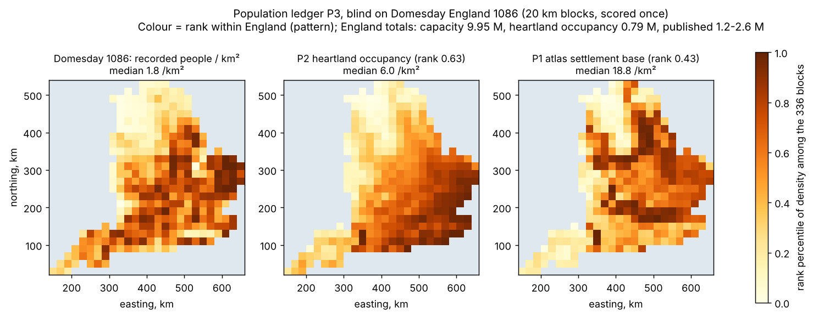

# Predicted population ledger, blind on Domesday England 1086 — 8 November 2026

Plan, frozen before the statistics database was opened: `calibration/population_ledger_20261108/plan.json`, with
amendment 1 (person categories, duplicate rule and place join), made from the schema and flag notes before any
population column was opened. Script: `scripts/population_ledger_p3.py` (`dev`, `blind`). Results:
`output/population_ledger_20261108/{dev,blind}.json`.

## Question

The atlas spreads a *supplied* population budget (53.8 M on the Earth fit) by local food support. Can the
Earth-calibrated chain instead predict where people lived, and how many, in a long-settled, low-input farming
landscape?

## Candidates (fixed; nothing fitted on Domesday)

| | Ledger |
|---|---|
| P0 | Earth-harness farming capacity: arable from slope, D2/D2b irrigation, `FALLOW` 0.600 (North China Plain census at capacity) |
| P1 | The atlas's settlement base (capacity × clearance, herding, river access, malaria) × the central occupation share: the weights the atlas allocates by |
| P2 | Capacity × exp(−D / 800 km), D the travel cost to the nearest old core (Uruk, Memphis, Harappa, Zhengzhou, Rome): the occupancy rule of `reports/POPULATION_20261023.md` |

## Development (seen data, nothing selected)

| | Han AD 2 commanderies, rank | Ten historical regions, RMS of ln(historical / predicted) |
|---|---|---|
| P0 capacity | 0.287 | 1.653 |
| P1 settlement base | 0.428 | — |
| P2 heartland occupancy | **0.820** | **0.965** |

P2 lands Roman Gaul (8.7 M against 8.0 M) and Italy (7.7 M against 8.7 M). It cuts the Han south's overfill from about
30× to about 6×.

## Blind: Domesday 1086 (scored once)

* **Data.** The Hull Domesday places and statistics databases (J.J.N. Palmer and team; CC BY-NC-SA), supplied by the
  owner.
  * 19,970 holdings; 73 whole-entry duplicates (flag X) were excluded.
  * 277,969 recorded people (villagers, smallholders, slaves, freemen, priests, cottagers, burgesses and others).
  * 13,430 places located by their 1-km Ordnance Survey squares; 20,242 people sit at places without a usable reference.
* **Area.** Earth-harness land within 15 km of a located place: 133,509 km².
* **Blocks.** 336 British National Grid squares of 20 km (92 of 40 km).

| | 20 km rank | 40 km rank | England total |
|---|---|---|---|
| P0 capacity | 0.395 | 0.525 | 9.95 M |
| P1 settlement base | 0.431 | 0.531 | — |
| **P2 heartland occupancy** | **0.630** | **0.687** | 0.79 M |
| Gate | ≥ 0.30 | (reported) | inside 1.2–2.6 M (central 1.71 M) |

* **Pattern: Earth-tested, blind.** All three ledgers pass. The old-heartland occupancy rule is by far the best. It gets
  the empty north, which is the Yorkshire "waste" after the Harrying of the North, and the dense south and east. The atlas's
  base density overfills the Yorkshire plain and underfills East Anglia.
* **Total: fails.** Full capacity predicts 5.8× England's people. Heartland occupancy predicts 0.46×. England in 1086 had
  been farmed and governed for centuries longer than the AD 200 cores rule assumes for it.
* **Disclosure.** A dry run of the scoring code on synthetic truth printed the two England totals before the real run.
  They depend on the model only, nothing was tunable, and the comparison range is public, so the plan had already
  called the level part semi-blind. The block pattern was first seen in the real run.

## What changes in the atlas

* **Population total.** It stays the supplied budget, because neither predicted total passed.
* **Badges.**
  * *Where people live* (`land_density`): Scenario → Partly tested (pattern blind-tested, rank 0.43; total supplied).
  * *Density around the old heartlands* (`land_density_cores`): Experimental → Partly tested. It is now shown in the
    main view as the best-tested population pattern (0.63 blind). On the map the heartlands are the lore cores.
* **Hosted Earth-fit page.** Version 43, which updates `evidence.js` only.

## Next

* **The level.** Capacity × occupancy has the right pattern but no absolute anchor outside its fitted plain. A total
  would need occupancy to grow with time since a region was first farmed or governed. That is the
  F15b farming-spread model plus polity age, and it needs a fresh blind pool.
* **Domesday is now spent** (`dataset_usage.json`). Any village-scale settlement test on it would be development.
