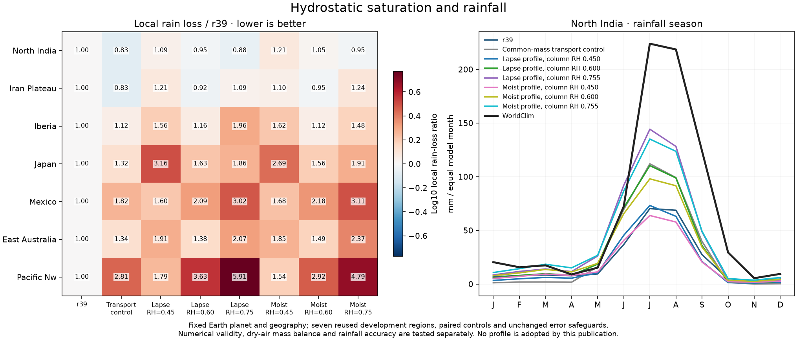
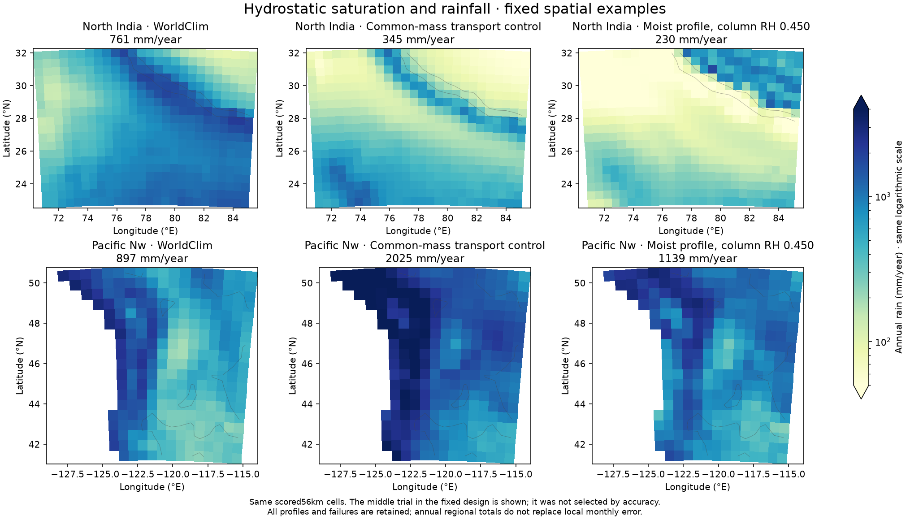

# Pressure-integrated saturation in the coupled climate model

The preceding reservoir experiments expose the need for thermal structure:
a prescribed humidity ratio or arbitrary capacity partition cannot independently
establish realistic upper-air moisture. This round introduces a diagnostic
hydrostatic saturation profile into the actual coupled seasonal climate model,
with existing Earth planetary forcing fixed. It is opt-in and not an adopted
fit or a prognostic vertical atmosphere.

## Physics and verification

New shared `column_saturation_scheme='legacy'` preserves existing fits. The
optional `pressure-lapse` and `pressure-moist` modes integrate specific saturation
humidity q_sat over pressure, `W_sat=integral(q_sat dp/g)`. The liquid Bolton
vapor-pressure approximation is consistent with the old model; specific humidity
is distinguished from the mixing ratio used in the older V10 experiments.

Surface pressure is101325exp(-terrain/8000m)Pa, matching the existing common-mass
basis. Smoothed surface air temperature is T_col minus the full terrain lapse,
instead of the old half-lapse mountain approximation. Pressure-lapse follows
the existing fitted environmental lapse; pressure-moist uses a saturated
pseudoadiabatic dry-gas approximation, with constant cp1004J/kg/K, Rd287.05J/kg/K,
Lv2.5MJ/kg and g9.80665m/s². A prescribed200K isothermal stratosphere is an
explicit Earth-like assumption. Water above100hPa is omitted while its air
mass stays in the upper dry-mass fraction. Ice, independent vertical heat and
momentum, latent-heat feedback and prognostic convection are not added.

The same profile supplies rainfall capacity, sea-equilibrium water and any
storm crest capacity. No additional vapor scale-height factor is applied.
The old 2.2km water scale and -45C saturation floor remain only in the disabled
legacy path. This does not force actual water to the calculated saturation
profile or replace the existing fixed two-branch humidity ratio.

RK4 uses64 steps in log pressure per air layer. Independent isothermal analytic
and environmental-lapse hydrostatic quadratures validate units and integration.
Cold/warm/elevated convergence is checked at64/128 steps: require1e-4mm absolute
water agreement plus2e-5 relative, explicitly allowing a nonsmooth prescribed
tropopause. This is a quadrature accuracy check, not a relaxation of the climate
moisture-equation residual. Eleven operator checks and two actual coupled-model
checks cover profile behavior, supported states, specific versus mixing humidity,
cold columns and strict conservative water certificates. Invalid model schemes
are rejected. Full31/ocean/fine/established gates now require the active pressure
profile certificate too. The focused compatibility suite passes92 tests.

## Predeclared actual Earth comparison

`calibration/pressure_column_20261026/plan.json` specifies56 full regional climate
integrations: seven originalr39 controls, seven archived common-mass transport
controls, then42 candidates. Controls must reproduce every stored field, mask,
observation, budget and available native wind array before candidates.

The six fixed combinations are two profile modes times effective column ocean
relative humidities0.45,0.60 and the original0.754746. These are shared boundary
column humidity values, not measured surface RH or independent upper/lower RH.
They are fixed before new Earth results, with no adaptive additions. All use
common-mass two-branch transport, lower air fraction0.25, upper/lower humidity
ratio0.2,1km thermal shear and the existing rainfall/source/sink closures.
Earth tilt, orbit, spin, radius, sunlight and greenhouse forcing stay locked.

Same strict numerical residuals and original temperature, rainfall, individual
region, SST, native circulation, stationary dry-mass and separate branch-speed
safeguards apply. Damping/work remains separately declared0.05/1024. At most two
qualifiers may advance through unchanged full31/ocean/fine/established checks;
matched-world qualification is still required before a normal atlas replacement.
The supervisor stops on frozen-source change or a2h wall-clock ceiling and never
automatically exports atlas climates or writes Git commits.

These are seven reused development regions, not independent validation. No
new global/city headline accuracy is implied. Existing fantasy Earthr38,
scientific Earthr39, free and Whittaker atlas climates remain until all relevant
qualification gates pass. An external vertical-profile audit and final coupled
results will be recorded separately without retrospectively changing this plan.

## Completed actual coupled comparison

Source5c72c34, output `output/pressure_column_20261026/`. All56 integrations
pass numerical checks; all14 archived controls reproduce exactly. None of the
six candidates passes unchanged accuracy safeguards. No full31/ocean/fine/
established candidate stage runs, and no atlas climate or headline changes.

| Profile | North India annual mm | NI monthly MAE mm | Seven-region S | Rain-loss ratio |
|---|---:|---:|---:|---:|
|reference|256.3|50.01|1.0000|1.0000|
|transport_control|345.1|43.67|1.1535|1.3217|
|lapse_045|236.8|51.92|1.3188|1.6325|
|lapse_060|372.3|49.42|1.2587|1.5207|
|lapse_original|494.3|48.53|1.5696|2.1028|
|moist_045|230.4|55.62|1.2978|1.5872|
|moist_060|362.1|53.49|1.2503|1.5045|
|moist_original|494.6|52.06|1.5308|2.0413|

The smallest aggregate score is1.2503 for moist/RH0.60, still materially worse
thanr39 (rain-loss ratio1.5045). Every candidate fails regional protections;
several also fail SST or aggregate temperature safeguards. A better externally
anchored thermal/humidity shape does not establish better coupled rainfall.
All observations, masks, actual monthly cells, numerical steps and failures are
retained. The fixed middle design index (moist/RH0.45) is mapped; no best-map
selection is made.

The external [vertical reference audit](VERTICAL_REFERENCE_20261026.md) remains
a separate conditional diagnostic; it neither modifies the plan nor overrides
these rainfall failures. Pressure-profile capacity alone leaves the imposed
transport humidity ratio and associated mean-flow import. Next isolate separately
solved layer water using the existing calibrated total capacity, so a failed
absolute-capacity change is not conflated with a change in transport states.

The completed Earth series is777 attempts:773 passed and4 original failures
preserved. The new56 all pass, and the native reference audit adds0 integrations.
A coupled reservoir backend is being prepared separately; it is not claimed as
an adopted or already validated rainfall gain.
