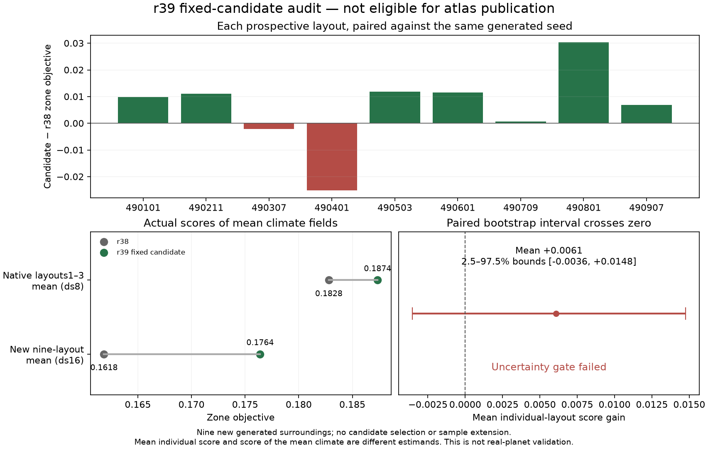

# Fixed-planet r39 world transfer

The qualified r39 Earth physics is held fixed while fitting the fantasy world's
latitude, orientation, elevation tiers and unknown surroundings. The existing
retrograde rotation, 33.50° tilt, Earth-sized planet, orbit and stellar input
are unchanged. Target rules and publication protections are unchanged.

The first 97-case ds32 search did not yield a publishable world: its native
candidate 32 converged but lost strict agreement and Mediterranean skill.
The complete failed review remains in `output/r39_world_publication/`.

A declared supplemental screen uses that measured resolution discrepancy to
rank archived candidates, computes seven actual ds16 mean climates and chooses
at most two actual ds8 checks. Corrections rank proposals only; integrated
climate fields and the final metrics are never corrected. Each numerically
verified surroundings layout is saved separately with an input identity.

All seven intermediate worlds converged. The selected native order is 49,65.
Candidate 49's complete native result is:

| Measure | Published r38 | Native r39 candidate 49 |
|---|---:|---:|
| Zone-fit objective | 0.182806 | 0.187963 |
| Exact target-zone agreement | 34.99% | 37.04% |
| Mediterranean classified dry | 6.41% | 6.08% |
| Mediterranean classified Cs | 74.55% | 80.46% |
| Tree-zone recall | 6.79% | 4.56% |

**Candidate 49 is rejected.** The tree recall must remain at least 4.79% under
the previously declared allowance. All its numerical checks passed, but a
better aggregate cannot cancel this regional failure. The canonical atlas
therefore stays on r38. Candidate 65 also converged but is rejected:
zonefit 0.187228, strict agreement 36.00%, tree recall 6.26%, Mediterranean
dry share 7.55% versus the unchanged 6.91% maximum. No additional-layout
result was inspected for either rejected endpoint. The full final review is
`output/r39_world_transfer/review.json`.

The tree-zone climate diagnosis is descriptive: mean annual rainfall falls
from 543.7 to 504.4 mm, mean coldest-month temperature rises 6.24→6.42°C,
and the humidity factor falls 0.369→0.334. Insufficient moisture is the
larger weakness; this is not a causal sensitivity measurement. Existing
classification rules remain fixed.

`output/r39_world_transfer/native_comparison.png` compares the actual native
climates. `world_preview.png` is the earlier ds16 preview. Input and picture
hashes accompany both. No new model run is required to make these figures.

A conditional three-case geometry path was declared in
`calibration/map_world_r39_balance/plan.json`, before candidate 65's native
result and before any interpolated climate integrations. Both endpoints are
now rejected with successful numerics, so this path is running. It keeps all original protections and
allows only one further actual native candidate. Eleven focused tests cover
locked physical parameters, interpolation/ranking and complete atlas assets.

All three actual ds16 balance screens converged:

| Fraction from 49 toward 65 | Zone objective | Exact agreement | Tree recall | Mediterranean dry |
|---|---:|---:|---:|---:|
| 1/3 | 0.186653 | 36.90% | 5.56% | 5.05% |
| 1/2 | 0.186477 | 36.87% | 5.56% | 5.05% |
| 2/3 | 0.186510 | 36.67% | 5.98% | 5.45% |

The declared ranking, using measured endpoint resolution discrepancies only
to predict test order, chooses the 2/3 case (`balance_003`). Its one actual
native test has completed. It passes every native protection: zonefit0.187353,
exact agreement36.35%, tree recall5.73%, Mediterranean dry6.88% and Cs80.90%.
The five existing world-publication guard tests also pass.

**The balance attempt is rejected at its final layout gate.** On layouts17/23,
its zone objective is0.187013 versus0.187191 for r38. Strict agreement improves
32.39%→33.60%, but that cannot cancel the objective loss under the declared
rule. No other candidate is selected after inspecting this result. All numerical
checks passed. The automatic staging builder correctly skips the unqualified
result, retaining the canonical r38 atlas. Full records and the explanatory
`native_balance.png` are under `output/r39_world_balance/`.

Any future fit using these two inspected layouts must count them as development
data and declare different layouts for final validation. This rejection remains
part of the evidence; new training does not retroactively make it a pass.

The next, separately declared campaign is
`calibration/map_world_r39_robust/plan.json`, run by
`scripts/check_r39_world_robust.py`. Four fixed geometries train over layouts
1,2,3,17,23, with no score regression allowed in either known batch or their
five-layout mean climate. At most one proposal advances through actual native
checks and five prospectively reserved validation layouts. All original native
and layout thresholds remain unchanged. The previous failed attempts remain
rejected. All four training screens converged, but each lost on the known17/23
batch, so this campaign is rejected. No native or prospective390xxx validation
was run. Nineteen focused tests pass. The canonical Earth atlas still uses r38
and the complete local atlases remain
available through `start_atlases.bat`.

A final separate audit is prospectively declared at
`calibration/map_world_r39_audit/plan.json`. It tests one fixed, already
native-passing geometry (balance003) over nine new490xxx surroundings layouts,
without selection, parameter changes or sample extension. Publication requires
the original native protections, a nonnegative nine-layout mean-climate zone
gain and a strictly positive lower2.5% paired-bootstrap bound for mean individual
layout gains (20000 draws). Score of the mean climate and mean individual score
are distinct; both are required. This describes uncertainty under the invented
surroundings generator, not validation against real planetary climate. The
previous two-layout rejection remains reported. Twenty-three focused tests pass;
the fixed audit has now completed its full original sample without extension.

## Completed nine-layout audit and atlas sensitivity maps

All 18 prospective members passed numerical checks. The r39 candidate improves
the actual nine-layout mean-climate zone objective from 0.161844 to 0.176399
and strict agreement from 30.61% to 34.48%. Seven of nine individual paired
zone-score changes are positive. Their mean is +0.006091, but the declared
bootstrap bounds are **[-0.003555, +0.014763]**. The lower bound is not positive,
so **the audit rejects publication**. No further candidate or sample is added.
The earlier two-layout failure also remains reported. The normal Earth atlas
therefore retains its qualified r38 climate and economic data.

The nine verified r38 reference climates provide a useful new atlas diagnostic.
The Earth atlas now has **Rain sensitivity** and **Temperature sensitivity**
under **Fit checks**, plus downloadable source-grid values. Only the generated
surroundings seed varies. The maps show sample standard deviations (n−1),
relative to mean annual rainfall for the rain map. They describe conditional
boundary sensitivity, not total model uncertainty, interannual weather or
validated climate-error intervals. Main atlas climate remains the ds8 mean
over layouts 1–3; these sensitivity cases use ds16.

| Spread over mapped land pixels | Median | 90th percentile | Maximum |
|---|---:|---:|---:|
| Annual rain (% of nine-layout mean) | 14.01% | 20.02% | 37.01% |
| Mean annual temperature (°C) | 0.775 | 0.920 | 1.315 |

`scripts/add_surroundings_sensitivity.py` checks actual physical/geographic
parameter equality, scientific source hashes and all member numerical
certificates. Each member is interpolated to source land pixels before taking
moments, preserving covariance between neighbouring cells. A streaming sample
variance calculation avoids stacking nine full-resolution products in memory.
Five focused tests cover sample variance, interpolation covariance, physical
fingerprints, consistent sea-level temperature projection and invalid samples.

All three normal atlas pages are refreshed. Chromium checks through the actual
`.bat` server pass for sensitivity maps, CSV downloads, deep-link reloads,
conditional settlement controls, existing farming/population/political modes
and mobile layout. Complete packet, food-budget and population-accounting
checks pass. Earth parameters, summary, climate binary and build provenance
are byte-identical to the previous release; only diagnostic assets and UI are
added. CSV downloads join the Windows checkout byte-preservation checks.

The next physical work should constrain or improve remote boundary forcing;
small changes in a few fitted surroundings layouts are not reliable evidence
of universal map-climate gains. Preserve the observed-global-rain versus
generated-descent distinction when evaluating future r39 physics changes.

Publication requires a native pass followed by the layouts17/23 comparison,
a full staged export, food and population accounting, complete asset checks,
and Chromium checks through the actual `.bat` server. All normal atlases remain
available meanwhile, with current directed markets and three Trade views.
