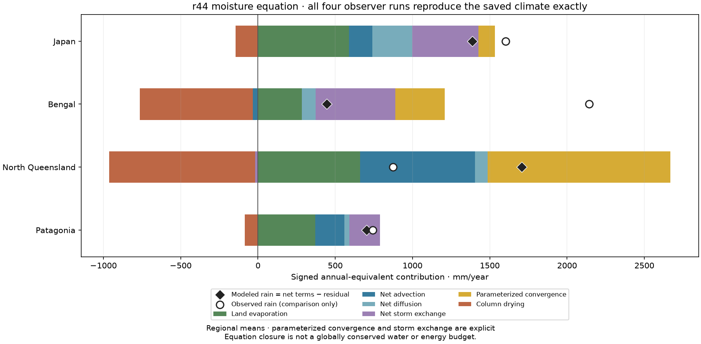
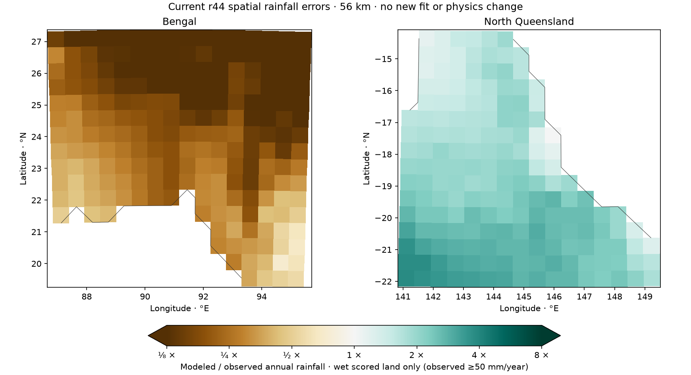

# r44 rainfall-source diagnosis — 10 November 2026

All four existing equation observers pass exact archived monthly-array controls, actual input hashes,
strict numerical checks and signed-source reconstruction. This is a read-only baseline audit, separate
from the P8d 51-candidate campaign: no coefficients, objective, finalist, independent pool or physics
adoption changed. The four cases are reused development data.

Bengal's annual rain is 444 mm versus 2143 observed. Its net advection contributes −32 mm, parameterized
convergence +319, storm exchange +516, evaporation +284, diffusion +90 and column drying −732 mm/year.
North Queensland has 1707 mm versus 874 observed; parameterized convergence supplies +1183 mm/year,
net advection +744, with drying −944. These are the present equation terms, not counterfactual causal
effects: removing one term would alter water, rain, recycling, temperatures and winds.

Japan's summer moisture shortage and excessive winter rain remain visible in the monthly series.
Patagonia's regional annual total is near observations, while local errors remain large. The maps
show annual modeled/observed rainfall on scored wet land (observed ≥50 mm/year), clipping colors at
one eighth/eight times. Southern coordinates are restored to actual Earth latitude.

The maximum reconstruction gap is below 0.000023 mm/month. Regional-mean annual integrated absolute
equation residuals are below 0.6 mm/year, much smaller than the climate errors. These checks establish
the recorded discrete equation and solver control, not physical correctness or a globally conserved
water/energy budget. The active transport equation is the legacy concentration form; convergence import
and storm exchange are parameterized, and monsoon drying is already included in column drying.
The legacy column water/saturation ratio is not measured surface relative humidity.

Frozen inputs: `calibration/r44_rainfall_sources_20261110/plan.json`; output protocol, numerical receipts,
monthly source arrays and summaries: `output/r44_rainfall_sources_20261110/`. The wrapper reuses the
existing `check_moisture_sources.audit_one` observer without editing model/scoring code. Monthly archives
use the model's existing equal-month calendar; source contributions are converted from mm/day with
the same year/12 factor used by the climate export. Plots of regional means conceal local cancellation;
canonical rainfall loss continues to score every cell and month.

See [the calibration-method proposal](CALIBRATION_STRATEGY_20261110.md) for verified academic approaches
to separating parameter uncertainty, process constraints and model limitations. That proposal does not
change the current campaign or provide new independent validation.
