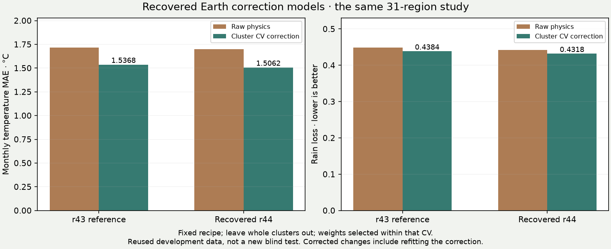

# Recovered r44 corrections and repaired joint inputs

The latest project state was fetched at `21e7c215`. It contains adopted r44
physics, terrain v2.2 with rivers continuing through lakes, delta-fan estimates,
soil/fertility work, irrigation and population/control updates. Free and Whittaker
fits were retired on 8 November; their snapshots remain available.

Two issues prevented a reliable continuation: the joint-input partition rejected
nine new parameters, and the r44 correction models referenced by the release
scripts had never been committed or separately saved.

## Joint physics versus geography

`terrain_file` belongs to world geography. Eight `storm_plateau` response fields
belong to shared physics. Their omission made 14 existing input-boundary tests
fail before a joint experiment could run.

The repaired partition excludes invented terrain from Earth inputs and preserves
shared plateau coefficients when composing world parameters. It also makes the
existing correction-compatibility check reject r43 corrections under r44 plateau
physics. Tests exercise these boundaries and verify identical solver outputs when
irrelevant world inputs change. No physical equation, adopted coefficient, Earth
orbit or solver convergence requirement was changed by this repair.

## Reconstruction recipe and exposure

The [reconstruction plan](../calibration/earth_correction_r44_20261107/reconstruction_plan.json)
was committed in `8a3871c7` before retraining. It pins the adopted r44 parameters
and existing training source files. The unchanged training driver regenerates
31 development regions, fixed whole-cluster correction folds, 28/14 km pairs and
the old Norway/southeast-Africa correction checks. Weight candidates, model
hyperparameters and acceptance criteria are unchanged.

These are repeated development/evaluation data, **not new unseen validation**.
No fresh sealed pool was opened. Climate sets f/g/h were already spent in their
recorded November experiments. The recovered artifacts have new hashes; matching
published rounded metrics does not prove byte identity with the lost originals.

| Same 31-region correction study | Raw physics | Cluster-CV correction |
|---|---:|---:|
| r43 temperature MAE, °C | 1.716805 | 1.536767 |
| Reconstructed r44 temperature MAE, °C | 1.699588 | 1.506243 |
| r43 rain loss | 0.448876 | 0.438408 |
| Reconstructed r44 rain loss | 0.442646 | 0.431778 |

The r44 results reproduce the earlier published rounded values of 1.506°C and
0.4318. Temperature selects shape/level weights 0.8/0.3; rain selects weight 1.0
under the original finite candidate grids. Whole clusters are left out for the
correction predictions; weight selection uses that CV, so it is not an additional
independent test. Differences in corrected performance include correction
refitting, not just a change in raw physics.



The separate **49-region raw-physics** development pool has temperature MAE
1.861483°C and rain loss 0.488261. It cannot be paired with the 31-region corrected
errors as if their difference measured correction gain. The original r44 adoption
record reports combined error ratios 0.99023 on development, 0.98594 at finer
resolution and 0.97847 on then-unseen set g. Those historical gates remain distinct
from this reconstruction. The later P8a coast candidate failed its unseen check;
r44 remains the adopted model.

## Artifacts that survive checkout

Both final models, all fold models, training protocols and scores are saved under
`calibration/earth_correction_r44_20261107`. A full training receipt checks the
replayed cases, source identities, observations and outputs. A separate release
receipt freezes the smaller set of models/protocols/metrics needed by an atlas
build. A fresh checkout need not contain every raw training-cache file merely to
apply these already-trained corrections.

`freeze_r44_corrections.py` verifies the complete training receipt and pinned
recipe before writing the release receipt. It rejects disagreement with the
published rounded reference instead of changing fit settings to force a match.
`check_v22_release_inputs.py` verifies actual model and protocol identities,
shared-physics compatibility and the release artifacts before an atlas build.
Resume markers carry an input manifest: changed inputs cannot silently reuse
earlier completed stages. A missing world checkpoint can be regenerated;
missing learned models cannot be silently substituted with r43 files.

The current accuracy page is refreshed without relabelling its older r39/r43
experiments as current results. Its exposure-register download is synchronized
with the current source register. The hub features the active Earth fit, keeps
explicit archive links, and verifies all retained metadata snapshots.

## Reproduction

```sh
TAG=r44 PARAMS=calibration/local_accuracy_20261023/r44_params.json \
OUT=output/earth_correction_r44_20261107 \
CAL=calibration/earth_correction_r44_20261107 \
bash scripts/retrain_earth_corrections.sh
python -I scripts/freeze_r44_corrections.py
python -I scripts/check_v22_release_inputs.py
bash scripts/release_v22_deltas.sh
```

The reconstruction result and release receipt retain old/new identities and all
scores. Production v2.2 release completion is recorded separately in
[the lake/delta report](LAKES_DELTAS_20261108.md); reconstruction alone does not
declare the pending atlas release complete.
