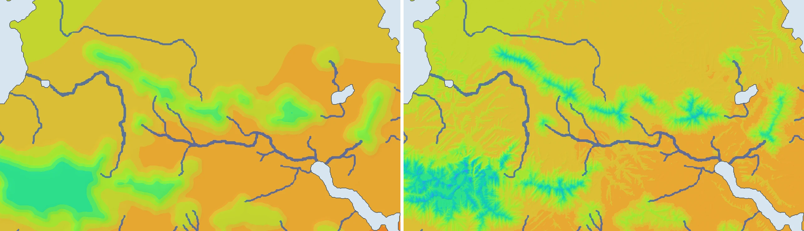

# Earth-fit atlas: r44 physics, r44 corrections and height map v2 — 7 November 2026

This release combines two pending changes:

* **r44 physics** (r43 + e72d plateau-steered storms; `calibration/local_accuracy_20261023/r44_adoption.json`) and
  its retrained Earth corrections (`calibration/earth_correction_r44_20261107`). Held-out temperature error is
  1.506 °C against 1.537 °C for r43; rain loss is 0.4318 against 0.4384.
* **Height map v2** (`calibration/geography_control_20261107/plan_B2.json`), set by `Params.terrain_file`. It adds
  eroded uplands, unmarked lowland hills fitted to Earth's lowland slopes, and the marked rivers carried as channels.

Climate check before the release (`plan_D.json`, `output/terrain_v2_climate_check/summary.json`):
* strict climate-zone agreement, raw: +0.73 points;
* strict climate-zone agreement, with the Earth corrections: +0.60 points;
* mean |ΔT| 0.39 °C; rain ratio median 1.001.

So the climate uses the new terrain too.

World parameters: `calibration/map_world_r44_terrain/params.json`.

## Release (7 November 2026)

**Stage 1, staged base build** (`scripts/release_r44_terrain.sh`, logs in `output/atlas_r44/`):
* the world, reusing the climate-check simulation as its checkpoint;
* diagnostics;
* corrected layers and the corrected climate, with the r44 corrections (temperature error −11 %, rain loss −2 % on
  held-out Earth clusters);
* languages and the physics tag.

Raw strict zone agreement is 0.352, against 0.345 for the live r43 atlas, and the numerical checks pass.

**Stage 2, promotion and add-ons** (`scripts/release_r44_addons.sh`):
* The live r43 atlas is backed up locally to `output/atlas_r44/previous_atlases/earth_fit_r43`.
* Then, in order:
  1. administrative inventory;
  2. coverage (compute, then publish);
  3. pasture;
  4. farm work;
  5. presence;
  6. imperial access (compute, then publish);
  7. administrative hierarchy (compute, then publish);
  8. fertility maps;
  9. settlement integration, labour and fertility;
  10. control v2 and v2.1;
  11. the settlement publisher;
  12. pages.

**Results.**
* The promoted atlas has exactly the file set of the previous one.
* Smoke passes for the free, Earth-fit and Whittaker atlases.
* The free and Whittaker add-ons were recomputed too. Their gzip packets are identical apart from timestamps; pasture,
  presence and hierarchy images change because they share Earth-fit pilots and the joint administrative inventory.
* Control v2.1 on the new terrain: held 68.1 % (raw) and 67.8 % (corrected) of Earth-fit land, desert holes 0.17 % /
  0.13 %.

