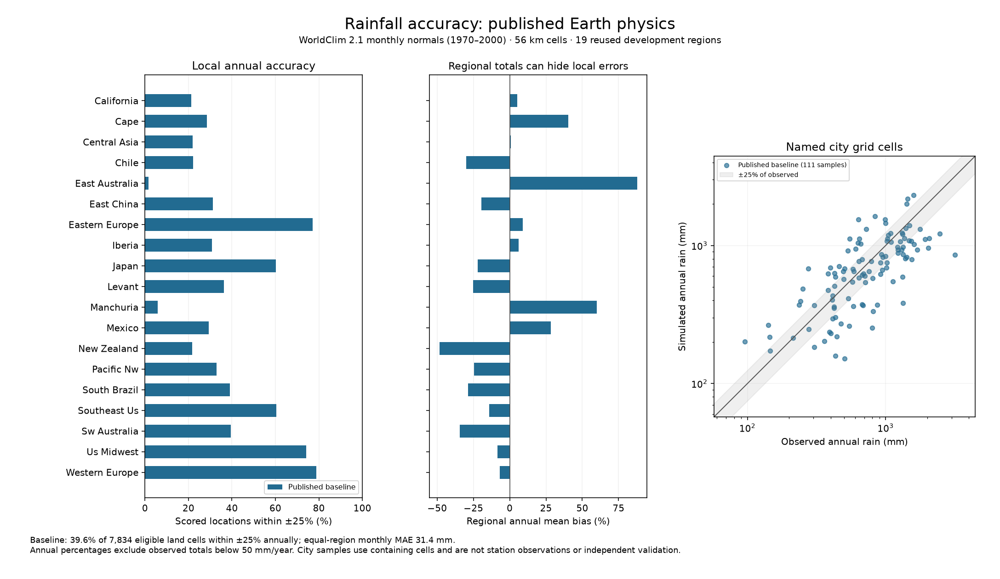
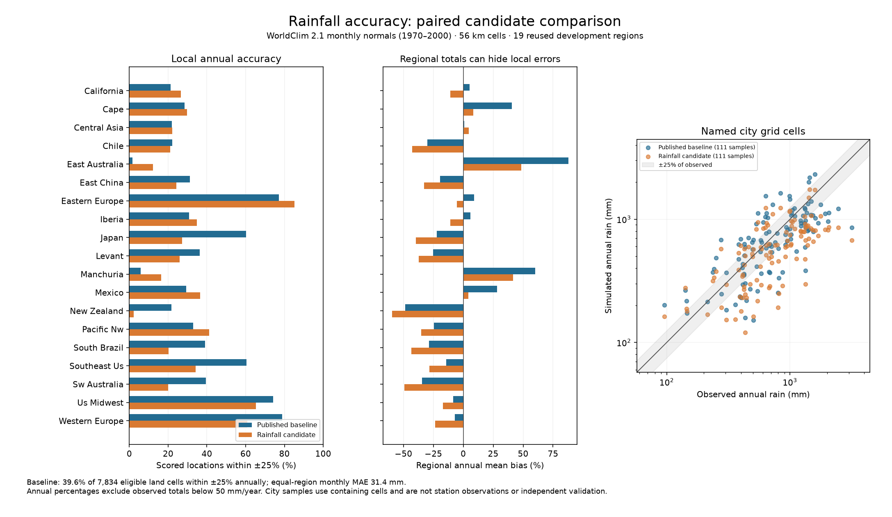

# Rainfall accuracy: location, amount and season

The user's current priority is rainfall physics and calibration. Fantasy-map
geography and demographic additions are paused. No rainfall accuracy gain
is claimed from a biome score, regional total or closed numerical budget.

## Reference accuracy

The published Earth r29 physical profile has been compared with WorldClim
2.1's monthly 1970–2000 normals on 19 real regions at 56 km resolution.
The archived baseline in `output/autonomous_20261021/screen1/case_base_*.json`
covers 7,968 scored land cells. Equal-region mean monthly cell MAE is
**31.36 mm**, annual spatial Spearman correlation is **0.510**, and the
absolute error in the fraction of annual rain falling in the winter half
is **11.78 percentage points**. These regions have been reused during
development; these numbers are not independent validation or a station-level
accuracy claim. Monthly normals assess climatology, not individual storms.

| Region | Simulated / observed regional mean, mm/year | Monthly cell MAE, mm | Annual wet/dry spatial correlation |
|---|---:|---:|---:|
| California | 412 / 392 | 19.3 | 0.804 |
| Central Asia | 230 / 228 | 11.7 | 0.255 |
| Eastern China | 1032 / 1281 | 46.6 | 0.465 |
| Eastern Australia | 1203 / 641 | 47.4 | 0.935 |
| Japan | 1247 / 1601 | 62.6 | -0.067 |
| New Zealand | 869 / 1685 | 69.1 | 0.364 |

Central Asia shows why the near-perfect regional mean is insufficient:
individual wet and dry places are ranked poorly. Eastern Australia gets the
ordering right but is far too wet. Neither metric alone measures accuracy.
The current strict numerical rerun will additionally measure the share of
individual cells within 25% and 50% of observed annual rain. Named city
samples are containing grid cells, not independently measured stations.

## Rainfall-only calibration

The former Earth objective combined temperature and rainfall distances.
`earth_calibrate.py --objective rainfall` now minimizes, per region:

```
0.5 * RMS_cells(log((simulated annual mm + 50) / (observed annual mm + 50)))
  + 0.5 * 12 * mean_absolute_monthly_cell_error_mm / (observed_mean_annual_mm + 120)
```

Each region has equal weight. Within a region, errors are computed at each
cell and month before averaging. A swapped rainy season or misplaced rain
is penalized even when annual or regional totals agree. The +50 mm annual
smoothing and 10 mm/month normalization floor prevent near-zero desert rain
from giving unbounded relative errors. The loss is dimensionless and is
**not an accuracy percentage**. Temperature and biome agreement do not enter
this loss. Temperature remains a separate protection against an improved
rain fit damaging the rest of the climate.

The initial bounded search uses the eight established training regions,
eight storm/moisture coefficients, strict saved numerical criteria, one
baseline plus eight candidates, sigma 0.06 and seed 241023. Eleven other
previously used regions are evaluated only for the selected candidate in
this search. Search manifests fingerprint the objective, physics, observations,
parameters and optimizer settings; incompatible resumes are rejected. Every
training and final comparison keeps its actual numerical certificates, local
rainfall diagnostics and city-cell monthly samples.

Selection gates are frozen in
`calibration/climate_physics_20261023/rainfall_policy.json`: at least 1% lower
rainfall loss across all 19 regions, better monthly MAE, no higher annual
log RMSE, and protections for individual regions, temperature, seasonality,
location ranking and the fraction of locations within 25% of observed totals.

Two new geographic tests are specified **before seeing candidate results**:
Norway (Atlantic coast, mountains and Sweden) and southeast Africa (Indian
Ocean coast, Drakensberg and interior). The baseline and the selected
candidate will be compared once on these regions. Subsequent use for tuning
would make them development data. This is a limited geographic test, not
proof of global or finer-resolution accuracy.

## Reproducible commands

```sh
OPENBLAS_NUM_THREADS=1 OMP_NUM_THREADS=1 .venv/bin/python -I scripts/benchmark_rainfall.py \
  --fits baseline=atlases/earth_fit/params.json --workers 1 \
  --out output/climate_physics_20261023/rainfall_baseline

OPENBLAS_NUM_THREADS=1 OMP_NUM_THREADS=1 .venv/bin/python -I scripts/earth_calibrate.py \
  --start atlases/earth_fit/params.json --physics storm_water --objective rainfall \
  --saved-numerics --cell-km 56 --evals 9 --popsize 8 --sigma 0.06 --seed 241023 --workers 2 \
  --regions california iberia southeast_us levant central_asia east_china east_australia mexico \
  --holdout chile cape sw_australia south_brazil japan pacific_nw western_europe eastern_europe us_midwest manchuria new_zealand \
  --out calibration/climate_physics_20261023/rainfall_r1
```

The initial 21 targeted tests pass, covering local errors hidden by regional
means, reversed wet seasons, desert/zero-rain behavior, invalid data,
rainfall-only optimizer scoring, failed numerical checks, incomplete regional
comparisons and equal-region versus pooled-cell reporting. Calibration and
new validation results will be recorded after they complete.

## Completed baseline and first search

The strict 19-region rerun passes all observed convergence checks and confirms
the archived errors: equal-region monthly MAE **31.359 mm**, annual cell MAE
**293.910 mm**, annual log RMSE **0.451874**. Of **7,834** cells receiving at
least 50 mm/year, **39.63%** are within 25% of observed annual rainfall and
**69.80%** within 50%. These pooled-cell percentages differ from equal-region
averages; the benchmark summary labels both. Mean 12-month rainfall-fraction
total variation is 0.173522, a separate seasonal-pattern diagnostic.



The first search completes nine candidates and eleven final development
comparisons with no numerical failures. Its selected training loss improves
**0.487145 → 0.466780 (4.18%)**, but the full 19-region loss worsens
**0.442412 → 0.457687**, monthly MAE rises **31.359 → 31.770 mm**, and pooled
annual agreement within 25% falls **39.63% → 35.15%**. Several dry biases
worsen, including New Zealand and southwest Australia. The candidate fails
the predeclared regional and overall protections and is rejected. No atlas
is updated; the two new geographic tests remain unused.



The follow-up is a separately bounded balanced refinement: all original
19 regions now contribute to the rainfall training objective, one baseline
plus eight candidates, sigma 0.04 and seed 251023. They are explicitly all
development data; none are relabeled as independent validation. Its unchanged
selection limits and distinct region list are frozen in `rainfall_r2_policy.json`
before results. Norway and southeast Africa remain reserved for a selected
candidate. This responds to the observed regional tradeoff rather than
relaxing the rainfall protections.

The geographic benchmark now accepts an explicit region-definition JSON and
freezes both those definitions and the actual aggregated observational grids.
The review script checks shared input/source hashes, paired cell counts, saved
optimizer costs and every selection protection. All 26 rainfall, Earth-search
and regional-selection tests pass. The baseline, rejected candidate, journals,
station-cell samples, figure data and source manifests are retained in the
repository.
