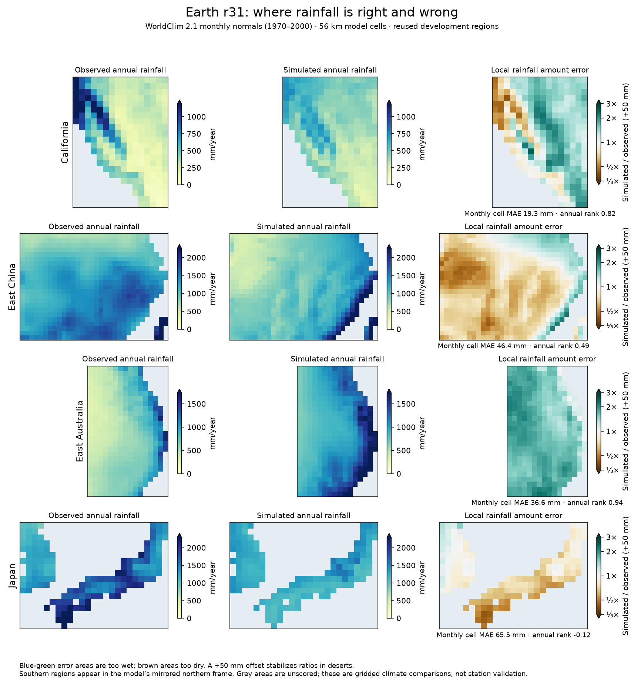

# Rainfall development resumed on Earth r31

The repository was advanced from the older cloud checkout to `f02ed84`,
including the intervening r30/r31 ocean, seasonal and population work.
The climate reference is now `calibration/local_accuracy_20261023/r31_params.json`.
The published atlas packets are unchanged by this round.

## Recover a verifiable reference

The new workspace did not contain the untracked observational cache or the
prior r31 run directory. WorldClim 2.1's 5-minute elevation, precipitation and
temperature archives were restored, and r31 was rerun on all **31 development
regions at 56 km**, with every observed numerical check passing.

| Equal-region metric | Restored r31 |
|---|---:|
| Monthly temperature MAE | 2.101623 °C |
| Annual-mean temperature MAE | 1.483 °C |
| Monthly rainfall MAE | 31.529 mm |
| Rainfall loss | 0.480956 |
| Annual rainfall log RMSE | 0.505 |
| Annual rainfall spatial rank correlation | 0.455 |

These are reused development regions, not station observations or new
independent validation. The original 19-region figures must not be compared
directly with these wider-set means as an accuracy change.

`benchmark_local.py` now freezes complete parameters, region definitions,
scientific source hashes and raw observational archive hashes. Each region
records a hash of its actual model/observation arrays, its numerical certificate,
and a hash of its saved monthly cells. Completed verified regions are reused;
changed inputs are rejected and missing/corrupted cell files are recomputed.
Parameters are passed to workers from the frozen configuration, rather than
reloaded from a possibly changing parameter file. Shared global fetch caches
are prepared before parallel workers to avoid competing writes.

The reference was immediately repeated: all **31 regional results were reused**
and the summary remained byte-identical. Benchmark failures receive explicit
records and no aggregate accuracy score. Rainfall rank correlation now averages
ties; constant fields have an undefined correlation rather than an arbitrary
rank. Old benchmark directories without manifests remain preserved and must
be regenerated into new folders before reuse.

The local adoption gate now checks the exact policy region set, successful
numerical certificates, matching scientific sources and observations, matching
numerical criteria and matching per-region input identities. It recomputes
overall and group means from regional records. It cannot be passed using a
stale summary, a missing difficult region or a changed observation grid.
The 0.5% improvement threshold and all four group protections are unchanged.
An actual reference-versus-itself check correctly fails adoption at S = 1.

## First bounded rainfall hypothesis: warm-column convergence import

The experiment was declared in `calibration/rainfall_r31_20261023/plan.json`
before candidate results. Keep r31 fixed and raise `flux_convergence` from
0.15 to 0.30 or 0.45. This tests whether missing warm-season moisture import
explains deficient monsoon rainfall. The six-region pilot includes China,
Japan and Mexico, with California, Central Asia and eastern Australia as
counterchecks. The existing convergence import is explicit in the vapor
equation; it is not a globally conservative circulation model.

All 12 candidate simulations pass numerical checks, but both amplitudes fail
the predeclared rainfall selection limits:

| Convergence coefficient | Mean rainfall loss | Monthly rainfall MAE | Monthly temperature MAE |
|---|---:|---:|---:|
| r31 control, 0.15 | 0.476515 | 36.423 mm | 1.9921 °C |
| 0.30 | 0.488517 | 37.357 mm | 1.9772 °C |
| 0.45 | 0.514885 | 39.419 mm | 1.9657 °C |

Eastern China's rainfall loss improves **0.3972 → 0.3442 → 0.3214**, while
Japan barely changes. Mexico worsens **0.6482 → 0.7207 → 0.8209**, and eastern
Australia also becomes too wet. The 0.30 candidate exceeds eastern Australia's
monthly-error limit; 0.45 exceeds both its and Mexico's limits. A small
temperature improvement cannot make these rainfall regressions acceptable.
Neither advances to the full development gate, finer-grid checks, validation
or atlas publication.

The complete reference, candidate records, frozen inputs and rejection review
are saved under `output/rainfall_r31_20261023/`. The focused benchmark/gate,
rainfall, Earth calibration and orographic tests pass **48/48**; the earlier
climate/Earth regression set passes **49/49**. No production physics parameter
or published atlas is changed by this milestone.

## Second hypothesis: evaporation below cloud base

The next controlled change raises the existing `subcloud_evaporation`
coefficient from 0.377239 to 0.65 or 0.90, leaving all other r31 parameters
unchanged. The plan and selection limits were frozen before results in
`evaporation_plan.json`. The rain closure represents less precipitation
surviving the passage through dry air beneath high cloud bases. The solved
vapor column retains evaporated rain; this is not a correction applied to
the final precipitation maps.

All 12 pilot simulations pass numerical checks:

| Evaporation coefficient | Pilot rainfall loss | Monthly rainfall MAE | Monthly temperature MAE |
|---|---:|---:|---:|
| Control, 0.377239 | 0.476515 | 36.423 mm | 1.9921 °C |
| 0.65 | 0.473190 | 36.231 mm | 2.0029 °C |
| 0.90 | 0.471735 | 36.115 mm | 2.0126 °C |

Both amplitudes improve pilot rainfall, particularly eastern Australia.
The 0.90 setting increases mean temperature error by more than the
predeclared 1% limit and is rejected. The 0.65 setting passes the pilot,
with about **0.70% lower rainfall loss**, and is selected for the full
31-region development comparison. Japan worsens slightly, so the full
group protections remain material. No adoption is inferred from this pilot.

The diagnostic figure uses the verified monthly cell files. It exposes
errors that a regional annual total hides: California's wet coast is too
dry and its interior too wet; eastern China's rain is concentrated too near
the coast; eastern Australia is broadly too wet; and Japan misses the wetter
southern/eastern coast. The figure's ratios use a +50 mm annual offset to
stabilize comparisons in deserts. These maps diagnose development errors;
they are not a newly adopted atlas climate.

The selected 0.65 setting completes all **31 regions** with successful
numerical checks, but fails the wider gate: S = **1.001917**, with the former
holdout, mid-latitude and dev12 groups worsening. Monthly temperature MAE is
2.101623 → 2.106063 °C and rainfall loss 0.480956 → 0.481783. It is rejected.
The pilot improvement did not transfer, and the established validation regions
were not used. The new pilot-review, input-pairing and benchmark tests pass
**14/14**. No atlas or default physics coefficient changes.

## Reduced-import controls

The first convergence experiment could also mean the r31 atmosphere needs
less of the old positive moisture import. `reduced_convergence_plan.json`
therefore freezes half strength (0.075) and no import (0), using the same
pilot regions and protections before their results.

| Convergence coefficient | Pilot rainfall loss | Monthly rainfall MAE | Monthly temperature MAE |
|---|---:|---:|---:|
| Control, 0.15 | 0.476515 | 36.423 mm | 1.9921 °C |
| 0.075 | 0.476265 | 36.357 mm | 2.0031 °C |
| 0 | 0.480049 | 36.564 mm | 2.0189 °C |

Turning import off fails the pilot: China becomes too dry, the mean rainfall
metrics worsen, and temperature error exceeds its limit. Half strength barely
improves pilot rainfall and qualifies for the wider comparison, but its full
31-region result fails: **S = 1.002689**, temperature MAE **2.104440 °C**,
rainfall loss **0.482898**. Training, former-holdout and dev12 group scores
worsen. The candidate is rejected.

This round retains **129 regional Earth simulations**, all passing their
observed numerical checks, plus the successful 31-region resume test. There
is no adopted climate change, and no validation-region result was used for
tuning. The consolidated targeted tests pass **51/51**. All three bounded
families and their selection decisions are complete; no simulation remains
running.

The local maps prioritize the next physical question: how storm moisture
crosses coastlines and mountain barriers, and where its condensation falls.
Any new transport/rainout operator must account for that condensation in the
vapor equation and be tested against the same r31 reference and group limits.
Increasing or decreasing a global rainfall coefficient has not resolved the
opposing local errors in these experiments.

The next physical development is documented in
[Explicit condensation during storm transport](STORM_RAINOUT_20261023.md),
with a new opt-in operator, conservation tests and a paired r31 control.
