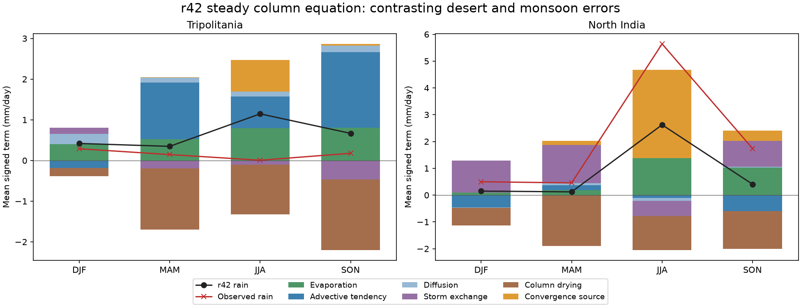
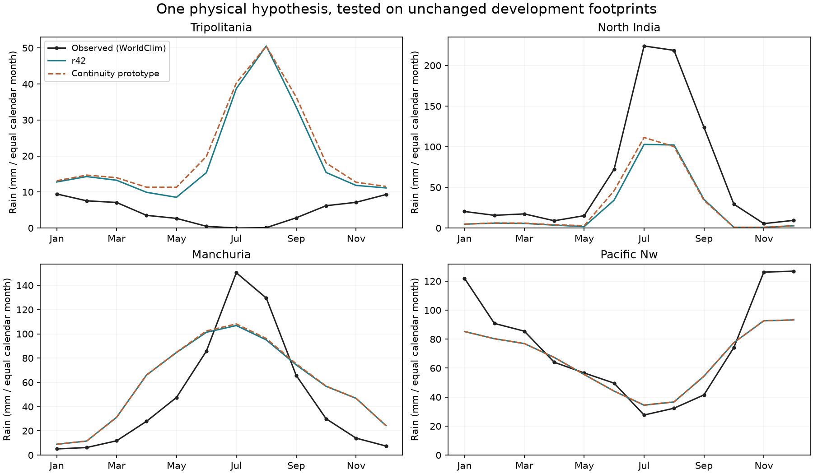

# Rainfall processes and a continuity hypothesis, 2 November 2026

The four-region process diagnostics reproduce r42's ordinary temperature and
rainfall benchmark errors to 1e-10 on the same complete scoring footprints.
The isolated physics prototype below is **not adopted**: it worsens the
four-region combined error by 1.50%. The independent 49-region calibration
continues separately, with no change to production physics or the running
atlas release.

## What the current model is doing

Plan: `calibration/r42_rain_diagnosis_20261102/plan.json`. All four cases are
development data. The existing numerical tolerances, geography, Earth
parameters and forcing are unchanged. Every scored land cell is traced;
there is no selection of representative or favourable centre cells.

The terms are signed tendencies in the model's **steady concentration-form
column equation**, not source-water tracers or a globally conservative
atmospheric budget. The advective tendency is not an independently measured
boundary flux. Monsoon drying is a subset of column drying, never another
term in the sum. Month weights are the benchmark's exact equal-calendar-month
weights; annual means preserve the 25-step annual integral.

* **Tripolitania:** mean rain is 235 mm/year versus 56 observed. The largest
  error is a false summer rainy season: JJA 1.146 versus 0.007 mm/day. JJA
  modeled evaporation is 0.798, advective tendency +0.775, convergence source
  +0.782 and column drying −1.229 mm/day. More generally drying the desert
  would act on large competing tendencies, not solely on a rain coefficient.
* **North India:** annual rain is 301 versus 761 mm. JJA has 2.623 versus
  5.643 mm/day. It receives +3.292 from the convergence source but loses
  −1.263 through column drying and −0.571 through storm exchange, with
  evaporation +1.381. The model's mean-wind advective tendency is slightly
  negative (−0.103). The annual column-drying sink is 479 mm/year, but its
  timing matters; removing an annual sink is not a prediction of recovered
  monsoon rainfall.
* **Manchuria:** DJF rain is 0.491 versus 0.207 mm/day. Storm exchange
  contributes +1.341 while mean-wind advection removes −1.162. Spring rain
  is also excessive; summer remains too dry. Its annual water total alone
  hides the seasonal problem.
* **Pacific Northwest:** annual rain is 798 versus 897 mm, with the largest
  shortage in winter. It remains a coastal control for mechanisms intended
  to fix the desert or monsoon.

Recorded source terms reconstruct the recorded equation within float32
storage roundoff (maximum discrepancy about 6e-7 mm/day for the desert/Indian
cases). The underlying equation still has its actual iterative residuals:
mean absolute 0.00152 mm/day in Tripolitania and 0.000515 in North India.
Those residuals are retained, not corrected away or described as exact closure.

## Isolated continuity prototype

Plan: `calibration/descent_continuity_20261102/plan.json`. The production
model was copied into an experimental source capsule. Its precise diff is
`output/descent_continuity_20261102/source_diff.patch`; production
`rotclimate/*.py` was not modified. Every region runs fresh ordinary r42,
the copied model disabled, then the enabled hypothesis.

The hypothesis subtracts diagnosed convergent ascent from the geometric
branch's requested downward dry-air replacement:

`net_drying = max(requested_drying − max(−G300km(div(column_wind)), 0), 0)`.

All rates are s^-1. Existing branch geometry and prior-rain gates remain.
This is a declared kinematic closure, not a solved three-dimensional mass
or energy budget: horizontal convergence alone does not determine vertical
motion at every atmospheric level. Its coefficient is fixed at 1 and the
300 km averaging scale is declared before results; neither is fitted here.

The disabled copy matches all eight full-domain output arrays exactly
(T, sea-level T, rain, water, both winds, evaporation and snow) in every case.
All 12 control/prototype integrations pass the unchanged numerical checks.

| Region | r42 rain loss | Prototype loss | Change |
|---|---:|---:|---:|
| Tripolitania | 1.02642 | 1.11037 | +8.18% |
| Manchuria | 0.32584 | 0.32840 | +0.79% |
| North India | 0.77689 | 0.75702 | −2.56% |
| Pacific Northwest | 0.34532 | 0.34552 | +0.06% |

Over these four regions, equal-region mean temperature error worsens 0.30%,
rain loss worsens 2.70%, and their combined ratio is **1.0149907**. The
prototype is not advanced because its aggregate gets worse; the decision
does not require every individual region to improve. All regressions and
raw packets are retained. Nothing was tested on unseen set e.

The next process target is the contrast between false summer moisture
convergence over the desert and deficient monsoon delivery, together with
winter eddy import over East Asia. The failed prototype shows that simply
subtracting convergent ascent from geometric drying does not solve this.
A future mechanism must be compared over the full 49-region objective and
paired fine-grid checks before a prospectively frozen independent validation.

## Calibration and atlas status at this milestone

The independent three-start campaign has one provisional eligible candidate
at S49 0.9944235 relative to r42 (temperature −0.96%, rainfall loss −0.15%).
It also worsens the historical holdout group by 7.75% while improving the
retired desert group by 8.37%. Groups are reported, not adoption vetoes.
This is an intermediate development result, not an adopted release or proof
of global optimality; selection waits for all three starts.

The r42 atlas's climate simulation and food/foraging exports have completed.
Its 463,000-cell directed trade graph is the current bottleneck. Background
calibration/probe jobs have lower CPU priority so the atlas can progress.
Correction training was started independently while the export runs; a shared
lock and verified completion receipt prevent conflicting writers or reuse of
partial models. The served Earth atlas remains r41 until the staged release
finishes. Free-fit and Whittaker are unchanged.
